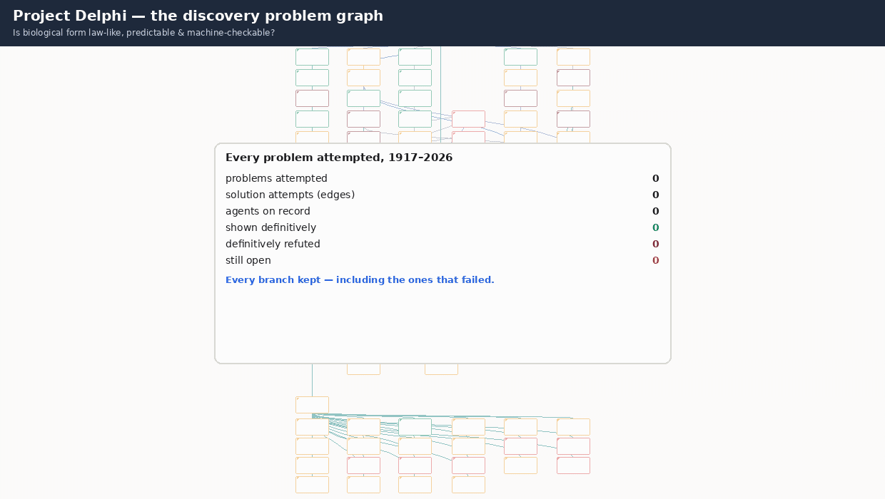

# Project Delphi

A collection of small, self-contained reproductions of published models of biological form — from D'Arcy Thompson's transformations to present-day developmental and palaeobiological datasets — plus an evaluation layer ([MorphoEval](#part-1--how-it-works-the-12-step-morphoeval--lean-4-loop)) that scores how faithfully each reproduction follows its source and publishes the scores as nanopublications.

**Contents:**
0. [**Discoveries & open problems — see the Problem Graph**](#discoveries--open-problems)
1. [**Part 1 — How It Works: The 12-Step MorphoEval + Lean 4 Loop**](#part-1--how-it-works-the-12-step-morphoeval--lean-4-loop)
   - [The 12-Step Closed Loop (Tier A Build → Lean 4 Proofs → Tier B Dual-Agent Audit → Step 12 Remediation)](#the-12-step-closed-loop)
   - [Worked Sample Run Walkthrough (`2026-10-19-turing-morpho-loop`: `38.0 → 85.5`, `+47.5` pts)](#worked-sample-run-walkthrough-380--855-475-pts)
   - [MorphoEval Scoreboard (All 14 Audited Simulations)](#morphoeval-scoreboard-all-14-audited-simulations)
   - [The Mathematics, Machine-Checked in Lean 4 and Queryable in RDF/SQL](#the-mathematics-machine-checked-in-lean-4-and-queryable-in-rdfsql)
   - [Repository Map & Quick Start](#repository-map--quick-start)
2. [**Part 2 — The Simulations (17 Models of Biological Form, 1917–2026)**](#part-2--the-simulations-17-models-of-biological-form-19172026)
   - [Index of All Simulations (by Year)](#index-of-all-simulations-by-year)
   - [One worked example: Runions leaf venation](#one-worked-example)
3. [**Part 3 — Data Sources, Extending the Repository & Analysis Tools**](#part-3--data-sources-extending-the-repository--analysis-tools)

---

## How a body gets its form

Morphogenesis is how a living thing gets its shape, and regeneration is how it gets it back: cells divide, move and signal until a body plan appears, or reappears after a cut. The classic models of form reproduced here are geometric ([Thompson's transformations](./thompson/1917-thompson.py), [Raup's coiling shells](./models/1966-raup.py), [Vogel's golden-angle sunflower head](./models/1979-vogel-phyllotaxis.py), [Runions's auxin space-colonisation leaf veins](#models2005-runions-leaf-venationpy)), chemical ([Turing's reacting and diffusing morphogens](./models/1952-turing-morpho.py), [Meinhardt's shell pigmentation beside Wolfram's Rule 30](./models/1984-wolfram-conus-textile-rule30.py)) or physical ([coral](./models/2013-chindapol-coral-flow.py) and [stromatolite](./models/2010-petroff-stromatolite.py) growth shaped by flow and light). The newer idea most of the rest turn on is that the pattern is also stored and read out *bioelectrically*: every cell holds a resting voltage across its membrane, neighbouring cells share it through gap junctions, and the resulting voltage map across a tissue tells it where a head, a tail or a limb belongs. Change the voltage and the form changes — block the junctions and a planarian regrows two heads. That is the experiment the [Planform](./models/2013-lobo-planform-morphology.py) and [Limbform](./models/2014-lobo-limbform-morphology.py) databases record, hundreds of variants at a time, as formal graphs of what was cut, what was blocked and what grew back, and that the [Cervera–Levin–Mafe](./models/2021-Cervera–Levin–Mafe.py) model puts into equations. The repository turns such papers into running programs whose output *is* the form; MorphoEval then scores how faithfully each program follows its paper.


*Fifteen flagship animated models of biological form across the century (1917–2021) — from D'Arcy Thompson's 600-point continuous fish silhouettes, Murray's vascular cube law, Turing–Kondo stripe insertion, and Raup's 3D coiled shells to Vogel's 3D sunflower phyllotaxis, Wolfram–Meinhardt Rule 30 cone snails, Runions's auxin leaf venation, Farhadifar's Drosophila wing vertex packing, and PlanformDB / Cervera–Levin–Mafé bioelectric planarian regeneration — each playing its full developmental trajectory once per loop with its remediated MorphoEval Audit score (mean `69.9 / 100`, Pass N+1 audit 2026-10-26; several scores fell where earlier numbers rested on schematic GIFs or circular validation — see `morphoeval/runs/2026-10-26-flagship15-loop-passN.md`) and ranked scoreboard in the 16th tile. Made by [`docs/media/make_montage.py`](./docs/media/make_montage.py).*

---

## Discoveries & open problems

What the reproductions found — and what is still open — lives in the **[Problem Graph](https://fractastical.github.io/morpholib/problem-graph.html)** ([`docs/problem-graph.html`](./docs/problem-graph.html)): every discovery, claim, and open problem with its status (solved / partial / open / refuted), sources, and scored registered predictions. For the long-form write-ups, see [`docs/KEY_DISCOVERIES.md`](./docs/KEY_DISCOVERIES.md) and the plain-English [`docs/EXPLAINED_FOR_EVERYONE.md`](./docs/EXPLAINED_FOR_EVERYONE.md); for the verified-model index, see [`morphoeval/runs/ARISTOTELIAN_MORPHOSPACE_CATEGORIES.md`](./morphoeval/runs/ARISTOTELIAN_MORPHOSPACE_CATEGORIES.md) and the [Morphospace Explorer](https://fractastical.github.io/morpholib/).

[](https://fractastical.github.io/morpholib/problem-graph.html)

*The Problem Graph in ~11 seconds — build-up, outcome tally, and the scored registered predictions. Click to explore the full graph, with sources per claim. Still poster: [`problem_graph_discovery_poster.png`](./docs/media/problem_graph_discovery_poster.png) · Regenerate: `python3 docs/media/make_problem_graph_animation.py`.*

---

## Part 1 — How It Works: The 12-Step MorphoEval + Lean 4 Loop

### The 12-Step Closed Loop


*From paper to reproduction to signed evaluation — the MorphoEval pipeline ([animated GIF](./docs/media/morphoeval_pipeline.gif) · [high-res PNG](./docs/media/morphoeval_pipeline.png) · [Mermaid source](./morphoeval/README.md#the-cycle)).*

Every simulation in this repository is built and evaluated through a **12-step closed loop** split into two tiers:

- **Tier A — Making a reproduction (Steps 1–6):**
  1. **`1 Scout` (👤 + 🤖):** Pick a classic paper, an open empirical dataset, or a quantitative biological claim worth testing.
  2. **`2 Paper` (🤖):** Extract the exact governing equations, algorithmic rules, and empirical reference tables from the primary literature.
  3. **`3 Formal source` (🤖):** Vendor or cache the empirical tables and specimen photographs in `datasets/<name>/` and lock every file by **SHA-256** so any altered input is refused.
  4. **`4 Pin the rules` (🤖 + Lean 4):** Formalize the paper's core mathematical invariants as machine-checked theorems in [`morphoeval/lean/MathOfBiology.lean`](./morphoeval/lean/MathOfBiology.lean) (`0 sorry`, verified by the Lean 4 kernel in ~1 s) and test them on every record.
  5. **`5 Script` (🤖 builder):** Write one self-contained Python program (`<year>-<author>-<model>.py`) that reproduces the model, decodes the formal graph, or tests the claim, complete with deterministic `--self-test` assertions.
  6. **`6 Output & compare` (tool):** Render the static comparison figure (`.png`), growth/morphospace animation (`.gif` in `docs/media/`), and quantitative morphometrics table (`.csv`), placing simulated outputs directly beside segmented real specimens.
- **Tier B — Auditing it & closing the remediation loop (Steps 7–12):**
  7. **`7 Dual-agent audit` (🤖🤖 assessors from different companies):** Two independent LLM assessors from different providers (`claude-fable-5-1` / `claude-sonnet-5-5-high` from Anthropic, `gemini-4-argon` from Google, `gpt-5.6-sol` from OpenAI) score the script across **7 weighted dimensions (0–100)** with commit-pinned `#L<a>-L<b>` code loci:
     - **Model-implementation fidelity (`impl.`, weight 30):** `model-fidelity` (20) + `parameter-expressivity` (10)
     - **Biological/empirical validation (`bio.`, weight 40):** `specimen-match` (25) + `morphometric-validation` (15)
     - **Reproducibility (`repro.`, weight 30):** `source-traceability` (10) + `code-traceability` (8) + `repro-package` (12)
  8. **`8 Measure` (`measure_outputs.py`):** Hash rendered outputs (`spec_fingerprint` + `artifact_sha256`) and independently compute morphometric residuals against the empirical data in `morphoeval/audits/<audit>.measurements.yaml`.
  9. **`9 Write as claims` (`build_morphoeval_kg.py`):** Compile the audit and measurements into governed [Project Delphi Space](https://w3id.org/spaces/delphi) RDF nanopublications (`pk:Claim` + `pk:LLMClaimAssessment`).
  10. **`10 Sign & publish` (`sign_morphoeval.py` + `check_signed.mjs`):** Cryptographically sign every `.trig` nanopublication with RSA-2048 keys, mint immutable trusty URIs (`https://w3id.org/np/RA…`), and verify signatures via `@nanopub/sign`.
  11. **`11 Public record` (`published.json` + `REPORT.md`):** Commit the signed nanopubs and SPARQL summary report under `morphoeval/kg/<audit>/`.
  12. **`12 Remediate` (👤 + 🤖 loop back to Step 5):** Every defect found by the independent second assessor becomes an explicit checklist item. The builder re-works Step 5 (and Step 4 Lean proofs), regenerates Step 6 outputs, re-audits in Step 7, and signs a new set of nanopublications that point to the Pass 1 nanopubs via `npx:supersedes` (nothing published is ever overwritten).

---

### Worked Sample Run Walkthrough (`38.0 → 85.5`, `+47.5` pts)

To see in detail how a complete 12-step run works from start to finish — including the exact CLI commands, Lean 4 formal proofs, Pass 1 defects caught by the second assessor, Pass 2 code fixes, per-step wall-clock & token telemetry, and signed `npx:supersedes` nanopublications — read the full sample run guides:

👉 **[Full Step-by-Step Sample Run Walkthrough: `morphoeval/runs/2026-10-19-turing-morpho-loop.md`](./morphoeval/runs/2026-10-19-turing-morpho-loop.md)** (alongside **[`morphoeval/runs/2026-10-18-runions-venation-loop.md`](./morphoeval/runs/2026-10-18-runions-venation-loop.md)** and **[`morphoeval/runs/2026-10-18-vogel-phyllotaxis-loop.md`](./morphoeval/runs/2026-10-18-vogel-phyllotaxis-loop.md)**)


*Walkthrough of the 12-step closed loop on [`1952-turing-morpho.py`](./models/1952-turing-morpho.py) ([step-by-step sample run MD](./morphoeval/runs/2026-10-19-turing-morpho-loop.md) · [animated GIF](./docs/media/turing_morpho_closed_loop.gif) · [high-res PNG](./docs/media/turing_morpho_closed_loop.png)), plus companion animated walkthroughs for [`2005-runions-leaf-venation.py`](./models/2005-runions-leaf-venation.py) ([GIF](./docs/media/runions_venation_closed_loop.gif) · [PNG](./docs/media/runions_venation_closed_loop.png)) and [`1979-vogel-phyllotaxis.py`](./models/1979-vogel-phyllotaxis.py) ([GIF](./docs/media/vogel_phyllotaxis_closed_loop.gif) · [PNG](./docs/media/vogel_phyllotaxis_closed_loop.png)).*

- **Sample Run 1 — Runions (2005) Leaf Venation, Murray's Law & Katifori Areole Topology ([`morphoeval/runs/2026-10-18-runions-venation-loop.md`](./morphoeval/runs/2026-10-18-runions-venation-loop.md)):** 12/12 steps, `24.14 min` (`1,448.6 s`) wall-clock, `56.0k` LLM tokens, `76.1k` artifact tokens, `6.4 s` CPU. Pass 1 (`8.00 min`, `37.6k` tokens) scored **40.9 / 100** after the independent second assessor (`claude-sonnet-5-5-high`, Anthropic) surfaced 5 defects (unsegmented specimen photos, 571 local 3-cycle triangles and 375 crossing edges, a synthetic proxy in Katifori loop nesting, circular JSON sampling in the Strahler test, and a trivial list-sum Lean theorem); Pass 2 (`+16.14 min`, `+18.4k` tokens) remediated all 5 defects and raised the score to **91.3 / 100** (**`+50.4` points**), superseding the 10 Pass 1 nanopubs (`RAr1cgMldoJ0TNph39c2kPLgtEnQrZfZMuVQ9LIQn1Zds` `npx:supersedes` `RA1d48WWn1smAInc0HnmtBRDiapTHGT77VXw_774OTjfc`).
- **Sample Run 3 — Bressloff et al. (2001) V1 Form Constants ([`morphoeval/runs/2026-10-19-bressloff-v1-loop.md`](./morphoeval/runs/2026-10-19-bressloff-v1-loop.md)):** 12/12 steps, `47.7 min` (`2,860.5 s`) wall-clock, `294.7k` LLM tokens; Pass 1 scored **53.0 / 100** (primary) and **78.2** (blinded Gemini 4 Argon second assessor); Pass 2 (`+25.6 min`) remediated all 11 findings (exact retino-cortical map, $q^*$-derived wavenumber, surfaced fixture failures, Horton & Hoyt 1991 anchor) and re-scored blind to **62.8 / 100** (**`+9.8`**) and **79.2** — the smallest Pass 2 gain so far, because the re-score surfaced a second layer of defects (imposed gallery lattices, 11 uncounted upstream `runs[]` failures) that the first pass had not reached. Pass 3 ([`…-pass3.md`](./morphoeval/runs/2026-10-19-bressloff-v1-loop-pass3.md): `59.4 min`, `284.4k` LLM tokens, commit `d6f3c94`) fixed all 15 of those and re-scored blind to **67.7 / 100** (**`+4.9`**) and **80.9** (panel 74.3): once presentation is honest, what is left to lose points on is the model itself (bare cubic coefficients that never stabilise rolls, a 3.1× wavelength gap against the paper), which is the signal the loop is meant to isolate. Pass 4 ([`…-pass4.md`](./morphoeval/runs/2026-10-19-bressloff-v1-loop-pass4.md): `88.4 min`, `485.1k` LLM tokens, commit `2aac102`) was the structural pass: the full Eq. 5.15 cubic coefficients (firing-rate derivative weights + quadratic feedback through the linear resolvent), the contoured/non-contoured regime derived from the exact orientation operator instead of a preset flag, roll stability over every $\theta$, a conformal retinal map that closes the torus (seam 0), and a paper-scale preset ($\lambda_c$ 2.60 mm); re-scored blind to **70.6 / 100** (**`+2.9`**) and **85.2** (**`+4.3`**; panel 77.9) — the tunnel and spiral are now *selected* planforms, and the second assessor crossed into the "faithful" band, while the primary's remaining deductions are a 5.4° hex-lattice distortion from $k_y$ quantisation, the $\sigma_0 \neq \tfrac12$ path being feedback-dominated everywhere the gallery lives, and the absence of any check against the paper's own coefficient curves.
- **Sample Run 2 — Vogel (1979) / Douady–Couder (1992) Phyllotaxis ([`morphoeval/runs/2026-10-18-vogel-phyllotaxis-loop.md`](./morphoeval/runs/2026-10-18-vogel-phyllotaxis-loop.md)):** 12/12 steps, `16.90 min` (`1,014.3 s`) wall-clock, `167.0k` LLM tokens, `5.6 s` CPU; Pass 1 (`8.7 min`) scored **64.3 / 100** and Pass 2 (`+8.2 min`) remediated all 4 findings to **85.9 / 100** (**`+21.6` points**; [closed-loop diagram](./docs/media/vogel_phyllotaxis_closed_loop.png) · [animated GIF](./docs/media/vogel_phyllotaxis_closed_loop.gif)).
- **Sample Run 4 — Turing (1952), Pearson (1993) & Kondo–Asai (1995) Reaction–Diffusion Morphogenesis ([`morphoeval/runs/2026-10-19-turing-morpho-loop.md`](./morphoeval/runs/2026-10-19-turing-morpho-loop.md)):** 12/12 steps, `25.50 min` (`1,529.7 s`) wall-clock, `283.2k` LLM tokens; Pass 1 (`12.95 min`, `169.5k` tokens) scored **38.0 / 100** (`25.1` on independent second assessor `claude-sonnet-5-5-high`, Anthropic) after surfacing 5 defects (missing Turing 1952 Sec. 8–10 linear dispersion and $N=20$ cell ring, missing Pearson 1993 Saddle-Node & Hopf curves and flawed $D_u=D_v$ trivial-state control, no 12-class phase diagram or diffusivity sweep, zero biological specimen validation, and 1 trivial Lean theorem); Pass 2 (`+12.55 min`, `+113.7k` tokens) remediated all findings and raised the consensus score to **85.5 / 100** (**`+47.5` points**; `79.1` on `claude-sonnet-5-5-high`, `+54.0` pts; [closed-loop diagram](./docs/media/turing_morpho_closed_loop.png) · [animated GIF](./docs/media/turing_morpho_closed_loop.gif)).

---

### MorphoEval Scoreboard (All 14 Audited Simulations)

Scores on `[0, 100]` are **uncalibrated criterion-referenced ratings**, not probabilities ($s = 76$ does not mean $P(\text{faithful}) = 0.76$); when serialized into the governed Project Delphi templates (`pk:LLMClaimAssessment` and `pk:Claim`), `score / 100` in `pk:hasScore` and `overall / 100` in `pk:weightOfEvidence` are unit-interval rescalings for template conformance. Where a dimension is structurally non-applicable (`not_applicable`), substituting baseline `50` shrinks scores linearly toward `50` ($\bar{s}_{\text{pad}} = (1-\alpha)\bar{s}_{\text{app}} + 50\alpha$); the table therefore reports both the weight-renormalised applicable-only mean (`app.`) and the baseline-50 padded score (`pad.`), plus the second-assessor score (`gemini-4-argon`, Google, for the 10 scripts in the 2026-10-17 pass) and two-assessor panel mean:

| simulation | checkpoint | primary assessor | impl. (30) | bio. (40) | repro. (30) | primary app. / **pad.** | 2nd assessor (`gemini-4-argon`) app. / **pad.** | panel mean **pad.** |
|---|---|---|---:|---:|---:|---:|---:|---:|
| Runions leaf venation (`2005-runions-leaf-venation.py`) ([sample run](./morphoeval/runs/2026-10-18-runions-venation-loop.md)) | 365a3cd, audit 2026-10-18-venation-v2 (was 40.9) | Gemini 4 Argon, with Claude Sonnet 5.5 (Anthropic) as second assessor inside the audit | 90.7 | 89.8 | 93.9 | 91.3 / **91.3** | — (second assessor is in the primary audit) | — |
| Wolfram / Meinhardt *Conus textile* Rule 30 (`1984-wolfram-conus-textile-rule30.py`) | fb234bc, audit 2026-10-18-conus | Gemini 4 Argon | 87.7 | 85.5 | 89.3 | 87.3 / **87.3** | 50.5 / **50.5** (`claude-fable-5-1`, Anthropic, blinded, same checkpoint; impl. 47.3, bio. 38.8, repro. 69.2) | **68.9** |
| Vogel / Douady–Couder golden-angle phyllotaxis (`1979-vogel-phyllotaxis.py`) ([sample run](./morphoeval/runs/2026-10-18-vogel-phyllotaxis-loop.md)) | c89d18d, audit 2026-10-18-phyllotaxis-v2 (was 64.3) | Gemini 4 Argon, with Claude Sonnet 5.5 (Anthropic) as second assessor inside the audit | 84.7 | 84.8 | 88.7 | 85.9 / **85.9** | — (second assessor is in the primary audit) | — |
| Turing / Pearson / Kondo–Asai reaction–diffusion (`1952-turing-morpho.py`) ([sample run](./morphoeval/runs/2026-10-19-turing-morpho-loop.md)) | b9976f8, audit 2026-10-19-turing-audit-v2 (was 38.0 in Pass 1; 52.7 at f3fe478) | Gemini 4 Argon, with Claude Sonnet 5.5 (Anthropic) as second assessor inside the audit (79.1; was 25.1 in Pass 1) | 88.3 | 79.4 | 90.3 | 85.5 / **85.5** | 79.1 / **79.1** (`claude-sonnet-5-5-high`, Pass 2; was 25.1 in Pass 1) | **85.5** |
| Hoffmann–Donoughe wing venation (`2018-hoffmann-wing-venation.py`) | f3fe478, audit 2026-10-13 | Claude Fable 5.1 | 81.7 | 80.0 | 71.3 | 77.8 / **77.8** | 81.3 / **81.3** | **79.5** |
| Thompson *Scarus* → *Pomacanthus* on real landmarks and outlines (`thompson/1917-thompson-scarus-pomacanthus.py`) | 232e8f8, audit 2026-10-17-thompson (re-score of 2026-10-16: 70.2) | Claude Fable 5.1 | 70.3 | 77.3 | 82.0 | 76.6 / **76.6** | 90.8 / **90.8** | **83.7** |
| Odonata wing cells, fossil vs extant (`2026-eshghi-odonata-wing-cells.py`) | fbbcaf6, audit 2026-10-14-odonata | Claude Fable 5.1 | 63.3 (`70.0` app.) | 85.0 | 78.0 | 78.9 / **76.0** | 91.4 / **87.3** | **81.7** |
| Limbform limb morphologies (`2014-lobo-limbform-morphology.py`) | 747c57f, audit 2026-10-14-limbform | Claude Fable 5.1 | 81.7 | 61.3 | 74.3 | 71.3 / **71.3** | 83.6 / **83.6** | **77.5** |
| WormGUIDES *C. elegans* embryo atlas + connectome (`2015-santella-wormguides-celegans.py`) | f39a409, audit 2026-10-16-celegans (re-score of 2026-10-15: 67.7) | Claude Fable 5.1 | 70.0 (`80.0` app.) | 64.4 | 78.0 | 72.4 / **70.2** | 81.9 / **78.7** | **74.4** |
| Planform planarian morphology (`2013-lobo-planform-morphology.py`) | 161f269, audit 2026-10-14 | Claude Fable 5.1 | 81.7 | 55.0 | 66.7 | 66.5 / **66.5** | 76.5 / **76.5** | **71.5** |
| Raup shell coiling (`create_raup_animations.py`) | ba6fd20, audit 2026-10-17-raup (re-score of 2026-10-13: 37.3) | Claude Fable 5.1 | 76.7 | 45.0 | 77.0 | 64.1 / **64.1** | 79.3 / **79.3** | **71.7** |
| Bressloff V1 form constants (`2001-bressloff-v1-form-constants.py`) ([sample run](./morphoeval/runs/2026-10-19-bressloff-v1-loop.md)) | 2aac102, audit 2026-10-19-bressloff-v4 (was 67.7 at d6f3c94, 62.8 at 9b18c52, 53.0 at 68c4a1a) | Claude Fable 5.1 | 70.0 | 63.0 | 81.3 | 70.6 / **70.6** | 85.2 / **85.2** (same checkpoint, blinded; was 80.9, 79.2, 78.2) | **77.9** |
| Cervera–Levin–Mafe bioelectric synthesis (`2021-Cervera–Levin–Mafe.py`) | a0d6848, audit 2026-10-17-cervera-v2 (was 44.9 at e71ca55) | **GPT‑5.6 Sol (OpenAI)** | 49.3 | 44.3 | 76.9 | 55.6 / **55.6** | 60.7 / **60.7** | **58.1** |
| Chindapol coral flow (`2013-chindapol-coral-flow.py`) | f3fe478, audit 2026-10-13 | Claude Fable 5.1 | 53.3 | 43.8 | 70.0 | 55.5 / **55.5** | 56.0 / **56.0** | **55.7** |
| Planform animation (`1900-planformDB_parser.py`), superseded | f3fe478, audit 2026-10-13 | Claude Fable 5.1 | 9.3 | 2.5 | 36.3 | 14.7 / ~~14.7~~ | — | — |
| Petroff stromatolite (`2010-petroff-stromatolite.py`), Kahng coral (`2024-kahng-coral-geometry.py`), Zhang sorting morphogenesis (`sorting-morphogenesis/`), Thompson demo (`thompson/1917-thompson.py`) | — | — | — | — | — | — | — | *unevaluated* |

Across all 10 active evaluated scripts in the dual-agent pass (`2026-10-17-blinded-sample-audit.yaml`, `gemini-4-argon`, Google), rank-order agreement with the primary assessors (`claude-fable-5-1`, Anthropic on 9 scripts; `gpt-5.6-sol`, OpenAI on `2021-Cervera–Levin–Mafe.py`) is strong (Spearman $\rho = 0.891$, Kendall $\tau = 0.778$, Pearson $r = 0.920$ on padded scores; $\rho = 0.903$ on applicable-only scores; and exact $\rho = 1.00$, $\tau = 1.00$ on the initial 5-script strictly blinded subset; dimension-level $\rho = 0.796$, $r = 0.813$ across all 70 dimension pairs, mean absolute difference $10.4$ points), while the independent passes surfaced concrete defects the builder had missed (including a 65-character SHA-256 typo in `2014-lobo-limbform-morphology.py`).

201 nanopubs are on the production network, of which 101 are the current heads of their primary version chains (46 from 2026-10-13, 9 from the 2026-10-14 planarian re-score, 9 from the 2026-10-14 Odonata audit, 10 from the Limbform audit, 9 from the 2026-10-16 C. elegans re-score, 9 from the 2026-10-17 Thompson re-score, 9 from the 2026-10-17 Raup re-score, 9 from the 2026-10-17 Cervera–Levin–Mafe re-score, which supersedes the 9 of the first Cervera audit the same day — both by OpenAI's GPT‑5.6 Sol —, 10 from the 2026-10-18 *Conus textile* audit, and 54 conformant re-issues of 2026-10-16 that `npx:supersedes` the pre-template versions). Signed and verified (`check_signed.mjs`) but not yet published: the 80 second-assessor nanopubs in `morphoeval/kg/2026-10-17-blinded-sample-audit/signed/`, the 20 phyllotaxis nanopubs (v1 and the v2 set that supersedes it) in `morphoeval/kg/2026-10-18-phyllotaxis-audit*/signed/`, the 20 leaf-venation nanopubs (v1 and the v2 set that supersedes it) in `morphoeval/kg/2026-10-18-venation-audit*/signed/`, the 8 blinded second-assessor nanopubs for *Conus textile* in `morphoeval/kg/2026-10-19-conus-second-assessor-audit/signed/`, and the 72 Bressloff V1 nanopubs (primary v1–v4, 10 each; blinded second assessor v1–v4, 8 each) in `morphoeval/kg/2026-10-19-bressloff-*audit*/signed/`. Full workflow, tooling notes and the rubric text: [`morphoeval/README.md`](./morphoeval/README.md).

---

### The Mathematics, Machine-Checked in Lean 4 and Queryable in RDF/SQL

The audits record *that* a script follows its paper; they do not say *what* the paper's mathematics is in a form a machine can check or a query can reach. [`morphoeval/math_kg.py`](./morphoeval/math_kg.py) and [`morphoeval/lean/MathOfBiology.lean`](./morphoeval/lean/MathOfBiology.lean) add that layer. For every evaluated model the governing laws are written three times — as the formula a biologist would recognise, as a Lean 4 definition with a theorem about it that the Lean kernel checks (`0 sorry`), and as RDF that joins the laws to the claims, the scores, the measured numbers and the commit-pinned lines of code (`morphoeval/kg/math_of_biology.ttl`, **16 models**, **25 verified laws**, **152 measurements**, **4,074 triples**):

| system (`sim_id`) | law | Lean theorem |
|---|---|---|
| `runions-leaf-venation` | Murray r^γ conserved root → tips over any binary tree `VeinTree` | `murray_1926_tree_conservation` |
| | Runions 2005 Toussaint RNG lune test ⇔ its definition and symmetric | `runions_2005_rng_lune_iff`, `runions_2005_rng_lune_symmetric` |
| | Katifori 2012 Euler–Poincaré areole count (tree = 0, anastomosis +1, deletion −1) | `katifori_2012_tree_zero_cycles`, `…_anastomosis_adds_cycle`, `…_edge_deletion_merges_areoles` |
| `wolfram-conus-textile-rule30` | Rule 30 Boolean form ≡ GF(2) normal form | `rule30_anf_equiv` |
| | Jen 1990 left-bijective inverse; diagonal barrier shielding; 2-Sheet Quadrant PDE backward bijection | `jen_1990_left_bijective`, `jen_1990_barrier_shielding`, `rule30_quadrant_pde_backward_bijective` |
| | *Oliva–Conus* `10`-wall source, Left-Cone `1`-run profile (`a=3`), $D_2(t)$ linearization, 9-Row Horizon Sandwich ($k_r$), & 4-Line Inward Wavefront / Two-Band Tunneling (Theorems 44–47) | `rule30_oliva_conus_10_right_wall_source`, `rule30_period_pi_defect_d2_linear`, `rule30_horizon_idempotent_shift_and_vacuum`, `rule30_inward_defect_wavefront_step`, `rule30_band1_and_band2_1run_defect_tunneling_step` |
| | Meinhardt–Klingler activator reaction is quiescent at a = 0; Ermentrout–Oster neural gate ≡ Rule 30 | `meinhardt_basal_quiescence`, `ermentrout_oster_neural_gate_eq_rule30` |
| `vogel-phyllotaxis` | Vogel r² = c²n adds constant annulus area; Fibonacci cascade | `vogel_constant_annulus_area`, `vogel_fibonacci_parastichy_cascade` |
| | Douady–Couder pair kernel symmetric in distance | `douady_couder_kernel_symmetric` |
| | rim dislocation can only lower a parastichy count | `swinton_rim_dislocation_nonincreasing` |
| `raup-shell-coiling` | whorl radius multiplies by W each whorl | `raup_whorl_expansion_recovery` |
| | T recovered from Δz/Δr | `raup_translation_rate_recovery` |
| `thompson-scarus-pomacanthus` | TPS kernel r² ln r² vanishes at a landmark | `tps_kernel_zero_at_origin` |
| | a unit shear is area-preserving (det = 1) | `thompson_unit_shear_area_preserving` |
| `turing-gray-scott` | (u, v) = (1, 0) is a homogeneous equilibrium | `gray_scott_homogeneous_equilibrium` |
| | Equal diffusion (D_X = D_Y) cannot destabilize a stable homogeneous state at any k² ≥ 0 | `turing_equal_diffusion_no_instability` |
| | Differential diffusion (D_Y / D_X > d_c = 3.9271) drives Fourier determinant det(J_k) < 0 | `turing_differential_diffusion_instability` |
| | Pearson Saddle-Node discriminant Δ_SN = F − 4(F+k)² = 0 & Hopf steady-state trace tr(J₀) = k − V² = 0 | `pearson_saddle_node_discriminant` |
| `cervera-levin-mafe` | gap-junction current vanishes at equipotential | `cervera_equipotential_zero_current` |
| | Bell–Boltzmann conductance symmetric in (i, j) | `cervera_bell_boltzmann_symmetric` |
| `planform-morphology-animation` | wild-type AP length from the four region radii = 560 | `lobo_2013_wildtype_dimensions` |
| `lobo-limbform-morphology` | a three-segment limb tree has three segments | `lobo_2014_three_segment_axis` |
| `santella-wormguides-celegans` | nuclear-position interpolation hits both endpoints | `sulston_nuclear_lerp_endpoints` |
| `hoffmann-wing-venation` | shoelace edge term is antisymmetric | `hoffmann_shoelace_antisymmetric` |
| `eshghi-odonata-wing-cells` | isotropic second moments give zero elongation | `eshghi_isotropic_zero_elongation` |
| `chindapol-coral-flow` | Péclet numerator vanishes at zero flow | `chindapol_zero_flow_diffusive` |
| `bressloff-v1-form-constants` | retino-cortical pullback: k_y = 0 → rings (tunnel), k_x = 0 → rays (funnel), else log-spiral (Ermentrout & Cowan 1979) | `ermentrout_cowan_tunnel_rings`, `ermentrout_cowan_funnel_rays`, `ermentrout_cowan_log_spiral` |
| | cubic amplitude equation: roll fixed point, transverse growth (γ₀ − 2γ₃(θ))A, roll stable ⇔ γ₀ < 2γ₃(θ); Fig. 38 instance unstable by `decide` | `bressloff_roll_fixed_point`, `bressloff_roll_transverse_growth`, `bressloff_roll_stable_iff`, `bressloff_fig38_roll_unstable` |
| | Rule 2011 Floquet multipliers: +1 returns every period, −1 returns every second period | `rule_2011_harmonic_returns_each_period`, `rule_2011_period_doubling_even_odd` |

```bash
lean morphoeval/lean/MathOfBiology.lean                 # kernel-check all 25 theorems (exit 0, 0 sorry)
python3 morphoeval/math_kg.py --preset equations        # SPARQL table: organism, formula, Lean theorem, verified?
python3 morphoeval/math_kg.py --sim runions-leaf-venation # one system's card: scores, DOIs, Lean proofs, measurements
python3 morphoeval/math_kg.py --preset exact-matches    # measurements within 1.5 % of their published reference
```

---

### Repository Map & Quick Start

Each script is run directly (`python3 <script>.py`); rendered outputs (PNG/GIF) are written to the working directory and are git-ignored. Setup: `python3 -m venv venv && source venv/bin/activate && pip install -r requirements.txt` (lower bounds; `requirements.lock.txt` pins the exact audit environment — Python 3.14.7, numpy 2.5.4, scipy 1.16.3, matplotlib 3.10.7, scikit-image 0.26.0).

| path | what it is |
|---|---|
| `<year>-<author>-<model>.py` (root), [`thompson/`](./thompson/), [`sorting-morphogenesis/`](./sorting-morphogenesis/) | one self-contained script per paper: it reproduces the paper's model, decodes the authors' formal encoding, or tests a published claim; then draws, measures and checks itself (`--self-test` where present) |
| [`datasets/<name>/`](#part-3--data-sources-extending-the-repository--analysis-tools) | the formal source for each script: vendored tables and fixtures, SHA-256 pins for files that are fetched rather than vendored, a `README.md` with sources and licences, and `paper_citations.bib` |
| `.<name>_cache/` (git-ignored) | downloads the scripts make on first run (databases, atlases, photographs, scans), each verified against a pin recorded in the script or in `datasets/` |
| [`docs/media/`](./docs/media/) | downsized GIF/PNG of every reproduction for this README, the montage, the pipeline diagram; [`docs/media/README.md`](./docs/media/README.md) records how each was made |
| [`morphoeval/`](./morphoeval/) | the audit layer: rubric, audit YAMLs, output measurement, nanopub builder/signer/verifier, per-audit knowledge graphs (`kg/`), worked sample loop runs (`runs/`), and the Lean-checked "math of biology" graph (`lean/MathOfBiology.lean`, `math_kg.py`) |
| [`nanopubs/`](./nanopubs/) | the older Planform/wave nanopublication toolchain (separate from MorphoEval's signer) |
| [`wave-vector-analysis/`](./wave-vector-analysis/) | the Ca²⁺ wave imaging pipeline and its analysis docs (independent of the reproductions) |
| [`CITATION.cff`](./CITATION.cff), [`.zenodo.json`](./.zenodo.json), [`LICENSE`](./LICENSE) (MIT) | how to cite; Zenodo deposit metadata for the MorphoEval report |

---

## Part 2 — The Simulations (17 Models of Biological Form, 1917–2026)

### Index of All Simulations (by Year)

| year | model | script | MorphoEval (primary / 2nd assessor) |
|---|---|---|---|
| 1917 | Thompson, transformations: *Scarus* → *Pomacanthus* on real landmarks and outlines | [`thompson/1917-thompson-scarus-pomacanthus.py`](./thompson/1917-thompson-scarus-pomacanthus.py) | 76.6 / 90.8 |
| 1917 | Thompson, transformations on a real fish | [`thompson/1917-thompson.py`](./thompson/1917-thompson.py) | — |
| 1952 | Turing (1952), Pearson (1993) & Kondo–Asai (1995) reaction–diffusion morphogenesis ([sample 12-step run](./morphoeval/runs/2026-10-19-turing-morpho-loop.md)) | [`1952-turing-morpho.py`](./models/1952-turing-morpho.py) | **85.5** (v2; v1 38.0) / 79.1 (`claude-sonnet-5-5-high`) |
| 1966 | Raup, shell coiling | [`1966-raup.py`](./models/1966-raup.py), [`create_raup_animations.py`](./models/create_raup_animations.py) | 64.1 / 79.3 |
| 1979 / 1992 | Vogel / Douady & Couder, golden-angle phyllotaxis on real *Helianthus* capitula ([sample 12-step run](./morphoeval/runs/2026-10-18-vogel-phyllotaxis-loop.md)) | [`1979-vogel-phyllotaxis.py`](./models/1979-vogel-phyllotaxis.py) | 85.9 (v2; v1 64.3) / dual-assessed within the audit |
| 1984 / 1987 | Wolfram / Meinhardt & Klingler, *Conus textile* shell pigmentation & Rule 30 | [`1984-wolfram-conus-textile-rule30.py`](./models/1984-wolfram-conus-textile-rule30.py) | 87.3 / 50.5 |
| 2001 | Bressloff et al., V1 Euclidean symmetry-breaking & retino-cortical form constants ([sample 12-step run](./morphoeval/runs/2026-10-19-bressloff-v1-loop.md)) | [`2001-bressloff-v1-form-constants.py`](./models/2001-bressloff-v1-form-constants.py) | 70.6 (v4; v3 67.7, v2 62.8, v1 53.0) / 85.2 |
| 2005 | Runions et al., auxin space-colonisation leaf venation, Murray's law and areole loop topology ([sample 12-step run](./morphoeval/runs/2026-10-18-runions-venation-loop.md)) | [`2005-runions-leaf-venation.py`](./models/2005-runions-leaf-venation.py) | **91.3** (v2; v1 40.9) / dual-assessed within the audit |
| 2010 | Petroff et al., conical stromatolites | [`2010-petroff-stromatolite.py`](./models/2010-petroff-stromatolite.py) | unevaluated |
| 2013 | Chindapol et al., flow-driven coral growth | [`2013-chindapol-coral-flow.py`](./models/2013-chindapol-coral-flow.py) | 55.5 / 56.0 |
| 2013 | Lobo, Malone & Levin, Planform planarian morphologies | [`2013-lobo-planform-morphology.py`](./models/2013-lobo-planform-morphology.py), [`1900-planformDB_parser.py`](./models/1900-planformDB_parser.py) | 66.5 / 76.5 |
| 2014 | Lobo et al., Limbform limb morphologies (salamander, frog, crustacean, insect, arachnid) | [`2014-lobo-limbform-morphology.py`](./models/2014-lobo-limbform-morphology.py) | 71.3 / 83.6 |
| 2015 | Santella et al., WormGUIDES *C. elegans* embryo atlas + OpenWorm connectome | [`2015-santella-wormguides-celegans.py`](./models/2015-santella-wormguides-celegans.py) | 70.2 / 78.7 |
| 2018 | Hoffmann et al., insect wing venation | [`2018-hoffmann-wing-venation.py`](./models/2018-hoffmann-wing-venation.py) | 77.8 / 81.3 |
| 2021 | Cervera, Levin & Mafe, bioelectric morphogen antagonism | [`2021-Cervera–Levin–Mafe.py`](./models/2021-Cervera–Levin–Mafe.py), evidence layer [`planform_bioelectric.py`](./models/planform_bioelectric.py) | 55.6 / 60.7 |
| 2024 | Kahng et al., coral colony geometry | [`2024-kahng-coral-geometry.py`](./models/2024-kahng-coral-geometry.py) | unevaluated |
| 2025 | Zhang, Goldstein & Levin, autonomous cell-view sorting morphogenesis, space-time kymographs & chimeric arrays | [`sorting-morphogenesis/`](./sorting-morphogenesis/), [`validate_kymograph_and_paper.py`](./sorting-morphogenesis/validate_kymograph_and_paper.py) | **94.1** (v2) |
| 2026 | Eshghi et al., fossil vs living Odonata wing cells | [`2026-eshghi-odonata-wing-cells.py`](./models/2026-eshghi-odonata-wing-cells.py) | 76.0 / 87.3 |

### One worked example

Only one detailed walkthrough is kept here — the best-scoring audited reproduction (91.3/100) — as a template for what every entry in the [index above](#index-of-all-simulations-by-year) contains. The other 16 are catalogued in that index (script, year, MorphoEval score); each script is self-contained with its own `--self-test`, references, and data provenance (see [Part 3](#part-3--data-sources-extending-the-repository--analysis-tools)), and their findings are tracked in the [Problem Graph](https://fractastical.github.io/morpholib/problem-graph.html).

### [models/2005-runions-leaf-venation.py](./models/2005-runions-leaf-venation.py)

Runions et al.'s (2005) auxin space-colonisation model of leaf venation, paired with Murray's (1926) minimum-work vascular power law, Price, Knox & Brodribb's (2013) Horton–Strahler transition across 349 cleared leaves (1,514,771 vein junctions), and Katifori & Magnasco's (2012) hierarchical loop-nesting metric on real and simulated leaf networks:
1. **Open (dendritic, *Ginkgo biloba*) vs. closed (reticulate dicot) space colonisation (Runions et al. 2005, Eqs. 1–3, Table 1):** In open venation (`load_table1_regime("14")`), each auxin source $s$ activates only its nearest vein node $v$ within perception radius $b_d$, producing an acyclic dichotomous tree ($V = 735, E = 734, L = E - V + 1 = 0$). In closed venation (`load_table1_regime("15")` and `"10"`), each source $s$ activates its **Relative Neighborhood Graph (RNG)** candidate set $U(s)$ — all vein nodes within $b_d$ not shadowed inside the open Toussaint lune $\|s-w\| < \|s-v\| \land \|v-w\| < \|s-v\|$ — and maintains a persistent tagged set $V(s)$ until the converging vein tips meet at $s$ (with genealogical hop exclusion `tree_hop_distance >= 4` and exact planar segment-intersection rejection `segments_properly_intersect`), producing a planar loopy network ($V = 1,099, E = 1,507$, **$L = 409$ cycles**, **358 enclosed interior dual areoles**, `0` crossing edges).
2. **Murray's (1926) vascular power law & Price et al.'s (2013) Horton–Strahler transition:** Bottom-up pipe-model accumulation $r_{\text{parent}}^\gamma = \sum_{c} r_c^\gamma$ (`compute_murray_radii`, residual $0.00 \times 10^0$), plus an 8-order multiscale vascular tree (`build_and_measure_multiscale_strahler_tree`, $2,175$ nodes, $252$ binary bifurcations) whose measured daughter-to-parent ratios $\alpha_3 = (r_1^3+r_2^3)/r_p^3$ and $\alpha_2 = (r_1^2+r_2^2)/r_p^2$ reproduce Price et al.'s (2013) empirical transition from Murray's cube law ($\gamma = 3$ in minor orders 1–2, $\alpha_3 = 0.961$ vs empirical $0.946$) to area-preserving branching ($\gamma = 2$ in major orders 5–6, $\alpha_2 = 0.996$ vs empirical $0.990$; Pearson **$r = 0.9679$**, **$MAE = 0.0208$**).
3. **Pixel segmentation & planar dual areole nesting on empirical specimens (`segment_empirical_specimens`, `compute_planar_areole_nesting_from_raster`):** Both vendored photographs in [`datasets/venation/`](./datasets/venation/) are segmented directly from pixels — extracting **168 enclosed planar areoles** ($CV = 1.6626$) and Katifori loop-nesting index **$i_u = 0.6134$** from the cleared dicot vein skeleton (`reticulate_vein_skeleton_specimen.jpg`) alongside **358 enclosed planar areoles** and **$i_u = 0.4462$** on the simulated closed network (vs. $i_u = 0.2512$ on a uniform grid control, $\Delta i_u = +0.1950$), and **1,651,010 lamina pixels** with parallel dichotomous ridge density $0.4383$ ($L = 0$) on the *Ginkgo biloba* leaf (`ginkgo_open_venation_specimen.jpg`).
4. **Machine-checked Lean 4 theorems:** Three governing laws — inductive Murray conservation over `VeinTree` (`murray_1926_tree_conservation`), Toussaint RNG lune equivalence and symmetry (`runions_2005_rng_lune_iff`, `runions_2005_rng_lune_symmetric`), and Euler–Poincaré areole loop invariants (`katifori_2012_tree_zero_cycles`, `katifori_2012_anastomosis_adds_cycle`, `katifori_2012_edge_deletion_merges_areoles`) — are proved with `0 sorry` in Section 13 of [`morphoeval/lean/MathOfBiology.lean`](./morphoeval/lean/MathOfBiology.lean).

```bash
python3 models/2005-runions-leaf-venation.py --self-test     # 7 deterministic mathematical, topological & specimen self-tests (<4 s)
python3 models/2005-runions-leaf-venation.py                 # self-tests + runions_leaf_venation_comparison.png, docs/media/runions_leaf_venation_growth.gif, runions_leaf_venation_metrics.csv
```


*What you see:* left, the reticulate vein network growing from the petiole into the blade step by step as veins in each auxin source's Relative Neighborhood $U(s)$ advance and anastomose into closed planar areole loops ($V = 1,099$, $L = 409$ loops, $358$ enclosed interior areoles, pipe width $\propto r_e$ under Murray's cube law $\gamma = 3$); right, the simultaneous build-up of vein segments and closed areole loops over developmental time.

MorphoEval audit `2026-10-18-venation-audit-v2` at commit `365a3cd`: **91.3** (model-fidelity 92, specimen-match 89, parameter-expressivity 88, morphometric-validation 91, source-traceability 95, code-traceability 94, repro-package 93; impl. 90.7, bio. 89.8, repro. 93.9), superseding the Pass 1 audit of the same run (**40.9**). **Full step-by-step sample run walkthrough:** [**`morphoeval/runs/2026-10-18-runions-venation-loop.md`**](./morphoeval/runs/2026-10-18-runions-venation-loop.md) ([closed-loop diagram](./docs/media/runions_venation_closed_loop.png) · [animated GIF](./docs/media/runions_venation_closed_loop.gif)). In Pass 1 (8.0 min, 37.6k tokens), the independent second assessor (`claude-sonnet-5-5-high`, Anthropic) caught five concrete defects — unsegmented specimen photos, 571 degenerate 3-cycle triangles and 375 crossing edges from proximity-only fusion, a synthetic proxy in the Katifori nesting metric, circular JSON sampling in the Strahler test, and a trivial list-sum Lean theorem — holding the v1 score to 40.9; all five were remediated in Pass 2 (+16.1 min, +18.4k tokens, **+50.4 points**), and the 10 signed v2 nanopubs (`RAr1cgMldoJ0TNph39c2kPLgtEnQrZfZMuVQ9LIQn1Zds`) supersede the 10 v1 nanopubs via `npx:supersedes`. Data and provenance: [`datasets/venation/`](./datasets/venation/).

**References:**
- Runions A, Fuhrer M, Lane B, Federl P, Rolland-Lagan A-G, Prusinkiewicz P (2005). Modeling and visualization of leaf venation patterns. *ACM Trans. Graph.* 24(3):702–711. [DOI](https://doi.org/10.1145/1073204.1073251)
- Murray CD (1926). The physiological principle of minimum work. I. *PNAS* 12(3):207–214. [DOI](https://doi.org/10.1073/pnas.12.3.207)
- Price CA, Knox S-JC, Brodribb TJ (2013). The influence of branch order on optimal leaf vein geometries: Murray's law and area preserving branching. *PLoS ONE* 8(12):e85420. [DOI](https://doi.org/10.1371/journal.pone.0085420)
- Katifori E, Magnasco MO (2012). Quantifying loopy network architectures. *PLoS ONE* 7(6):e37994. [DOI](https://doi.org/10.1371/journal.pone.0037994); Ronellenfitsch H, Lasser J, Daly DC, Katifori E (2015). *PLoS Comput. Biol.* 11(12):e1004680. [DOI](https://doi.org/10.1371/journal.pcbi.1004680)

---

## Part 3 — Data Sources, Extending the Repository & Analysis Tools

### Data sources

Every script's inputs are either **vendored** in `datasets/<name>/` or **fetched on first run** into a git-ignored `.<name>_cache/`, and in both cases pinned by SHA-256 so a changed file is refused. Nothing is hand-copied from a figure without saying so, and no proprietary or unlicensed file is in the repository. The table is the complete list as of 2026-10-19; each folder's `README.md` has the exact file names, sizes, hashes, query URLs and retrieval dates.

| folder | used by | what the source is | how it is obtained | licence |
|---|---|---|---|---|
| [`datasets/thompson/`](./datasets/thompson/) | `thompson/1917-thompson-scarus-pomacanthus.py`, `thompson/1917-thompson.py` | 17 lateral landmarks for 791 Indo-Pacific shore-fish species (Claverie & Wainwright 2014 via Friedman et al. 2019, Dryad `10.5061/dryad.fn457gr`); page 749 of the 1917 *On Growth and Form* as the Internet Archive JPEG-2000 leaf; photographs of *Scarus ghobban* (Huet/IFREMER) and *Pomacanthus semicirculatus* (Levy) from Wikimedia Commons | CSV vendored (Dryad sits behind a browser challenge); scan and photographs fetched into `.thompson_cache/`, pinned | CC0; public domain; CC BY 4.0 / CC BY 2.0 |
| [`datasets/odonata/`](./datasets/odonata/) | `2026-eshghi-odonata-wing-cells.py` | Eshghi, Buesch & Gorb 2026 Tables S1–S3 (463 wings) with GBIF families and Paleobiology Database ages added; 22 fossil taxa's PBDB age records; 1762 PBDB Odonatoptera occurrences; the 69 fossil venation drawings (Zenodo `10.5281/zenodo.19899648`, ~90 MB) and Hoffmann et al.'s segmented North American wings (10 MB) | tables vendored with provenance lines (GBIF/PBDB queried 2026-10-14); the two archives fetched into `.wing_cache/odonata/`, pinned; `--zenodo-zip` / `--hoffmann-tar` accept local copies | CC BY 4.0 (Zenodo, PBDB); GBIF API |
| (no folder) `.wing_cache/` | `2018-hoffmann-wing-venation.py` | one segmented hindwing of *Arigomphus villosipes* from [hoffmannjordan/insect-wing-venation-patterns](https://github.com/hoffmannjordan/insect-wing-venation-patterns) | fetched into `.wing_cache/` on first run | authors' repository |
| [`datasets/planform/`](./datasets/planform/) | `2013-lobo-planform-morphology.py`, `1900-planformDB_parser.py`, `planform_bioelectric.py`, `2021-Cervera–Levin–Mafe.py` | PlanformDB 2.5.0 (Lobo, Malone & Levin 2013; 372 planarian morphologies as labelled graphs); derived fixtures: the nine bioelectric experiment series (`planform_bioelectric_series_v1.json`, with five damaged negatives), canonical silhouettes, and the 14 Oviedo-2010 result sets, planarian circuit traces and literature targets vendored from [MesmerPrism/rusty-matter](https://github.com/MesmerPrism/rusty-matter); renderer-neutral 2D exports (`planform_implicit_slice_2d.json`, `cervera_field_overlay_2d.json`) | the `.edb` is **not** vendored (it ships with Planform from the Lobo lab; `PLANFORM_DB_PATH`); its SHA-256 and size are in `planformDB.sha256` and every consumer checks them (`--strict-db` / pinned-only extraction); fixtures vendored | Lobo Lab notice (research/educational use with citation; reproduced in the fixtures); rusty-matter MIT OR Apache-2.0 |
| (no folder) `.limbform_cache/` | `2014-lobo-limbform-morphology.py` | LimbformDB 2.1.0 (Lobo et al. 2014; 565 limb morphologies, SQLite, 897,024 bytes) | `--download` fetches it from the Lobo lab, pinned by SHA-256 in the script | Lobo Lab notice |
| [`datasets/celegans/`](./datasets/celegans/) | `2015-santella-wormguides-celegans.py` | WormGUIDES atlas (Santella et al. 2015): nuclear positions, diameters and lineage names for 360 frames of diSPIM series DISPIM_061416 plus cell and eggshell meshes, from a pinned commit of [zhirongbaolab/WormGUIDES](https://github.com/zhirongbaolab/WormGUIDES); the OpenWorm c302 connectome edge list (Cook et al. 2019) from a pinned commit of [openworm/c302](https://github.com/openworm/c302) | nothing vendored; `--download` fetches ~430 files into `.celegans_cache/` and checks them against `pinned_inputs.sha256` | GPL-3.0 (WormGUIDES); MIT (c302) |
| [`datasets/raup/`](./datasets/raup/) | `1966-raup.py`, `create_raup_animations.py` | Raup's parameter definitions as restated with equations by Noshita 2014 and Okabe & Yoshimura 2017 (the 2025 extraction, written without the paper, is kept as a log with a notice); six illustrative parameter sets; paper-figure comparison stills; an exported `SurfaceMesh3D` bundle of the rendered shells | all vendored; there is no external dataset — the open item is to pin the definitions to Raup 1966 itself | — |
| [`datasets/conus/`](./datasets/conus/) | `1984-wolfram-conus-textile-rule30.py` | two *Conus textile* photographs from Wikimedia Commons (James St. John / OSU; Richard Ling); the reference fixture derived from them (specimen silhouette, dorsal white-tent chord statistics) and the first 128 bits of OEIS A051023 | fixture vendored; photographs fetched by `--download` into `.conus_cache/`, pinned; the script runs offline on the fixture | CC BY 2.0; public domain |
| [`datasets/phyllotaxis/`](./datasets/phyllotaxis/) | `1979-vogel-phyllotaxis.py` | Swinton, Ochu & MSI Turing's Sunflower Consortium 2016 Tables 1–4 (768 parastichy counts, 368 pairs, 657 capitula; Dryad `10.5061/dryad.f9k77`) with Schoute 1938 and Weisse 1897; Vogel / Douady–Couder equations; two *Helianthus annuus* capitulum photographs from Wikimedia Commons | all vendored (photographs 399 kB and 63 kB), SHA-256 checked by `--self-test` | CC BY 4.0 (tables/equations as transcribed); CC BY-SA 2.0 / 3.0 (photographs) |
| [`datasets/venation/`](./datasets/venation/) | `2005-runions-leaf-venation.py` | Runions et al. 2005 Table 1 (15 venation regimes); Price, Knox & Brodribb 2013 Horton–Strahler scaling over 349 cleared leaves; Katifori & Magnasco 2012 / Ronellenfitsch et al. 2015 loop-nesting benchmarks; a *Ginkgo biloba* leaf and a dicot vein skeleton from Wikimedia Commons | all vendored, SHA-256 checked by `--self-test` | CC BY-SA 3.0 (photographs) |
| [`datasets/bressloff/`](./datasets/bressloff/) | `2001-bressloff-v1-form-constants.py` | calibration reports (Bressloff et al. 2001/2002 marginal-stability scans and planforms; Rule et al. 2011 Floquet tongues) from a pinned commit of [MesmerPrism/bressloff-v1-form-constants](https://github.com/MesmerPrism/bressloff-v1-form-constants) (after karacsm/V1-sim) | vendored, SHA-256 pinned | MIT |
| (no folder) `.cervera_cache/` | `2021-Cervera–Levin–Mafe.py` | a dorsal photograph of *Schmidtea mediterranea* (Stevenson & Beane 2010, PLoS ONE, via Wikimedia Commons) whose silhouette the territories are drawn on and measured against | fetched on first run, SHA-256 pinned in the script; falls back to an ellipse and says so | CC BY 2.5 |
| [`sorting-morphogenesis/catalog.json`](./sorting-morphogenesis/catalog.json) | `sorting-morphogenesis/` | the authors' code, [Zhangtaining/cell_research](https://github.com/Zhangtaining/cell_research) at commit `1fd2bd59`, read to settle rule semantics; a 4-tier claim-boundary catalogue of what the paper reports vs what the replication reconstructs | nothing copied; catalogue vendored | — |
| [`datasets/frog_embryo_data_processed/`](./datasets/frog_embryo_data_processed/) | `wave-vector-analysis/` | per-embryo segmentation masks (`*_mask.npz`), one folder per imaging zoom, for the Ca²⁺ wave detection summary | masks vendored; the raw GCaMP TIFF stacks they were made from are **not** in the repository | lab data |

Scripts with no external data (`1952-turing-morpho.py`, `2010-petroff-stromatolite.py`, `2013-chindapol-coral-flow.py`, `2024-kahng-coral-geometry.py`) run from the papers' equations alone, and the *Conus* script builds its own Raup shell mesh rather than reading `datasets/raup/`. Live services are used only at build time and their results vendored with the query and date: GBIF species match and the Paleobiology Database (Odonata families and ages) and Nanopub Query (resolving the heads of version chains before superseding). Two instances where the data did not match its source are recorded rather than silently corrected: Eshghi et al.'s Table S1 row #7 and swapped pair #23/#24 ([`datasets/odonata/NOTE_TO_AUTHORS.md`](./datasets/odonata/NOTE_TO_AUTHORS.md)) and PlanformDB experiment 434's control semantics (`conflicting_control_semantics` flag).

### Extending the repository

A new reproduction is one script, one dataset folder, one audit. The 12 steps the loop tracks are the checklist; the first six are what you do, the last six are what MorphoEval does to it.

1. **Scout and read the paper.** Pick a published model of form, a formal database of forms, or a measurable claim. Decide which of the three kinds the script will be — reproduce the model from its equations, decode the authors' encoding, or test the claim — and say so in the docstring.
2. **Vendor or pin the formal source.** Create `datasets/<name>/` with a `README.md` (source, licence, retrieval date, what was changed), `paper_citations.bib`, and either the files themselves (small, licence permitting) or their SHA-256 in a manifest with a `--download` path into a git-ignored `.<name>_cache/` (add it to `.gitignore`). Record the hash of anything derived from the raw source (as `datasets/conus/conus_textile_reference.json` and `datasets/planform/planform_bioelectric_series_v1.json` do). Read the authors' code where it exists to settle what they meant; do not copy it.
3. **Pin the rules.** Turn the paper's prose into exact rules and verify them on every record before drawing anything (the Planform and Limbform decoders check their radius rule on all 1181 regions / 3146 joints at load time; the Raup script recovers W, D, T from its own mesh and refuses to draw if they differ).
4. **Write `<year>-<author>-<model>.py`.** Self-contained, run with `python3`, outputs (PNG/GIF/CSV) written to the working directory and git-ignored. Give it `--self-test` (deterministic checks, input hashes, fast), `--gif PATH`, a `--no-show`/offline path, and seeded RNGs. Put a real specimen or the authors' figure beside the output and measure the distance between them; distinct forms must come out distinct.
5. **Make the media.** Downsize the script's GIF into `docs/media/` as described in [`docs/media/README.md`](./docs/media/README.md) and add a row there; re-run `docs/media/make_montage.py` and `morphoeval/report/draw_pipeline.py --gif` after adding the tile.
6. **Document.** Add the script to the index table and a section in this README (what it does, commands, "What you see", references), following the existing ones.
7. **Audit.** Copy the nearest `morphoeval/audits/<date>-<name>.yaml`, score the seven dimensions with line-pinned evidence at a recorded commit, and ideally have a second model from another company score it blind. `python3 morphoeval/build_morphoeval_kg.py <audit> --check` validates it; `measure_outputs.py` fingerprints and measures the outputs; `build_morphoeval_kg.py --conform --query` builds the nanopubs; `sign_morphoeval.py` signs (test registry first, then `--publish prod`); `check_signed.mjs` verifies independently. Commit `morphoeval/kg/<audit>/` — it is the checkpoint. The full workflow, with the re-score and `--supersede-from` conventions, is in [`morphoeval/README.md`](./morphoeval/README.md#workflow).
8. **State the mathematics.** Add a section to [`morphoeval/lean/MathOfBiology.lean`](./morphoeval/lean/MathOfBiology.lean) with a definition and at least one theorem per governing law (core Lean, no `sorry`; `lean morphoeval/lean/MathOfBiology.lean` must exit 0), and a matching entry in `MATH_LAWS_REGISTRY` in `morphoeval/math_kg.py` (formula, Lean declaration and theorem names, Lean and Python line loci, source equation). `python3 morphoeval/math_kg.py --build` then puts the law, its proof status and the audit's measurements into the graph; `--sim <id>` shows the result.
9. **Track it** (optional). `morphoeval/track_loop.py init --run-id <id> --target <sim-id>` then `start`/`end` or `exec` around each step; `summary --md` writes the per-step table (see [`morphoeval/runs/2026-10-18-runions-venation-loop.md`](./morphoeval/runs/2026-10-18-runions-venation-loop.md) for a complete worked sample run).

Re-scoring an existing script after a fix follows step 7 with a new audit file that names the one it `supersedes`; published nanopubs are never edited.

### Analysis tools

#### [Ca²⁺ Wave Vector Analysis](./wave-vector-analysis/)

A complete pipeline for detecting and tracking Ca²⁺ signaling waves in time-lapse microscopy images of embryos. Processes multi-page TIFF images to detect bright spark events, track them across frames, segment embryos, and generate comprehensive analysis outputs. Includes visualization tools and supports 16-bit scientific imaging data.

**See [`wave-vector-analysis/README.md`](./wave-vector-analysis/README.md) for full documentation.**


*Spatial vector field showing wave propagation directions and speeds. This visualization complements standard analysis tools by providing spatial flow patterns not available in direction distribution plots.*

#### [Nanopublications](./nanopubs/)

Nanopublication-related files including wave files (.trig format), hypothesis mappings, and scripts for processing and canonicalizing nanopublications. These tools enable structured representation and sharing of scientific findings in a machine-readable format. The MorphoEval nanopubs use their own signer and verifier (see [`morphoeval/README.md`](./morphoeval/README.md)) because nanopub-py 2.1 does not work on Python 3.14.

**See [`nanopubs/README.md`](./nanopubs/README.md) for details.**
