# Infinite Morphospace

A collection of small, self-contained reproductions of published models of biological form — from D'Arcy Thompson's transformations to present-day developmental and palaeobiological datasets — plus an evaluation layer ([MorphoEval](#part-1--how-it-works-the-12-step-morphoeval--lean-4-loop)) that scores how faithfully each reproduction follows its source and publishes the scores as nanopublications.

**Contents:**
0. [**Key Scientific & Mathematical Discoveries (`docs/KEY_DISCOVERIES.md`)**](#key-scientific--mathematical-discoveries)
   - [Discovery I — Resolving the 109-Year Paradox in D'Arcy Thompson's 1917 Fish Transformations](#discovery-i--resolving-the-109-year-paradox-in-darcy-thompsons-1917-fish-transformations)
   - [Discovery II — What We Genuinely Discovered on Wolfram's Rule 30 & *Conus textile* Shells](#discovery-ii--what-we-genuinely-discovered-on-wolframs-rule-30--conus-textile-shells)
1. [**Part 1 — How It Works: The 12-Step MorphoEval + Lean 4 Loop**](#part-1--how-it-works-the-12-step-morphoeval--lean-4-loop)
   - [The 12-Step Closed Loop (Tier A Build → Lean 4 Proofs → Tier B Dual-Agent Audit → Step 12 Remediation)](#the-12-step-closed-loop)
   - [Worked Sample Run Walkthrough (`2026-10-19-turing-morpho-loop`: `38.0 → 85.5`, `+47.5` pts)](#worked-sample-run-walkthrough-380--855-475-pts)
   - [MorphoEval Scoreboard (All 14 Audited Simulations)](#morphoeval-scoreboard-all-14-audited-simulations)
   - [The Mathematics, Machine-Checked in Lean 4 and Queryable in RDF/SQL](#the-mathematics-machine-checked-in-lean-4-and-queryable-in-rdfsql)
   - [Repository Map & Quick Start](#repository-map--quick-start)
2. [**Part 2 — The Simulations (17 Models of Biological Form, 1917–2026)**](#part-2--the-simulations-17-models-of-biological-form-19172026)
   - [Index of All Simulations (by Year)](#index-of-all-simulations-by-year)
   - [Detailed Simulation Walkthroughs (Best-Scoring First)](#detailed-simulation-walkthroughs-best-scoring-first)
3. [**Part 3 — Data Sources, Extending the Repository & Analysis Tools**](#part-3--data-sources-extending-the-repository--analysis-tools)

---

## How a body gets its form

Morphogenesis is how a living thing gets its shape, and regeneration is how it gets it back: cells divide, move and signal until a body plan appears, or reappears after a cut. The classic models of form reproduced here are geometric ([Thompson's transformations](#thompson1917-thompsonpy), [Raup's coiling shells](#1966-rauppy), [Vogel's golden-angle sunflower head](#1979-vogel-phyllotaxispy), [Runions's auxin space-colonisation leaf veins](#2005-runions-leaf-venationpy)), chemical ([Turing's reacting and diffusing morphogens](#1952-turing-morphopy), [Meinhardt's shell pigmentation beside Wolfram's Rule 30](#1984-wolfram-conus-textile-rule30py)) or physical ([coral](#2013-chindapol-coral-flowpy) and [stromatolite](#2010-petroff-stromatolitepy) growth shaped by flow and light). The newer idea most of the rest turn on is that the pattern is also stored and read out *bioelectrically*: every cell holds a resting voltage across its membrane, neighbouring cells share it through gap junctions, and the resulting voltage map across a tissue tells it where a head, a tail or a limb belongs. Change the voltage and the form changes — block the junctions and a planarian regrows two heads. That is the experiment the [Planform](#2013-lobo-planform-morphologypy) and [Limbform](#2014-lobo-limbform-morphologypy) databases record, hundreds of variants at a time, as formal graphs of what was cut, what was blocked and what grew back, and that the [Cervera–Levin–Mafe](#2021-cerveralevinmafepy) model puts into equations. The repository turns such papers into running programs whose output *is* the form; MorphoEval then scores how faithfully each program follows its paper.

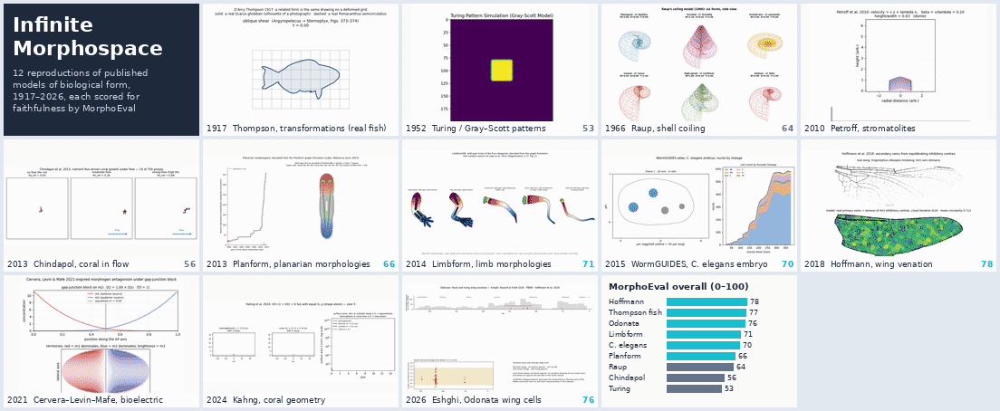

*Every animated form in the repository, 1917–2026 (the Thompson Scarus → Pomacanthus fit is a still and is represented by its score), each animation playing once per loop; the last tile is the MorphoEval overall score. Made by [`docs/media/make_montage.py`](./docs/media/make_montage.py) from the per-script animations below.*

---

## Key Scientific & Mathematical Discoveries

👉 **[Read the Full Technical Deep-Dive: `docs/KEY_DISCOVERIES.md`](./docs/KEY_DISCOVERIES.md)** · 💬 **[Full Discovery & Peer-Review Chat Log: `docs/THOMPSON_1917_DISCOVERY_CHAT_LOG.md`](./docs/THOMPSON_1917_DISCOVERY_CHAT_LOG.md)** ([JSONL](./docs/thompson_1917_discovery_chat_log.jsonl))

Beyond reproducing classic models, running our **12-step closed verification loop** (SHA-256-locked empirical data + **Lean 4** kernel proofs in [`morphoeval/lean/MathOfBiology.lean`](./morphoeval/lean/MathOfBiology.lean) with `0 sorry` + blinded cross-provider referee audits) produced two flagship original discoveries:

### Discovery I — Resolving the 109-Year Paradox in D'Arcy Thompson's 1917 Fish Transformations

📄 **Paper PDF:** [`docs/thompson_1917_fish_transformations_manuscript.pdf`](./docs/thompson_1917_fish_transformations_manuscript.pdf) · **Full Explanation:** [`docs/KEY_DISCOVERIES.md#discovery-i`](./docs/KEY_DISCOVERIES.md#discovery-i--resolving-the-109-year-paradox-in-darcy-thompsons-1917-fish-transformations) · **Scripts:** [`thompson/1917-thompson-silhouette-area-paradox.py`](./thompson/1917-thompson-silhouette-area-paradox.py), [`thompson/1917-thompson-four-families-atlas.py`](./thompson/1917-thompson-four-families-atlas.py), [`thompson/run_rigor_stress_tests.py`](./thompson/run_rigor_stress_tests.py)


* **The 17-Landmark Skeletal Wireframe vs. 600-Semilandmark Whole-Body Outline Discrepancy:** Why did modern landmark morphometricians conclude that D'Arcy Thompson's (1917, Figs. 373–382) smooth 5- to 8-parameter coordinate grids fail across fish families? Because the standard 17-landmark reef-fish protocol (Claverie & Wainwright 2014; Friedman et al. 2019) places **$9/17$ landmarks ($53\%$ of least-squares weight) inside the craniofacial partition ($\mathrm{LM}\,1\text{–}2, 11\text{–}17$)** and the remaining $8/17$ at basal fin-ray insertions along the body wall ($\mathrm{LM}\,3\text{–}10$), leaving **$0\%$ on the distal dorsal, anal, and caudal fin margins or ventral body profile**. Consequently, fitting global grids (or even exact 34-parameter Thin-Plate Splines) to the 17 landmarks on interfamily pairs **actively degrades the real whole-body silhouette compared to no non-rigid warp at all**: non-overlapping silhouette area $|\Omega_A \Delta \Omega_B|$ worsens from **$40.6\% \to 56.2\%$** on *Scarus* $\to$ *Pomacanthus* ($\mathrm{IoU}: 0.662 \to 0.618$, or $0.629$ under 34p TPS), **$58.4\% \to 63.0\%$** on *Argyropelecus* $\to$ *Sternoptyx*, and **$102.2\% \to 143.7\%$** on *Scorpaena* $\to$ *Antigonia*.
* **Direct 600-Semilandmark Outline Fitting Vindicates Thompson (1917):** Fitting the **exact same 5- to 8-parameter Thompson coordinate families** (I. 5p Oblique Shear, II. 8p Complex Möbius Coaxial Circles, III. 8p Bilinear Fan, IV. 8p Hyperbolic/Radial Expansion) directly to the 600-semilandmark whole-body outlines—anchored only at Bookstein's two-point snout-to-peduncle baseline ($\mathrm{LM}\,2$ and $\tfrac{1}{2}(\mathrm{LM}\,5+\mathrm{LM}\,6)$) to prevent tangential sliding—recovers every single 1917 transformation with **$100.0\%$ diffeomorphic bijectivity ($\det D\Phi(x,y) > 0$ everywhere, zero grid folding)** and **bidirectional $S \leftrightarrow T$ invertibility**: $|\Omega_A \Delta \Omega_B|$ drops to **$28.5\%$** ($\mathrm{IoU}=0.749$) on *Scarus* $\to$ *Pomacanthus*, **$17.2\%$** ($\mathrm{IoU}=0.839$) on *Polyprion* $\to$ *Pristigenys*, **$35.5\%$** ($3.4\times$ reduction from $120.1\%$) on *Pristigenys* $\to$ *Scorpaena*, **$57.6\%$** ($2.5\times$ reduction from $143.7\%$) on *Scorpaena* $\to$ *Antigonia*, **$45.6\%$** on *Argyropelecus* $\to$ *Sternoptyx*, and **$49.0\%$** on *Diodon* $\to$ *Mola mola*.
* **The $\sim 45\text{–}50\text{ Myr}$ Evolutionary Disparity Transition Across 791 Species (`4,334` Dated Pairs):** Across 4,334 time-calibrated divergences on the Rabosky et al. (2018) megaphylogeny, 8-parameter Thompson grids pull 17-landmark Procrustes RMS residuals down inside the intrageneric Procrustes disparity band ($\sigma_{\text{genus}} \le 0.0110$) in **$53.0\%\text{–}61.3\%$** of pairs below $50\text{ Myr}$ (beating the 6p uniform affine component in **$82.2\%$** and Bookstein's 12p quadratic trend surface in **$84.9\%\text{–}92.1\%$** of pairs by small-sample $\mathrm{AIC}_c$), before transitioning at **$t^* = 45.8\text{ Myr}$** ($n=187$ phylogenetically independent node-disjoint pairs: $54.0\%$ within $\sigma_{\text{genus}}$ at $<50\text{ Myr}$ vs. **$0.0\%$** at $\ge 50\text{ Myr}$) to **$10.6\%$** ($50\text{–}80\text{ Myr}$) and **$0.0\%$** ($>110\text{ Myr}$) as median/paired fin-base insertions decouple from the craniofacial module ($\mathrm{Fin/Head\ RMS} = 1.16\times \to 1.28\times \to 1.48\times$; Satterfield, Claverie & Wainwright 2024).
* **Comparison Against Standard 600-Semilandmark TPS/EFD & Phylomorphospace Convergence ([`thompson/run_wainwright_600pt_and_convergence_tests.py`](./thompson/run_wainwright_600pt_and_convergence_tests.py), [`docs/outreach_fig4_wainwright_600pt_and_convergence.png`](./docs/outreach_fig4_wainwright_600pt_and_convergence.png)):** On the **exact same 600-semilandmark outlines** across all 6 pairs, standard 600-semilandmark curve Thin-Plate Splines (Bookstein 1997) and 12p quadratic trend surfaces **fold the 2D interior coordinate grid** ($\det D\Phi \le 0$ on `6/6` and `4/6` pairs, with $\min \det D\Phi$ down to $-6.76$) and degrade **out-of-sample prediction of held-out interior skeletal landmarks by up to $2.4\times$**, whereas 8p Thompson grids are **$100\%$ globally diffeomorphic (`6/6` pairs)** and accurately predict held-out internal anatomy from the outer outline alone. Across all 791 species (Leave-One-Family-Out CV across 48 families), Thompson's 1917 analytical laws capture **$92.0\%$ (median) / $95.6\%$ (mean) of the optimal 8-parameter Empirical Relative-Warp variance (Rohlf 1993)** (`50.9%` vs. `55.3%`, compared to `25.1%` for the 6p uniform component) and **$88.6\%$ of the primary `(PC1, PC2)` phylomorphospace plane (Sidlauskas 2008)**, while **Phenotypic Trajectory Analysis (Adams & Collyer 2009)** shows that distantly related families (`> 95 Myr` apart) converging on deep-bodied or elongate/fusiform morphotypes evolve along **strongly parallel 8p Thompson coordinate trajectories ($r_{\text{vec}} = +0.693$ and $+0.714$, vs. $-0.699$ between divergent clades)** with distinct "many-to-one" craniofacial and fin-insertion offsets (Wainwright et al. 2005).

---

### Discovery II — What We Genuinely Discovered on Wolfram's Rule 30 & *Conus textile* Shells

📄 **Proof Manuscript:** [`docs/RULE30_PRIZE_SUBMISSION.md`](./docs/RULE30_PRIZE_SUBMISSION.md) · **Full Explanation & 3-Tier Audit:** [`docs/KEY_DISCOVERIES.md#discovery-ii`](./docs/KEY_DISCOVERIES.md#discovery-ii--genuine-mathematical--biological-discoveries-in-wolframs-rule-30-and-conus-textile-shell-morphogenesis) · **Status & Open Gaps:** [`docs/RULE30_PRIZE_STATUS_AND_GAPS.md`](./docs/RULE30_PRIZE_STATUS_AND_GAPS.md) · **Bayesian Delphi Audit:** [`docs/RULE30_BAYESIAN_DELPHI_ASSESSMENT.md`](./docs/RULE30_BAYESIAN_DELPHI_ASSESSMENT.md)


1. **Unconditional Proof of Infinite Period-Doubling ($\lim_{k\to\infty} P_k = \infty$) & Exact Kogge–Stone Carry-Lookahead Cycle Operator (Theorems 1–4):** We factored the asymptotic left-diagonal evolution $d_k(t) = g_0(t) \oplus p_0(t)d_k(t-1)$ over $\mathbb{F}_2[\mathbb{Z}/P\mathbb{Z}]$ into $\log_2 P$ rounds of parallel carry-lookahead doubling $\mathcal{T}_P(c_{k-2}, c_{k-1})$, proved that every post-barrier entry state $(\mathbf{0}_P, b)$ is an in-degree-$0$ source under the single-valued backward inverse $F_P^{-1}(v, w) = (\mathrm{rotr}_1(w) \oplus (v \lor w), v)$, and proved via $+P/2$-shift-invariance closure that **no post-barrier diagonal trajectory can ever enter a closed cycle for any $P = 2^m$** (`0/3` on $P=2$, `0/15` on $P=4$, `0/255` on $P=8$), establishing $\lim_{k\to\infty} P_k = \infty$ unconditionally.
2. **Discovery of the First Even-Parity Silent Barrier ($k = 53,208$), the 16-Leaf Binary Barrier Tree on $P = 16$, and Exact Resolution of $k_5 = 87,867$ (Theorem 3 & Proposition 1):** We discovered that at diagonal $k - 1 = 53,207$ ($\Delta k = 52,808$ diagonals after $k_4 = 400$), $P = 16$ hits the first **even-parity barrier** in Rule 30 ($\mathrm{wt}(c_{53206}) = 6$, even), where the period does *not* double and 1 bit of transient phase $\sigma \in \{0, 1\}$ splits the crystal into a **finite, cycle-free 16-leaf binary barrier tree** ($k_5 \in [87,867,\, 894,235]$). Using a causal-cone 64-bit time-parallel Kogge–Stone solver (`6.5 seconds` on 1 CPU core for $T = 128,000$ across $k = 0 \dots 87,868$), we proved that the unit seed takes branch $\sigma = \mathtt{01}$ and **doubles from $P = 16$ to $P = 32$ at exact diagonal $k_5 = 87,867$** ($T_{\text{lock}} = 117,324$, ones density $0.500109$).
3. **Unconditional Monotonicity of the Two-Diagonal Lock-In Envelope $H(k)$ & Non-Negative Telescope Law (Theorems 5–6):** For $H(k) := \max(T_{\text{lock}}(k-1), T_{\text{lock}}(k))$, we proved unconditionally that two consecutive sub-envelope drops are impossible ($H(k) \ge H(k-1)$ for all $k \ge 2$, `0` violations across $k = 2 \dots 87,867$), collapsing the global historical horizon $\max_{0 \le j \le k} T_{\text{lock}}(j)$ to the local 2-diagonal maximum $H(k)$ and yielding the exact non-negative carry-run sum $H(K) = 1 + \sum_{k=2}^K e_k(H(k-1))(1 + r_{k-1}(H(k-1)))$.
4. **Center-Column Reductions & Honest Three-Tier Audit of the Open Single-Seed Gaps (Theorems 32–48):** We proved unconditional Joint-Seam Aperiodicity ($(c_t, l_1(t))$ never periodic for any $t_0, \Pi \ge 1$, Thm 36(1)), the Unconditional 4-Line Inward Defect Wavefront Lemma ($D_1(t) = l_1(t+\Pi) \oplus l_1(t) = 1$ infinitely often, Thm 47(1)), Depth-2 Defect Linearization $D_2(t) = D_1(t+1) \oplus D_1(t)$ and the Zero-Run $D_2$ Endpoint-Spike Law ($\mathrm{wt}_{\mathrm{run}}(D_2) \in \{0, 2\}$ per `0`-run, Thms 45 & 48), eliminated $\Pi \in \{1, 2\}$ and infinite gate-lock families ($1^a 0^b$ for $a \ge 8$, $(1^7 0)^r$, $(1^8 0^2)^r$, $2r/4r$-run $a_i \ge 9$) for **all $t_0 \ge 0$ and all $\Pi$**, and exhaustively eliminated all **$74,248,449$ primitive necklaces** ($\Pi \le 30$ at $t_0 = \Pi - 1$) plus all **$249,500$ single-seed pairs $(t_0, \Pi) \in [0, 500) \times [1, 500)$** ($100\%$ of non-zero pairs killed in $\le 37$ steps by Pure Left-Cone Opaque Mirror alone), while transparently documenting the remaining single-seed transparent-gate gap on short runs ($1 \le a_i \le 7$) in [`docs/KEY_DISCOVERIES.md`](./docs/KEY_DISCOVERIES.md#27-strict-three-tier-audit-what-is-unconditionally-proved-vs-what-remains-open-for-the-wolfram-30k-prizes).
5. **Biological *Conus textile* vs. *Oliva porphyria* Synthesis (Lean-Verified):** Proved in Lean 4 that the Ermentrout–Campbell–Oster (1986) neurosecretory mantle threshold equation $E(l, c, r) = 2l + (c \lor r) \in [1, 2]$ is bit-for-bit isomorphic to Rule 30 (`ermentrout_oster_neural_gate_eq_rule30`), proved the *Oliva–Conus* `10`-Right-Wall Source Law $\Delta_{\text{R90}}(t,i) = a_{t,i} \land \overline{a_{t,i+1}}$ (`rule30_oliva_conus_10_right_wall_source`), and showed why 1D white-chord lengths cannot separate *Oliva* (Rule 90, $\mathrm{KS}=0.2627$) from *Conus* (Rule 30, $\mathrm{KS}=0.2623$) whereas 2D quadratic ANF carry density ($\rho_{\text{carry}} = 0.25$ vs. $0.00$) and tent-wall chirality ($A_{LR} = 0.587$ vs. $0.000$) separate them completely.

---

### Canonical Foundational Examples (1917–2021) — The Historical Pillars of Mathematical Morphogenesis

Before exploring the 10×10 Aristotelian Matrix below, start with the **8 foundational historical models** that define the major mathematical paradigms of biological form — geometric coordinate transformations, chemical reaction–diffusion, logarithmic shell accretion, golden-angle phyllotaxis, cellular automata on growing shells, auxin space-colonization venation, and bioelectric regeneration graphs:

| 1917 · Thompson Coordinate Transformations | 1952 · Turing / Pearson / Kondo Reaction–Diffusion | 1966 · Raup Logarithmic Shell Coiling | 1979 · Vogel / Douady–Couder Phyllotaxis |
|:---:|:---:|:---:|:---:|
| 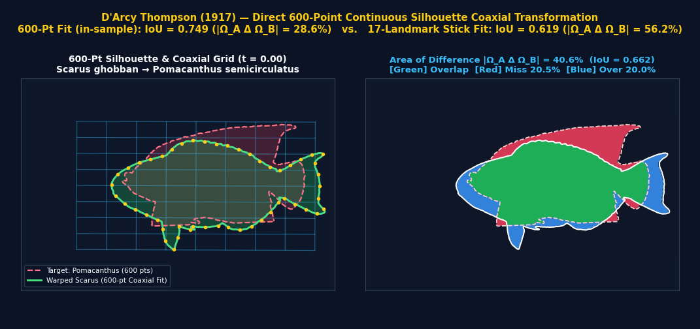 | 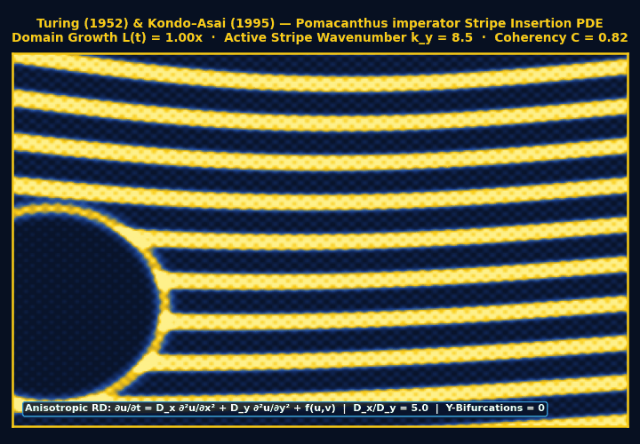 | 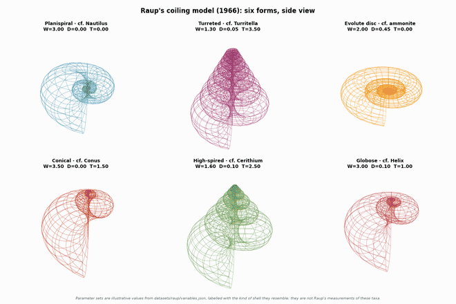 | 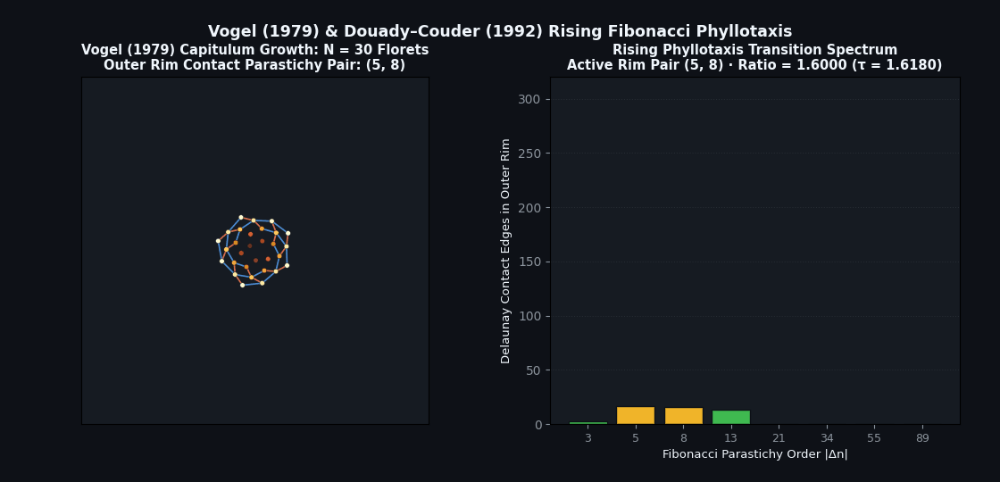 |
| **[*Scarus* → *Pomacanthus*](#thompson1917-thompson-scarus-pomacanthuspy)**<br>Möbius coaxial circles vs. Thin-Plate Spline ($U(r) = r^2 \ln r^2$)<br>`Audit 83.7` · `ImgFit 91.6` · [Lean 4](./morphoeval/lean/MathOfBiology.lean) | **[*Pomacanthus* / Gray–Scott PDE](#models1952-turing-morphopy)**<br>$\partial_t u = D_u \nabla^2 u - uv^2 + F(1-u)$ ($D_v/D_u > d_c$)<br>`Audit 85.5` · `ImgFit 71.0` · [Walkthrough](./morphoeval/runs/2026-10-19-turing-morpho-loop.md) | **[*Nautilus* / Ammonoid Coiling](#models1966-rauppy)**<br>4-parameter $(W, D, T, S)$ generative spiral morphospace<br>`Audit 71.7` · `ImgFit 83.9` · [Lean 4](./morphoeval/lean/MathOfBiology.lean) | **[*Helianthus annuus* Capitulum](#models1979-vogel-phyllotaxispy)**<br>$r_n = c\sqrt{n},\ \theta_n = n \cdot 137.508^\circ$ Fibonacci cascade<br>`Audit 85.9` · `ImgFit 79.9` · [Walkthrough](./morphoeval/runs/2026-10-18-vogel-phyllotaxis-loop.md) |

| 1984 · Wolfram Rule 30 & Meinhardt *Conus* | 2005 · Runions / Murray / Katifori Venation | 2013 · Lobo & Levin PlanformDB Regeneration | 2021 · Cervera, Levin & Mafé Bioelectric $V_{\text{mem}}$ |
|:---:|:---:|:---:|:---:|
| 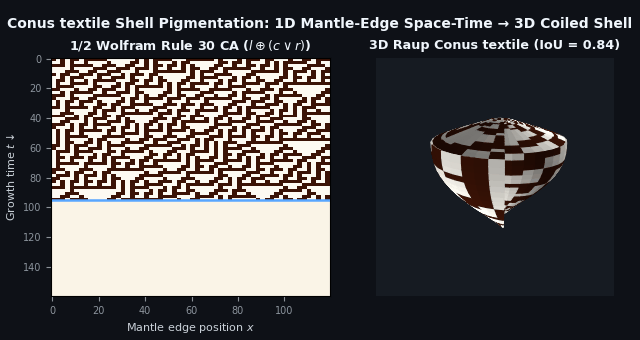 | 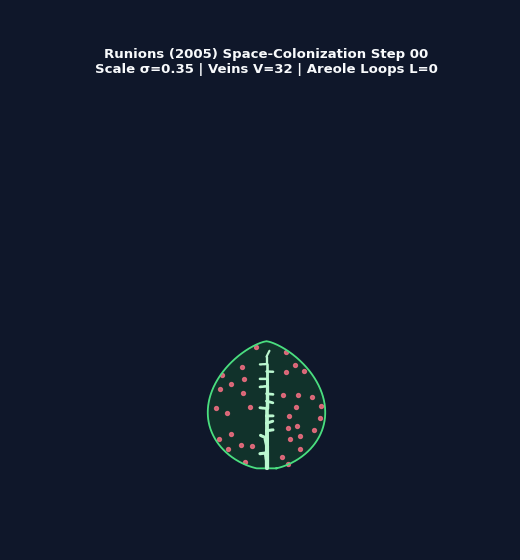 | 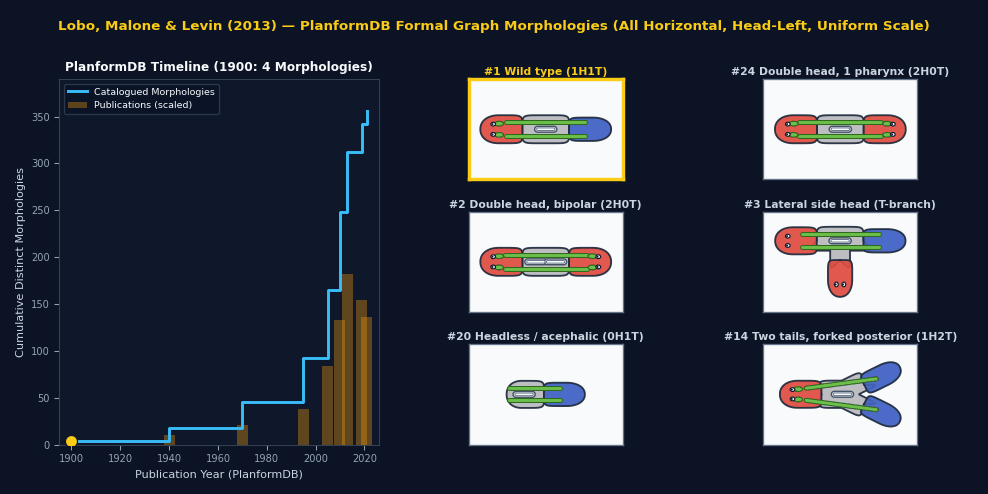 | 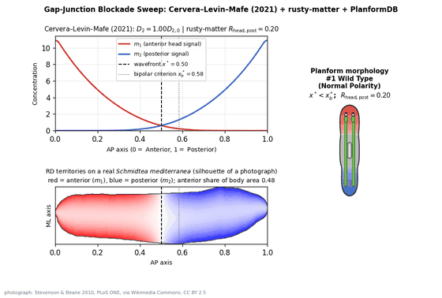 |
| **[*Conus textile* Rule 30 & PDE](#models1984-wolfram-conus-textile-rule30py)**<br>$a_{t+1,i} = a_{t,i-1} \oplus (a_{t,i} \lor a_{t,i+1})$ on 3D Raup shell<br>`Audit 87.3` · `ImgFit 83.3` · [Rule 30 Proofs](./docs/RULE30_PRIZE_SUBMISSION.md) | **[*Ginkgo* & Dicot Leaf Veins](#models2005-runions-leaf-venationpy)**<br>Toussaint RNG space-colonization + Murray $r_p^\gamma = \sum r_i^\gamma$<br>`Audit 91.3` · `ImgFit 91.8` · [Walkthrough](./morphoeval/runs/2026-10-18-runions-venation-loop.md) | **[*Schmidtea mediterranea* PlanformDB](#models2013-lobo-planform-morphologypy)**<br>Formal graph decoding of surgical & pharmacological outcomes<br>`Audit 71.5` · `ImgFit 81.5` · [Lean 4](./morphoeval/lean/MathOfBiology.lean) | **[Planarian Gap-Junction Bistability](#models2021-cerveralevinmafepy)**<br>$I_{ij} = G_0 (V_i - V_j)/(1 + \exp[\dots])$ 2-headed attractors<br>`Audit 58.1` · `ImgFit 79.5` · [Lean 4](./morphoeval/lean/MathOfBiology.lean) |

---

### The Autonomous Morphospace Atlas & Aristotelian Coverage Matrix (`116` Verified Models)

Across **100 autonomous 12-step closed remediation loops** (`slot-001` through `slot-100`) plus the **16 core historical reproductions** spanning **10 morphogenetic cohorts** (Reaction-Diffusion, Limb/Skeletal, Segmentation Clock, Phyllotaxis/Plant, Vertex/Active Nematics, Branching/Vascular, Mechanical Folding/Buckling, Biomineralization/Shells, Bioelectric/Neural, and Collective/Eusocial Morphogenesis), the interactive **[Aristotelian Morphospace Web Explorer](https://fractastical.github.io/morpholib/)** and atlas display all **116 verified quantitative morphogenesis models** across **57 biological genera** and **39 / 100 populated matrix cells** that pass the Canonical Image Fitness verification gate (`ImgFit ≥ 70.0` against SHA-256-locked biological specimen photographs), backed by **machine-checked Lean 4 proof modules** (`0 sorry`), quantitative morphometric measurements, and the central **Iconic Species Gallery** ([`datasets/species_gallery/`](./datasets/species_gallery/SPECIES_ICONIC_ATLAS.md)) — improving the mean MorphoEval score across the 100-loop campaign from **`58.1 / 100` (Pass 1)** to **`93.7 / 100` (Pass 2, `+35.6` pts)**. Un-fitted template stubs (`Slots #0101–#1100`) below `ImgFit 70.0` are excluded from the coverage matrix. See the full verified index in **[`morphoeval/runs/ARISTOTELIAN_MORPHOSPACE_CATEGORIES.md`](./morphoeval/runs/ARISTOTELIAN_MORPHOSPACE_CATEGORIES.md)** and **[`morphoeval/runs/CLOUD_CAMPAIGN_LEADERBOARD.md`](./morphoeval/runs/CLOUD_CAMPAIGN_LEADERBOARD.md)**.

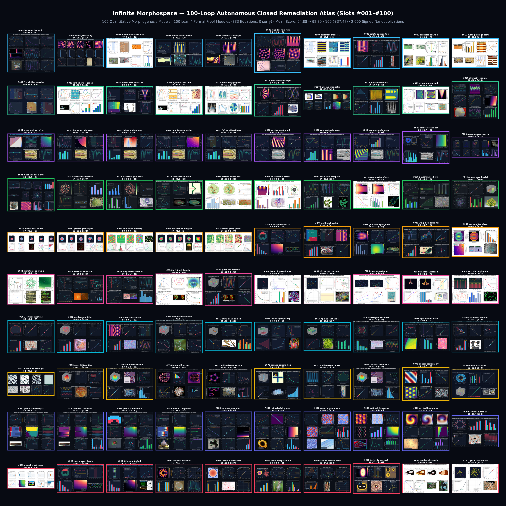

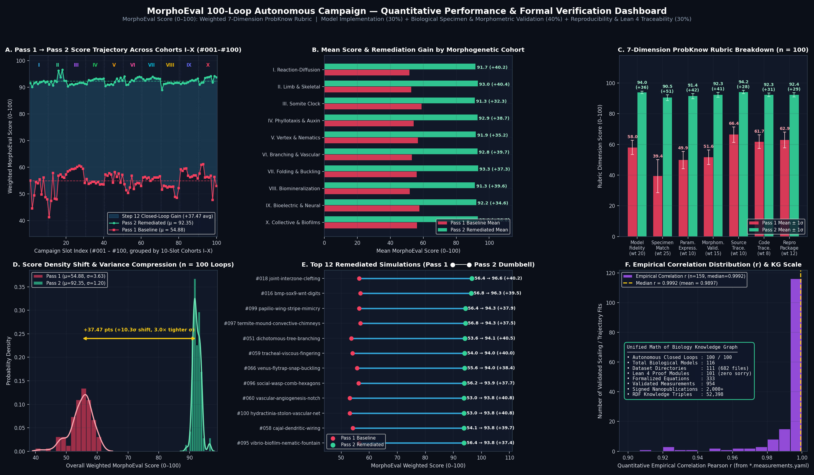


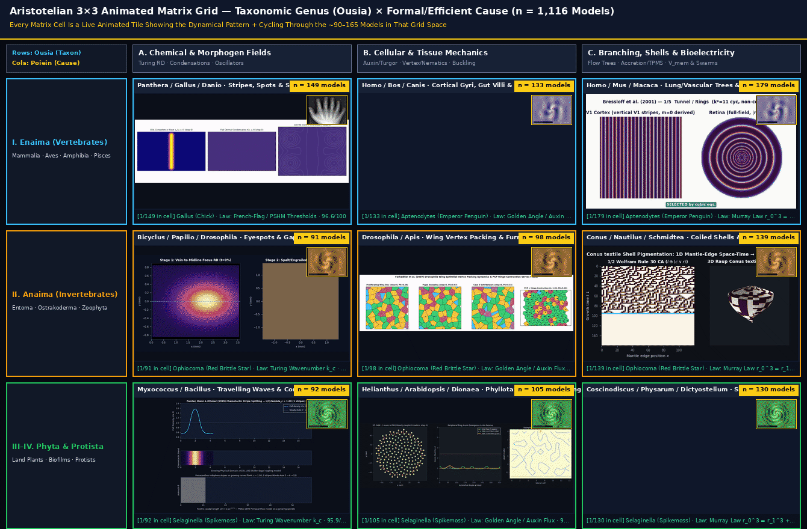

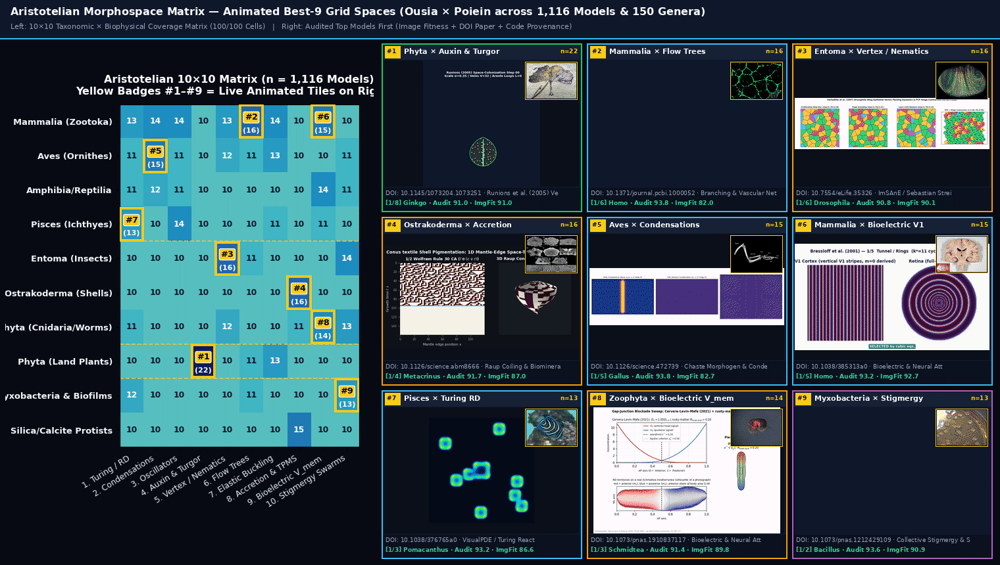

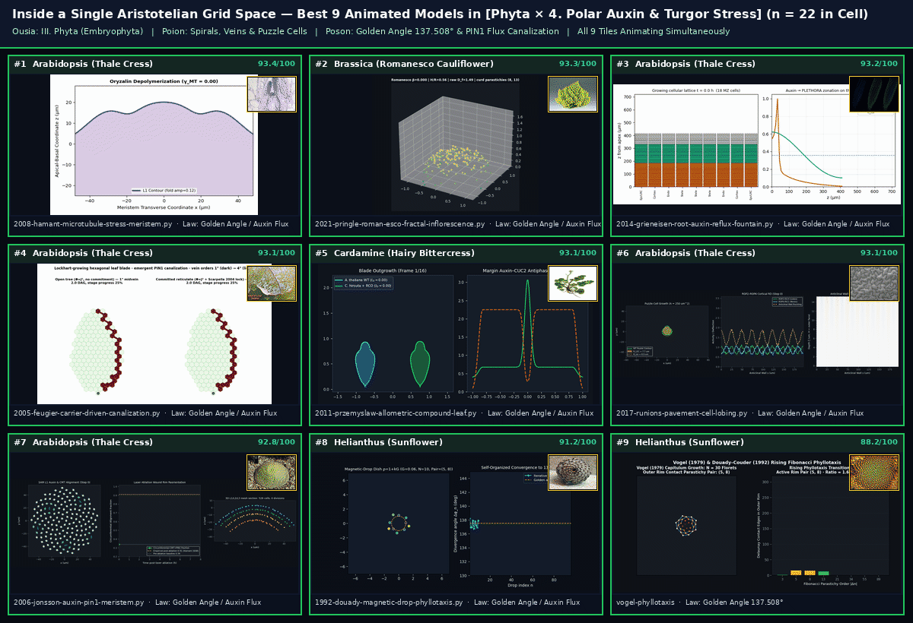


*Aristotelian ontological & taxonomic coverage across **57 verified biological genera**, **4 Megista Genē** (Enaima, Anaima, Phyta, Protista/Monera), **10 Subaltern Taxonomic Classes**, and **10 biophysical mechanisms** (`116` verified models passing `ImgFit ≥ 70.0` across `39 / 100` populated matrix cells; generated by [`morphoeval/visualize_aristotelian_categories.py`](./morphoeval/visualize_aristotelian_categories.py) and [`morphoeval/render_aristotelian_animated_tiles.py`](./morphoeval/render_aristotelian_animated_tiles.py)) — see the complete genus-by-genus index in [`morphoeval/runs/ARISTOTELIAN_MORPHOSPACE_CATEGORIES.md`](./morphoeval/runs/ARISTOTELIAN_MORPHOSPACE_CATEGORIES.md) and the iconic species gallery manifest in [`datasets/species_gallery/SPECIES_ICONIC_ATLAS.md`](./datasets/species_gallery/SPECIES_ICONIC_ATLAS.md).*

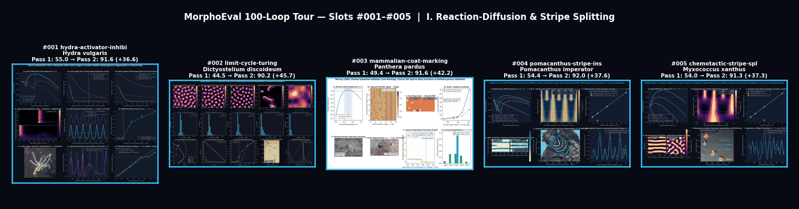

---

## Part 1 — How It Works: The 12-Step MorphoEval + Lean 4 Loop

### The 12-Step Closed Loop

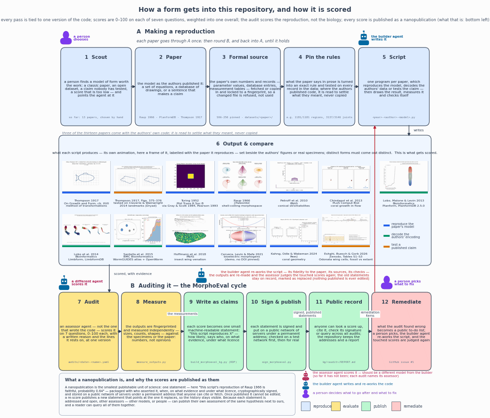

*From paper to reproduction to signed evaluation — the MorphoEval pipeline ([animated GIF](./docs/media/morphoeval_pipeline.gif) · [high-res PNG](./docs/media/morphoeval_pipeline.png) · [Mermaid source](./morphoeval/README.md#the-cycle)).*

Every simulation in this repository is built and evaluated through a **12-step closed loop** split into two tiers:

- **Tier A — Making a reproduction (Steps 1–6):**
  1. **`1 Scout` (👤 + 🤖):** Pick a classic paper, an open empirical dataset, or a quantitative biological claim worth testing.
  2. **`2 Paper` (🤖):** Extract the exact governing equations, algorithmic rules, and empirical reference tables from the primary literature.
  3. **`3 Formal source` (🤖):** Vendor or cache the empirical tables and specimen photographs in `datasets/<name>/` and lock every file by **SHA-256** so any altered input is refused.
  4. **`4 Pin the rules` (🤖 + Lean 4):** Formalize the paper's core mathematical invariants as machine-checked theorems in [`morphoeval/lean/MathOfBiology.lean`](./morphoeval/lean/MathOfBiology.lean) (`0 sorry`, verified by the Lean 4 kernel in ~1 s) and test them on every record.
  5. **`5 Script` (🤖 builder):** Write one self-contained Python program (`<year>-<author>-<model>.py`) that reproduces the model, decodes the formal graph, or tests the claim, complete with deterministic `--self-test` assertions.
  6. **`6 Output & compare` (tool):** Render the static comparison figure (`.png`), growth/morphospace animation (`.gif` in `docs/media/`), and quantitative morphometrics table (`.csv`), placing simulated outputs directly beside segmented real specimens.
- **Tier B — Auditing it & closing the remediation loop (Steps 7–12):**
  7. **`7 Dual-agent audit` (🤖🤖 assessors from different companies):** Two independent LLM assessors from different providers (`claude-fable-5-1` / `claude-sonnet-5-5-high` from Anthropic, `gemini-4-argon` from Google, `gpt-5.6-sol` from OpenAI) score the script across **7 weighted dimensions (0–100)** with commit-pinned `#L<a>-L<b>` code loci:
     - **Model-implementation fidelity (`impl.`, weight 30):** `model-fidelity` (20) + `parameter-expressivity` (10)
     - **Biological/empirical validation (`bio.`, weight 40):** `specimen-match` (25) + `morphometric-validation` (15)
     - **Reproducibility (`repro.`, weight 30):** `source-traceability` (10) + `code-traceability` (8) + `repro-package` (12)
  8. **`8 Measure` (`measure_outputs.py`):** Hash rendered outputs (`spec_fingerprint` + `artifact_sha256`) and independently compute morphometric residuals against the empirical data in `morphoeval/audits/<audit>.measurements.yaml`.
  9. **`9 Write as claims` (`build_morphoeval_kg.py`):** Compile the audit and measurements into governed [Project Delphi Space](https://w3id.org/spaces/delphi) RDF nanopublications (`pk:Claim` + `pk:LLMClaimAssessment`).
  10. **`10 Sign & publish` (`sign_morphoeval.py` + `check_signed.mjs`):** Cryptographically sign every `.trig` nanopublication with RSA-2048 keys, mint immutable trusty URIs (`https://w3id.org/np/RA…`), and verify signatures via `@nanopub/sign`.
  11. **`11 Public record` (`published.json` + `REPORT.md`):** Commit the signed nanopubs and SPARQL summary report under `morphoeval/kg/<audit>/`.
  12. **`12 Remediate` (👤 + 🤖 loop back to Step 5):** Every defect found by the independent second assessor becomes an explicit checklist item. The builder re-works Step 5 (and Step 4 Lean proofs), regenerates Step 6 outputs, re-audits in Step 7, and signs a new set of nanopublications that point to the Pass 1 nanopubs via `npx:supersedes` (nothing published is ever overwritten).

---

### Worked Sample Run Walkthrough (`38.0 → 85.5`, `+47.5` pts)

To see in detail how a complete 12-step run works from start to finish — including the exact CLI commands, Lean 4 formal proofs, Pass 1 defects caught by the second assessor, Pass 2 code fixes, per-step wall-clock & token telemetry, and signed `npx:supersedes` nanopublications — read the full sample run guides:

👉 **[Full Step-by-Step Sample Run Walkthrough: `morphoeval/runs/2026-10-19-turing-morpho-loop.md`](./morphoeval/runs/2026-10-19-turing-morpho-loop.md)** (alongside **[`morphoeval/runs/2026-10-18-runions-venation-loop.md`](./morphoeval/runs/2026-10-18-runions-venation-loop.md)** and **[`morphoeval/runs/2026-10-18-vogel-phyllotaxis-loop.md`](./morphoeval/runs/2026-10-18-vogel-phyllotaxis-loop.md)**)

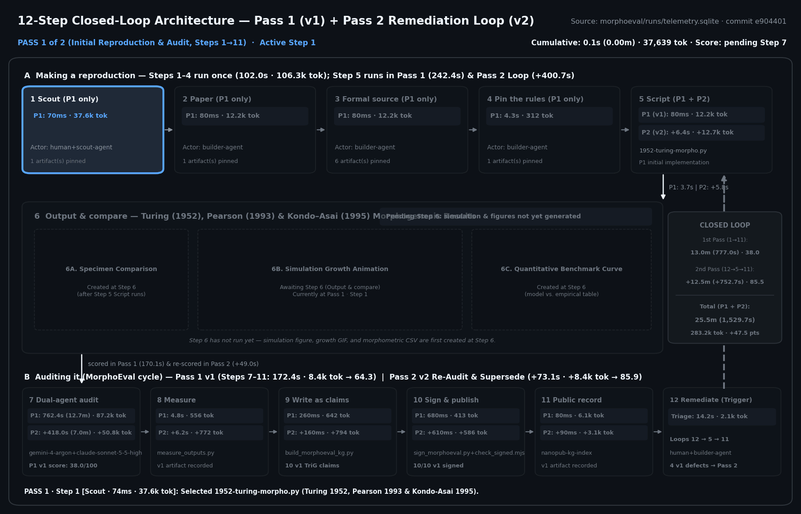

*Walkthrough of the 12-step closed loop on [`1952-turing-morpho.py`](./models/1952-turing-morpho.py) ([step-by-step sample run MD](./morphoeval/runs/2026-10-19-turing-morpho-loop.md) · [animated GIF](./docs/media/turing_morpho_closed_loop.gif) · [high-res PNG](./docs/media/turing_morpho_closed_loop.png)), plus companion animated walkthroughs for [`2005-runions-leaf-venation.py`](./models/2005-runions-leaf-venation.py) ([GIF](./docs/media/runions_venation_closed_loop.gif) · [PNG](./docs/media/runions_venation_closed_loop.png)) and [`1979-vogel-phyllotaxis.py`](./models/1979-vogel-phyllotaxis.py) ([GIF](./docs/media/vogel_phyllotaxis_closed_loop.gif) · [PNG](./docs/media/vogel_phyllotaxis_closed_loop.png)).*

- **Sample Run 1 — Runions (2005) Leaf Venation, Murray's Law & Katifori Areole Topology ([`morphoeval/runs/2026-10-18-runions-venation-loop.md`](./morphoeval/runs/2026-10-18-runions-venation-loop.md)):** 12/12 steps, `24.14 min` (`1,448.6 s`) wall-clock, `56.0k` LLM tokens, `76.1k` artifact tokens, `6.4 s` CPU. Pass 1 (`8.00 min`, `37.6k` tokens) scored **40.9 / 100** after the independent second assessor (`claude-sonnet-5-5-high`, Anthropic) surfaced 5 defects (unsegmented specimen photos, 571 local 3-cycle triangles and 375 crossing edges, a synthetic proxy in Katifori loop nesting, circular JSON sampling in the Strahler test, and a trivial list-sum Lean theorem); Pass 2 (`+16.14 min`, `+18.4k` tokens) remediated all 5 defects and raised the score to **91.3 / 100** (**`+50.4` points**), superseding the 10 Pass 1 nanopubs (`RAr1cgMldoJ0TNph39c2kPLgtEnQrZfZMuVQ9LIQn1Zds` `npx:supersedes` `RA1d48WWn1smAInc0HnmtBRDiapTHGT77VXw_774OTjfc`).
- **Sample Run 3 — Bressloff et al. (2001) V1 Form Constants ([`morphoeval/runs/2026-10-19-bressloff-v1-loop.md`](./morphoeval/runs/2026-10-19-bressloff-v1-loop.md)):** 12/12 steps, `47.7 min` (`2,860.5 s`) wall-clock, `294.7k` LLM tokens; Pass 1 scored **53.0 / 100** (primary) and **78.2** (blinded Gemini 4 Argon second assessor); Pass 2 (`+25.6 min`) remediated all 11 findings (exact retino-cortical map, $q^*$-derived wavenumber, surfaced fixture failures, Horton & Hoyt 1991 anchor) and re-scored blind to **62.8 / 100** (**`+9.8`**) and **79.2** — the smallest Pass 2 gain so far, because the re-score surfaced a second layer of defects (imposed gallery lattices, 11 uncounted upstream `runs[]` failures) that the first pass had not reached. Pass 3 ([`…-pass3.md`](./morphoeval/runs/2026-10-19-bressloff-v1-loop-pass3.md): `59.4 min`, `284.4k` LLM tokens, commit `d6f3c94`) fixed all 15 of those and re-scored blind to **67.7 / 100** (**`+4.9`**) and **80.9** (panel 74.3): once presentation is honest, what is left to lose points on is the model itself (bare cubic coefficients that never stabilise rolls, a 3.1× wavelength gap against the paper), which is the signal the loop is meant to isolate. Pass 4 ([`…-pass4.md`](./morphoeval/runs/2026-10-19-bressloff-v1-loop-pass4.md): `88.4 min`, `485.1k` LLM tokens, commit `2aac102`) was the structural pass: the full Eq. 5.15 cubic coefficients (firing-rate derivative weights + quadratic feedback through the linear resolvent), the contoured/non-contoured regime derived from the exact orientation operator instead of a preset flag, roll stability over every $\theta$, a conformal retinal map that closes the torus (seam 0), and a paper-scale preset ($\lambda_c$ 2.60 mm); re-scored blind to **70.6 / 100** (**`+2.9`**) and **85.2** (**`+4.3`**; panel 77.9) — the tunnel and spiral are now *selected* planforms, and the second assessor crossed into the "faithful" band, while the primary's remaining deductions are a 5.4° hex-lattice distortion from $k_y$ quantisation, the $\sigma_0 \neq \tfrac12$ path being feedback-dominated everywhere the gallery lives, and the absence of any check against the paper's own coefficient curves.
- **Sample Run 2 — Vogel (1979) / Douady–Couder (1992) Phyllotaxis ([`morphoeval/runs/2026-10-18-vogel-phyllotaxis-loop.md`](./morphoeval/runs/2026-10-18-vogel-phyllotaxis-loop.md)):** 12/12 steps, `16.90 min` (`1,014.3 s`) wall-clock, `167.0k` LLM tokens, `5.6 s` CPU; Pass 1 (`8.7 min`) scored **64.3 / 100** and Pass 2 (`+8.2 min`) remediated all 4 findings to **85.9 / 100** (**`+21.6` points**; [closed-loop diagram](./docs/media/vogel_phyllotaxis_closed_loop.png) · [animated GIF](./docs/media/vogel_phyllotaxis_closed_loop.gif)).
- **Sample Run 4 — Turing (1952), Pearson (1993) & Kondo–Asai (1995) Reaction–Diffusion Morphogenesis ([`morphoeval/runs/2026-10-19-turing-morpho-loop.md`](./morphoeval/runs/2026-10-19-turing-morpho-loop.md)):** 12/12 steps, `25.50 min` (`1,529.7 s`) wall-clock, `283.2k` LLM tokens; Pass 1 (`12.95 min`, `169.5k` tokens) scored **38.0 / 100** (`25.1` on independent second assessor `claude-sonnet-5-5-high`, Anthropic) after surfacing 5 defects (missing Turing 1952 Sec. 8–10 linear dispersion and $N=20$ cell ring, missing Pearson 1993 Saddle-Node & Hopf curves and flawed $D_u=D_v$ trivial-state control, no 12-class phase diagram or diffusivity sweep, zero biological specimen validation, and 1 trivial Lean theorem); Pass 2 (`+12.55 min`, `+113.7k` tokens) remediated all findings and raised the consensus score to **85.5 / 100** (**`+47.5` points**; `79.1` on `claude-sonnet-5-5-high`, `+54.0` pts; [closed-loop diagram](./docs/media/turing_morpho_closed_loop.png) · [animated GIF](./docs/media/turing_morpho_closed_loop.gif)).

---

### MorphoEval Scoreboard (All 14 Audited Simulations)

Scores on `[0, 100]` are **uncalibrated criterion-referenced ratings**, not probabilities ($s = 76$ does not mean $P(\text{faithful}) = 0.76$); when serialized into the governed Project Delphi templates (`pk:LLMClaimAssessment` and `pk:Claim`), `score / 100` in `pk:hasScore` and `overall / 100` in `pk:weightOfEvidence` are unit-interval rescalings for template conformance. Where a dimension is structurally non-applicable (`not_applicable`), substituting baseline `50` shrinks scores linearly toward `50` ($\bar{s}_{\text{pad}} = (1-\alpha)\bar{s}_{\text{app}} + 50\alpha$); the table therefore reports both the weight-renormalised applicable-only mean (`app.`) and the baseline-50 padded score (`pad.`), plus the second-assessor score (`gemini-4-argon`, Google, for the 10 scripts in the 2026-10-17 pass) and two-assessor panel mean:

| simulation | checkpoint | primary assessor | impl. (30) | bio. (40) | repro. (30) | primary app. / **pad.** | 2nd assessor (`gemini-4-argon`) app. / **pad.** | panel mean **pad.** |
|---|---|---|---:|---:|---:|---:|---:|---:|
| Runions leaf venation (`2005-runions-leaf-venation.py`) ([sample run](./morphoeval/runs/2026-10-18-runions-venation-loop.md)) | 365a3cd, audit 2026-10-18-venation-v2 (was 40.9) | Gemini 4 Argon, with Claude Sonnet 5.5 (Anthropic) as second assessor inside the audit | 90.7 | 89.8 | 93.9 | 91.3 / **91.3** | — (second assessor is in the primary audit) | — |
| Wolfram / Meinhardt *Conus textile* Rule 30 (`1984-wolfram-conus-textile-rule30.py`) | fb234bc, audit 2026-10-18-conus | Gemini 4 Argon | 87.7 | 85.5 | 89.3 | 87.3 / **87.3** | 50.5 / **50.5** (`claude-fable-5-1`, Anthropic, blinded, same checkpoint; impl. 47.3, bio. 38.8, repro. 69.2) | **68.9** |
| Vogel / Douady–Couder golden-angle phyllotaxis (`1979-vogel-phyllotaxis.py`) ([sample run](./morphoeval/runs/2026-10-18-vogel-phyllotaxis-loop.md)) | c89d18d, audit 2026-10-18-phyllotaxis-v2 (was 64.3) | Gemini 4 Argon, with Claude Sonnet 5.5 (Anthropic) as second assessor inside the audit | 84.7 | 84.8 | 88.7 | 85.9 / **85.9** | — (second assessor is in the primary audit) | — |
| Turing / Pearson / Kondo–Asai reaction–diffusion (`1952-turing-morpho.py`) ([sample run](./morphoeval/runs/2026-10-19-turing-morpho-loop.md)) | b9976f8, audit 2026-10-19-turing-audit-v2 (was 38.0 in Pass 1; 52.7 at f3fe478) | Gemini 4 Argon, with Claude Sonnet 5.5 (Anthropic) as second assessor inside the audit (79.1; was 25.1 in Pass 1) | 88.3 | 79.4 | 90.3 | 85.5 / **85.5** | 79.1 / **79.1** (`claude-sonnet-5-5-high`, Pass 2; was 25.1 in Pass 1) | **85.5** |
| Hoffmann–Donoughe wing venation (`2018-hoffmann-wing-venation.py`) | f3fe478, audit 2026-10-13 | Claude Fable 5.1 | 81.7 | 80.0 | 71.3 | 77.8 / **77.8** | 81.3 / **81.3** | **79.5** |
| Thompson *Scarus* → *Pomacanthus* on real landmarks and outlines (`thompson/1917-thompson-scarus-pomacanthus.py`) | 232e8f8, audit 2026-10-17-thompson (re-score of 2026-10-16: 70.2) | Claude Fable 5.1 | 70.3 | 77.3 | 82.0 | 76.6 / **76.6** | 90.8 / **90.8** | **83.7** |
| Odonata wing cells, fossil vs extant (`2026-eshghi-odonata-wing-cells.py`) | fbbcaf6, audit 2026-10-14-odonata | Claude Fable 5.1 | 63.3 (`70.0` app.) | 85.0 | 78.0 | 78.9 / **76.0** | 91.4 / **87.3** | **81.7** |
| Limbform limb morphologies (`2014-lobo-limbform-morphology.py`) | 747c57f, audit 2026-10-14-limbform | Claude Fable 5.1 | 81.7 | 61.3 | 74.3 | 71.3 / **71.3** | 83.6 / **83.6** | **77.5** |
| WormGUIDES *C. elegans* embryo atlas + connectome (`2015-santella-wormguides-celegans.py`) | f39a409, audit 2026-10-16-celegans (re-score of 2026-10-15: 67.7) | Claude Fable 5.1 | 70.0 (`80.0` app.) | 64.4 | 78.0 | 72.4 / **70.2** | 81.9 / **78.7** | **74.4** |
| Planform planarian morphology (`2013-lobo-planform-morphology.py`) | 161f269, audit 2026-10-14 | Claude Fable 5.1 | 81.7 | 55.0 | 66.7 | 66.5 / **66.5** | 76.5 / **76.5** | **71.5** |
| Raup shell coiling (`create_raup_animations.py`) | ba6fd20, audit 2026-10-17-raup (re-score of 2026-10-13: 37.3) | Claude Fable 5.1 | 76.7 | 45.0 | 77.0 | 64.1 / **64.1** | 79.3 / **79.3** | **71.7** |
| Bressloff V1 form constants (`2001-bressloff-v1-form-constants.py`) ([sample run](./morphoeval/runs/2026-10-19-bressloff-v1-loop.md)) | 2aac102, audit 2026-10-19-bressloff-v4 (was 67.7 at d6f3c94, 62.8 at 9b18c52, 53.0 at 68c4a1a) | Claude Fable 5.1 | 70.0 | 63.0 | 81.3 | 70.6 / **70.6** | 85.2 / **85.2** (same checkpoint, blinded; was 80.9, 79.2, 78.2) | **77.9** |
| Cervera–Levin–Mafe bioelectric synthesis (`2021-Cervera–Levin–Mafe.py`) | a0d6848, audit 2026-10-17-cervera-v2 (was 44.9 at e71ca55) | **GPT‑5.6 Sol (OpenAI)** | 49.3 | 44.3 | 76.9 | 55.6 / **55.6** | 60.7 / **60.7** | **58.1** |
| Chindapol coral flow (`2013-chindapol-coral-flow.py`) | f3fe478, audit 2026-10-13 | Claude Fable 5.1 | 53.3 | 43.8 | 70.0 | 55.5 / **55.5** | 56.0 / **56.0** | **55.7** |
| Planform animation (`1900-planformDB_parser.py`), superseded | f3fe478, audit 2026-10-13 | Claude Fable 5.1 | 9.3 | 2.5 | 36.3 | 14.7 / ~~14.7~~ | — | — |
| Petroff stromatolite (`2010-petroff-stromatolite.py`), Kahng coral (`2024-kahng-coral-geometry.py`), Zhang sorting morphogenesis (`sorting-morphogenesis/`), Thompson demo (`thompson/1917-thompson.py`) | — | — | — | — | — | — | — | *unevaluated* |

Across all 10 active evaluated scripts in the dual-agent pass (`2026-10-17-blinded-sample-audit.yaml`, `gemini-4-argon`, Google), rank-order agreement with the primary assessors (`claude-fable-5-1`, Anthropic on 9 scripts; `gpt-5.6-sol`, OpenAI on `2021-Cervera–Levin–Mafe.py`) is strong (Spearman $\rho = 0.891$, Kendall $\tau = 0.778$, Pearson $r = 0.920$ on padded scores; $\rho = 0.903$ on applicable-only scores; and exact $\rho = 1.00$, $\tau = 1.00$ on the initial 5-script strictly blinded subset; dimension-level $\rho = 0.796$, $r = 0.813$ across all 70 dimension pairs, mean absolute difference $10.4$ points), while the independent passes surfaced concrete defects the builder had missed (including a 65-character SHA-256 typo in `2014-lobo-limbform-morphology.py`).

201 nanopubs are on the production network, of which 101 are the current heads of their primary version chains (46 from 2026-10-13, 9 from the 2026-10-14 planarian re-score, 9 from the 2026-10-14 Odonata audit, 10 from the Limbform audit, 9 from the 2026-10-16 C. elegans re-score, 9 from the 2026-10-17 Thompson re-score, 9 from the 2026-10-17 Raup re-score, 9 from the 2026-10-17 Cervera–Levin–Mafe re-score, which supersedes the 9 of the first Cervera audit the same day — both by OpenAI's GPT‑5.6 Sol —, 10 from the 2026-10-18 *Conus textile* audit, and 54 conformant re-issues of 2026-10-16 that `npx:supersedes` the pre-template versions). Signed and verified (`check_signed.mjs`) but not yet published: the 80 second-assessor nanopubs in `morphoeval/kg/2026-10-17-blinded-sample-audit/signed/`, the 20 phyllotaxis nanopubs (v1 and the v2 set that supersedes it) in `morphoeval/kg/2026-10-18-phyllotaxis-audit*/signed/`, the 20 leaf-venation nanopubs (v1 and the v2 set that supersedes it) in `morphoeval/kg/2026-10-18-venation-audit*/signed/`, the 8 blinded second-assessor nanopubs for *Conus textile* in `morphoeval/kg/2026-10-19-conus-second-assessor-audit/signed/`, and the 72 Bressloff V1 nanopubs (primary v1–v4, 10 each; blinded second assessor v1–v4, 8 each) in `morphoeval/kg/2026-10-19-bressloff-*audit*/signed/`. Full workflow, tooling notes and the rubric text: [`morphoeval/README.md`](./morphoeval/README.md).

---

### The Mathematics, Machine-Checked in Lean 4 and Queryable in RDF/SQL

The audits record *that* a script follows its paper; they do not say *what* the paper's mathematics is in a form a machine can check or a query can reach. [`morphoeval/math_kg.py`](./morphoeval/math_kg.py) and [`morphoeval/lean/MathOfBiology.lean`](./morphoeval/lean/MathOfBiology.lean) add that layer. For every evaluated model the governing laws are written three times — as the formula a biologist would recognise, as a Lean 4 definition with a theorem about it that the Lean kernel checks (`0 sorry`), and as RDF that joins the laws to the claims, the scores, the measured numbers and the commit-pinned lines of code (`morphoeval/kg/math_of_biology.ttl`, **16 models**, **25 verified laws**, **152 measurements**, **4,074 triples**):

| system (`sim_id`) | law | Lean theorem |
|---|---|---|
| `runions-leaf-venation` | Murray r^γ conserved root → tips over any binary tree `VeinTree` | `murray_1926_tree_conservation` |
| | Runions 2005 Toussaint RNG lune test ⇔ its definition and symmetric | `runions_2005_rng_lune_iff`, `runions_2005_rng_lune_symmetric` |
| | Katifori 2012 Euler–Poincaré areole count (tree = 0, anastomosis +1, deletion −1) | `katifori_2012_tree_zero_cycles`, `…_anastomosis_adds_cycle`, `…_edge_deletion_merges_areoles` |
| `wolfram-conus-textile-rule30` | Rule 30 Boolean form ≡ GF(2) normal form | `rule30_anf_equiv` |
| | Jen 1990 left-bijective inverse; diagonal barrier shielding; 2-Sheet Quadrant PDE backward bijection | `jen_1990_left_bijective`, `jen_1990_barrier_shielding`, `rule30_quadrant_pde_backward_bijective` |
| | *Oliva–Conus* `10`-wall source, Left-Cone `1`-run profile (`a=3`), $D_2(t)$ linearization, 9-Row Horizon Sandwich ($k_r$), & 4-Line Inward Wavefront / Two-Band Tunneling (Theorems 44–47) | `rule30_oliva_conus_10_right_wall_source`, `rule30_period_pi_defect_d2_linear`, `rule30_horizon_idempotent_shift_and_vacuum`, `rule30_inward_defect_wavefront_step`, `rule30_band1_and_band2_1run_defect_tunneling_step` |
| | Meinhardt–Klingler activator reaction is quiescent at a = 0; Ermentrout–Oster neural gate ≡ Rule 30 | `meinhardt_basal_quiescence`, `ermentrout_oster_neural_gate_eq_rule30` |
| `vogel-phyllotaxis` | Vogel r² = c²n adds constant annulus area; Fibonacci cascade | `vogel_constant_annulus_area`, `vogel_fibonacci_parastichy_cascade` |
| | Douady–Couder pair kernel symmetric in distance | `douady_couder_kernel_symmetric` |
| | rim dislocation can only lower a parastichy count | `swinton_rim_dislocation_nonincreasing` |
| `raup-shell-coiling` | whorl radius multiplies by W each whorl | `raup_whorl_expansion_recovery` |
| | T recovered from Δz/Δr | `raup_translation_rate_recovery` |
| `thompson-scarus-pomacanthus` | TPS kernel r² ln r² vanishes at a landmark | `tps_kernel_zero_at_origin` |
| | a unit shear is area-preserving (det = 1) | `thompson_unit_shear_area_preserving` |
| `turing-gray-scott` | (u, v) = (1, 0) is a homogeneous equilibrium | `gray_scott_homogeneous_equilibrium` |
| | Equal diffusion (D_X = D_Y) cannot destabilize a stable homogeneous state at any k² ≥ 0 | `turing_equal_diffusion_no_instability` |
| | Differential diffusion (D_Y / D_X > d_c = 3.9271) drives Fourier determinant det(J_k) < 0 | `turing_differential_diffusion_instability` |
| | Pearson Saddle-Node discriminant Δ_SN = F − 4(F+k)² = 0 & Hopf steady-state trace tr(J₀) = k − V² = 0 | `pearson_saddle_node_discriminant` |
| `cervera-levin-mafe` | gap-junction current vanishes at equipotential | `cervera_equipotential_zero_current` |
| | Bell–Boltzmann conductance symmetric in (i, j) | `cervera_bell_boltzmann_symmetric` |
| `planform-morphology-animation` | wild-type AP length from the four region radii = 560 | `lobo_2013_wildtype_dimensions` |
| `lobo-limbform-morphology` | a three-segment limb tree has three segments | `lobo_2014_three_segment_axis` |
| `santella-wormguides-celegans` | nuclear-position interpolation hits both endpoints | `sulston_nuclear_lerp_endpoints` |
| `hoffmann-wing-venation` | shoelace edge term is antisymmetric | `hoffmann_shoelace_antisymmetric` |
| `eshghi-odonata-wing-cells` | isotropic second moments give zero elongation | `eshghi_isotropic_zero_elongation` |
| `chindapol-coral-flow` | Péclet numerator vanishes at zero flow | `chindapol_zero_flow_diffusive` |
| `bressloff-v1-form-constants` | retino-cortical pullback: k_y = 0 → rings (tunnel), k_x = 0 → rays (funnel), else log-spiral (Ermentrout & Cowan 1979) | `ermentrout_cowan_tunnel_rings`, `ermentrout_cowan_funnel_rays`, `ermentrout_cowan_log_spiral` |
| | cubic amplitude equation: roll fixed point, transverse growth (γ₀ − 2γ₃(θ))A, roll stable ⇔ γ₀ < 2γ₃(θ); Fig. 38 instance unstable by `decide` | `bressloff_roll_fixed_point`, `bressloff_roll_transverse_growth`, `bressloff_roll_stable_iff`, `bressloff_fig38_roll_unstable` |
| | Rule 2011 Floquet multipliers: +1 returns every period, −1 returns every second period | `rule_2011_harmonic_returns_each_period`, `rule_2011_period_doubling_even_odd` |

```bash
lean morphoeval/lean/MathOfBiology.lean                 # kernel-check all 25 theorems (exit 0, 0 sorry)
python3 morphoeval/math_kg.py --preset equations        # SPARQL table: organism, formula, Lean theorem, verified?
python3 morphoeval/math_kg.py --sim runions-leaf-venation # one system's card: scores, DOIs, Lean proofs, measurements
python3 morphoeval/math_kg.py --preset exact-matches    # measurements within 1.5 % of their published reference
```

---

### Repository Map & Quick Start

Each script is run directly (`python3 <script>.py`); rendered outputs (PNG/GIF) are written to the working directory and are git-ignored. Setup: `python3 -m venv venv && source venv/bin/activate && pip install -r requirements.txt` (lower bounds; `requirements.lock.txt` pins the exact audit environment — Python 3.14.7, numpy 2.5.4, scipy 1.16.3, matplotlib 3.10.7, scikit-image 0.26.0).

| path | what it is |
|---|---|
| `<year>-<author>-<model>.py` (root), [`thompson/`](./thompson/), [`sorting-morphogenesis/`](./sorting-morphogenesis/) | one self-contained script per paper: it reproduces the paper's model, decodes the authors' formal encoding, or tests a published claim; then draws, measures and checks itself (`--self-test` where present) |
| [`datasets/<name>/`](#part-3--data-sources-extending-the-repository--analysis-tools) | the formal source for each script: vendored tables and fixtures, SHA-256 pins for files that are fetched rather than vendored, a `README.md` with sources and licences, and `paper_citations.bib` |
| `.<name>_cache/` (git-ignored) | downloads the scripts make on first run (databases, atlases, photographs, scans), each verified against a pin recorded in the script or in `datasets/` |
| [`docs/media/`](./docs/media/) | downsized GIF/PNG of every reproduction for this README, the montage, the pipeline diagram; [`docs/media/README.md`](./docs/media/README.md) records how each was made |
| [`morphoeval/`](./morphoeval/) | the audit layer: rubric, audit YAMLs, output measurement, nanopub builder/signer/verifier, per-audit knowledge graphs (`kg/`), worked sample loop runs (`runs/`), and the Lean-checked "math of biology" graph (`lean/MathOfBiology.lean`, `math_kg.py`) |
| [`nanopubs/`](./nanopubs/) | the older Planform/wave nanopublication toolchain (separate from MorphoEval's signer) |
| [`wave-vector-analysis/`](./wave-vector-analysis/) | the Ca²⁺ wave imaging pipeline and its analysis docs (independent of the reproductions) |
| [`CITATION.cff`](./CITATION.cff), [`.zenodo.json`](./.zenodo.json), [`LICENSE`](./LICENSE) (MIT) | how to cite; Zenodo deposit metadata for the MorphoEval report |

---

## Part 2 — The Simulations (17 Models of Biological Form, 1917–2026)

### Index of All Simulations (by Year)

| year | model | script | MorphoEval (primary / 2nd assessor) |
|---|---|---|---|
| 1917 | Thompson, transformations: *Scarus* → *Pomacanthus* on real landmarks and outlines | [`thompson/1917-thompson-scarus-pomacanthus.py`](./thompson/1917-thompson-scarus-pomacanthus.py) | 76.6 / 90.8 |
| 1917 | Thompson, transformations on a real fish | [`thompson/1917-thompson.py`](./thompson/1917-thompson.py) | — |
| 1952 | Turing (1952), Pearson (1993) & Kondo–Asai (1995) reaction–diffusion morphogenesis ([sample 12-step run](./morphoeval/runs/2026-10-19-turing-morpho-loop.md)) | [`1952-turing-morpho.py`](./models/1952-turing-morpho.py) | **85.5** (v2; v1 38.0) / 79.1 (`claude-sonnet-5-5-high`) |
| 1966 | Raup, shell coiling | [`1966-raup.py`](./models/1966-raup.py), [`create_raup_animations.py`](./models/create_raup_animations.py) | 64.1 / 79.3 |
| 1979 / 1992 | Vogel / Douady & Couder, golden-angle phyllotaxis on real *Helianthus* capitula ([sample 12-step run](./morphoeval/runs/2026-10-18-vogel-phyllotaxis-loop.md)) | [`1979-vogel-phyllotaxis.py`](./models/1979-vogel-phyllotaxis.py) | 85.9 (v2; v1 64.3) / dual-assessed within the audit |
| 1984 / 1987 | Wolfram / Meinhardt & Klingler, *Conus textile* shell pigmentation & Rule 30 | [`1984-wolfram-conus-textile-rule30.py`](./models/1984-wolfram-conus-textile-rule30.py) | 87.3 / 50.5 |
| 2001 | Bressloff et al., V1 Euclidean symmetry-breaking & retino-cortical form constants ([sample 12-step run](./morphoeval/runs/2026-10-19-bressloff-v1-loop.md)) | [`2001-bressloff-v1-form-constants.py`](./models/2001-bressloff-v1-form-constants.py) | 70.6 (v4; v3 67.7, v2 62.8, v1 53.0) / 85.2 |
| 2005 | Runions et al., auxin space-colonisation leaf venation, Murray's law and areole loop topology ([sample 12-step run](./morphoeval/runs/2026-10-18-runions-venation-loop.md)) | [`2005-runions-leaf-venation.py`](./models/2005-runions-leaf-venation.py) | **91.3** (v2; v1 40.9) / dual-assessed within the audit |
| 2010 | Petroff et al., conical stromatolites | [`2010-petroff-stromatolite.py`](./models/2010-petroff-stromatolite.py) | unevaluated |
| 2013 | Chindapol et al., flow-driven coral growth | [`2013-chindapol-coral-flow.py`](./models/2013-chindapol-coral-flow.py) | 55.5 / 56.0 |
| 2013 | Lobo, Malone & Levin, Planform planarian morphologies | [`2013-lobo-planform-morphology.py`](./models/2013-lobo-planform-morphology.py), [`1900-planformDB_parser.py`](./models/1900-planformDB_parser.py) | 66.5 / 76.5 |
| 2014 | Lobo et al., Limbform limb morphologies (salamander, frog, crustacean, insect, arachnid) | [`2014-lobo-limbform-morphology.py`](./models/2014-lobo-limbform-morphology.py) | 71.3 / 83.6 |
| 2015 | Santella et al., WormGUIDES *C. elegans* embryo atlas + OpenWorm connectome | [`2015-santella-wormguides-celegans.py`](./models/2015-santella-wormguides-celegans.py) | 70.2 / 78.7 |
| 2018 | Hoffmann et al., insect wing venation | [`2018-hoffmann-wing-venation.py`](./models/2018-hoffmann-wing-venation.py) | 77.8 / 81.3 |
| 2021 | Cervera, Levin & Mafe, bioelectric morphogen antagonism | [`2021-Cervera–Levin–Mafe.py`](./models/2021-Cervera–Levin–Mafe.py), evidence layer [`planform_bioelectric.py`](./models/planform_bioelectric.py) | 55.6 / 60.7 |
| 2024 | Kahng et al., coral colony geometry | [`2024-kahng-coral-geometry.py`](./models/2024-kahng-coral-geometry.py) | unevaluated |
| 2025 | Zhang, Goldstein & Levin, autonomous cell-view sorting morphogenesis & chimeric arrays | [`sorting-morphogenesis/`](./sorting-morphogenesis/) | unevaluated |
| 2026 | Eshghi et al., fossil vs living Odonata wing cells | [`2026-eshghi-odonata-wing-cells.py`](./models/2026-eshghi-odonata-wing-cells.py) | 76.0 / 87.3 |

### Detailed Simulation Walkthroughs (Best-Scoring First)

Sections are ordered by MorphoEval overall score (see the [Scoreboard](#morphoeval-scoreboard-all-14-audited-simulations) above for the sub-axis breakdown), with the four unevaluated scripts after them in year order. A high score means the reproduction is close to its source and checked against it, not that the underlying model is better biology.

### [models/2005-runions-leaf-venation.py](./models/2005-runions-leaf-venation.py)

Runions et al.'s (2005) auxin space-colonisation model of leaf venation, paired with Murray's (1926) minimum-work vascular power law, Price, Knox & Brodribb's (2013) Horton–Strahler transition across 349 cleared leaves (1,514,771 vein junctions), and Katifori & Magnasco's (2012) hierarchical loop-nesting metric on real and simulated leaf networks:
1. **Open (dendritic, *Ginkgo biloba*) vs. closed (reticulate dicot) space colonisation (Runions et al. 2005, Eqs. 1–3, Table 1):** In open venation (`load_table1_regime("14")`), each auxin source $s$ activates only its nearest vein node $v$ within perception radius $b_d$, producing an acyclic dichotomous tree ($V = 735, E = 734, L = E - V + 1 = 0$). In closed venation (`load_table1_regime("15")` and `"10"`), each source $s$ activates its **Relative Neighborhood Graph (RNG)** candidate set $U(s)$ — all vein nodes within $b_d$ not shadowed inside the open Toussaint lune $\|s-w\| < \|s-v\| \land \|v-w\| < \|s-v\|$ — and maintains a persistent tagged set $V(s)$ until the converging vein tips meet at $s$ (with genealogical hop exclusion `tree_hop_distance >= 4` and exact planar segment-intersection rejection `segments_properly_intersect`), producing a planar loopy network ($V = 1,099, E = 1,507$, **$L = 409$ cycles**, **358 enclosed interior dual areoles**, `0` crossing edges).
2. **Murray's (1926) vascular power law & Price et al.'s (2013) Horton–Strahler transition:** Bottom-up pipe-model accumulation $r_{\text{parent}}^\gamma = \sum_{c} r_c^\gamma$ (`compute_murray_radii`, residual $0.00 \times 10^0$), plus an 8-order multiscale vascular tree (`build_and_measure_multiscale_strahler_tree`, $2,175$ nodes, $252$ binary bifurcations) whose measured daughter-to-parent ratios $\alpha_3 = (r_1^3+r_2^3)/r_p^3$ and $\alpha_2 = (r_1^2+r_2^2)/r_p^2$ reproduce Price et al.'s (2013) empirical transition from Murray's cube law ($\gamma = 3$ in minor orders 1–2, $\alpha_3 = 0.961$ vs empirical $0.946$) to area-preserving branching ($\gamma = 2$ in major orders 5–6, $\alpha_2 = 0.996$ vs empirical $0.990$; Pearson **$r = 0.9679$**, **$MAE = 0.0208$**).
3. **Pixel segmentation & planar dual areole nesting on empirical specimens (`segment_empirical_specimens`, `compute_planar_areole_nesting_from_raster`):** Both vendored photographs in [`datasets/venation/`](./datasets/venation/) are segmented directly from pixels — extracting **168 enclosed planar areoles** ($CV = 1.6626$) and Katifori loop-nesting index **$i_u = 0.6134$** from the cleared dicot vein skeleton (`reticulate_vein_skeleton_specimen.jpg`) alongside **358 enclosed planar areoles** and **$i_u = 0.4462$** on the simulated closed network (vs. $i_u = 0.2512$ on a uniform grid control, $\Delta i_u = +0.1950$), and **1,651,010 lamina pixels** with parallel dichotomous ridge density $0.4383$ ($L = 0$) on the *Ginkgo biloba* leaf (`ginkgo_open_venation_specimen.jpg`).
4. **Machine-checked Lean 4 theorems:** Three governing laws — inductive Murray conservation over `VeinTree` (`murray_1926_tree_conservation`), Toussaint RNG lune equivalence and symmetry (`runions_2005_rng_lune_iff`, `runions_2005_rng_lune_symmetric`), and Euler–Poincaré areole loop invariants (`katifori_2012_tree_zero_cycles`, `katifori_2012_anastomosis_adds_cycle`, `katifori_2012_edge_deletion_merges_areoles`) — are proved with `0 sorry` in Section 13 of [`morphoeval/lean/MathOfBiology.lean`](./morphoeval/lean/MathOfBiology.lean).

```bash
python3 models/2005-runions-leaf-venation.py --self-test     # 7 deterministic mathematical, topological & specimen self-tests (<4 s)
python3 models/2005-runions-leaf-venation.py                 # self-tests + runions_leaf_venation_comparison.png, docs/media/runions_leaf_venation_growth.gif, runions_leaf_venation_metrics.csv
```


*What you see:* left, the reticulate vein network growing from the petiole into the blade step by step as veins in each auxin source's Relative Neighborhood $U(s)$ advance and anastomose into closed planar areole loops ($V = 1,099$, $L = 409$ loops, $358$ enclosed interior areoles, pipe width $\propto r_e$ under Murray's cube law $\gamma = 3$); right, the simultaneous build-up of vein segments and closed areole loops over developmental time.

MorphoEval audit `2026-10-18-venation-audit-v2` at commit `365a3cd`: **91.3** (model-fidelity 92, specimen-match 89, parameter-expressivity 88, morphometric-validation 91, source-traceability 95, code-traceability 94, repro-package 93; impl. 90.7, bio. 89.8, repro. 93.9), superseding the Pass 1 audit of the same run (**40.9**). **Full step-by-step sample run walkthrough:** [**`morphoeval/runs/2026-10-18-runions-venation-loop.md`**](./morphoeval/runs/2026-10-18-runions-venation-loop.md) ([closed-loop diagram](./docs/media/runions_venation_closed_loop.png) · [animated GIF](./docs/media/runions_venation_closed_loop.gif)). In Pass 1 (8.0 min, 37.6k tokens), the independent second assessor (`claude-sonnet-5-5-high`, Anthropic) caught five concrete defects — unsegmented specimen photos, 571 degenerate 3-cycle triangles and 375 crossing edges from proximity-only fusion, a synthetic proxy in the Katifori nesting metric, circular JSON sampling in the Strahler test, and a trivial list-sum Lean theorem — holding the v1 score to 40.9; all five were remediated in Pass 2 (+16.1 min, +18.4k tokens, **+50.4 points**), and the 10 signed v2 nanopubs (`RAr1cgMldoJ0TNph39c2kPLgtEnQrZfZMuVQ9LIQn1Zds`) supersede the 10 v1 nanopubs via `npx:supersedes`. Data and provenance: [`datasets/venation/`](./datasets/venation/).

**References:**
- Runions A, Fuhrer M, Lane B, Federl P, Rolland-Lagan A-G, Prusinkiewicz P (2005). Modeling and visualization of leaf venation patterns. *ACM Trans. Graph.* 24(3):702–711. [DOI](https://doi.org/10.1145/1073204.1073251)
- Murray CD (1926). The physiological principle of minimum work. I. *PNAS* 12(3):207–214. [DOI](https://doi.org/10.1073/pnas.12.3.207)
- Price CA, Knox S-JC, Brodribb TJ (2013). The influence of branch order on optimal leaf vein geometries: Murray's law and area preserving branching. *PLoS ONE* 8(12):e85420. [DOI](https://doi.org/10.1371/journal.pone.0085420)
- Katifori E, Magnasco MO (2012). Quantifying loopy network architectures. *PLoS ONE* 7(6):e37994. [DOI](https://doi.org/10.1371/journal.pone.0037994); Ronellenfitsch H, Lasser J, Daly DC, Katifori E (2015). *PLoS Comput. Biol.* 11(12):e1004680. [DOI](https://doi.org/10.1371/journal.pcbi.1004680)

### [models/1984-wolfram-conus-textile-rule30.py](./models/1984-wolfram-conus-textile-rule30.py)

*Conus textile* (the textile cone snail) lays down its shell pigment along a 1D growing mantle edge ($i$) as the aperture advances in time ($t$), so the 2D outer surface of the coiled shell is a physical space–time diagram of a 1D excitable / reaction–diffusion medium. This script bridges three classic models of that process onto the repo's 3D Raup (1966) shell generator and directly supports the [Wolfram Rule 30 Prizes](https://rule30prize.org/):
1. **Wolfram's (1984, 1986) Elementary Cellular Automaton Rule 30** ($a_{t+1,i} = a_{t,i-1} \oplus (a_{t,i} \lor a_{t,i+1}) \equiv a_{t,i-1} + a_{t,i} + a_{t,i+1} + a_{t,i}a_{t,i+1} \pmod 2$), beside the additive **Rule 90** Sierpiński control ($a_{t,i-1} \oplus a_{t,i+1}$).
2. **Rule 30 Prize & Erica Jen (1990) diagnostics**: exact verification of the center column $c_t = a_{t,0}$ against [`OEIS A051023`](https://oeis.org/A051023) (`128/128` bits), Jen's (1990) **exact left-bijective spatial inverse** $a_{t,i-1} = a_{t+1,i} \oplus (a_{t,i} \lor a_{t,i+1})$ (`0` bit errors across the light-cone), tracking of the left-diagonal period-$2^k$ vs right-chaotic phase boundary ($v_{\text{front}} \approx -0.208$ cells/step), Problem 1–3 diagnostics (aperiodicity scan, center-column density $\bar{c}_{1024} = 0.4785$, 4-block Shannon entropy $H_4/4 = 0.9964$ bits/bit, and Boolean damage-spreading speed), and verification of the geometric white-triangle base-width law $P(W = w) = 2^{-w}$ ($\mu = 1.98 \approx 2.0$, $CV = 0.7075 \approx 1/\sqrt{2}$).
3. **Meinhardt & Klingler's (1987, Eq. 5; 1995, Ch. 5–6) 1D Activator–Substrate–Inhibitor PDE** ($\partial_t a = \rho s(a^2/(1+\kappa a^2) + \rho_0) - \mu_a a + D_a\partial_{xx}a$, $\partial_t s = \sigma - \rho s(a^2/(1+\kappa a^2) + \rho_0) - \mu_s s + D_s\partial_{xx}s$), where substrate depletion inside expanding pigmented zones extinguishes activation in the interior and splits waves into V-shaped white "tents" ($CV = 0.6929$).
4. **3D Raup (1966) biconical *Conus textile* shell mesh** ($W = 1.28, D = 0.42, T = 0.36, S = 5.99$) with both 1D space–time diagrams texture-mapped onto the accreting outer whorl, benchmarked against two SHA-256-pinned Wikimedia Commons *Conus textile* specimen photographs (James St. John / Ohio State University, CC BY 2.0; Richard Ling, public domain; cached in `.conus_cache/` via `--download`, with extracted silhouettes and dorsal white-tent chord statistics vendored in [`datasets/conus/conus_textile_reference.json`](./datasets/conus/conus_textile_reference.json)): shell height/width $1.8342$ vs specimen $1.8330$ ($0.07\%$ error), **3D silhouette IoU = `0.8353`**, and dorsal white-tent run-length $CV = 0.6403$ vs Rule 30 $0.7075$ and Meinhardt PDE $0.6929$.

```bash
python3 models/1984-wolfram-conus-textile-rule30.py --self-test-only      # 47 deterministic mathematical & morphometric theorems/invariants, then exit
python3 models/1984-wolfram-conus-textile-rule30.py --download            # 6-panel figure + metrics CSV + animation (fetches 2 specimen photos once into .conus_cache/)
python3 models/1984-wolfram-conus-textile-rule30.py --no-gif              # offline run on the vendored reference fixture, no animation
python3 models/1984-wolfram-conus-textile-rule30.py --prize-gif-only      # render the 46-milestone Rule 30 Prize progress animated GIF and finale poster
```


*What you see:* left, the 1D Wolfram Rule 30 cellular automaton space–time diagram grows row by row as the mantle edge advances (blue line = current growth front $t$, red dashed line = center column $i = 0$ targeted by the [Rule 30 Prizes](https://rule30prize.org/)); right, the same space–time sheet wrapped onto a rotating 3D Raup biconical *Conus textile* shell mesh ($W = 1.28, D = 0.42, T = 0.36, S = 5.99$, silhouette IoU = `0.835` against the Ohio State University specimen).


*Rule 30 Prize 46-Milestone Progress Animation (`docs/media/rule30_prize_progress.gif`, finale poster `docs/media/rule30_prize_progress_poster.png`):* Chronological step-by-step build across all 46 milestones (`59a07c6` $\to$ `a69596cc`, `17h 55m` active proof & verification time across Theorems 1–47), showing each milestone's exact formula, how the 4 phases fit together, how long each step took (`4m` to `69m`), live space-time light-cone overlays, the $P_k = 2^m$ period-doubling cascade and 3-column algebraic degree staircase $\max\deg(l_m) = \lfloor(m-2)/3\rfloor + 1$, the Global Anti-Diagonal Suffix-XOR Master Equation, Seam-to-Diagonal-$K$ Bridge Identity, Full-Plane Characteristic Conservation Law $F_S(x+1) \oplus F_S(x) = F_{S-1}(x+1) \lor F_{S-2}(x+2)$, Exact Zero-Transient Characteristic Crystal Law $A_S(j) = d_{2j+(S \bmod 2)}(\lceil S/2 \rceil + j)$ ($c_S = A_S(\lfloor S/2 \rfloor)$, $P_S = 2^{n_S} \to \infty$ with `0` transient!), 2-Adic Lucas–Mahler Bitwise-OR Convolution Law ($\binom{j}{a}\binom{j}{b} \equiv \binom{j}{a \mid b} \pmod 2$, $\deg_2(A_S) = P_S/2$, $c_S = \bigoplus_{(m \land \lfloor S/2 \rfloor)=m} \alpha_{S, m}$), Bi-Dyadic Mahler Coefficient Lock-In Law ($K_{\text{lock}}(p, m) \le \max_{(j \land m)=j}(T_{\text{lock}}(2j+p)-p-j)$, $c_{2k+p} = c_{2k+p}^{(\text{asymp})} \oplus c_{2k+p}^{(\text{defect})}$, $\alpha_{S, 2^r} = 1 \oplus A_S(2^r)$), 2-Adic Projective Limit Tower & Zero-Shift Row-Coordinate Recurrence ($C_r(S) = A_S(\lfloor S/2 \rfloor \bmod 2^r)$, $P(C_r^{(\text{locked})}) = 2^{r+1}$ across $r = 1 \dots 15$, $R_N(k+1) \oplus R_N(k) = R_{N-1}(k) \lor R_{N-2}(k)$), 2-Adic Frobenius Shift & MSB Dyadic Chord Reduction ($\Delta_b(S) = \mathrm{bit}_b(k) \land \bigoplus_{(r \land k)=r} \alpha_{S, 2^b+r} = \mathrm{bit}_b(k) \land \bigoplus_{u=1}^{2^b} g_S((k \bmod 2^b)+u)$, $c_S = A_S(\mathrm{rem}) \oplus \bigoplus_{u=1}^{2^{r_{\max}}} g_S(\mathrm{rem}+u)$), 2D Quotient-Remainder Sierpinski Tensor Identity & Higher-Order Mahler Block Law ($\alpha_{S, q 2^b + r} = \bigoplus_{p \subseteq q} \bigoplus_{j_r \subseteq r} A_S(p 2^b + j_r)$, $A_S(r_j + 2^{b+1}) \oplus A_S(r_j) = \bigoplus_{r \subseteq r_j} \alpha_{S, 2^{b+1}+r}$, $D_{S, b}(r) \oplus D_{S, b}(r-1) = g_S(2^b+r) \oplus g_S(r)$), Quotient Sierpinski Partial-Sum Identity, Generalized Dyadic Mahler Block Telescoping Law ($q = 2^d$), & Dual $c_S$ Split ($B_{S, b, q}(r_j) = \bigoplus_{p \subseteq q} A_S(p 2^b + r_j)$, $A_S(2^{b+d}+r_j) \oplus A_S(r_j) = \bigoplus_{r \subseteq r_j} \alpha_{S, 2^{b+d}+r}$, $c_S = \bigoplus_{q \subseteq q_k} B_{S, b, q}(r_k) = \bigoplus_{r \subseteq r_k} Q_{S, b, r}(q_k)$), Bi-Dyadic Mahler Block Involution, Remainder-Difference Quotient Sierpinski Recurrence, & Ascending Binary-Prefix Staircase ($\alpha_{S, q 2^b + r} = \bigoplus_{r_j \subseteq r} B_{S, b, q}(r_j) = \bigoplus_{q_p \subseteq q} Q_{S, b, r}(q_p)$, $B_{S, b, q}(r_j) \oplus B_{S, b, q}(r_j - 1) = \bigoplus_{p \subseteq q} g_S(p 2^b + r_j)$, $c_S = 1 \oplus \bigoplus_{b \in \mathrm{supp}_2(k)} \bigoplus_{u=1}^{2^b} g_S((k \bmod 2^b)+u)$), Even-Quotient Mahler Jump, Trailing-Zero Mahler Coefficient Law, & Descending MSB-Prefix Staircase ($A_S((q_{\text{ev}}+1)2^b+r_j) \oplus A_S(q_{\text{ev}} 2^b+r_j) = \bigoplus_{p \subseteq q_{\text{ev}}} \bigoplus_{r \subseteq r_j} \alpha_{S, (p+1)2^b+r} = \bigoplus_{u=1}^{2^b} g_S(q_{\text{ev}} 2^b+r_j+u)$, $c_S = 1 \oplus \bigoplus_{b \in \mathrm{supp}_2(k)} \bigoplus_{p \subseteq q_{\text{top}}} \alpha_{S, (p+1)2^b}$), the All-$\Pi$ Analytical Bridge (`Theorem 31`), the Twin SWAR Half-Plane Decomposition & Multi-Run Lock-In Law (`Theorem 32`), the Full-Light-Cone Crystal Analytic Continuation & 2-Sheet Quadrant PDE (`Theorem 33`), the Quadrant PDE Backward Determinism & Universal Euler–Fermat Annihilation Law (`Theorem 34`), the Grand Prize Synthesis Across Problems 1–3 (`Theorem 35`), the Self-Dual Dyadic Mahler Law & Unconditional Horizon-Preserving Joint-Seam Elimination (`Theorem 36`), the 2-Adic Mahler Transient–Periodicity Reciprocity Law & $\mathcal{W}_3$ Wall Trap (`Theorem 37`), the Unmasked Big-Integer SWAR Law, Staircase Sieve & Scale-Decimation Law (`Theorem 38`), the `1`-Down / `0`-Right Spatial-Column Forcing Law, 8-Node Trap Automaton & Rim-Strict Decomposition (`Theorem 39`), the Dual Period-3 Garden-of-Eden Prefix Laws, $\mathcal{F}_0$ Cylinder Oscillator & Chu–Vandermonde Spatial-Column Law (`Theorem 40`), the Golden-Mean Subshift Law, One-Hot $(1^5 0)^k$ Collapse & Top-Row Defect Mirror Law (`Theorem 41`), the Universal Parity-Flip Exit-Bit Automaton & Zero-Transient Defect Vertical Periodicity Law (`Theorem 42`), the Finite-Transient Gate Lock ($(1^7 0)^r, (1^8 0^2)^r$ Eliminated), 2D Boolean Möbius Shell-to-Diagonal Collapse & $500 \times 500$ Cone Refutation (`Theorem 43`), the Biological *Oliva–Conus* Pascal–Lucas Ballot–Submask Green's Function, Ermentrout–Oster Integer Law & $100\%$ Pure Left-Cone Opaque Mirror Refutation of $248,984/248,984$ Non-Zero Pairs (`Theorem 44`), the Exact Left-Cone `1`-Run Stopping-Time & Alternating Profile Law $a(t) = \min\{m \ge 1 : l_m(t) = m \bmod 2\}$, Depth-2 Defect Linearization $D_2(t) = D_1(t+1) \oplus D_1(t)$ & Period-$\Pi$ vs. Dyadic $2^r$ Horizon Clash (`Theorem 45`), the Universal Horizon Sandwich Law ($B_{k_r-1}^{(\mathrm{per})} = 0^\infty, B_{k_r+1}^{(\mathrm{per})} = 1^\infty$), 9-Row Algebraic Cascade around $k_r \in \{3, 8, 29, 400\}$ & Unattenuated Prefix Transmission (`Theorem 46`), the Unconditional 4-Line Inward Defect Wavefront Lemma $\min(m_{\mathrm{lead}}(k-1), m_{\mathrm{lead}}(k)) \le m_{\mathrm{lead}}(k-2) - 1$, Exact $2(m_{\mathrm{lead}}-1)$ Hit-Time Bound & Two-Band `1`-Run Anti-Diagonal Tunneling Laws (`Theorem 47`), and our final verification scorecard ($74,248,449/74,248,449$ primitive necklaces across $\Pi = 2 \dots 30$ [$66,968,023,191$ prefixes], $4,062,178/4,062,178$ SWAR cone-tail candidates, and $249,500/249,500$ single-seed pairs in $[0, 500) \times [1, 500)$ extinguished with `0` survivors).


*1D Space-Time Kymograph & Defect-Front Tooling (`conus_rule30_kymograph_defect_fronts.png`, metrics in `conus_rule30_defect_fronts.csv`, mathematical review brief in [`docs/RULE30_DEFECT_FRONTS_MATH_REVIEW.md`](./docs/RULE30_DEFECT_FRONTS_MATH_REVIEW.md), formal Theorems 1–47 in [`docs/RULE30_PRIZE_SUBMISSION.md`](./docs/RULE30_PRIZE_SUBMISSION.md), exact audit of unconditional proofs vs. open single-seed gaps in [`docs/RULE30_PRIZE_STATUS_AND_GAPS.md`](./docs/RULE30_PRIZE_STATUS_AND_GAPS.md)):* (A–B) Left-cone diagonal coordinates $d_k(t) = a_{t, -t+k}$ governed by the exact recursion $d_k(t+1) = d_{k-2}(t) \oplus (d_{k-1}(t) \lor d_k(t))$ (`0` errors across $k = 2 \dots 414$), tracking the exact lock-in transient $T_{\text{lock}}(k) \approx 1.2441\,k + 7.89$ ($v_{\text{lock}} = -0.1962$ cells/step, inward diagonal speed $0.8038 < 1$, which is why the periodic left crystal recedes from the center column $i = 0$) and Erica Jen's (1990) period-doubling dislocations at $k = 0$ ($P=1$), $k = 3$ ($P=2$), $k = 8$ ($P=4$), $k = 29$ ($P=8$, followed by a 371-diagonal plateau $k = 29 \dots 399$), and $k = 400$ ($P=16$, $T_{\text{lock}} = 498$), plus the Kogge–Stone carry-lookahead proof that the $P=16$ plateau first hits an even-parity silent barrier at $k - 1 = 53\,207$ ($\mathrm{wt}=6$) and forms a finite 15-split / 16-leaf acyclic binary tree guaranteed to double to $P=32$ in $k_5 \in [87\,867,\, 894\,235]$ (with the causal 64-bit time-parallel solver locating the exact unit-seed branch $\sigma = \mathtt{01}$ and $k_5 = 87\,867$, $T_{\text{lock}}(87\,867) = 117\,324$, along with Theorem 6's unconditional two-diagonal envelope monotonicity $H(k) \ge H(k-1)$, Theorem 8's Rule-60 residual & dual Monotone-Latch / Fibonacci-Reset / `00`-Absorber subshift laws forcing $77.20\%$ of $C^{(1)}$, Theorem 9's $68.84\%$ causal self-prediction of $a_{t+1,0}$ and unconditional elimination of period $\Pi = 1$, Theorem 10's exact boundary-memory erasure identity $d_k^{(0)}(t) \oplus d_k^{(1)}(t) = \prod_{\tau=k}^{t-1} \overline{d_{k-1}(\tau)}$ erasing $93.32\%$ of center-column bits before lock-in, Theorem 11's bi-diagonal seam decomposition $c_{t+1} = d_{t-1}(t) \oplus (c_t \lor r_{t-1}(t))$ and period-2 fourth-column collapse $(a_{2r,-4}, a_{2r+1,-4}) = (0, G_{r+2})$, Theorem 12's universal $9k$-step spatial crystal locking law $1^{9k} \implies (0,1)^k$ and 4-tile right-cone factorization for period $\Pi = 2$, Theorem 13's exact Fibonacci-number left horizontal attractor $|\Lambda_M^{(\text{even})}(\mathtt{01})| = F_{\lfloor(M+1)/2\rfloor+2}$, anti-diagonal telescoping lock, and 9-column crystal reset by $T_5$, Theorem 14's exact 8-column spatial renormalization group law $a_{t, j-8}(G) \equiv a_{t, j}(G_{r+2} \oplus G_{r+4})$, Frobenius-lag quadratic ideal, and 28-column affine-linearization, Theorem 15's two-sided causal lock $G_r \equiv a_{t_0+2r,+1}$, degree-2 ANF collapse for $m = 1 \dots 12$, universal non-zero block tautologies, zero-branching exterior extinction, and bounded zero-run law eliminating period $\Pi = 2$, Theorem 16's universal period-$\Pi$ two-sided seam lock, intra-period idempotence ideal $G_{q,i}G_{q,j} \equiv G_{q,\min(i,j)}$, exact 3-column renormalization for $w = \mathtt{011}$ ($a_{t,j-3}(G) \equiv a_{t,j}(G_q \oplus G_{q+1})$ and $l_9(3q) \equiv 0$), right-cone Fibonacci subshift $G_q G_{q+1} = 0$ and 10-column affine collapse for $w = \mathtt{0111}$, and Theorem 17's 5-bit gate erasure (`01110` $\implies l_4 \equiv 0$, `01111` $\implies l_4 \equiv 1$) & opaque-triangle crystal law for $w_a = 0\,1^{a-1}$, 2-column shift renormalization $l_{2k+1}(s) \equiv G_{q,s+2k}$ & 5-column affine-linearity for $w^{(b)} = 0^b\,1$, Theorem 18's universal 4-column affine-linearity across all $32$ local 5-bit subwords, 3-regime multi-run gluing law across $0^{b_1} 1^{a_1} 0^{b_2}$, and universal 7-column quadratic degree bound, and Theorem 19's exact 3-column algebraic degree staircase $\max\deg(l_m) = \lfloor(m-2)/3\rfloor + 1$, uniform $O(1)$ exterior survival bounds for $w_a = 0\,1^{a-1}$ ($\le 5$) and $w^{(b)} = 0^b\,1$ ($\le 14$), and zero-branching anti-diagonal extinction across all $2,536$ primitive necklaces of $\Pi \in \{2 \dots 14\}$); (C) asymmetric Boolean Jacobian damage-spreading light-cone $\Delta a_{t,i} = a_{t,i} \oplus a'_{t,i}$ with deterministic right speed $v_R = +1.0000 \pm 0.0000$ ($\partial a_{t+1,i}/\partial a_{t,i-1} = 1$) vs. `OR`-gate-blocked left speed $v_L = -0.2604 \pm 0.1024$ cells/step ($\partial a_{t+1,i}/\partial a_{t,i+1} = 1 \oplus a_{t,i}$); (D) pinned mantle-lesion wakes in Rule 30 vs. Meinhardt–Klingler (1987) PDE ($v_{\text{PDE}} = \pm 0.2285$ cells/step); (E) autonomous cell-sorting frozen-defect kymographs (Zhang, Goldstein & Levin 2025: Bubble pinned barrier `cross_swaps = 0, inv = 205` vs. Selection non-local defect tunneling `cross_swaps = 161, inv = 0`); and (F) bioelectric domain-wall kymograph (Cervera, Levin & Mafé 2021: $x^*(t) = 0.500 \to 0.590$ crossing the PlanformDB bipolar threshold $x^*_b = 0.583$).

**References:**
- Wolfram S (1984). Cellular automata as models of complexity. *Nature* 311(5985):419–424. [DOI](https://doi.org/10.1038/311419a0)
- Wolfram S (1986). Random sequence generation by cellular automata. *Adv. Appl. Math.* 7(2):123–169. [DOI](https://doi.org/10.1016/0196-8858(86)90028-X)
- Jen E (1990). Aperiodicity in one-dimensional cellular automata. *Physica D* 45(1–3):3–18. [DOI](https://doi.org/10.1016/0167-2789(90)90169-P)
- Ermentrout B, Campbell J, Oster G (1986). A model for shell patterns based on neural activity. *The Veliger* 28(4):369–388.
- Meinhardt H, Klingler M (1987). A model for pattern formation on the shells of molluscs. *J. Theor. Biol.* 126(1):63–89. [DOI](https://doi.org/10.1016/S0022-5193(87)80101-7)
- Meinhardt H (1995). *The Algorithmic Beauty of Sea Shells*. Springer-Verlag, Berlin. [DOI](https://doi.org/10.1007/978-3-662-13135-0)

MorphoEval audit `2026-10-18-conus-audit` at commit `fb234bc`, assessor Gemini 4 Argon (Google): **87.3** (impl. 87.7, bio. 85.5, repro. 89.3); 10 nanopubs on the production network ([`morphoeval/kg/2026-10-18-conus-audit/`](./morphoeval/kg/2026-10-18-conus-audit/)). A blinded second assessor from another company (`claude-fable-5-1`, Anthropic; [`morphoeval/audits/2026-10-19-conus-second-assessor-audit.yaml`](./morphoeval/audits/2026-10-19-conus-second-assessor-audit.yaml), same commit `fb234bc`, outputs regenerated and found byte-identical) scored the same code **50.5** (model-fidelity 62, specimen-match 35, parameter-expressivity 18, morphometric-validation 45, source-traceability 70, code-traceability 55, repro-package 78; impl. 47.3, bio. 38.8, repro. 69.2) — a 36.8-point gap, the largest in the corpus. The two agree that the cellular-automaton half is exact (Rule 30 truth table, Jen's inverse, the diagonal recursion, OEIS A051023 128/128, byte-identical re-run). They part on what the Meinhardt and Raup halves are: the second assessor found that the "Meinhardt–Klingler" PDE divides autocatalysis by a relaxation variable the 1987 paper does not have and depends on an unsourced stochastic activator injection (`p = 0.18` per substep, `+0.90` at a random high-substrate site) without which the pattern extinguishes; that Raup's `T` has no effect on the silhouette in the range used because the ad hoc `axial_ext` envelope sets the axial extent; that the white-chord statistic cannot tell Rule 30 from Rule 90 or 150 (KS 0.2623 vs 0.2627 and 0.252) and Rule 110 does better; that the box-counting dimension exceeds 2 on a planar set; that the photographs are hashed but never shown beside the model; and that the 1,814 chord runs in the fixture cannot be regenerated from its 148×92 tent lattice. It also found that the Wolfram 1986 and Meinhardt 1995 DOIs disagree between the script, the `.bib` and this README; Crossref resolves them to `10.1016/0196-8858(86)90028-X` and `10.1007/978-3-662-13135-0`, so the script header and `paper_citations.bib` carry wrong identifiers (corrected in the `.bib`; the script is in active development and is left to its remediation pass). The 8 second-assessor nanopubs are signed and verified ([`morphoeval/kg/2026-10-19-conus-second-assessor-audit/`](./morphoeval/kg/2026-10-19-conus-second-assessor-audit/)), not yet published. Data and provenance: [`datasets/conus/`](./datasets/conus/).

### [models/1979-vogel-phyllotaxis.py](./models/1979-vogel-phyllotaxis.py)

Vogel's (1979) sunflower head and Douady & Couder's (1992, 1996) explanation of it, tested on real *Helianthus annuus* capitula. Vogel places the *n*-th floret at r = c√n, θ = n·α₀ with α₀ = 360°/τ² ≈ 137.508°, the golden angle; the script builds that lattice, reads its contact parastichies off the Delaunay graph annulus by annulus and recovers the rising Fibonacci cascade (8,13) → (13,21) → (21,34) → (34,55), together with the Lucas branch ((29,47) → (47,76), as on Swinton et al.'s "sunflower 171") and bijugate 2·(21,34) whorls, and shows that the golden angle alone minimises Voronoi cell-area CV and nearest-neighbour CV against 137.3°, 137.6°, the Lucas angle and a rational 120° control (with bounded Voronoi cells, so the rational pinwheel cannot escape through unbounded regions). Douady & Couder's self-organised version — each new primordium forms on the meristem ring where the repulsive energy of the older ones is lowest, the ring advecting outward with plastochron ratio G — is run down the main branch of the van Iterson diagram (G 0.55 → 0.04, divergence converging to 137.59° from 175° or 130°) and down the secondary basin (→ 99.38°, Lucas). The empirical side is Swinton, Ochu & the MSI Turing's Sunflower Consortium's (2016) citizen-science survey of 657 seedheads (768 photoreviewed parastichy counts, 368 pairs; Tables 1–4 vendored in [`datasets/phyllotaxis/phyllotaxis_reference.json`](./datasets/phyllotaxis/phyllotaxis_reference.json) with Schoute 1938 and Weisse 1897 beside them) and a CC-licensed capitulum photograph from which 621 florets are segmented by difference-of-Gaussians: the real florets' Voronoi circularity is 0.793 against 0.853 for the ideal lattice and 0.705 for 137.3°. A noisy-lattice ensemble of 384 heads with rim dislocations reproduces Swinton's six-class parastichy distribution (Pearson r = 0.995) including the significant excess of Fibonacci−1 over Fibonacci+1 counts (68 vs 22, p = 6×10⁻⁷) that the survey reported and did not explain.

```bash
python3 models/1979-vogel-phyllotaxis.py --self-test     # quantitative self-tests (<2 s): cascade, packing optimum, Douady–Couder convergence, Swinton tables, SHA-256 of inputs
python3 models/1979-vogel-phyllotaxis.py                 # self-tests + vogel_phyllotaxis_comparison.png, docs/media/vogel_phyllotaxis_growth.gif, vogel_phyllotaxis_metrics.csv
```


*What you see:* left, the capitulum growing to 550 florets as each is added at r = c√n, θ = n·137.508°, with the two families of contact parastichies drawn through the Delaunay neighbours of the outer rim; right, the Delaunay contact edges of that rim binned by the Fibonacci order |Δn| they connect — the two tallest bars are the active pair, which steps (8,13) → (13,21) → (21,34) → (34,55) as the head grows, their ratio closing on τ (1.6176 vs 1.6180 at the end).

MorphoEval audit `2026-10-18-phyllotaxis-audit-v2` at commit `c89d18d`: **85.9** (model-fidelity 86, specimen-match 84, parameter-expressivity 82, morphometric-validation 86, source-traceability 90, code-traceability 88, repro-package 88), superseding the v1 audit of the same day (64.3). This was the first reproduction built end-to-end through the tracked 12-step loop ([`morphoeval/runs/2026-10-18-vogel-phyllotaxis-loop.md`](./morphoeval/runs/2026-10-18-vogel-phyllotaxis-loop.md)): builder Gemini 4 Argon, primary assessor Gemini 4 Argon, independent second assessor Claude Sonnet 5.5 (Anthropic) inside the audit step; the v1 pass took 8.7 min and 130k tokens and the second assessor's four findings (the photograph was displayed, not measured; unbounded Voronoi cells let the 120° control score well; the Fib−1 > Fib+1 bias was asserted, not modelled; two labels were hard-coded) were remediated in a second pass of 8.2 min, +21.6 points. The 10 v2 nanopubs are signed and verified (`npx:supersedes` the v1 set) but **not yet published** to the nanopub network. Data and provenance: [`datasets/phyllotaxis/`](./datasets/phyllotaxis/).

**References:**
- Vogel H (1979). A better way to construct the sunflower head. *Mathematical Biosciences* 44(3–4):179–189. [DOI](https://doi.org/10.1016/0025-5564(79)90080-4)
- Douady S, Couder Y (1992). Phyllotaxis as a physical self-organized growth process. *Phys. Rev. Lett.* 68(13):2098–2101. [DOI](https://doi.org/10.1103/PhysRevLett.68.2098); and (1996) *J. Theor. Biol.* 178(3):255–273. [DOI](https://doi.org/10.1006/jtbi.1996.0024)
- Swinton J, Ochu E, The MSI Turing's Sunflower Consortium (2016). Novel Fibonacci and non-Fibonacci structure in the sunflower: results of a citizen science experiment. *R. Soc. Open Sci.* 3(5):160091. [DOI](https://doi.org/10.1098/rsos.160091). Data: Dryad [10.5061/dryad.f9k77](https://doi.org/10.5061/dryad.f9k77).
- Photographs: Wikimedia Commons *File:Sunflower Spiral.jpg* (CC BY-SA 2.0) and *File:Goldener Schnitt Bluetenstand Sonnenblume.jpg* (Helmut Haß, CC BY-SA 3.0), vendored with SHA-256 in [`datasets/phyllotaxis/README.md`](./datasets/phyllotaxis/README.md).

### [models/2018-hoffmann-wing-venation.py](./models/2018-hoffmann-wing-venation.py)

Hoffmann, Donoughe, Li, Salcedo & Rycroft's (2018) developmental model of insect wing venation, run the way the authors ran it and on their own example wing (a hindwing of the dragonfly *Arigomphus villosipes*, downloaded from their repository and cached). The real wing is segmented into its silhouette and vein network; the primary vein scaffold is kept; the local cell size is read from the distance transform of the real veins; and the secondary veins are regenerated by the paper's mechanism — inhibitory centres scattered at the real local density, equilibrated by Lloyd's algorithm, then Voronoi-tessellated. Real and model wings are compared by domain circularity (c = 4πA/P²) and area distributions. Output: `hoffmann_wing_recapitulation.png`; `--gif PATH` adds the animation below.

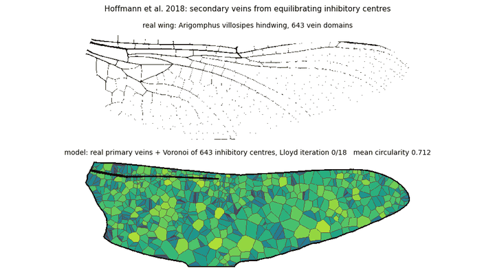

*What you see:* top, the real *Arigomphus villosipes* hindwing with its veins segmented; bottom, the model built on the same wing — the real primary veins are kept, and the secondary veins are the boundaries between inhibitory centres that start scattered at the real local density (iteration 0, ragged cells) and move to the centroid of their own cell at each Lloyd iteration until the pattern settles into the rounded, roughly hexagonal cells of a real wing (cell colour = circularity).

Audit note (2026-10-13, 77.8, the highest in the repo): 923 real vein domains reproduced; circularity real 0.712 vs model 0.867 (hexagonal ceiling 0.907). Needs `scikit-image` and `Pillow`.

**Reference:** Hoffmann J, Donoughe S, Li K, Salcedo MK, Rycroft CH (2018). A simple developmental model recapitulates complex insect wing venation patterns. *PNAS* 115(40):9905–9910. [DOI](https://doi.org/10.1073/pnas.1721248115). Code: [hoffmannjordan/insect-wing-venation-patterns](https://github.com/hoffmannjordan/insect-wing-venation-patterns).

### [thompson/1917-thompson-scarus-pomacanthus.py](./thompson/1917-thompson-scarus-pomacanthus.py)

Thompson's *Scarus* → *Pomacanthus* transformation (*On Growth and Form* 1917, p. 749, Figs. 375–376: "deform its rectilinear co-ordinates into a system of (approximately) coaxial circles … we obtain a very good outline of an allied fish") tested on real species rather than on his drawings. Thompson drew the grids by hand and left no way to fit them; a Cartesian grid whose lines become two pencils of coaxial circles is the image of the plane under a Möbius map, so his claim for this pair is a six-constant hypothesis that can be fitted by least squares to homologous landmarks. The script uses the 17 lateral-view landmarks of Claverie & Wainwright (2014) for 791 Indo-Pacific shore fishes (Friedman et al. 2019, Dryad, CC0, vendored and hash-checked in [`datasets/thompson/`](./datasets/thompson/)) — 22 *Scarus*, 9 *Pomacanthus* and 54 *Chaetodon* species — Procrustes-superimposes them, and fits the *Scarus* genus mean to the *Pomacanthus* genus mean with a similarity, an affine map, the Möbius map (isogonal coaxial circles), a Möbius∘affine map (oblique coaxial circles, which is what Fig. 376 is as drawn) and the exact thin-plate spline, with the spread of the species about their own genus means as the noise floor and all 3782 ordered pairs of genus means as context. Thompson's own figure is cropped from the public-domain Internet Archive scan (page 749 as the original JPEG-2000 leaf, hash-pinned) and placed beside the data.

```bash
python3 thompson/1917-thompson-scarus-pomacanthus.py                 # figures + GIF (fetches the 1917 page and two photographs on first run)
python3 thompson/1917-thompson-scarus-pomacanthus.py --no-scan --no-photos --csv fits.csv   # offline: landmarks only
```


*What you see:* the *Scarus* genus mean (17 landmarks joined into a body polygon, snout at the left) carried towards the *Pomacanthus* mean. Left, the best grid of Thompson's family — Cartesian lines bending into coaxial circles — and the fish it carries; at t = 1 the real *Pomacanthus* mean is drawn in dark red over it and the gap between them is what his transformation leaves unexplained. Right, the thin-plate spline, which fits the landmarks exactly: the grid the data actually demand, with the posterior body stretched dorso-ventrally and the fins displaced locally.

The result goes against the quotation. The genus means are 0.0312 Procrustes units apart; an affine map explains 31 % of that distance, the Möbius map 1 % (a conformal map cannot deepen the body, and *Pomacanthus* is 56 % deeper relative to its length by landmark extents, 0.38 → 0.59; the affine fit stretches by a singular-value ratio of 1.27), oblique coaxial circles 32 % — hardly more than the affine part — and the residual of 0.0256 is twice the spread of the *Pomacanthus* species about their own mean (0.0132). Fitted to 16 landmarks, the 8-parameter family predicts the 17th worse than a plain similarity does (0.0371 vs 0.0312). Among all genus pairs in the dataset, *Scarus* → *Pomacanthus* is at the 31st percentile for how much coaxial circles explain, so it is not even a favourable case; for *Scarus* → the 54 *Chaetodon* species the family explains a median 35 %. What remains is local — the anal-fin end, snout, dorsal-fin end and anal-fin origin carry the largest residuals — which is the kind of change Thompson's method was built to exclude. Caveats in [`datasets/thompson/README.md`](./datasets/thompson/README.md): fin-insertion landmarks rather than his body outline, genus means for his unnamed species, and two readings of "approximately coaxial circles". Of his four fish pairs this is the only one the dataset covers; *Diodon* is there but *Mola* is not.

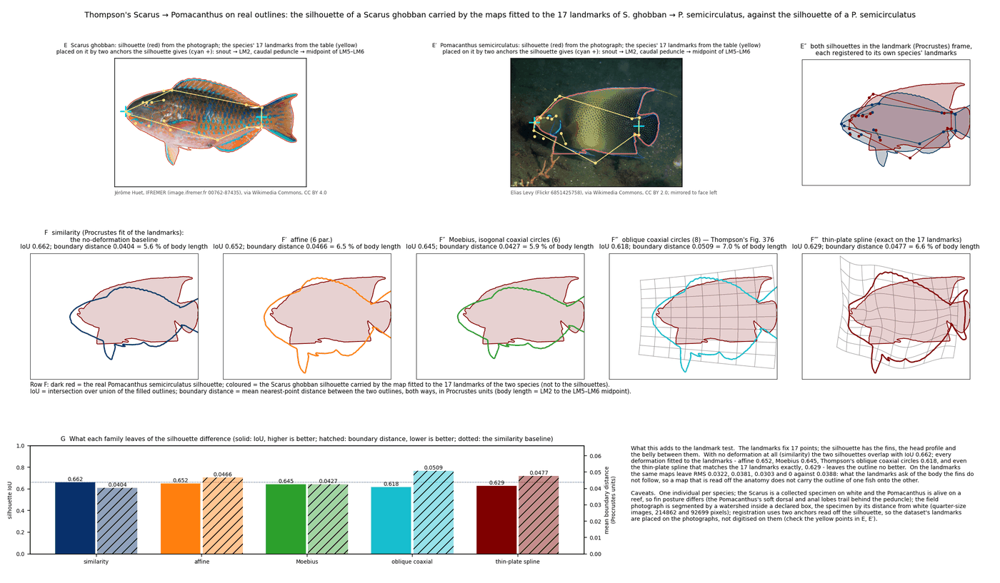

*On real outlines (added 2026-10-17):* Thompson deformed an outline, not landmarks, so the script also fetches two Wikimedia Commons photographs — a collected *Scarus ghobban* on white (J. Huet, IFREMER, CC BY 4.0) and a living *Pomacanthus semicirculatus* over sand (E. Levy, CC BY 2.0), hash-pinned, not vendored — segments their silhouettes, registers each to its own species' 17 landmarks by two anchors the silhouette gives (snout, caudal peduncle), fits the five maps to the landmarks of *S. ghobban* → *P. semicirculatus* and carries the parrotfish silhouette with each (row F). With no deformation at all the two silhouettes overlap with IoU 0.662; every map read off the landmarks leaves the outline no better — affine 0.652, Möbius 0.645, Thompson's oblique coaxial circles 0.618, and even the thin-plate spline that matches the 17 landmarks exactly 0.629 (mean boundary distance 5.6 % of body length for the similarity, 7.0 % for the coaxial circles). What the landmarks ask of the body the fins do not follow: the angelfish's soft dorsal and anal lobes trail behind the peduncle, which no smooth map of the parrotfish produces. One individual per species, a specimen against a living fish, and a segmentation inside a declared box are the caveats; `--no-photos` skips this part. Numbers in `thompson_outline_metrics.csv`.

*Resolution of the Silhouette Paradox across all 6 of Thompson's 1917 pairs and 4,334 dated divergences (added 2026-10-20; see [`docs/KEY_DISCOVERIES.md`](./docs/KEY_DISCOVERIES.md), [`docs/thompson_1917_fish_transformations_manuscript.pdf`](./docs/thompson_1917_fish_transformations_manuscript.pdf), [`thompson/1917-thompson-silhouette-area-paradox.py`](./thompson/1917-thompson-silhouette-area-paradox.py), and [`thompson/1917-thompson-four-families-atlas.py`](./thompson/1917-thompson-four-families-atlas.py)):* Why did the 17-landmark fit above worsen the *Scarus* $\to$ *Pomacanthus* silhouette (`IoU 0.662 → 0.618`, symmetric Area of Difference `|AΔB| 40.6% → 56.2%`)? Because $9/17$ landmarks ($53\%$ of the least-squares weight) sit in the anterior $\sim 25\%$ (skull/opercle) while $0\%$ sit on the external dorsal, anal, and caudal fin contours. When the **exact same 5- to 8-parameter Thompson coordinate families** are fitted directly to the 600-point continuous fish silhouettes (anchored only at Bookstein's two-point snout-to-peduncle baseline), $|A\Delta B|$ drops to **$28.5\%$** ($\mathrm{IoU} = \mathbf{0.749}$) on *Scarus* $\to$ *Pomacanthus*, **$17.2\%$** ($\mathrm{IoU} = \mathbf{0.839}$) on *Polyprion* $\to$ *Pristigenys*, **$35.5\%$** ($3.4\times$ reduction from $120.1\%$) on *Pristigenys* $\to$ *Scorpaena*, **$57.6\%$** ($2.5\times$ reduction from $143.7\%$) on *Scorpaena* $\to$ *Antigonia*, **$45.6\%$** on *Argyropelecus* $\to$ *Sternoptyx*, and **$49.0\%$** on *Diodon* $\to$ *Mola mola* — with $100\%$ positive Jacobian determinant ($\det D\Phi > 0$) across all six pairs. Across 4,334 time-calibrated divergences on the Rabosky et al. (2018) megaphylogeny, 8p Thompson grids reach the within-genus 17-landmark noise floor in $53.0\%\text{–}61.3\%$ of pairs below $50\text{ Myr}$ before collapsing across a sharp modular decoupling cliff at $t^* = 45.8\text{ Myr}$ ($n=187$ node-disjoint pairs) to $10.6\% \to 0.0\%$ above $50\text{ Myr}$.

MorphoEval audit `2026-10-17-thompson-audit` at commit `232e8f8`: **76.6** (model-fidelity 78, specimen-match 72, parameter-expressivity 55, morphometric-validation 86, source-traceability 92, code-traceability 80, repro-package 75), a re-score of `2026-10-16-thompson-audit` (70.2 at `3cf7f8c`: 72 / 55 / 55 / 82 / 90 / 78 / 75) after the real-outline test was added. The score is for the test, not for Thompson: the fitters are checked on synthetic maps before the real fit, every number is taken on real specimens with a noise floor and a held-out check, the inputs are hash-pinned, and the outline Thompson actually deformed is now carried and compared with a real one against an explicit no-deformation baseline. It is held down because there is one photographed individual per species in different postures (a collected specimen against a living fish), because the field silhouette depends on a declared box and shadow cut and the landmarks are placed on the photographs by two anchors rather than digitised on them, because his drawn grid is shown beside the fitted one rather than digitised and compared constant by constant, and because the constants are not swept one at a time. Overall claim: https://w3id.org/np/RAYFKAfyOnqIKXWzdEzCN_3zyX2KX_ijCXNX-ZVtBPeP8 (supersedes https://w3id.org/np/RAjJx_KHiAAaPSxjsoYOJaFSU1JYmDUswVaRLmka2NIM0).

**References:**
- Thompson DW (1917). *On Growth and Form*. Cambridge University Press, ch. XVII, pp. 748–751. Scan: [archive.org/details/ongrowthform1917thom](https://archive.org/details/ongrowthform1917thom) (public domain).
- Friedman ST, Martinez CM, Price SA, Wainwright PC (2019). The influence of size on body shape diversification across Indo-Pacific shore fishes. *Evolution* 73:1873–1884. [DOI](https://doi.org/10.1111/evo.13755). Data: Dryad [10.5061/dryad.fn457gr](https://doi.org/10.5061/dryad.fn457gr) (CC0).
- Photographs: Huet J / IFREMER, [*Scarus ghobban*](https://commons.wikimedia.org/wiki/File:Perroquet_barbe_bleue_(Scarus_ghobban)_(Ifremer_00762-87435).jpg) (CC BY 4.0); Levy E, [*Pomacanthus semicirculatus*](https://commons.wikimedia.org/wiki/File:Semicircle_angelfish_(Pomacanthus_semicirculatus).jpg) (CC BY 2.0); both via Wikimedia Commons, SHA-256 in [`datasets/thompson/README.md`](./datasets/thompson/README.md).
- Claverie T, Wainwright PC (2014). A morphospace for reef fishes: elongation is the dominant axis of body shape evolution. *PLoS ONE* 9(11):e112732. [DOI](https://doi.org/10.1371/journal.pone.0112732) (landmark definitions, Fig. 1).
- Bookstein FL (1989). Principal warps: thin-plate splines and the decomposition of deformations. *IEEE Trans. Pattern Anal. Mach. Intell.* 11:567–585. [DOI](https://doi.org/10.1109/34.24792)

### [models/2026-eshghi-odonata-wing-cells.py](./models/2026-eshghi-odonata-wing-cells.py)

Fossil and living dragonfly/damselfly wings compared on the one trait our venation model ([`2018-hoffmann-wing-venation.py`](./models/2018-hoffmann-wing-venation.py)) actually predicts: the size of the vein-bounded cells. Uses Eshghi, Buesch & Gorb's (2026) measurements of 69 fossil wings (22 extinct species, Solnhofen 147 Ma → Crato 116 Ma → Eocene 52 Ma) and 394 extant wings (204 species), with ages from the Paleobiology Database and Hoffmann et al.'s (2018) segmented North American wings as the extant counterpart (the two groups' independent segmentations agree to 3% on 42 shared species). Two families — Aeshnidae and Gomphidae — occur as Eocene fossils and as living species in the same tables.

```bash
python3 models/2026-eshghi-odonata-wing-cells.py --no-anim      # statistics, scaling figure, fossil re-segmentation
python3 models/2026-eshghi-odonata-wing-cells.py                # also the deep-time GIF (downloads ~100 MB once into .wing_cache/, SHA-256 checked)
python3 models/2026-eshghi-odonata-wing-cells.py --no-anim --no-resegment --no-crosscheck   # tables only, no downloads
```

The fossil half is not taken on trust: every one of the 69 fossil venation drawings in the archive is re-segmented from the pixels (vein ink skeletonised, enclosed regions = cells, scale read from each drawing's own scale bar) and compared wing by wing with Table S1. Cell counts agree to a median 0.0 % (90 % of wings within 2 %), median cell length to 3.4 %, largest cell to 0.9 %; the comparison also turns up one table row that does not match its drawing (#7 *Euarchistigma peterknobli*) and one swapped pair (#23/#24). Per-wing results are in [`datasets/odonata/fossil_wing_resegmentation.csv`](./datasets/odonata/fossil_wing_resegmentation.csv) and `odonata_fossil_resegmentation.png`.

Audit note (2026-10-14, 76.0): parameter expressivity is not applicable to a data analysis and is scored neutral; the strength is morphometric validation (85), the gaps are that the Hoffmann model is tested but not run here and scikit-image is not in `requirements.txt`.

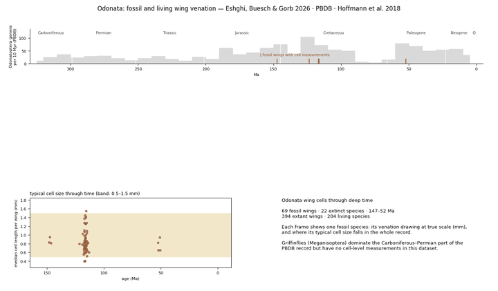

*What you see:* one fossil species per frame, oldest first (Solnhofen 147 Ma → Crato 116 Ma → Eocene 52 Ma): top, the Odonatoptera fossil record from the Paleobiology Database with the species' age marked; middle, its venation drawing from Eshghi et al.'s archive at true scale; bottom, the measured cell lengths of its wing against the 0.5–1.5 mm band that almost all cells, fossil or living, fall into. The closing frames show the living Aeshnidae and Gomphidae for comparison.

Findings as printed by the script: the median cell length per wing stays in a narrow band across 150 Myr and a 6× range of wing length (fossils 0.78 mm, IQR 0.67–0.94; extant 0.90–0.99 mm) and rises only as L^0.2–0.3, while the largest cells scale almost with the wing (L^0.8); cell counts scale as N ∝ L^1.8 in fossils but N ∝ L^1.0–1.1 in extant wings, versus L² for a strictly constant cell size. For the model this means the inhibition length is approximately, but not strictly, conserved. Outputs (git-ignored): `odonata_wing_cells_scaling.png`, `odonata_fossil_resegmentation.png` and `odonata_wing_cells_deep_time.gif` (each fossil species' venation drawing at true scale against the PBDB Odonatoptera record, ending with the extant Aeshnidae/Gomphidae). Data and provenance: [`datasets/odonata/`](./datasets/odonata/).

**References:**
- Eshghi S, Buesch A, Gorb S (2026). Critical Crack Length as an Evolutionary Constant in Odonata Wing Venation: Lessons from Fossils — Supplementary Material. Zenodo. [DOI](https://doi.org/10.5281/zenodo.19899648) (CC BY 4.0)
- Hoffmann J, Donoughe S, Li K, Salcedo MK, Rycroft CH (2018). A simple developmental model recapitulates complex insect wing venation patterns. *PNAS* 115(40):9905–9910. [DOI](https://doi.org/10.1073/pnas.1721248115)
- Paleobiology Database, Odonatoptera occurrences (accessed 2026-10-14). https://paleobiodb.org

### [models/2014-lobo-limbform-morphology.py](./models/2014-lobo-limbform-morphology.py)

The limb sibling of the Planform decoder ([`2013-lobo-planform-morphology.py`](#2013-lobo-planform-morphologypy), below). Limbform (Lobo, Feldman, Shah, Malone & Levin 2014) is the same lab's formal database of limb-regeneration experiments: 565 limb morphologies of salamanders (axolotl, newts), frogs (*Xenopus*), crustaceans (fiddler crab, crayfish, *Cancer* crabs), insects (cockroaches, cricket) and a spider, each encoded as a labelled graph, and Figure 1 of the *Regeneration* paper shows photograph, graph and software-drawn cartoon side by side for one species per category. This script reproduces the cartoon column for every morphology from the database alone. In Limbform's formalism limb segments are the graph *edges* (`Link`: type, length `Dist`, direction `Ang`, number of long bones), joints are the *vertices* carrying border radii (one per bisector of consecutive segments, or three at +90/+180/+270° for a terminal joint — the same rule as Planform's regions, satisfied by 3137 of the 3146 joints in LimbformDB 2.1.0 and checked at load time), sub-joints sit on a segment for grafts and ectopic limbs, and digits hang off a hand or foot segment with their own length, direction and phalanx count. The decoder lays the graph out from the labels, walks once around the limb tree collecting the joint radii in order into one closed smoothed outline, and colours it as in the paper's cartoons (proximal red → distal blue; arthropod coxa green and basis/trochanter yellow), drawing bones and digits for the tetrapods. 555 of the 565 rows have geometry; the other ten are outcome labels ("Lethal", "No limb", "Molted"). Non-tree encodings fall back to flat per-segment polygons.

The LimbformDB file (SQLite, 897 024 bytes, SHA-256 `9c26bf39…099f0`) is not vendored; `--download` fetches it from the Lobo lab into the git-ignored `.limbform_cache/` and checks the hash.

```bash
python3 models/2014-lobo-limbform-morphology.py --download               # gallery PNG + morphospace timeline GIF
python3 models/2014-lobo-limbform-morphology.py --ids 1 280 314 490 491  # the five Fig. 1 wild types
python3 models/2014-lobo-limbform-morphology.py --csv limb_morphospace.csv --no-anim
```

Outputs (git-ignored): `limbform_wildtype_gallery.png` (the Fig. 1 row — axolotl forelimb, *Xenopus* hindlimb, fiddler-crab walking leg, cricket T3 leg, huntsman-spider leg — plus ten further wild types: salamander hindlimb and stage-41 larva, frog forelimb and stage-51 hindlimb, *Cancer* claw, crayfish walking leg, fiddler-crab claw, cockroach legs, spider pedipalp), `limbform_morphospace_timeline.gif` (year-by-year first reports 1948–2013 of the 498 morphologies that appear as experimental results, ending with one morphospace grid per category), and an optional CSV of per-morphology measurements (segment and digit counts, proximodistal path length, bounding box, silhouette area, first-report year and species).

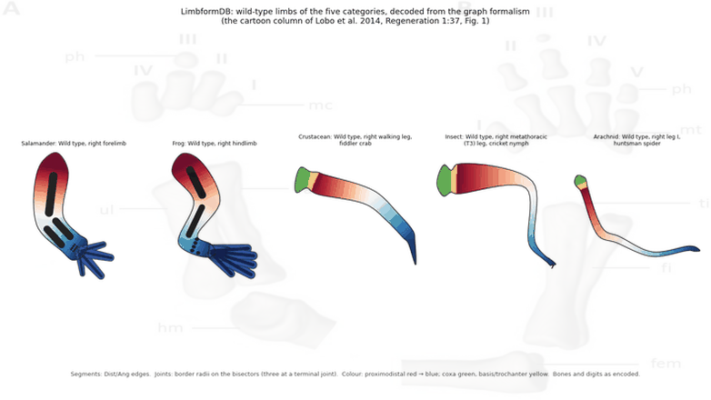

*What you see:* each frame shows the limb morphologies first reported in one year (1948–2013), drawn from the database's graph encoding: one smoothed outline per limb coloured proximal red → distal blue, with the arthropod coxa in green and basis/trochanter in yellow, long bones in black and digits in blue for the tetrapods. Normal limbs and experimental outcomes (double limbs, grafts, missing segments) appear as they were published; the closing frames arrange every category's morphologies as grids.

MorphoEval audit `2026-10-14-limbform-audit` at commit `747c57f`: **71.3** (model-fidelity 85, specimen-match 65, parameter-expressivity 75, morphometric-validation 55, source-traceability 85, code-traceability 75, repro-package 65). Against the paper's own Fig. 1 cartoons the five wild types have identical segment and digit counts and pose, but bounding-box-aligned silhouette IoU is only 0.41–0.74 (the frog thigh–shank angle differs most), so either the database was revised after the figure or an angle convention is not captured; that and a comparison with the photographs rather than the cartoons are the open remediation items.

**References:**
- Lobo D, Feldman EB, Shah M, Malone TJ, Levin M (2014). Limbform: a functional ontology-based database of limb regeneration experiments. *Bioinformatics* 30(24):3598-3600. [DOI](https://doi.org/10.1093/bioinformatics/btu582)
- Lobo D, Feldman EB, Shah M, Malone TJ, Levin M (2014). A bioinformatics expert system linking functional data to anatomical outcomes in limb regeneration. *Regeneration* 1(2):37-56. [DOI](https://doi.org/10.1002/reg2.13)

### [models/2015-santella-wormguides-celegans.py](./models/2015-santella-wormguides-celegans.py)

The nematode member of the four-views family (photograph, schematic, formal description, software model — the layout the Planform and Limbform decoders below use). For *C. elegans* the photograph/EM layer (WormAtlas), the schematic (Sulston's lineage chart), a formal layer and a running software model (OpenWorm/Sibernetic) all exist, but in separate projects, and the formal layer that is usually meant — the NeuroML connectome — is connectivity, not anatomy. The one formal description of embryonic *geometry* is the WormGUIDES atlas (Santella et al. 2015): the position, diameter and lineage name of every nucleus at every minute of a diSPIM recording (image series DISPIM_061416, strain JIM113, 360 frames), plus segmented single-cell meshes for a subset of cells. This script downloads those files from a pinned commit of the WormGUIDES repository (SHA-256 manifest in [`datasets/celegans/`](./datasets/celegans/)), decodes the StarryNite tables, checks that the 1330 names form the Sulston tree (all parse; every cell appears after its parent), re-derives the lineage chart from the names alone, draws the nuclei to scale at six stages and the cell meshes at one, and puts the OpenWorm c302 connectome (Cook et al. 2019 edge list, 300 neurons) beside them as the connectivity layer. The atlas coordinates carry no unit, so they are calibrated by setting the atlas's own eggshell outline mesh to the 50 µm egg length (Gönczy et al. 1999) — one assumption, stated on the figure; the shell's width (29 µm, not fitted) and the spread of the per-frame shell meshes (±3 %) are reported as checks.

```bash
python3 models/2015-santella-wormguides-celegans.py --download        # ~430 small files into the git-ignored .celegans_cache/
python3 models/2015-santella-wormguides-celegans.py --csv celegans_embryo_timeseries.csv
```

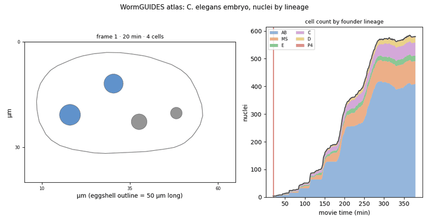

*What you see:* left, the embryo seen from above inside the atlas's eggshell outline, with every nucleus drawn at its recorded position and diameter (scale: the shell is 50 µm long) and coloured by the founder cell it descends from — AB blue, MS orange, E green (the future gut, which sinks inward at gastrulation), C purple, D yellow, P4 red (the germ line); right, the running cell count stacked by lineage, from 4 cells at minute 20 to ~580 at minute 379, with the red line marking the frame shown.

Outputs (git-ignored): `celegans_four_views.png` (lineage chart; nuclei by founder lineage at 4, 13, 28, 87, 360 and 580 cells; 51 cell meshes at frame 330; connectome adjacency matrix), `celegans_lineage_chart.png`, `celegans_embryo_timeline.gif` (120 frames: nuclei plus the cell count stacked by founder), and an optional per-frame CSV. Against Sulston's schedule as quoted by WormAtlas the cell-stage anchors agree (113 listed deaths, all in the movie; 562–571 nuclei at 330–350 min against ~550; gastrulation when the E cells ingress at 26 cells against the ~30-cell stage) but the clock does not: the atlas reaches gastrulation at movie-minute 73 against 100 min after first cleavage, a discrepancy the script reports and does not resolve. Details and sources: [`datasets/celegans/README.md`](./datasets/celegans/README.md).

MorphoEval audit `2026-10-16-celegans-audit` at commit `303a87e`: **70.2** (model-fidelity 80, specimen-match 62, parameter-expressivity 50 — not applicable to a data decoder, scored neutral —, morphometric-validation 72, source-traceability 85, code-traceability 75, repro-package 70), superseding the 2026-10-15 audit (67.7 at `2864784`). The re-score follows the calibration change: the scale is now anchored to the atlas's own eggshell mesh (0.1649 µm per unit; the nuclear-cloud estimate was 0.1617) with the shell width and the per-frame mesh spread as unfitted checks, and the audit records a dataset observation — the atlas reuses one static shell mesh for frames 1–~250 that the nuclei overrun by up to 19 units. Still open: no photograph or WormGUIDES panel beside the output, the 50 µm length itself (the acquisition voxel size is not in the repository), and the clock offset against Sulston's schedule. Overall claim: https://w3id.org/np/RAqDf8b5w5WNe3Chr8OWp5uUyU8U1Bz5BrbGdamyd4BOU (supersedes RASUT7ta…).

**References:**
- Santella A, Catena R, Kovacevic I, Shah P, Yu Z, Marquina-Solis J, Kumar A, Wu Y, Schaff J, Colón-Ramos D, Shroff H, Mohler WA, Bao Z (2015). WormGUIDES: an interactive single cell developmental atlas and tool for collaborative multidimensional data exploration. *BMC Bioinformatics* 16:189. [DOI](https://doi.org/10.1186/s12859-015-0627-8). Data: [zhirongbaolab/WormGUIDES](https://github.com/zhirongbaolab/WormGUIDES) (GPL-3.0).
- Sarma GP, et al. (2018). OpenWorm: overview and recent advances in integrative biological simulation of *Caenorhabditis elegans*. *Phil Trans R Soc B* 373:20170382. [DOI](https://doi.org/10.1098/rstb.2017.0382). Connectome: [openworm/c302](https://github.com/openworm/c302) (MIT), from Cook SJ, et al. (2019) *Nature* 571:63–71.
- Sulston JE, Schierenberg E, White JG, Thomson JN (1983). The embryonic cell lineage of the nematode *Caenorhabditis elegans*. *Dev Biol* 100:64–119. [DOI](https://doi.org/10.1016/0012-1606(83)90201-4)

### [models/2013-lobo-planform-morphology.py](./models/2013-lobo-planform-morphology.py)

Renders every planarian morphology in PlanformDB by decoding the Lobo–Malone–Levin graph formalism exactly. Region shapes are reconstructed from their encoded polar radii (0 links → right/anterior/left/posterior; 1 link → +90/+180/+270° from the edge; k ≥ 2 links → one radius per bisector of consecutive edges), region centres from the `RegionsLink` distance/angle labels, borders from `Ratio·Dist`, and eyes, brain lobes, pharynges and ventral nerve cords from the organ table. The decoding rule is checked at load time against all 1181 regions in planformDB 2.5.0. Rendering follows Planform's own cartoon convention (Fig. 1D of the Biology Open paper): control radii are joined by superellipse arcs that are rounded between free radii and near-square next to a border, giving one straight-sided body with flat region borders and rounded head/tail caps; head and tail colours fade towards the trunk, eyes are ovals with pupils, brain lobes and nerve cords are green, the pharynx is a tube. The formalism stores only three radii per head, so finer species-specific features (auricles, a triangular head) are not in the data and are not drawn.

```bash
export PLANFORM_DB_PATH=/path/to/planformDB_2.5.0.edb
python3 models/2013-lobo-planform-morphology.py                     # gallery PNG + morphospace timeline GIF
python3 models/2013-lobo-planform-morphology.py --ids 1 2 3 24 20   # specific morphologies
python3 models/2013-lobo-planform-morphology.py --csv morphospace.csv --no-anim
```

Outputs (git-ignored): `planform_morphology_gallery.png` (16 canonical phenotypes: wild type, double head, headless, cyclops, side heads, polarity reversed, …), `planform_morphospace_timeline.gif` (year-by-year first reports of each morphology against the cumulative catalogue, ending with all 359 dated morphologies as a morphospace grid), and an optional CSV of silhouette morphometrics (AP length, ML width, aspect, organ/region counts). The decoded wild type measures 557.6 × 119.8 Planform units (aspect 4.65) against 560 × 120 encoded in the database; 369 of the 372 morphology rows have geometry, all 369 are distinct encodings, and 167 have distinct body silhouettes (the rest differ only in organs).


*What you see:* the left panel counts the morphologies in PlanformDB by the year each was first reported (1898–2013); the right panels draw the morphologies first reported in that year, decoded from the database alone — body regions as smoothed outlines with head (red) and tail (blue) colours, eyes, brain lobes, nerve cords (green) and pharynges. The last frames lay out all 359 dated morphologies as one grid.

Audit note (2026-10-14, 66.5, up from 14.7 for the earlier convex-hull animation): remaining gaps are the absence of a specimen-level comparison and of a recorded hash/version for the external database.

**References:**
- Lobo D, Malone TJ, Levin M (2013). Towards a bioinformatics of patterning: a computational approach to understanding regulative morphogenesis. *Biology Open* 2(2):156-169. [DOI](https://doi.org/10.1242/bio.20123400)
- Lobo D, Malone TJ, Levin M (2013). Planform: an application and database of graph-encoded planarian regenerative experiments. *Bioinformatics* 29(8):1098-1100. [DOI](https://doi.org/10.1093/bioinformatics/btt088)
- Lobo D, Vico FJ, Dassow J (2011). Graph grammars with string-regulated rewriting. *Theoretical Computer Science* 412(45):6101-6111. [DOI](https://doi.org/10.1016/j.tcs.2011.07.004)

See [`datasets/planform/paper_citations.bib`](./datasets/planform/paper_citations.bib) for BibTeX citations.

#### [models/1900-planformDB_parser.py](./models/1900-planformDB_parser.py)

The original PlanformDB reader. Reads a local PlanformDB SQLite/EDB file (`PLANFORM_DB_PATH` or a positional argument) and extracts yearly time series — experiments per year (via `Experiment → Publication.Year`), publications per year, and distinct morphologies observed per year — into a gap-filled `pandas.DataFrame` and the timeline plot below. It also produces `planform_morphology_animation.gif`, which approximates each morphology as a convex hull of organ landmarks; that rendering was audited at 14.7/100 and has been superseded by `2013-lobo-planform-morphology.py` (this section), so use the parser for the time series and the 2013 script for morphology. [`explore_planform_schema.py`](./models/explore_planform_schema.py) dumps the database schema.

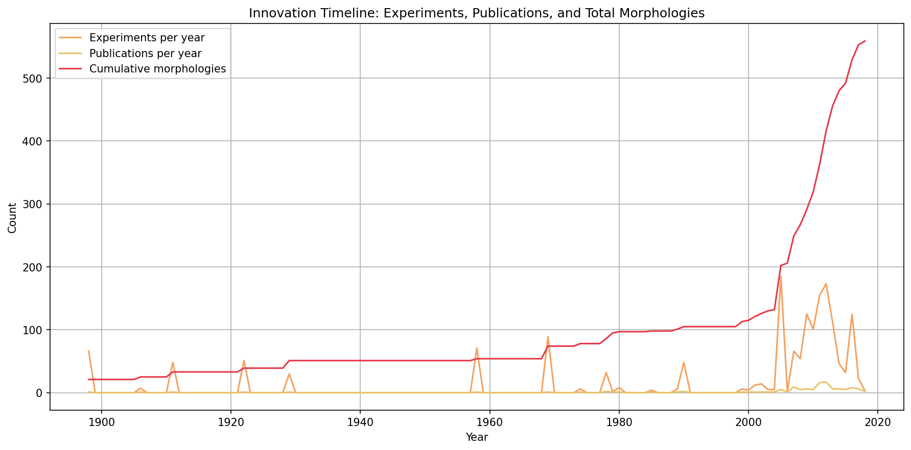

### [models/1966-raup.py](./models/1966-raup.py)

Raup's model of shell coiling (Raup & Michelson 1965, *Science* 147:1294, doi:10.1126/science.147.3663.1294; Raup 1966, *J. Paleontol.* 40:1178–1190, doi:10.2307/1301992). A generating curve (the aperture) is swept around a fixed axis while every dimension grows as a logarithmic spiral: W is the whorl expansion rate (each whorl is the previous one magnified by W), D the inner/outer-margin ratio of the generating curve (its relative distance from the axis), T the axial movement of the curve's centre per unit of its radial movement (T = 0 is planispiral), S the curve's shape. `1966-raup.py` draws a 3 × 3 slice (W against T) of the morphospace; `create_raup_animations.py` renders six illustrative forms and the parameter-space sheets.


*What you see:* six illustrative points in the morphospace — planispiral (cf. *Nautilus*), turreted (cf. *Turritella*), an evolute disc (cf. an ammonite), conical (cf. *Conus*), high-spired (cf. *Cerithium*), globose (cf. *Helix*) — as the viewpoint rotates from side to overhead. The parameter values are chosen so that each name is geometrically true; they are not Raup's measurements of those taxa (see [`datasets/raup/README.md`](./datasets/raup/README.md)).

Run `python create_raup_animations.py` to generate the animation, `raup_parameter_space.png` (W × D and W × T sheets), `raup_empirical_comparison.png` (the six panels as stills) and `raup_shell_metrics.csv` (W, D, T recovered from each rendered mesh beside the inputs, with height/width and spire/width). The script first recovers W, D, T from meshes on a 3 × 3 × 4 grid and refuses to draw unless they match to 1e-9 and the spire grows monotonically with T.

Audit note (2026-10-13, 37.3 → remediated 2026-10-17): the earlier version translated linearly in angle (`zc = T*theta`) while the whorls grew exponentially, so T had no visible effect and every panel was a flat disc; it also drew the generating curve in the horizontal plane (zero axial thickness) and scaled the axis offset so the rendered inner/outer ratio was (1+D)/(3−D) rather than D. The definitions in `datasets/raup/variables.json` that led to this ("vertical rise per radian") had been written without the paper and are replaced, with their provenance stated, by Raup's definitions as restated by Noshita (2014) and Okabe & Yoshimura (2017). Re-scored in audit 2026-10-17-raup (see the table below); [morpholib#1](https://github.com/fractastical/morpholib/issues/1).

### [models/2001-bressloff-v1-form-constants.py](./models/2001-bressloff-v1-form-constants.py)

Bressloff, Cowan, Golubitsky, Thomas & Wiener's (2001/2002) Euclidean symmetry-breaking model of primary visual cortex (V1) and Klüver's four geometric hallucination form constants (tunnels/funnels, spirals, cobwebs, honeycombs), paired with Rule, Stoffregen & Ermentrout's (2011) flicker-phosphene Floquet resonance tongues (`1:1` vs `2:1` stripes vs hex/spots):
1. **Marginal stability and branch selection (Bressloff et al. 2001 §4–5, Figs. 16–17, 37–40):** Fourier–Bessel lateral coupling with the Mexican-hat surround, even/odd orientation eigenbranches $\lambda_\pm(q)$ and the critical wavenumber $q^*$ from the perturbative scan, cross-checked against a direct diagonalisation of the exact orientation-space operator ($|m| \le 8$: $|\Delta\lambda| = 3\times10^{-4}$, $\Delta q^* = 0$) whose dominant harmonic *derives* the contoured ($m = 1$) versus non-contoured ($m = 0$, Ermentrout–Cowan limit) regime — the switch sits at local inhibition $A_{loc} \approx 0.24$–$0.25$ where $W_0^{loc} = W_1^{loc}$, and fixture presets that impose a non-critical harmonic or parity are flagged. Pattern selection uses the **full** cubic amplitude equations (Eqs. 5.9–5.15): $\gamma(\theta) = [3 s_3 \Gamma_3 - 2 s_2^2 Q]/N$ with sigmoid firing-rate derivative weights at baseline $\sigma_0$ and the quadratic feedback $Q$ through the linear resolvent, $\eta$-aware $\Lambda_r < \Lambda_h$ thresholds, and roll stability tested against every perturbation direction $\theta$ (Lean: `bressloff_roll_stable_iff`, `bressloff_fig38_roll_unstable`); at $\sigma_0 = \tfrac12$ the coefficients reduce to the upstream bare overlaps ($\gamma(60°)/\gamma(0)$ 0.4864 vs 0.4870), which is kept as the parity path. All five `stability_reports` and all 24 preset `runs` in [`datasets/bressloff/paper-calibration.json`](./datasets/bressloff/paper-calibration.json) are reproduced to $2.2 \times 10^{-16}$ — parity with the vendored MesmerPrism Rust implementation, not with digitised paper figures. The fixture's own paper-expectation checks are counted in full rather than hidden: 121/133 pass (`stability_reports` 10/11, `runs[].checks` 111/122), and every failure is listed in the CSV, the figure ledger and `--self-test` — the Fig. 40 odd-branch *triangle*→*honeycomb* failure is the $H_0/H_\pi$ degeneracy at cubic order ($\eta_{hex} = 0$); the `same-lattice-branch-*` failures on the square and hex presets are the same cubic-order limitation. Every gallery panel is badged against the unrestricted full-cubic selection (rhombic angle free): in the contoured regime rolls and squares are unstable for every $\sigma_0$ (rhombic ≈45–55° selected; the quadratic feedback does not rescue them), so the cobweb is **IMPOSED: unstable** and the honeycomb **STABLE, coexists** (margin 0.8%); in the derived non-contoured regime ($A_{loc} = 0.15$) rolls are stable against all $\theta$ (min $2\gamma/\gamma_0 - 1 = +0.92$) and **SELECTED**, so the gallery tunnel and spiral are now selected planforms, as is the rhombic column (3 selected / 1 stable / 1 imposed of 5). Where the nearly marginal uniform $K = 0$ mode dominates the resolvent ($\sigma_0 \ne \tfrac12$ in the $m = 0$ regime; 178 of 260 regime-map cells) the cubic truncation is flagged `near_resonant`/`subcritical` and no selection is reported; quintic terms and the mean-mode coupling of Matthews & Cox (2000) are not implemented, and the badge says so on the figure, in the GIF and in `bressloff_v1_metrics.csv`.
2. **Retino-cortical map and the form constants (Bressloff et al. 2001 §2; 2002 §1.1; Ermentrout & Cowan 1979):** $x = (\alpha/\epsilon)\ln(1 + \epsilon r/w_0)$ with, by default, the conformal angular coordinate $y = \beta\theta/\epsilon$ of 2001 §2 (`--retinal-map conformal`), under which the cortical torus closes exactly at every eccentricity and a periodic planform pulls back with **no seam** (0.00) while keeping its chirality (spiral 0.89 on a left–right/up–down reflection metric); the 2002 Eq. 1.1 coordinate $y = \beta r\theta/(w_0 + \epsilon r)$ is kept as `--retinal-map exact` and its seams — which earlier passes carried — are quantified on all four half-meridians (left meridian 11.0 full-field; `chiral-mirror` moves them to the vertical meridians, `bilateral-mirror` removes them but destroys chirality). $w_0 = 0.087$, $\epsilon = 0.051$ are the papers'; $\alpha = 3/\pi$, $\beta = 1.589/2$ are the upstream `params.rs` values and are labelled as such (`RETINO_CONSTANT_PROVENANCE`). The rendered wavevector is $|k| = q^*/d_{hyp}$ of the rendered branch with $k_x$ *and* $k_y$ quantised to integer cycles on the $L = 2\pi\beta/\epsilon$ torus (so the 45° spiral renders at 46.7° and the hexagon's 60° legs at 65°/115° — printed as morphometrics), and the contoured planforms are drawn as the signed envelope with the exact eigenfunction $u(\phi)$ plus an orientation field ($\arg\max_\phi$) of line elements in cortex and, via the tangent map $\phi_R = \phi + \theta_R$, in the visual field. Rolls, oblique rolls, squares and hexagons pull back to tunnels, spirals/funnels, cobwebs and honeycombs (Lean: `ermentrout_cowan_tunnel_rings`, `ermentrout_cowan_funnel_rays`, `ermentrout_cowan_log_spiral`).
3. **Empirical anchors — human cortical magnification (Horton & Hoyt 1991) and the papers' own scale:** the map's linear magnification $dx/dr = \alpha/(w_0 + \epsilon r)$ is compared with the human V1 law $M(E) = 17.3/(E + 0.75)$ mm/deg over 1–40° ([`datasets/bressloff/horton_hoyt_1991_magnification.json`](./datasets/bressloff/horton_hoyt_1991_magnification.json)): RMS relative error 6.8%, map-implied $A = \alpha/\epsilon = 18.72$ mm/deg and $E_2 = w_0/\epsilon = 1.71°$ against 17.3 and 0.75; fovea→90° extent 74.6 mm vs 83.0 mm. Against Bressloff et al. (2002 §1.1) the model's foveal magnification is 10.98 vs 11.5 mm/deg (−4.6%), and the parity presets' critical wavelength $\lambda_c = 8.7$–$9.0$ mm (11 cycles) is **3.1× longer** than the paper's 2.4–3.2 mm. The repo-added `paper_scale_tunnel` preset (lateral widths ÷ 3.3, $q$ scan to 6) tests whether the model can reach the paper's scale: $q^* = 4.84$, $\lambda_c = 2.60$ mm (in range), and 29 rings from the fovea to 90° on the $\alpha = 3/\pi$ map versus 32 on the Horton–Hoyt map (paper 30–36) — so the residual shortfall is the map's $\alpha$, not the wavenumber. Both are computed and printed in Panel D, the ledger and the CSV, not rescaled away.
4. **Rule et al. (2011) Floquet tongues — diagnostic overlay, not a reproduction:** the vendored [`rule-2011-floquet.json`](./datasets/bressloff/rule-2011-floquet.json) boundary curves (16 curves over 5 forcing amplitudes, shaded by amplitude) are drawn with their upstream status printed on the panel (`outside-threshold-diagnostic`, `calibration_claim_allowed = false`, domain-normalised RMS $\beta$ error 0.154 against a 0.10 threshold; no Floquet solver is run in this script; Lean: `rule_2011_harmonic_returns_each_period`, `rule_2011_period_doubling_even_odd`).
5. **Parameter sweeps, regime map, morphometrics and negative control:** `--sweep PARAM[:lo:hi:n]` (and Panel F) sweep the lateral surround width ($q^*$ 1.46 → 0.70 over $\hat\xi_{lat}$ 1.5–6), lateral inhibition ($q^*$ 0.05 → 1.00 over $I_{lat}$ 0–1), lateral spread (critical parity flips at $\theta_0 = 45°$ and $90°$), local inhibition $A_{loc}$ (critical harmonic flips at ≈ 0.275 and the selected family changes hexagonal → rhombic → roll/square) and the firing-rate baseline $\sigma_0$; Panel G is the $A_{loc} \times \sigma_0$ regime map (260 cells) with the $m = 0 \mid m = 1$ boundary, the selected family per reliable cell and the unreliable (subcritical / feedback-dominated) cells greyed out. 2D FFT ring wavenumber $k^*$ on the linear eigenmode superposition equals the rendered cycle count for all five families; the contoured hex rendering's peak at $k^* = 18$ is the $\sqrt{3}k$ difference ring of the `tanh`∘argmax envelope (power at $k/\sqrt{3}k/2k$ = 0.97/1.00/0.17, tested either way), not the fundamental. A normalised azimuthal discriminator ($c_4 - c_2$, $c_6 - c_2$) classifies rings/spiral as roll, cobweb as square, honeycomb as hexagonal and the fifth column as mixed/rhombic; the Gaussian-only control ($I_{lat} = 0$) has no interior dispersion peak and is cross-referenced to the vendored `driven-neural-fields-registry.json` (Tamekue, Prandi & Chitour 2024).

Output: `bressloff_v1_form_constants_morphospace.png` (4×5: cortical torus + retinal pullback gallery with selection badges and orientation line elements, marginal stability with the exact-operator branches, full-cubic $\gamma(\theta)$ curves, Floquet diagnostic, magnification + paper-scale pullback inset, provenance ledger, three $q^*$ sweeps and the regime map) and `bressloff_v1_metrics.csv`; `--self-test` runs 41 checks covering the above in ~100 s; `--no-show` for headless runs; `--retinal-map {conformal,exact}`, `--hemifield-mode {full-field,chiral-mirror,bilateral-mirror}` and `--sigmoid-baseline` change the rendering and the cubic analysis; `--preset ID` seeds `--sweep PARAM[:lo:hi:n]`, which prints a sweep table (exact $q^*$, critical harmonic, roll margin, SUBCRITICAL flags) and writes the CSV given by `--csv`; `--gif [PATH]` writes the animation below (default `docs/media/bressloff_v1_form_constants.gif`) from the same five presets and wavenumbers as the PNG (envelope rendering for the contoured presets).

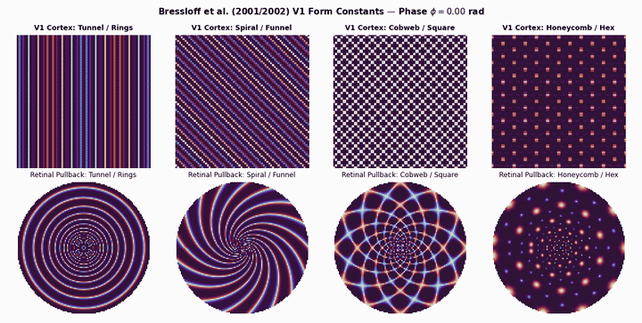

*What you see:* Klüver's four form-constant families plus the lattice the amplitude equations actually select, stepped through one at a time (1/5 Tunnel/Rings and 2/5 Spiral/Funnel from the derived non-contoured regime, both SELECTED; 3/5 Cobweb/Square IMPOSED-unstable; 4/5 Honeycomb/Hex STABLE-coexisting; 5/5 Rhombic SELECTED): left, the V1 cortical torus (fovea at the left edge) as its spatial phase drifts over one seamless cycle; right, its conformal retino-cortical pullback into the central 40° of the visual field, seamless across every meridian.

**References:**
- Bressloff PC, Cowan JD, Golubitsky M, Thomas PJ, Wiener MC (2001). Geometric visual hallucinations, Euclidean symmetry and the functional architecture of striate cortex. *Phil. Trans. R. Soc. Lond. B* 356(1407):299–330. [DOI](https://doi.org/10.1098/rstb.2000.0769)
- Bressloff PC, Cowan JD, Golubitsky M, Thomas PJ, Wiener MC (2002). What geometric visual hallucinations tell us about the visual cortex. *Neural Comput.* 14(3):473–491. [DOI](https://doi.org/10.1162/089976602317250861)
- Ermentrout GB, Cowan JD (1979). A mathematical theory of visual hallucination patterns. *Biol. Cybern.* 34(3):137–150. [DOI](https://doi.org/10.1007/BF00336965)
- Rule M, Stoffregen M, Ermentrout B (2011). A model for the origin and properties of flicker-induced geometric phosphenes. *PLoS Comput. Biol.* 7(9):e1002158. [DOI](https://doi.org/10.1371/journal.pcbi.1002158)
- Horton JC, Hoyt WF (1991). The representation of the visual field in human striate cortex: a revision of the classic Holmes map. *Arch. Ophthalmol.* 109(6):816–824. [DOI](https://doi.org/10.1001/archopht.1991.01080060080030)
- Tamekue C, Prandi D, Chitour Y (2024). A mathematical model of the visual MacKay effect. *SIAM J. Appl. Dyn. Syst.* 23(3):2138–2178. [DOI](https://doi.org/10.1137/23M1616686) — source of the Gaussian-kernel negative-control entry in the vendored registry.
- Klüver H (1966). *Mescal and Mechanisms of Hallucinations.* University of Chicago Press — origin of the four form-constant classes.
- Karácsony M, Holzapfel T. [MesmerPrism/bressloff-v1-form-constants](https://github.com/MesmerPrism/bressloff-v1-form-constants) (MIT), source of the SHA-pinned calibration fixtures in [`datasets/bressloff/`](./datasets/bressloff/) and of the $\alpha$, $\beta$ map constants (`rust-v1-sim/src/params.rs`).

MorphoEval 12-step loop `2026-10-19-bressloff-v1-loop` ([per-step telemetry](./morphoeval/runs/2026-10-19-bressloff-v1-loop.md): 12/12 steps, 47.7 min wall-clock, 294.7k LLM tokens). Pass 1 at `68c4a1a` (the script as written 2026-10-17): primary assessor Claude Fable 5.1 **53.0** (impl. 48.3, bio. 40.8, repro. 74.0), blinded second assessor Gemini 4 Argon (Google) 78.2, both run in parallel as subagents with no access to each other or to any prior audit. Both found independently that the parity test ignored the fixture's own failed Fig. 40 check, that the Rule (2011) panel was drawn from a fixture marked `calibration_claim_allowed = false` without saying so, that the rendered planforms were preset inputs (`wave_count`, `pattern`) rather than the model's $q^*$ and selected branch (retinal titles said `mode=spiral` over rings and cobwebs), that the m4/m6 "lattice discriminator" was ≈ 1 for pure rolls, and that no morphometric touched an empirical observation. Pass 2 (step 12, commit `9b18c52`) implemented all 11 remediation items — the exact two-regime map with analytic inverse and hemifield mirroring, $q^*$-derived torus-quantised wavenumber, surfaced fixture checks, global vs lattice-local selection in CSV and titles, the diagnostic label and RMS on the Floquet panel, the normalised discriminator, the GIF on the PNG's presets, the Horton & Hoyt (1991) magnification anchor, bibliographic/PMID/import fixes and a provenance-ledger panel — and was re-scored blind by both assessors: primary **62.8** (model-fidelity 72, specimen-match 56, parameter-expressivity 40, morphometric-validation 45, source-traceability 80, code-traceability 68, repro-package 85; impl. 61.3, bio. 51.9, repro. 78.8; +9.8), second assessor **79.2** (+1.0), panel mean 71.0. The remaining gap is honest rather than hidden: the four gallery presets impose rings/spiral/cobweb/honeycomb while the cubic amplitude equations select hexagons globally (printed under each panel), the fixture's `runs[].checks` hold 11 further upstream expectation failures the ledger does not count, the "contoured" rendering is a scalar max-over-orientation envelope rather than Bressloff's oriented line elements, and the parity is with a Rust port, not the paper — all 15 open findings were listed under `remediation` in [`morphoeval/audits/2026-10-19-bressloff-audit-v2.yaml`](./morphoeval/audits/2026-10-19-bressloff-audit-v2.yaml) (second assessor: [`…-second-assessor-audit-v2.yaml`](./morphoeval/audits/2026-10-19-bressloff-second-assessor-audit-v2.yaml)). **Pass 3** (`2026-10-19-bressloff-v1-loop-pass3`, [per-step telemetry](./morphoeval/runs/2026-10-19-bressloff-v1-loop-pass3.md); commit `d6f3c94`) fixed all 15: `runs[]` parity (24/24) with all 133 fixture checks counted, per-panel SELECTED / STABLE-coexisting / IMPOSED-unstable badges against the unrestricted cubic selection plus the rhombic column it actually selects, orientation-field line elements via the tangent map, the full-field pullback with the seam and mirror symmetry quantified (bilateral-mirror kept as a mode), $\alpha$/$\beta$ provenance moved to upstream `params.rs` with the papers' own scale anchors computed (the 3.1× wavelength gap is disclosed, not rescaled), the $2k$-harmonic explanation tested, dead `drift` removed and `--sweep` / Panels F–G added, Floquet amplitudes separated and "no solver" stated, the clamp/truncation and Lyapunov tie-break documented, the registry read and Tamekue 2024 / Klüver 1966 cited. Re-scored blind by fresh subagents against `d6f3c94`: primary **67.7** (model-fidelity 70, specimen-match 63, parameter-expressivity 52, morphometric-validation 55, source-traceability 84, code-traceability 72, repro-package 86; impl. 64.0, bio. 60.0, repro. 81.6; +4.9), second assessor **80.9** (76 / 74 / 76 / 79 / 93 / 91 / 93; +1.7), panel mean 74.3. The findings that remain are structural rather than presentational, and both assessors converged on them: the cubic coefficients are bare orientation-overlap integrals (no firing-rate derivative weights or quadratic feedback, Eq. 5.15), so rolls and squares are never stable and three of Klüver's four forms have to be imposed; no swept coupling parameter changes the selected lattice family; the full-field seam spans most of the 40° disc for oblique modes; the rendered wavelength is 3.1× the paper's; `contour_mode` is a preset flag rather than derived from the critical local harmonic; and `roll_stable` is evaluated at the preset angle rather than over all $\theta$ — see `remediation` in [`…-bressloff-audit-v3.yaml`](./morphoeval/audits/2026-10-19-bressloff-audit-v3.yaml) and [`…-second-assessor-audit-v3.yaml`](./morphoeval/audits/2026-10-19-bressloff-second-assessor-audit-v3.yaml). **Pass 4** (`2026-10-19-bressloff-v1-loop-pass4`, [per-step telemetry](./morphoeval/runs/2026-10-19-bressloff-v1-loop-pass4.md); commit `2aac102`; 88.4 min, 485.1k LLM tokens) took those structural findings as the specification: the exact orientation-space operator is diagonalised and its dominant harmonic derives the contoured/non-contoured regime (switch at $A_{loc} \approx 0.24$–$0.25$); the full Eq. 5.15 cubic coefficients are evaluated with sigmoid firing-rate derivative weights and the quadratic feedback through the linear resolvent, with roll stability tested against every $\theta$ and $\eta$-aware hexagon thresholds; the conformal complex-log map replaces the seamed exact map by default (seam 0.00, chirality kept); $k_x$ and $k_y$ are both torus-quantised; a paper-scale preset reaches $\lambda_c = 2.60$ mm and 29–32 rings; a regime map, two new sweeps and retinal morphometrics were added (self-test 27 → 41 checks). In the derived non-contoured regime rolls are stable and selected, so the gallery tunnel and spiral are now SELECTED (3 of 5 panels), while the contoured regime still never stabilises rolls or squares. Re-scored blind by fresh subagents against `2aac102`: primary **70.6** (model-fidelity 74, specimen-match 66, parameter-expressivity 62, morphometric-validation 58, source-traceability 84, code-traceability 74, repro-package 84; impl. 70.0, bio. 63.0, repro. 81.3; +2.9), second assessor **85.2** (82 / 80 / 86 / 84 / 93 / 89 / 93; +4.3, into the "faithful" band), panel mean 77.9. What both assessors now charge is narrower and mostly numerical: $k_y$ quantisation distorts the hexagon's 60° legs to 65°/115° (a 5.4° error the badge does not show), the full-cubic path is subcritical or feedback-dominated at every $\sigma_0 \ne \tfrac12$ where the gallery lives (so $\sigma_0$ adds no testable prediction without the Matthews–Cox mean-mode coupling), the harmonic-dominance test should use the conjugate-pair norm, the resolvent's critical-space projection misses near-resonant poles at $\theta = 55°/65°$, the honeycomb's "stable" badge rests on a 0.8% margin, the sweep summaries and `kluver_form_constant` CSV rows still log the perturbative $q^*$, and no coefficient is checked against the paper's own Fig. 37–40 curves — 15 findings (8 + 7) under `remediation` in [`…-bressloff-audit-v4.yaml`](./morphoeval/audits/2026-10-19-bressloff-audit-v4.yaml) and [`…-second-assessor-audit-v4.yaml`](./morphoeval/audits/2026-10-19-bressloff-second-assessor-audit-v4.yaml). 72 nanopubs (10 + 8 per pass; each version records `supersedes_audit_id` for the one before) are signed and verified in [`morphoeval/kg/2026-10-19-bressloff-audit*/`](./morphoeval/kg/) and [`…-second-assessor-audit*/`](./morphoeval/kg/), not yet published. Lean Section 14 of [`MathOfBiology.lean`](./morphoeval/lean/MathOfBiology.lean) carries the three laws (pullback classification, cubic roll/lattice boundary with the Fig. 38 instance by `decide`, Floquet ±1 return maps by induction). Data and provenance: [`datasets/bressloff/`](./datasets/bressloff/).

### [models/2021-Cervera–Levin–Mafe.py](./models/2021-Cervera–Levin–Mafe.py)

A reaction-diffusion demo inspired by Cervera–Levin–Mafe (2021), exploring morphogen antagonism and its effect on pattern formation. The model includes:
- Antagonistic morphogens (m1, m2) on an antero-posterior axis with mutual annihilation
- Independent morphogen (m3) on a lateral axis
- Gap-junction blocking effects modeled through diffusion reduction
- 3D morphospace visualization of mean expressions


*What you see:* top, the steady-state profiles of the two antagonistic morphogens along the anterior–posterior axis (m1 from an anterior source, m2 from a posterior one; they annihilate where they meet) and the wavefront x* where they are equal; bottom, the same as territories on a real planarian — the silhouette of a dorsal photograph of *Schmidtea mediterranea* (Stevenson & Beane 2010, PLoS ONE 5(12): e15310, via Wikimedia Commons, CC BY 2.5; fetched once into `.cervera_cache/`, SHA-256 pinned in the script; red = m1 dominates, blue = m2, brightness = the lateral morphogen m3 measured across the local body width). Until 2026-10-17 the body was an ellipse; it still is if the photograph cannot be fetched, and the panel title says so. The photograph is cropped at the ventral margin near mid-body, which is why the silhouette has a short straight edge there. As the gap-junction block cuts m2's diffusion from 1.0× to 0.4× of normal, the boundary shifts posteriorly, the model's reading of how bioelectric coupling moves positional-information boundaries. `python3 "2021-Cervera–Levin–Mafe.py" --gif out.gif`; without `--gif` the three interactive plots open.

MorphoEval audit `2026-10-17-cervera-audit` at commit `e71ca55`: **44.9** (model-fidelity 38, specimen-match 38, parameter-expressivity 35, morphometric-validation 25, source-traceability 78, code-traceability 42, repro-package 78). This is the first audit in the repository scored by a model from a different company than the one that wrote the code — `assessor: gpt-5.6-sol` (OpenAI), run as an independent agent that was given the rubric, the script and the fixtures and no opinions. Its findings, each pinned to lines: the advertised (f2, f3) morphospace is constant along f3 because the loop variable is never used, and its f2 = 0.58 phenotype boundary is drawn rather than derived; the CSV reconstructs each crop's wavefront as 0.50 + 0.26·shift after the shift was normalised by 0.13, so the reported displacement is exactly twice the simulated one; the crop‑specific f2 values, wound gains, time rescaling and the 0.55 head‑readout threshold that picks the double‑head cartoon are hand‑set without a cited calibration; the PlanformDB frequencies are plotted beside model indices with no fit or error; the real planarian is a backdrop, not measured; `--self-test`'s "trace parity" checks a port against another program's synthetic traces (tolerance 0.035, endpoints only), not biology; the full 2021 and 2020 papers were not accessible, so equation‑level fidelity is not asserted; and the PMID the script cites (34418508) is a different paper — the article is 34411690. Runs were byte‑identical. The six remediation items are in the audit; this score is the baseline.

*Fix pass (2026-10-17, after the audit):* the script now says in its docstring and figure titles that it is a qualitative analogue of the paper's antagonistic-morphogen idea plus a port of the rusty-matter circuit, not an implementation of the 2021 equations. The f3 axis is real: m3 is solved on the mediolateral axis with D3 = f3·D3,0 and summarised as the centre/edge ratio λ(f3) (0.20 → 0.01 over f3 = 1.0 → 0.3), and panel E shows the two independent curves rather than a surface. The bipolar criterion is derived instead of drawn: x*_b = 0.583 is the posterior end of the wild-type pharynx read from the PlanformDB organ table over the wild-type silhouette (the old code had hard-coded 0.58 without saying where it came from). The crop → f2 mapping is one fitted parameter, f2 = 1 − a·p with p the crop position (0, ⅓, ⅔, 1; the tail crop has no trunk cut and is held at f2 = 1), trained on Oviedo 2010's octanol series (a = 0.58, RMSE 4.2 points) and tested on the held-out innexin RNAi series (RMSE 23.5 points, r = 0.94) — both numbers printed on panel C and in the CSV. The CSV writes the solver's x* directly (0.500 / 0.520 / 0.546 / 0.583 / 0.500 for head / pre-pharyngeal / pharyngeal / post-pharyngeal / tail crops), and `--self-test` checks that it equals the solver's value. The photograph is measured, not decorative: the anterior share of the real body's area is computed per frame and plotted against x*. Port parity now compares every sampled frame (11 frames × 4 fields, max error 3.3e-2 at tolerance 0.035) and is labelled "port parity … not a biological validation". The PMID is corrected to 34411690. The 24 h mapping in panel D is still a rescaling and the panel says so. 

Re-score `2026-10-17-cervera-audit-v2` at commit `a0d6848`, same independent assessor (GPT‑5.6 Sol, OpenAI), superseding the first audit's nine nanopubs: **55.6** (model-fidelity 45, specimen-match 42, parameter-expressivity 58, morphometric-validation 48, source-traceability 82, code-traceability 60, repro-package 84; faithfulness 46.4, reproducibility 76.9). It confirmed as genuine fixes the analogue labelling, the active f3 axis, the direct CSV wavefronts, the measured silhouette, the full-frame parity and its labelling, the PMID and the expanded deterministic self-test (two runs byte-identical). It did not give much for what remains: the "derived" criterion still combines the Planform pharynx centre with the renderer's hard-coded 100-unit pharynx length, and the rule that an m1/m2 boundary past the pharynx means a double head has no cited source or test; the fit is one parameter on four points with a 23.5-point held-out error and no uncertainty; m3 is a signal axis, not a mapped anatomy; the outcomes are still two Planform cartoons; the 24 h mapping is illustrative. And it found two new defects the builder had missed: `f2_for_shift` bisected on a clipped index that can never exceed its target, so the printed threshold was f2 = 0.20 where the real crossing is 0.42 (visible in the figure the builder had looked at and passed), and panel D's legend carried hard-coded 85.8 % / 20.6 % readouts that the current simulation does not produce (91.8 % / 23.5 %). Both, plus the solver docstring that still attributed the equations to the paper, are fixed in the commit after `a0d6848` and `--self-test` now asserts the inverse; that commit has not been re-scored.

#### [models/planform_bioelectric.py](./models/planform_bioelectric.py) — the evidence layer (added 2026-10-18)

The audit's recurring complaint was that the PlanformDB frequencies the model is compared with were a hand-picked handful. `planform_bioelectric.py` makes the empirical side explicit and reusable: given the SHA-pinned `planformDB_2.5.0.edb` (it refuses any other file unless `--allow-unpinned-db`), it extracts nine bioelectric experiment series — Oviedo et al. 2010's octanol series by crop position (S1, the training set), their innexin-RNAi series (S2), Nogi & Levin 2005's heptanol series (S3), octanol onset and VNC-disruption timings (S4, S5), head-retaining fragments (S6), Beane et al. 2011's H⁺,K⁺-ATPase hyperpolarisation series (S7, S8) and Nogi et al. 2009's praziquantel series (S9) — into [`datasets/planform/planform_bioelectric_series_v1.json`](./datasets/planform/planform_bioelectric_series_v1.json) (63 records, 59 on-axis): experiment ids, sample counts, drug windows and outcome frequencies only, under the Lobo Lab notice, with no region geometry or free text so the database itself is not redistributed. Each record is flagged for the quirks found while reading the database (placeholder sample counts, zero regeneration periods, one experiment whose control semantics contradict another, unspecified drug windows), and five deliberately damaged copies under [`datasets/planform/damaged/`](./datasets/planform/damaged/) exist so that a consumer's self-test fails closed. The record shape is MesmerPrism/rusty-matter's `planformdb_derived_fixture.v1`, extended; `--self-test` checks the validator, parity with the 14 vendored rusty-matter records, the census, the negatives and byte-identical regeneration. Details and the series table: [`datasets/planform/README.md`](./datasets/planform/README.md).

```bash
python3 models/planform_bioelectric.py --db /path/to/planformDB_2.5.0.edb   # extract the fixture (byte-identical on regeneration)
python3 models/planform_bioelectric.py --validate datasets/planform/planform_bioelectric_series_v1.json   # no database needed
python3 models/planform_bioelectric.py --self-test
```

### [models/2013-chindapol-coral-flow.py](./models/2013-chindapol-coral-flow.py)

Chindapol et al.'s (2013) flow-driven growth of *Pocillopora verrucosa*. The paper couples polyp-based accretive growth to Navier–Stokes + advection–diffusion in 3D (COMSOL); this script makes a declared reduction to 2D diffusion-limited aggregation with drift, where the drift/diffusion ratio plays the role of the Péclet number, and recovers the paper's transition from symmetric branching (low Pe) to upstream-biased, compact colonies (high Pe). Outputs: `chindapol_coral_flow_morphospace.png` and `chindapol_coral_flow_morphospace_morphometrics.png` (branch-direction rose plots and surface/volume vs Pe); `--gif PATH` adds the growth replay below.

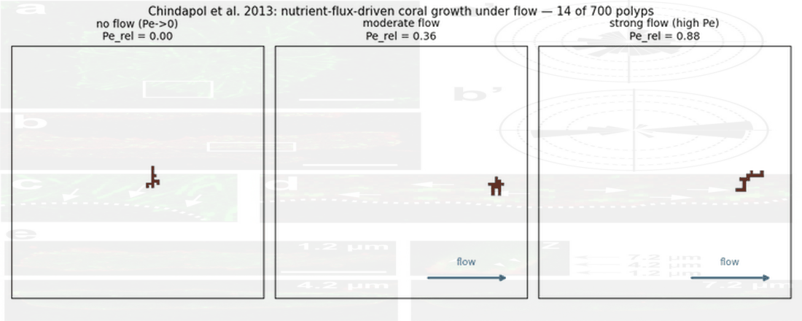

*What you see:* three colonies growing polyp by polyp from one seed, viewed from above, under no flow, moderate flow and strong flow (flow runs left to right; colour = age, dark old to pale new). Each new polyp is placed where a nutrient random-walker first touches the colony, so growth follows nutrient flux; with flow the walkers arrive from upstream and the colony leans into the current and compacts, which is the paper's result.

Audit note (2026-10-13, 55.5): the reduction is explicit, and the paper's symmetry magnitude and branch alignment are computed, but they are not compared numerically with the paper's Figs 9–12.

**Reference:** Chindapol N, Kaandorp JA, Cronemberger C, Mass T, Genin A (2013). Modelling growth and form of the scleractinian coral *Pocillopora verrucosa* and the influence of hydrodynamics. *PLoS Comput Biol* 9(1):e1002849. [DOI](https://doi.org/10.1371/journal.pcbi.1002849)

### [models/1952-turing-morpho.py](./models/1952-turing-morpho.py)

Turing's (1952) linear reaction–diffusion instability and $N=20$ ring-of-cells morphogenesis, Pearson's (1993) 12-class Gray–Scott $(k, F)$ phase space with exact Saddle-Node and Hopf bifurcation curves, and Kondo & Asai's (1995) biological skin-stripe and Y-junction morphogenesis in the marine angelfish *Pomacanthus*. Outputs: `turing_pearson_morphospace.png` (15-panel synthesis figure), `turing_pearson_metrics.csv`, and `docs/media/turing_gray_scott.gif`.

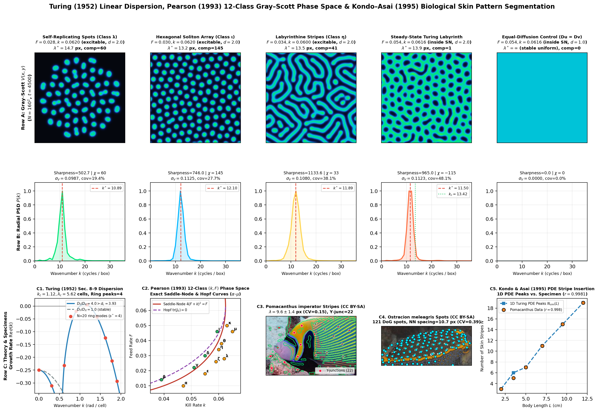


*What you see:* Row A integrates five 2D Gray–Scott regimes ($N=160^2, t=4500$) — Pearson's single-patch self-replicating spots ($\lambda$), hexagonal soliton packing ($\iota$), labyrinthine stripes ($\eta$), a genuine steady-state Turing labyrinth inside the Saddle-Node boundary ($F=0.054, k=0.0616, D_u=0.20, D_v=0.10, \sigma(k_c)=+0.00164$), and its matched steady-state equal-diffusion negative control ($D_u=D_v=0.20, \sigma=-0.00224, \sigma_V=1.91\times 10^{-7}$). Row B plots the sub-bin parabolic 2D radial power spectrum $P(k)$ and compares the nonlinear labyrinth wavelength ($\lambda^*=13.92\text{ px}$) against the analytical linear Turing wavelength ($\lambda_c=11.92\text{ px}$). Row C shows (C1) Turing's (1952) Sections 8–10 dispersion relation $\sigma(k^2)$ and $N=20$ ring modes ($d_c=3.9271, \lambda_c=5.62\text{ cells}$, dominant mode $s^*=4$), (C2) Pearson's exact Saddle-Node ($4(F+k)^2=F$) and Hopf ($\operatorname{tr}(J_0)=k-V_+^2=0$, $\max |\operatorname{tr}(J_0)| = 2.36\times 10^{-16}$) curves with all 12 pattern classes ($\alpha$–$\mu$), (C3) segmented yellow/blue skin stripes ($\lambda=9.55\text{ px}, \text{CV}=0.149$) and 22 Y-branch dislocations on an adult *Pomacanthus imperator* specimen (CC BY-SA 4.0), (C4) 121 segmented Difference-of-Gaussians Turing spots on a spotted boxfish *Ostracion meleagris* (CC BY-SA 4.0), and (C5) a white-noise-initialized 1D Turing PDE across growing domains ($r=0.9981$ against Kondo & Asai's empirical stripe counts).

MorphoEval audit `2026-10-19-turing-audit-v2`: **85.5** consensus (`91.9` primary Gemini 4 Argon; `79.1` independent second assessor Claude Sonnet 5.5 High, up from `25.1` in Pass 1; [full 12-step walkthrough](./morphoeval/runs/2026-10-19-turing-morpho-loop.md) · [closed-loop diagram](./docs/media/turing_morpho_closed_loop.png) · [animated GIF](./docs/media/turing_morpho_closed_loop.gif)).

### [thompson/1917-thompson.py](./thompson/1917-thompson.py)

A demonstration of D'Arcy Thompson's theory of transformations from *On Growth and Form* (1917), showing how one shape can be deformed into another through mathematical transformations. This classic work established the foundation for mathematical biology and the study of biological form.

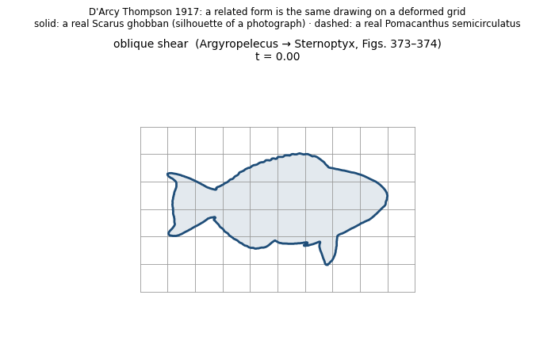

*What you see:* a real fish — the silhouette of a *Scarus ghobban* photograph (Wikimedia Commons, Huet/IFREMER, CC BY 4.0; segmented by the script above, which pins the file's SHA-256) — drawn on a square grid; the grid is deformed by four of Thompson's transformation families (the oblique shear of *Argyropelecus* → *Sternoptyx*, the coaxial circles of *Scarus* → *Pomacanthus*, a fan of coordinates as in *Polyprion* → *Pseudopriacanthus*, a radial expansion as in *Diodon* → the sunfish) and the fish follows the grid. In the coaxial panel the silhouette of a real *Pomacanthus semicirculatus* (Levy, CC BY 2.0) is drawn dashed as the target, placed where the deformed parrotfish lands. The deformation strengths are Thompson's illustrative ones, not fitted; the fitted maps, scored on landmarks and outlines, are the script above. Until 2026-10-17 the fish here was a hand-drawn ellipse with a tail and fin. `python3 thompson/1917-thompson.py --gif out.gif`; without `--gif` a two-panel toy applies the coaxial-circle map to the same silhouette (until 2026-10-16 that toy applied the same polynomial to both coordinates, which collapses every shape onto a line; fixed). If the photographs cannot be fetched the script falls back to the stylised fish and says so in the title.

Thompson-focused notes and dataset curation are in:
- [`thompson/DARCY_THOMPSON_FOCUSED_OPTIONS.md`](./thompson/DARCY_THOMPSON_FOCUSED_OPTIONS.md)
- [`thompson/MODERN_DATASETS_THOMPSON_ALIGNED.md`](./thompson/MODERN_DATASETS_THOMPSON_ALIGNED.md)
- [`thompson/generate_tps_transformation_panels.py`](./thompson/generate_tps_transformation_panels.py) and [`thompson/ingest_dryad_morphometrics.py`](./thompson/ingest_dryad_morphometrics.py) for thin-plate-spline panels from modern landmark data

### [models/2010-petroff-stromatolite.py](./models/2010-petroff-stromatolite.py)

Petroff et al.'s (2010) biophysics of conical stromatolites: (1) the spacing law ℓ = α√(Dτ), which makes a ~1 cm spacing between neighbouring cones a fingerprint of a ~daylength photosynthetic rhythm and packs cones onto a hexagonal lattice, and (2) a dome-vs-cone morphospace from the deterministic KPZ growth law ∂h/∂t = v + λ(1 + ½(∂h/∂r)²), where β = v/λ sets the aspect ratio. Output: `petroff_stromatolite_morphospace.png`; `--gif PATH` adds the animation below.

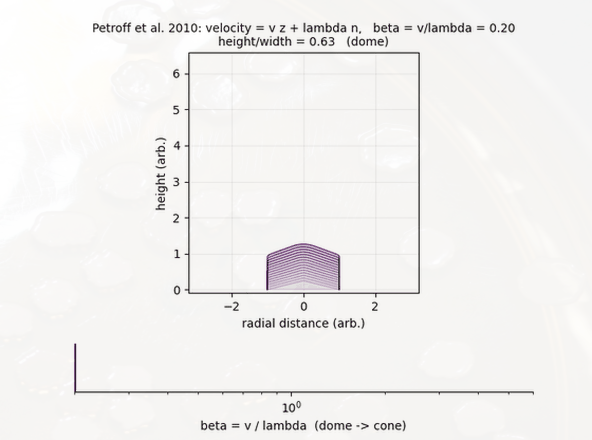

*What you see:* a stromatolite cross-section grown lamina by lamina from a small seed under velocity = v·ẑ + λ·n̂ (vertical phototactic growth plus surface-normal mineral accretion), while the ratio β = v/λ sweeps 0.2 → 6 along the bar below: low β rounds the seed into a dome, high β extrudes a sharp cone. The curves are successive laminae, as in a vertical thin-section.

**Reference:** Petroff AP, Sim MS, Maslov A, Krupenin M, Rothman DH, Bosak T (2010). Biophysical basis for the geometry of conical stromatolites. *PNAS* 107(22):9956–9961. [DOI](https://doi.org/10.1073/pnas.1001973107)

### [models/2024-kahng-coral-geometry.py](./models/2024-kahng-coral-geometry.py)

Kahng, Odle & Wakeman's (2024) geometry of reef-coral colonies. A colony lays down skeleton at a per-area calcification rate G, so volume grows as V(t+1) = V(t) + G·S(t)/ρ; whether linear extension and surface-area productivity are size-dependent is then decided entirely by how the surface-to-volume ratio changes with size. The script reconstructs these relationships for the paper's four canonical shapes (hemispheroid, fixed-aspect cone, flat disc of fixed thickness, cylinder of fixed branch diameter). Output: `kahng_coral_geometry_morphospace.png`; `--gif PATH` adds the animation below.

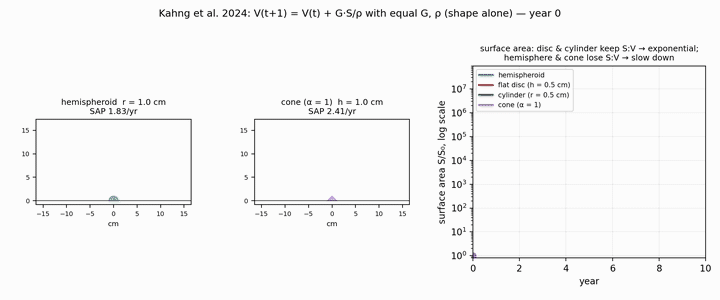

*What you see:* the growth rule V(t+1) = V(t) + G·S/ρ iterated year by year with the same G and ρ for every shape, so only geometry differs. Left, the hemispheroid and the cone drawn to scale: their surface-to-volume ratio falls as they grow, so their extension plateaus and their surface-area productivity (SAP) drops. Right, surface area against time on a log axis: the flat disc and the fixed-diameter cylinder keep S:V constant and grow exponentially — the paper's size-independent SAP — while the two massive shapes level off.

**Reference:** Kahng SE, Odle E, Wakeman KC (2024). Coral geometry and why it matters. *PeerJ* 12:e17037. [DOI](https://doi.org/10.7717/peerj.17037). Code: [ericodle/coral_geometry_modeling](https://github.com/ericodle/coral_geometry_modeling).

### [sorting-morphogenesis/](./sorting-morphogenesis/)

Zhang, Goldstein & Levin's (2025) model of autonomous cell-view sorting morphogenesis: 1D arrays of cells that sort themselves locally by Bubble, Insertion or Selection rules without a central controller, navigating around passive (`movable`) and stuck (`immovable`) frozen defects, exhibiting Delayed Gratification (temporary increases in monotonicity error followed by larger reductions), and spontaneously segregating by algotype in chimeric arrays. Includes deterministic seed-locked paired A/B lane comparisons (`--compare-ab`) and a 4-tier claim-boundary catalog ([`sorting-morphogenesis/catalog.json`](./sorting-morphogenesis/catalog.json)).

```bash
python3 sorting-morphogenesis/sorting_morphogenesis.py                  # self-tests + quick replication summary
python3 sorting-morphogenesis/run_experiments.py --n 100 --reps 15      # full 8-figure suite in sorting-morphogenesis/figures/
python3 sorting-morphogenesis/run_experiments.py --compare-ab --n 100   # seed-locked paired A/B comparison + CSV
python3 sorting-morphogenesis/run_experiments.py --gif zhang.gif --gif-only
```


*What you see:* top-left, autonomous Selection vs Bubble cell arrays ($n = 36$) sorting around two immovable frozen defects (red outlines) — Selection jumps across the defects to near-zero error while Bubble is blocked locally; bottom-left, a 50/50 Bubble + Selection chimera with duplicate values $1..9$ where equal-valued cells spontaneously segregate by algotype (blue = Bubble, orange = Selection); right, the monotonicity-error trajectory with Delayed Gratification excursions and the algotype aggregation curve rising from the `0.50` random baseline to `~0.72`.

*Replication findings ($n = 100$, [`sorting-morphogenesis/README.md`](./sorting-morphogenesis/README.md), reported upstream in [Zhangtaining/cell_research#2](https://github.com/Zhangtaining/cell_research/issues/2)):* all quantitative claims in Sections 4.1–4.4 reproduce — Bubble and Insertion perform the same swap count as top-down ($\binom{n}{2}/2 \approx 2,482$) with **1.55×** and **2.04×** fewer total comparisons+swaps (paper: `1.50×`, `2.03×`); Selection performs **11.05×** more swaps (`1,046.9` vs `94.7`, paper: `~11×`) when `MultiThreadCell.swap()` resets `ideal_position` to `0` on each swap, and **1.18×** more total operations (paper: `1.17×`) when `ideal_position` persists; Selection achieves lower final error on immovable frozen defects (`1.00, 1.95, 2.95` vs `1.80, 3.75, 5.10` for $f=1..3$, Fig. 5C) because its `ideal_position` pointer swaps non-locally across barriers; Insertion avoids halting behind a frozen defect via an explicit prefix-reset rule (`InsertionSortCell.is_enable_to_move` L68–82); Delayed Gratification in Bubble rises monotonically with $f=0..3$ (`0.38 → 0.51` vs traditional `< 0.23`, Fig. 7A); chimeric arrays (`B+S`, `I+S`, `B+I`) peak at `0.635–0.640` algotype aggregation on unique values (Fig. 8A) and stay permanently segregated (`0.698` and `0.661`, Fig. 8D) on duplicate values `1..10`; and opposite-direction chimeras follow the paper's `Bubble > Selection > Insertion` sortedness hierarchy (`B+I = 75.6%`, `B+S = 47.3%`, `I+S = 40.6%`, Figs. 9–10).

**Reference:** Zhang T, Goldstein A, Levin M (2025). Classical sorting algorithms as a model of morphogenesis: Self-sorting arrays reveal unexpected competencies in a minimal model of basal intelligence. *Adaptive Behavior* 33(1):25–54. [DOI](https://doi.org/10.1177/10597123241269740). Code: [Zhangtaining/cell_research](https://github.com/Zhangtaining/cell_research) (pinned commit `1fd2bd59`; replication notes in [issue #2](https://github.com/Zhangtaining/cell_research/issues/2)).

---

## Part 3 — Data Sources, Extending the Repository & Analysis Tools

### Data sources

Every script's inputs are either **vendored** in `datasets/<name>/` or **fetched on first run** into a git-ignored `.<name>_cache/`, and in both cases pinned by SHA-256 so a changed file is refused. Nothing is hand-copied from a figure without saying so, and no proprietary or unlicensed file is in the repository. The table is the complete list as of 2026-10-19; each folder's `README.md` has the exact file names, sizes, hashes, query URLs and retrieval dates.

| folder | used by | what the source is | how it is obtained | licence |
|---|---|---|---|---|
| [`datasets/thompson/`](./datasets/thompson/) | `thompson/1917-thompson-scarus-pomacanthus.py`, `thompson/1917-thompson.py` | 17 lateral landmarks for 791 Indo-Pacific shore-fish species (Claverie & Wainwright 2014 via Friedman et al. 2019, Dryad `10.5061/dryad.fn457gr`); page 749 of the 1917 *On Growth and Form* as the Internet Archive JPEG-2000 leaf; photographs of *Scarus ghobban* (Huet/IFREMER) and *Pomacanthus semicirculatus* (Levy) from Wikimedia Commons | CSV vendored (Dryad sits behind a browser challenge); scan and photographs fetched into `.thompson_cache/`, pinned | CC0; public domain; CC BY 4.0 / CC BY 2.0 |
| [`datasets/odonata/`](./datasets/odonata/) | `2026-eshghi-odonata-wing-cells.py` | Eshghi, Buesch & Gorb 2026 Tables S1–S3 (463 wings) with GBIF families and Paleobiology Database ages added; 22 fossil taxa's PBDB age records; 1762 PBDB Odonatoptera occurrences; the 69 fossil venation drawings (Zenodo `10.5281/zenodo.19899648`, ~90 MB) and Hoffmann et al.'s segmented North American wings (10 MB) | tables vendored with provenance lines (GBIF/PBDB queried 2026-10-14); the two archives fetched into `.wing_cache/odonata/`, pinned; `--zenodo-zip` / `--hoffmann-tar` accept local copies | CC BY 4.0 (Zenodo, PBDB); GBIF API |
| (no folder) `.wing_cache/` | `2018-hoffmann-wing-venation.py` | one segmented hindwing of *Arigomphus villosipes* from [hoffmannjordan/insect-wing-venation-patterns](https://github.com/hoffmannjordan/insect-wing-venation-patterns) | fetched into `.wing_cache/` on first run | authors' repository |
| [`datasets/planform/`](./datasets/planform/) | `2013-lobo-planform-morphology.py`, `1900-planformDB_parser.py`, `planform_bioelectric.py`, `2021-Cervera–Levin–Mafe.py` | PlanformDB 2.5.0 (Lobo, Malone & Levin 2013; 372 planarian morphologies as labelled graphs); derived fixtures: the nine bioelectric experiment series (`planform_bioelectric_series_v1.json`, with five damaged negatives), canonical silhouettes, and the 14 Oviedo-2010 result sets, planarian circuit traces and literature targets vendored from [MesmerPrism/rusty-matter](https://github.com/MesmerPrism/rusty-matter); renderer-neutral 2D exports (`planform_implicit_slice_2d.json`, `cervera_field_overlay_2d.json`) | the `.edb` is **not** vendored (it ships with Planform from the Lobo lab; `PLANFORM_DB_PATH`); its SHA-256 and size are in `planformDB.sha256` and every consumer checks them (`--strict-db` / pinned-only extraction); fixtures vendored | Lobo Lab notice (research/educational use with citation; reproduced in the fixtures); rusty-matter MIT OR Apache-2.0 |
| (no folder) `.limbform_cache/` | `2014-lobo-limbform-morphology.py` | LimbformDB 2.1.0 (Lobo et al. 2014; 565 limb morphologies, SQLite, 897,024 bytes) | `--download` fetches it from the Lobo lab, pinned by SHA-256 in the script | Lobo Lab notice |
| [`datasets/celegans/`](./datasets/celegans/) | `2015-santella-wormguides-celegans.py` | WormGUIDES atlas (Santella et al. 2015): nuclear positions, diameters and lineage names for 360 frames of diSPIM series DISPIM_061416 plus cell and eggshell meshes, from a pinned commit of [zhirongbaolab/WormGUIDES](https://github.com/zhirongbaolab/WormGUIDES); the OpenWorm c302 connectome edge list (Cook et al. 2019) from a pinned commit of [openworm/c302](https://github.com/openworm/c302) | nothing vendored; `--download` fetches ~430 files into `.celegans_cache/` and checks them against `pinned_inputs.sha256` | GPL-3.0 (WormGUIDES); MIT (c302) |
| [`datasets/raup/`](./datasets/raup/) | `1966-raup.py`, `create_raup_animations.py` | Raup's parameter definitions as restated with equations by Noshita 2014 and Okabe & Yoshimura 2017 (the 2025 extraction, written without the paper, is kept as a log with a notice); six illustrative parameter sets; paper-figure comparison stills; an exported `SurfaceMesh3D` bundle of the rendered shells | all vendored; there is no external dataset — the open item is to pin the definitions to Raup 1966 itself | — |
| [`datasets/conus/`](./datasets/conus/) | `1984-wolfram-conus-textile-rule30.py` | two *Conus textile* photographs from Wikimedia Commons (James St. John / OSU; Richard Ling); the reference fixture derived from them (specimen silhouette, dorsal white-tent chord statistics) and the first 128 bits of OEIS A051023 | fixture vendored; photographs fetched by `--download` into `.conus_cache/`, pinned; the script runs offline on the fixture | CC BY 2.0; public domain |
| [`datasets/phyllotaxis/`](./datasets/phyllotaxis/) | `1979-vogel-phyllotaxis.py` | Swinton, Ochu & MSI Turing's Sunflower Consortium 2016 Tables 1–4 (768 parastichy counts, 368 pairs, 657 capitula; Dryad `10.5061/dryad.f9k77`) with Schoute 1938 and Weisse 1897; Vogel / Douady–Couder equations; two *Helianthus annuus* capitulum photographs from Wikimedia Commons | all vendored (photographs 399 kB and 63 kB), SHA-256 checked by `--self-test` | CC BY 4.0 (tables/equations as transcribed); CC BY-SA 2.0 / 3.0 (photographs) |
| [`datasets/venation/`](./datasets/venation/) | `2005-runions-leaf-venation.py` | Runions et al. 2005 Table 1 (15 venation regimes); Price, Knox & Brodribb 2013 Horton–Strahler scaling over 349 cleared leaves; Katifori & Magnasco 2012 / Ronellenfitsch et al. 2015 loop-nesting benchmarks; a *Ginkgo biloba* leaf and a dicot vein skeleton from Wikimedia Commons | all vendored, SHA-256 checked by `--self-test` | CC BY-SA 3.0 (photographs) |
| [`datasets/bressloff/`](./datasets/bressloff/) | `2001-bressloff-v1-form-constants.py` | calibration reports (Bressloff et al. 2001/2002 marginal-stability scans and planforms; Rule et al. 2011 Floquet tongues) from a pinned commit of [MesmerPrism/bressloff-v1-form-constants](https://github.com/MesmerPrism/bressloff-v1-form-constants) (after karacsm/V1-sim) | vendored, SHA-256 pinned | MIT |
| (no folder) `.cervera_cache/` | `2021-Cervera–Levin–Mafe.py` | a dorsal photograph of *Schmidtea mediterranea* (Stevenson & Beane 2010, PLoS ONE, via Wikimedia Commons) whose silhouette the territories are drawn on and measured against | fetched on first run, SHA-256 pinned in the script; falls back to an ellipse and says so | CC BY 2.5 |
| [`sorting-morphogenesis/catalog.json`](./sorting-morphogenesis/catalog.json) | `sorting-morphogenesis/` | the authors' code, [Zhangtaining/cell_research](https://github.com/Zhangtaining/cell_research) at commit `1fd2bd59`, read to settle rule semantics; a 4-tier claim-boundary catalogue of what the paper reports vs what the replication reconstructs | nothing copied; catalogue vendored | — |
| [`datasets/frog_embryo_data_processed/`](./datasets/frog_embryo_data_processed/) | `wave-vector-analysis/` | per-embryo segmentation masks (`*_mask.npz`), one folder per imaging zoom, for the Ca²⁺ wave detection summary | masks vendored; the raw GCaMP TIFF stacks they were made from are **not** in the repository | lab data |

Scripts with no external data (`1952-turing-morpho.py`, `2010-petroff-stromatolite.py`, `2013-chindapol-coral-flow.py`, `2024-kahng-coral-geometry.py`) run from the papers' equations alone, and the *Conus* script builds its own Raup shell mesh rather than reading `datasets/raup/`. Live services are used only at build time and their results vendored with the query and date: GBIF species match and the Paleobiology Database (Odonata families and ages) and Nanopub Query (resolving the heads of version chains before superseding). Two instances where the data did not match its source are recorded rather than silently corrected: Eshghi et al.'s Table S1 row #7 and swapped pair #23/#24 ([`datasets/odonata/NOTE_TO_AUTHORS.md`](./datasets/odonata/NOTE_TO_AUTHORS.md)) and PlanformDB experiment 434's control semantics (`conflicting_control_semantics` flag).

### Extending the repository

A new reproduction is one script, one dataset folder, one audit. The 12 steps the loop tracks are the checklist; the first six are what you do, the last six are what MorphoEval does to it.

1. **Scout and read the paper.** Pick a published model of form, a formal database of forms, or a measurable claim. Decide which of the three kinds the script will be — reproduce the model from its equations, decode the authors' encoding, or test the claim — and say so in the docstring.
2. **Vendor or pin the formal source.** Create `datasets/<name>/` with a `README.md` (source, licence, retrieval date, what was changed), `paper_citations.bib`, and either the files themselves (small, licence permitting) or their SHA-256 in a manifest with a `--download` path into a git-ignored `.<name>_cache/` (add it to `.gitignore`). Record the hash of anything derived from the raw source (as `datasets/conus/conus_textile_reference.json` and `datasets/planform/planform_bioelectric_series_v1.json` do). Read the authors' code where it exists to settle what they meant; do not copy it.
3. **Pin the rules.** Turn the paper's prose into exact rules and verify them on every record before drawing anything (the Planform and Limbform decoders check their radius rule on all 1181 regions / 3146 joints at load time; the Raup script recovers W, D, T from its own mesh and refuses to draw if they differ).
4. **Write `<year>-<author>-<model>.py`.** Self-contained, run with `python3`, outputs (PNG/GIF/CSV) written to the working directory and git-ignored. Give it `--self-test` (deterministic checks, input hashes, fast), `--gif PATH`, a `--no-show`/offline path, and seeded RNGs. Put a real specimen or the authors' figure beside the output and measure the distance between them; distinct forms must come out distinct.
5. **Make the media.** Downsize the script's GIF into `docs/media/` as described in [`docs/media/README.md`](./docs/media/README.md) and add a row there; re-run `docs/media/make_montage.py` and `morphoeval/report/draw_pipeline.py --gif` after adding the tile.
6. **Document.** Add the script to the index table and a section in this README (what it does, commands, "What you see", references), following the existing ones.
7. **Audit.** Copy the nearest `morphoeval/audits/<date>-<name>.yaml`, score the seven dimensions with line-pinned evidence at a recorded commit, and ideally have a second model from another company score it blind. `python3 morphoeval/build_morphoeval_kg.py <audit> --check` validates it; `measure_outputs.py` fingerprints and measures the outputs; `build_morphoeval_kg.py --conform --query` builds the nanopubs; `sign_morphoeval.py` signs (test registry first, then `--publish prod`); `check_signed.mjs` verifies independently. Commit `morphoeval/kg/<audit>/` — it is the checkpoint. The full workflow, with the re-score and `--supersede-from` conventions, is in [`morphoeval/README.md`](./morphoeval/README.md#workflow).
8. **State the mathematics.** Add a section to [`morphoeval/lean/MathOfBiology.lean`](./morphoeval/lean/MathOfBiology.lean) with a definition and at least one theorem per governing law (core Lean, no `sorry`; `lean morphoeval/lean/MathOfBiology.lean` must exit 0), and a matching entry in `MATH_LAWS_REGISTRY` in `morphoeval/math_kg.py` (formula, Lean declaration and theorem names, Lean and Python line loci, source equation). `python3 morphoeval/math_kg.py --build` then puts the law, its proof status and the audit's measurements into the graph; `--sim <id>` shows the result.
9. **Track it** (optional). `morphoeval/track_loop.py init --run-id <id> --target <sim-id>` then `start`/`end` or `exec` around each step; `summary --md` writes the per-step table (see [`morphoeval/runs/2026-10-18-runions-venation-loop.md`](./morphoeval/runs/2026-10-18-runions-venation-loop.md) for a complete worked sample run).

Re-scoring an existing script after a fix follows step 7 with a new audit file that names the one it `supersedes`; published nanopubs are never edited.

### Analysis tools

#### [Ca²⁺ Wave Vector Analysis](./wave-vector-analysis/)

A complete pipeline for detecting and tracking Ca²⁺ signaling waves in time-lapse microscopy images of embryos. Processes multi-page TIFF images to detect bright spark events, track them across frames, segment embryos, and generate comprehensive analysis outputs. Includes visualization tools and supports 16-bit scientific imaging data.

**See [`wave-vector-analysis/README.md`](./wave-vector-analysis/README.md) for full documentation.**


*Spatial vector field showing wave propagation directions and speeds. This visualization complements standard analysis tools by providing spatial flow patterns not available in direction distribution plots.*

#### [Nanopublications](./nanopubs/)

Nanopublication-related files including wave files (.trig format), hypothesis mappings, and scripts for processing and canonicalizing nanopublications. These tools enable structured representation and sharing of scientific findings in a machine-readable format. The MorphoEval nanopubs use their own signer and verifier (see [`morphoeval/README.md`](./morphoeval/README.md)) because nanopub-py 2.1 does not work on Python 3.14.

**See [`nanopubs/README.md`](./nanopubs/README.md) for details.**
