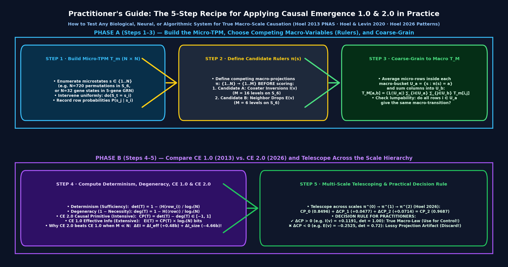

# Practitioner's Guide to Using Causal Emergence 1.0 (PNAS 2013) & Causal Emergence 2.0 (*Patterns* 2026) in Practice

**Primary Author:** Joel Dietz ([Project Delphi](https://github.com/fractastical/project-delphi-ontology) · [Infinite Morphospace](https://github.com/fractastical/morpholib))  
**Executable Reference Script:** [`sorting-morphogenesis/quantify_emergence_ce2.py`](../sorting-morphogenesis/quantify_emergence_ce2.py)  
**Machine-Checked Lean 4 Proofs (`0 sorry`):** [`morphoeval/lean/loops/Loop_causal_emergence.lean`](../morphoeval/lean/loops/Loop_causal_emergence.lean) & [`morphoeval/lean/loops/Loop_zhang_sorting_morphogenesis.lean`](../morphoeval/lean/loops/Loop_zhang_sorting_morphogenesis.lean)  
**Benchmark Corpus (`10` Papers, `2013–2026`):** [`datasets/causal_emergence/`](../datasets/causal_emergence/README.md)



---

## 1. What Problem Do Causal Emergence 1.0 and 2.0 Actually Solve?

Whenever you study a complex system—whether it is a self-sorting array of cells, a 5-gene mammalian cardiac regulatory network, a bioelectric tissue sheet, or a neural circuit—you face a fundamental choice: **at what scale (or through which coordinate "ruler") should you describe, predict, and control the system?**

* If you stay completely **zoomed in at the micro-scale** ($\pi^{(0)}$, watching every individual permutation, gene bit, or ion channel), stochastic transitions and degenerate pathways make the transition dynamics noisy.
* If you **zoom out to a macro-variable** ($\pi: S_{\text{micro}} \to S_{\text{macro}}$, grouping $N$ microstates into $M \ll N$ macro-buckets), two opposite things can happen:
  1. **True Causal Emergence ($\Delta\mathrm{CP} > 0$):** The macro-partition groups together microstates that are *causally equivalent* (Markov lumpable), stripping away micro-scale branching noise and revealing a **cleaner, more deterministic cause-and-effect law** than exists at the micro-scale!
  2. **Causal Submergence / Projection Artifact ($\Delta\mathrm{CP} < 0$):** The macro-partition lumps together microstates that move in *opposite* directions, destroying Markovianity and creating illusory "backtracking" (like the apparent uphill ticks in `monotonicity_error` $E(v)$ during sorting morphogenesis).

Over the last 13 years, **Erik Hoel** and collaborators developed two formal mathematical generations of this test:
* **Causal Emergence 1.0 (CE 1.0 — Hoel, Albantakis & Tononi 2013, *PNAS* `110:19790`; Hoel 2017, *Entropy* `19:188`; Hoel & Levin 2020, *Commun. Integr. Biol.* `13:108`):** Measures **Effective Information ($\mathrm{EI}$, in bits)**, defined as the mutual information $I(I_D; E_D)$ when you intervene uniformly across all $N$ states ($I_D = \text{uniform } \mathcal{U}(1..N)$).
* **Causal Emergence 2.0 (CE 2.0 — Comolatti & Hoel 2025, *Entropy* `27:825`; Hoel 2026, *Patterns* `7:101472`, `PyMergence`):** Measures the intensive **Causal Primitive ($\mathrm{CP} \in [-1, 1]$)**—equal to normalized **Determinism minus Degeneracy** (or Eells/Cheng **Sufficiency plus Necessity minus 1**)—and apportions causal power along a multi-scale hierarchy $\pi^{(0)} \to \pi^{(1)} \to \dots \to \pi^{(k)}$ without being distorted by state-space size $\log_2 N$.

---

## 2. The Exact Equations: CE 1.0 vs. CE 2.0 (And Why CE 1.0 Fails When $M \ll N$)

Suppose your system has $N$ discrete states and is governed by an $N \times N$ row-stochastic **Transition Probability Matrix (TPM)** $T$, where $T_{ij} = P(S_{t+1} = j \mid \mathrm{do}(S_t = i))$.

### Step A — Compute the Two Normalized Causal Primitives ($\mathrm{det}$ and $\mathrm{deg}$)
1. **Determinism ($\mathrm{det}(T) \in [0, 1]$, Causal Sufficiency):**
   How reliably does knowing the current state $i$ determine the next state $j$?
   $$\mathrm{det}(T) \;=\; 1 \;-\; \frac{\frac{1}{N}\sum_{i=1}^{N} H(T_{i,\cdot})}{\log_2 N}, \qquad H(T_{i,\cdot}) = -\sum_{j=1}^{N} T_{i,j}\log_2 T_{i,j}.$$
   * If every row $T_{i,\cdot}$ has a single `1.0` and zeros elsewhere, $H(T_{i,\cdot}) = 0 \implies \mathbf{\mathrm{det}(T) = 1.0000}$ ($100\%$ deterministic).
2. **Degeneracy ($\mathrm{deg}(T) \in [0, 1]$, $1 - \text{Causal Necessity}$):**
   Do all states collapse into the same few outputs, or do distinct causes produce distinct effects? Let $\bar{u} = \frac{1}{N}\sum_{i=1}^N T_{i,\cdot}$ be the column-average effect distribution:
   $$\mathrm{deg}(T) \;=\; 1 \;-\; \frac{H(\bar{u})}{\log_2 N}, \qquad H(\bar{u}) = -\sum_{j=1}^{N} \bar{u}_j \log_2 \bar{u}_j.$$
   * If every state $j$ is targeted equally ($\bar{u}_j = 1/N$, a bijective permutation), $H(\bar{u}) = \log_2 N \implies \mathbf{\mathrm{deg}(T) = 0.0000}$ (zero degeneracy).

### Step B — Compare CE 2.0 ($\mathrm{CP}$) Against CE 1.0 ($\mathrm{EI}$)
* **CE 2.0 Intensive Causal Primitive ($\mathrm{CP}(T)$, Hoel 2026 *Patterns*):**
  $$\mathrm{CP}(T) \;=\; \mathrm{det}(T) \;-\; \mathrm{deg}(T) \;=\; \frac{H(\bar{u}) - \langle H(T_{i,\cdot})\rangle}{\log_2 N} \;\in\; [-1, 1].$$
  In Comolatti & Hoel (2025) and Hoel (2026), $\mathrm{CP}(T)$ is the intensive **Effectiveness ($\mathrm{eff}$)** of the transition matrix (proved in `Loop_causal_emergence.lean`, Law 5 `comolatti_hoel_2025_causal_consilience`, to be algebraically isomorphic to Eells's and Cheng's causal power $\mathrm{suff} + \mathrm{nec} - 1$).
* **CE 1.0 Extensive Effective Information ($\mathrm{EI}(T)$, Hoel et al. 2013 *PNAS*):**
  $$\mathrm{EI}(T) \;=\; \mathrm{CP}(T)\,\log_2 N \;=\; H(\bar{u}) \;-\; \langle H(T_{i,\cdot})\rangle \quad \text{(in bits)}.$$

### Step C — The Crucial Splitting Identity That Explains Why You Need CE 2.0!
When you coarse-grain an $N$-state micro-TPM $T_m$ onto an $M$-state macro-TPM $T_M$ ($M < N$), how do CE 1.0 ($\Delta\mathrm{EI} = \mathrm{EI}_M - \mathrm{EI}_m$) and CE 2.0 ($\Delta\mathrm{CP} = \mathrm{CP}_M - \mathrm{CP}_m$) relate?

In `Loop_causal_emergence.lean` (**Theorem 1: `hoel_2013_ei_det_minus_deg_and_size_split`**), we machine-checked the exact algebraic identity:

$$\Delta\mathrm{EI} \;=\; \mathrm{EI}_M - \mathrm{EI}_m \;=\; \underbrace{(\mathrm{CP}_M - \mathrm{CP}_m)\log_2 M}_{\Delta I_{\text{eff}} \text{ (True Accuracy Gain)}} \;+\; \underbrace{\mathrm{CP}_m (\log_2 M - \log_2 N)}_{\Delta I_{\text{size}} \text{ (Dimensionality Penalty } <\,0\text{)}}.$$

**Look at what that equation tells every practitioner:**
* Whenever your micro-system is already moderately deterministic ($\mathrm{CP}_m \approx 0.70\text{–}0.85$) and your macro-law compresses a large state space ($N = 720$ permutations in $S_6$) onto a compact, low-dimensional coordinate ($M = 16$ inversion levels $I(v) \in \{0..15\}$), the negative size term $\Delta I_{\text{size}} = 0.8496 \times (\log_2 16 - \log_2 720) = \mathbf{-4.666\text{ bits}}$ **completely swamps** the positive effectiveness gain $\Delta I_{\text{eff}} = (0.9687 - 0.8496)\times 4.0 = \mathbf{+0.476\text{ bits}}$!
* Thus, **CE 1.0 gives a false negative ($\Delta\mathrm{EI} = -4.189\text{ bits} < 0$)** even when the macro-scale is **$100\%$ deterministic ($\mathrm{det}_M = 1.0000$)**!
* **CE 2.0 ($\Delta\mathrm{CP} = \mathrm{CP}_M - \mathrm{CP}_m = +0.1191 > 0$)** divides out the extensive $\log_2 N$ size confound and immediately identifies $I(v)$ as a causally emergent macro-law.

---

## 3. Copy-Paste Python Reference Implementation (~40 Lines of NumPy)

You do not need any heavy external libraries to run both CE 1.0 and CE 2.0 on your own models. Here is the exact, self-contained NumPy implementation from [`sorting-morphogenesis/quantify_emergence_ce2.py`](../sorting-morphogenesis/quantify_emergence_ce2.py):

```python
import numpy as np

def compute_ce1_and_ce2(tpm: np.ndarray) -> dict:
    """
    Compute Erik Hoel's Causal Emergence 1.0 (PNAS 2013) & 2.0 (Patterns 2026)
    primitives for any N x N row-stochastic Transition Probability Matrix (TPM).
    """
    n = tpm.shape[0]
    if n <= 1:
        return {"n_states": n, "log2_n": 0.0, "determinism": 1.0, "degeneracy": 0.0, "cp_eff": 1.0, "EI_bits": 0.0}
    log2_n = float(np.log2(n))
    eps = 1e-15
    p_clip = np.clip(tpm, eps, 1.0)

    # 1. Determinism (Sufficiency): 1 - <H(row_i)> / log2(N)
    row_entropies = -np.sum(tpm * np.log2(p_clip), axis=1)
    det = 1.0 - float(np.mean(row_entropies)) / log2_n

    # 2. Degeneracy (1 - Necessity): 1 - H(<row>) / log2(N)
    u_e = np.mean(tpm, axis=0)
    u_clip = np.clip(u_e, eps, 1.0)
    eff_entropy = float(-np.sum(u_e * np.log2(u_clip)))
    deg = 1.0 - eff_entropy / log2_n

    # 3. CE 2.0 Intensive Causal Primitive (CP) & CE 1.0 Extensive Effective Info (EI)
    cp_eff = det - deg
    ei_bits = cp_eff * log2_n
    return {
        "n_states": int(n),
        "log2_n": round(log2_n, 4),
        "determinism": round(det, 4),
        "degeneracy": round(deg, 4),
        "cp_eff": round(cp_eff, 4),
        "EI_bits": round(ei_bits, 4),
    }

def coarse_grain_tpm(tpm_micro: np.ndarray, macro_labels: list[int]) -> np.ndarray:
    """
    Project an N x N micro-TPM onto M macro-states defined by `macro_labels[i]`
    for each microstate i in 0..N-1.
    """
    uniq = sorted(set(macro_labels))
    u_to_idx = {u: i for i, u in enumerate(uniq)}
    m = len(uniq)
    tpm_macro = np.zeros((m, m), dtype=float)
    for u in uniq:
        mi = u_to_idx[u]
        rows = [idx for idx, lbl in enumerate(macro_labels) if lbl == u]
        w = 1.0 / len(rows)
        for r in rows:
            for c_idx, prob in enumerate(tpm_micro[r]):
                if prob > 0.0:
                    tpm_macro[mi, u_to_idx[macro_labels[c_idx]]] += prob * w
    return tpm_macro
```

---

## 4. Three Worked Case Studies from This Repository

### Case Study 1 — Self-Sorting Cell Arrays ($S_3 \dots S_6$): Separating a True Lyapunov Law ($I(v)$) from a Blurry Observer Projection ($E(v)$)
* **Script:** `python3 sorting-morphogenesis/quantify_emergence_ce2.py`
* **The Setup:** On $S_6$ ($N = 720$ permutations of $[1..6]$), random active-cell Bubble swaps give micro-scale determinism $\mathrm{det}_m = 0.8687$, degeneracy $\mathrm{deg}_m = 0.0192$, and $\mathrm{CP}_m = 0.8496$ ($\mathrm{EI}_m = 8.064\text{ bits}$).
* **Testing Two Competing Macro-Rulers:**
  1. **Candidate A — Coxeter Pairwise Inversions $\pi_I(v) = I(v) \in \{0..15\}$ ($M = 16$ states):**
     Every legal Bubble swap decreases $I(v)$ by exactly $-1$. Coarse-graining $S_6 \to I(v)$ yields **$\mathrm{det}_I = 1.0000$**, $\mathrm{deg}_I = 0.0313$, and **$\mathrm{CP}_I = 0.9687$**, giving **Positive Causal Emergence 2.0 of $\Delta\mathrm{CP}_I = +0.1191 > 0$** (and telescoping cleanly across $\pi^{(0)} (S_6, 720) \to \pi^{(1)} ((I, \text{head}), 26) \to \pi^{(2)} (I(v), 16)$ as $0.8496 + 0.0477 + 0.0714 = 0.9687$).
  2. **Candidate B — Paper's Adjacent Monotonicity Error $\pi_E(v) = E(v) \in \{0..5\}$ ($M = 6$ states):**
     Because microstates with the same $E(v)$ transition to $E-1$, $E$, or $E+1$, coarse-graining $S_6 \to E(v)$ drops determinism to **$\mathrm{det}_E = 0.7209$**, raises degeneracy to $\mathrm{deg}_E = 0.1238$, and collapses $\mathrm{CP}_E$ to **$0.5971$**, giving **Negative Causal Emergence of $\Delta\mathrm{CP}_E = -0.2525 < 0$**.

### Case Study 2 — Hoel & Levin (2020) 5-Gene Mammalian Cardiac GRN (`32 → 18` States)
* **Lean 4 Proof:** `morphoeval/lean/loops/Loop_causal_emergence.lean` (`Theorem 4: hoel_levin_2020_cardiac_grn_macronodes`)
* **The Setup:** In Herrmann et al. (2012) and Hoel & Levin (2020, *Commun. Integr. Biol.* Fig. 3), a 5-gene Boolean network (`exogen_canWnt_II`, `Foxc1_2`, `Fgf8`, `canWnt`, `Isl1`) has $2^5 = 32$ microstates.
* **What CE Identifies:** All 8 microstates with `(exogen_canWnt_II = 1, Foxc1_2 = 0)` transition in 1 step to the exact same state `01011`, and all 8 microstates with `(exogen_canWnt_II = 1, Foxc1_2 = 1)` transition in 1 step to `01111`—regardless of the values of `Fgf8`, `canWnt`, or `Isl1`! Grouping those two 8-state equivalence classes into two macro-nodes $\mu_1, \mu_2$ reduces the 32-state network to 18 states, eliminates 14 redundant degenerate inputs, and raises both $\Delta\mathrm{EI} > 0$ and $\Delta\mathrm{CP} > 0$.

### Case Study 3 — Hoel (2026) *Patterns* 8-State Two-Block Equivalence Benchmark (`ΔEI = 0` vs. `ΔCP = +0.6667`)
* **Lean 4 Proof:** `morphoeval/lean/loops/Loop_causal_emergence.lean` (`Theorem 6: hoel_2026_ce2_apportioning_and_block_divergence`)
* **The Setup:** Consider an 8-state system ($N = 8, \log_2 N = 3$) partitioned into two 4-state blocks $B_0 = \{0,1,2,3\}$ and $B_1 = \{4,5,6,7\}$, where any state in $B_0$ transitions uniformly ($p = 1/4$) to states in $B_1$, and any state in $B_1$ transitions uniformly ($p = 1/4$) to states in $B_0$.
* **Why CE 1.0 Is Blind Here:**
  - At the micro-scale ($N = 8$): each row has entropy $\log_2 4 = 2\text{ bits}$, so $\mathrm{det}_m = 1 - 2/3 = 1/3$, $\mathrm{deg}_m = 0$, $\mathrm{CP}_m = 1/3$, and $\mathrm{EI}_m = (1/3) \times 3 = \mathbf{1.0000\text{ bit}}$.
  - At the 2-block macro-scale ($M = 2, \log_2 M = 1$): $B_0 \leftrightarrow B_1$ is a $100\%$ deterministic toggle! So $\mathrm{det}_M = 1.0$, $\mathrm{deg}_M = 0.0$, $\mathrm{CP}_M = 1.0$, and $\mathrm{EI}_M = 1.0 \times 1 = \mathbf{1.0000\text{ bit}}$.
  - Under **CE 1.0**, $\Delta\mathrm{EI} = 1.0 - 1.0 = \mathbf{0.0000\text{ bits}}$ (it completely misses the emergence because the $3\times$ jump in determinism is canceled out by the $1/3$ drop in $\log_2 N$!).
  - Under **CE 2.0**, $\Delta\mathrm{CP} = 1.0000 - 0.3333 = \mathbf{+0.6667}$ ($+66.7\%$ gain in causal determinism).

---

## 5. Five Practical Rules of Thumb (And Common Pitfalls to Avoid)

1. **Always Report Both `det(T)` and `CP(T)` Alongside `EI(T)`:**
   If your macro-variable compresses $N$ states into $M \ll N$ buckets, always compute the exact Hoel (2013/2026) split $\Delta\mathrm{EI} = \Delta I_{\text{eff}} + \Delta I_{\text{size}}$. If $\Delta\mathrm{CP} > 0$ ($\Delta I_{\text{eff}} > 0$) while $\Delta\mathrm{EI} < 0$, your macro-variable is genuinely more deterministic/non-degenerate per state, and $\Delta\mathrm{EI}$ is only negative because $M \ll N$.
2. **Enforce Interventional (`do`) Uniformity, Not Observational Stationarity:**
   Causal Emergence is defined over **interventional rows** $P(S_{t+1} \mid \mathrm{do}(S_t = i))$ weighted uniformly ($1/N$ per microstate, or $1/|U_a|$ within each macro-bucket). If you weight rows by the stationary attractor distribution $P_{\text{ss}}(i)$, absorbing fixed points (like the sorted identity permutation $[1,2,\dots,n]$) will dominate 99% of the weight and hide the transient sorting dynamics.
3. **Compare Both Conditional Action Steps and Raw Proposal Steps:**
   In asynchronous agent models (like cell-view sorting), some time steps propose a no-op (self-loop $T_{ii} > 0$). Always check both the **active transition TPM** (conditioned on a swap occurring, where $\Delta\mathrm{CP}_I = +0.1191$ on $S_6$) and the **raw step TPM** (including self-loops, where $\Delta\mathrm{CP}_I = +0.1557$ on $S_6$).
4. **Use Multi-Scale Path Apportioning (`π^(0) → π^(1) → π^(2)`) to Find *Where* Emergence Enters:**
   In CE 2.0, if you order your partitions from finest to coarsest, the step-wise gains $\Delta\mathrm{CP}_k = \mathrm{CP}(\pi^{(k)}) - \mathrm{CP}(\pi^{(k-1)})$ telescope identically: $\mathrm{CP}_0 + \sum_{k=1}^K \Delta\mathrm{CP}_k = \mathrm{CP}_K$. If an intermediate scale $\pi^{(k)}$ has $\Delta\mathrm{CP}_k < 0$, that intermediate grouping is throwing away causal structure.
5. **For Large State Spaces ($N > 10^4$), Use Empirical Branching Sampling + Markov Lumpability Variance:**
   Exact $N \times N$ TPM construction works up to $N \approx 5,040$ ($S_7$). For larger systems ($n = 60\text{–}100$ sorting cells), sample $K$ random microstates inside each macro-bucket $U_a$, trigger $R$ single-step rollouts per microstate, and measure the **within-bucket macro-transition variance**: on a true lumpable macro-coordinate like $I(v)$, within-bucket variance is identically `0.0000`, whereas on a non-lumpable coordinate like $E(v)$, within-bucket variance is large (`> 0.20`).
