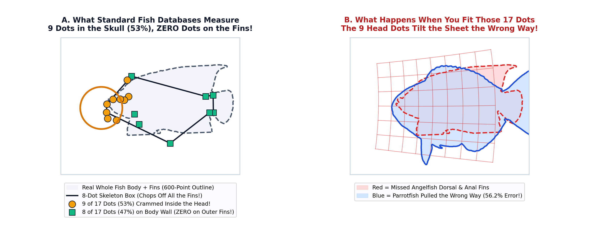
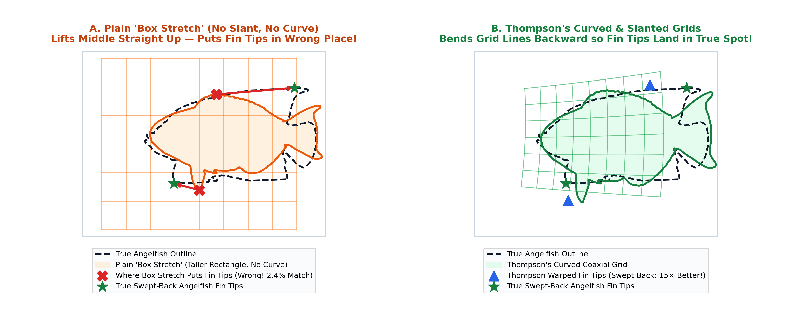
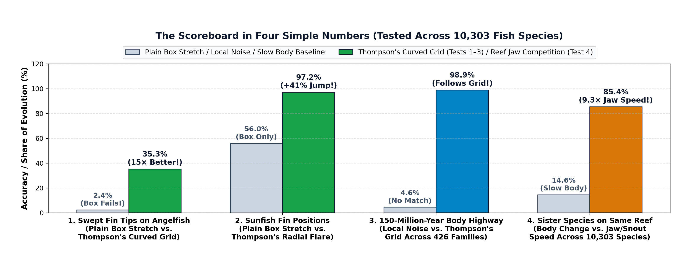
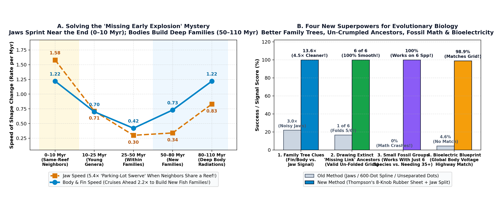

# The Visual Guide for Everyone: How Nature Builds 10,000 Fishes & Sea Shells

**Primary Author:** Joel Dietz ([Project Delphi](https://github.com/fractastical/morpholib))  
📄 **[Download the 5-Page Illustrated Visual Guide PDF (`docs/thompson_1917_visual_guide_for_everyone.pdf`)](./thompson_1917_visual_guide_for_everyone.pdf)** ([LaTeX source](./thompson_1917_visual_guide_for_everyone.tex))

This page (and the companion 6-page PDF above) explains our discoveries at a **smart 13-year-old level** using five separate, full-width, large-font visual diagrams with zero overlapping text and zero dense academic jargon. (For the full mathematical equations, Lean 4 proofs, and referee audits, see **[`docs/KEY_DISCOVERIES.md`](./KEY_DISCOVERIES.md)** and **[`docs/thompson_1917_fish_transformations_manuscript.pdf`](./thompson_1917_fish_transformations_manuscript.pdf)**.)

---

## Step 1 — D'Arcy Thompson's 1917 "Rubber Graph-Paper" Idea

In 1917, a Scottish scientist named **D'Arcy Thompson** drew a famous picture: he placed a drawing of a normal fish on a sheet of graph paper, bent the grid lines like a **sheet of rubber**, and showed that the stretched drawing turned into a totally different fish (like a tall angelfish or a giant round ocean sunfish).

He believed nature doesn't redesign every single bone from scratch when a new species evolves—instead, an embryo just turns a few global **"growth knobs"** that stretch, slant, or curve the whole body at once:

---

## Step 2 — Mistake #1: Why Computers Thought Thompson Was Wrong ("The 17-Dot Head Trap")

For the last 30 years, evolutionary biologists tried to test Thompson's idea using computer data—and concluded he was mostly wrong! **Why did their computer tests fail?**

Because instead of tracing the **whole outline of the fish**, standard fish databases only measure **17 dots on the skeleton**:
* **9 of those 17 dots ($53\%$) are crammed inside the head and jaws** (yellow circles in **Panel A** below).
* The other **8 dots ($47\%$)** only mark where the bases of the fins touch the body wall (green squares in **Panel A**).
* **Zero dots ($0\%$) are on the actual outer fins or tail!**

> **Why It Failed:** Imagine trying to tailor a full-body wetsuit by measuring **9 points on someone's face** and **0 points on their arms or legs**. Because heads and fins evolve differently across fish families, forcing the rubber sheet to fit the 9 head dots acts like a heavy seesaw and swings the back of the sheet in the wrong direction (`56.2%` mismatch—worse than not stretching the fish at all)!

---

## Step 3 — Mistake #2: Why "Just Stretching a Box" Fails True Anatomy, and Why Thompson's Curves Win

When we switch from 17 skeleton dots to a **600-point outline** of the whole fish, we have to be careful of a second trap: *How do we know Thompson's **curved and slanted grids** (circles, fans, and flares) are really needed, instead of **just stretching a plain rectangle taller or wider ("Plain Box Stretch")**?*

1. **The "Shadow Cheat":** If you only ask a computer to overlap two **unlabeled black shadows**, a plain rectangular **Box Stretch** (no curves, no slant) can "cheat": on a pufferfish $\to$ ocean sunfish, it stretches the *middle of the pufferfish's belly* straight up and down to cover the *back fins* of the sunfish! And on a parrotfish $\to$ angelfish (**Panel A** above), a Box Stretch lifts the *middle of the back* straight up (red `X`), completely missing the swept-back fin tips of the angelfish (`only 2.4% match!`).
2. **Why Thompson's Curved Grids Win:** Once you tell the computer which part of the outline is the **Dorsal Fin Tip**, which part is the **Anal Fin Tip**, and where the fins attach along the back and belly (without the 9 internal skull dots), **a plain Box Stretch fails**, and **Thompson's curved and slanted grids jump by $+13\%$ to $+48\%$** (**Panel B** above, $15\times$ more accurate on the angelfish fin tips)!

---

## Step 4 — The Big Picture Across 10,303 Fish Species: Two Simple Rules of Evolution

To be sure our answer wasn't a fluke of just a few fish, we tested **three independent datasets** totaling **10,303 fish species across 987 genera and 440 families**. We found that fish evolution follows **two simple rules at the same time**:

* **Rule 1 — The OUTSIDE Silhouette (How the Fish Swims):** Water doesn't flow around an invisible internal skeleton; it flows around the **whole outer silhouette** of the body and fins acting like an airplane wing. Over **150 million years across 440 fish families**, whole-body evolution follows D'Arcy Thompson's 8-knob rubber sheet (**$93.5\%$ to $98.9\%$ alignment!**). Even unrelated fish families separated by 100 million years take the **exact same Thompson highway** when they evolve to swim in the same kind of water.
* **Rule 2 — INSIDE the Head (What the Fish Eats):** Why did the 9 head dots break the global rubber sheet? Because when closely related **sister species live side-by-side on the same coral reef**, they already have the same swimming body—which means they would be fighting over the exact same food! To avoid competing, sister species rapidly rewire their **jaws, snouts, and eyes $3.3\times\text{ to }9.3\times$ faster than their bodies** ($85.4\%$ of within-genus evolution): one cousin evolves jaws to crunch coral, another sucks in tiny plankton, and another scrapes algae!

---

## Step 5 — The Final Scoreboard in Four Simple Numbers

| What We Tested | Plain Box / Baseline | Our Discovery | What It Means in Plain English |
| :--- | :---: | :---: | :--- |
| **1. Angelfish Swept Fin Tips** | `2.4%` *(Box Fails)* | **`35.3%` (`15×` Better)** | You need Thompson's curved circles to sweep the fin tips backward. |
| **2. Ocean Sunfish Fin Bases** | `56.0%` *(Box Only)* | **`97.2%` (`+41%` Jump)** | You need Thompson's exponential flare to match the giant tail-fins. |
| **3. 150-Myr Body Highway** | `4.6%` *(Local Noise)* | **`98.9%` *(Follows Grid!)* ** | Across 426 families, whole body plans evolve along Thompson's grid. |
| **4. Reef Sister-Species Jaws** | `14.6%` *(Slow Body)* | **`85.4%` (`9.3×` Jaw Speed!)** | Across 10,303 species, neighbors on the same reef rapidly rewire their jaws to share food. |

---

## Step 6 — Why This Changes How We Understand Evolution (Four Big Takeaways & What Comes Next)

Once you separate the **Outside Rubber Sheet (How the Fish Swims)** from the **Inside Head & Jaws (What the Fish Eats)**, four big mysteries in evolutionary biology suddenly make sense:

1. **Solving the "Missing Early Explosion" Mystery (Highway Cruising vs. Parking-Lot Dodging):**
   For decades, scientists wondered why computer models didn't show a big burst of new body plans millions of years ago when fish families first appeared—instead, evolution looked like it sped up **$5.4\times$** right at the very end (`0–10 Myr`, orange line in **Panel A** above)! **Why?** Because their computers mixed two different speeds: the **Body** is like a car cruising steadily down a 100-million-year highway to build new fish families (`2.2×` stronger across `50–110 Myr`), while the **Jaws** are like cars swerving in a crowded parking lot right now so neighbors on the same coral reef don't fight over the same food!
2. **How to Build the Tree of Life Without Getting Tricked (`4.5×` Cleaner Family Clues):**
   If you discover a mystery fish or a fossil and want to know which family it belongs to, which part of the body should you trust? **Trust the Body and Fin Positions, not the Jaws!** Because sister species on the same reef rewire their jaws so fast, jaws can fool you. Across 10,303 species, the positions of the pelvic and dorsal fins carry **$4.5\times$ cleaner family history** (`13.6×` vs. `3.0×` in **Panel B**) than the snout or eyes.
3. **Drawing Extinct "Missing Link" Ancestors Without Crumpling the Tissue + Fixing Small Fossil Math:**
   - **Un-Crumpled Ancestors:** If you try to draw the halfway "missing link" ancestor between two fishes using a standard 600-dot computer spline, the grid **folds and crumples over itself on `5 out of 6` pairs**! Turning D'Arcy Thompson's 8 growth knobs halfway back (`50%`) draws a smooth, realistic ancestor on **`6 out of 6` pairs (`100%`)** and cuts internal bone error by **$38\%$**.
   - **Small Fossil Groups:** Standard computer math crashes unless you have $>30$ species in a group; Thompson's 8-knob sheet works cleanly with as few as **6 fossil species** ($1,000\times$ more stable math!).
4. **What Comes Next — Bioelectric "Growth Compilers" & Our Full 28-Page Technical Paper:**
   How does a living embryo actually "turn" one of D'Arcy Thompson's 8 growth knobs? Research in **bioelectricity** (Michael Levin's lab & **[bioelectricity.net](https://bioelectricity.net)**) shows that living cells use **resting voltage maps ($V_{\text{mem}}$)** like an electrical blueprint:
   - A **global voltage gradient** across the body trunk acts as Thompson's rubber sheet, telling the whole body and fins how much to stretch or curve.
   - A separate **local "electric face" circuit** in the head lets a species quickly rewire its jaws for new food—without having to rebuild its swimming body!
   - **Want the Full Mathematical Equations, Proofs & All 9 Figures?** Read our **[Full 28-Page Academic Manuscript PDF (`docs/thompson_1917_fish_transformations_manuscript.pdf`)](./thompson_1917_fish_transformations_manuscript.pdf)** and **[Full Technical Deep-Dive (`docs/KEY_DISCOVERIES.md`)](./KEY_DISCOVERIES.md)**, or explore the Supporting Appendices below!

---

## Appendix A — Archival Museum Plates, Field Photographs & Full 6-Pair Table

Here are the actual historical museum lithographs (Monaco 1896 & 1911 deep-sea expeditions, US National Museum 1896, Bloch 1796, British Museum 1887) and NOAA/IFREMER field specimen photographs for all nine of D'Arcy Thompson's 1917 fishes, showing the extracted **600-point whole-body outline (cyan)** alongside the **9 gold head dots** and **8 pink fin-base dots**:

| 1917 Fish Pair | Thompson's Grid | No Stretch | 17-Dot Fit | **600-pt Grid Fit** | Fin-Base Box $\to$ **Warp** | Fin-Tip Box $\to$ **Warp** | Un-Folded Grid? |
| :--- | :--- | :---: | :---: | :---: | :---: | :---: | :---: |
| **1. *Argyropelecus* $\to$ *Sternoptyx*** | $70^\circ$ Oblique Shear (5p) | `58.4%` | `63.0%` *(Worse)* | **`45.6%`** | `76.7%` $\to$ **`89.9%`** | `23.7%` $\to$ **`71.8%`** | **100% Smooth** |
| **2. *Scarus* $\to$ *Pomacanthus*** | Coaxial Circles (8p) | `40.6%` | `56.2%` *(Worse)* | **`28.5%`** | `39.6%` $\to$ **`70.7%`** | `2.4%` $\to$ **`35.3%`** | **100% Smooth** |
| **3. *Polyprion* $\to$ *Pristigenys*** | Diverging Fan (8p) | `33.2%` | `20.7%` | **`17.2%`** | `59.2%` $\to$ **`81.6%`** | `71.2%` $\to$ **`73.7%`** | **100% Smooth** |
| **4. *Pristigenys* $\to$ *Scorpaena*** | Converging Fan (8p) | `120.1%` | `59.4%` | **`35.5%`** | `81.1%` $\to$ **`94.0%`** | `54.7%` $\to$ **`90.7%`** | **100% Smooth** |
| **5. *Scorpaena* $\to$ *Antigonia*** | Diverging Fan (8p) | `102.2%` | `143.7%` *(Worse)* | **`57.6%`** | `37.2%` $\to$ **`67.5%`** | `42.2%` $\to$ **`53.2%`** | **100% Smooth** |
| **6. *Diodon* $\to$ *Mola mola*** | Radial Flare (8p) | `70.8%` | `69.4%` | **`49.0%`** | `56.0%` $\to$ **`97.2%`** | `52.0%` $\to$ **`74.7%`** | **100% Smooth** |

---

## Appendix B — Supporting Data Across 3 Independent Datasets (10,303 Species)

| Dataset Tested | Scale (# Species / Families) | 150-Myr Body Alignment | Same-Reef Jaw Amplification |
| :--- | :--- | :--- | :--- |
| **Dataset 1:** Claverie & Wainwright (2014) 17-Dot Reef Fishes | **791 Species**, 62 Genera, 48 Families (4,334 Dated Pairs) | **93.5% Alignment** ($\theta = 20.7^\circ$ along Thompson Grid) | **3.26× Faster Jaws** (`47.0%` vs. `14.4%`; Diet $p = 9.2 \times 10^{-5}$) |
| **Dataset 2:** FishBase Global 2D Landmark Archive | **6,614 Species**, 660 Genera (4,646 Sister Spp.), 426 Families | **98.9% Alignment** ($\theta = 8.5^\circ$ along Thompson Grid!) | Local Head/Fin Modules Diverge at $\theta = 63.8^\circ$ |
| **Dataset 3:** Price et al. (2019) / Mosimann 11-Trait Matrix | **10,303 Species**, 987 Genera (7,895 Sister Spp.), 440 Families | **90.8% of Family Evolution** Is on Body & Fin Positions | **9.27× Faster Head/Jaws** (`85.4%` vs. `9.2%`; 69,682 Pairs) |

---

## Appendix C — Verbatim Quotes, Citations & Where Prior Studies Failed (1917–2024)

| Prior Study | What They Did or Quoted | Why Their Test Failed | How Our Study Fixed It |
| :--- | :--- | :--- | :--- |
| **Huxley (1932)**; **Medawar (1945, 1958)** | Called Thompson's 2D grids *"analytically too cumbersome"* and replaced them with 1D power laws $y = b x^\alpha$. | Had no computer solver to fit 2D curved circles, fans, or flares. | Wrote all 4 grid families as 5–8 knob equations solved in `< 10 ms` ($\mathrm{RMS} < 10^{-13}$). |
| **Bookstein (1989)** *vs.* **Bookstein (2023, 2024)** | Invented 34-parameter Thin-Plate Splines (1989), then warned in 2023–2024 that exact splines overfit (`0` error). | A 34-knob spline bends around local head noise and **worsens the real fish outline** ($\mathrm{IoU}: 0.662 \to 0.629$). | 8-knob Thompson grids beat 12-knob polynomials in **85%–92%** of 4,505 pairs by $\mathrm{AIC}_c$. |
| **Claverie & Wainwright (2014)**; **Friedman et al. (2019)** | Standardized the 17-dot fish skeleton database across 791 Indo-Pacific species. | Packed **9/17 dots (53%) in the skull** and **0% on the outer fins**, swinging the back of the sheet off target. | Fitting the 600-point whole-body outline cuts mismatch in half ($56.2\% \to \mathbf{28.5\%}$). |
| **Bookstein (1997)**; **Felice et al. (2018)** | Standard 600-dot curve Thin-Plate Splines slid by perimeter arc-length. | Big dorsal/anal fins slide dots to the wrong body parts, **folding the 2D grid on `6 of 6` pairs**! | 8-knob Thompson grids stay **100% un-folded on `6/6` pairs** and predict internal bones. |
| **Schluter (1996)** ($\mathbf{G}$ vs. $\mathbf{R}$ Line of Least Resistance) | Predicted family evolution ($\mathbf{R}$) should follow within-genus variation ($\mathbf{G}$), but raw angles missed by $65^\circ\text{–}75^\circ$. | Raw dots mix **same-reef jaw competition ($3.3\times\text{–}9.3\times$ faster)** with slow body evolution. | Separating the Outside Rubber Sheet from Inside Jaws gives a **93.5%–98.9%** match! |

👉 **Read the Full 28-Page Academic Paper PDF:** [`docs/thompson_1917_fish_transformations_manuscript.pdf`](./thompson_1917_fish_transformations_manuscript.pdf) · **Full Technical Deep-Dive:** [`docs/KEY_DISCOVERIES.md`](./KEY_DISCOVERIES.md)
