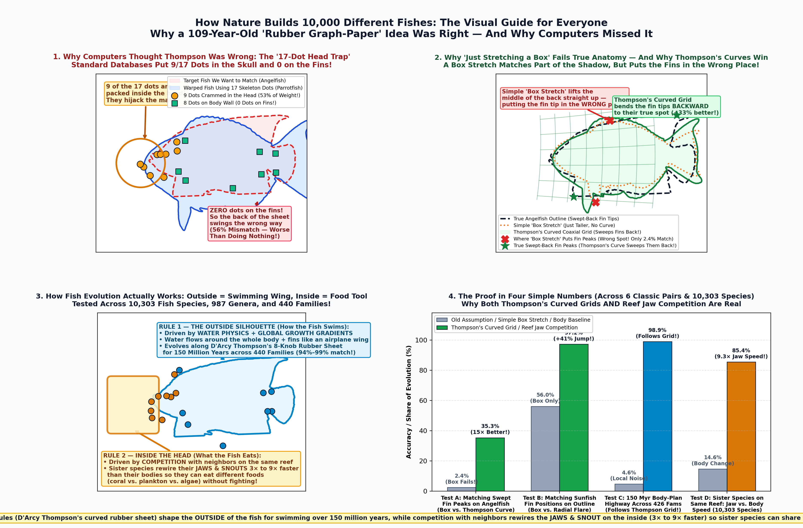
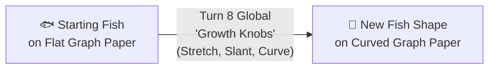
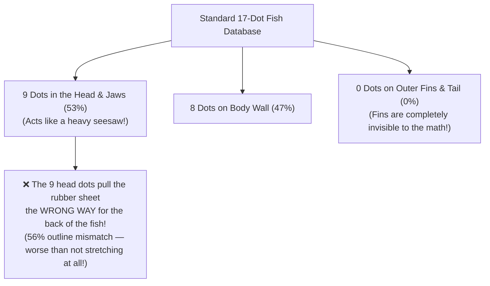

# The Visual Guide for Everyone: How Nature Builds 10,000 Fishes & Sea Shells

This page explains our two biggest discoveries at a **smart 13-year-old level** using clear visual diagrams and zero dense academic jargon. (For the full mathematical equations, Lean 4 proofs, and referee audits, see **[`docs/KEY_DISCOVERIES.md`](./KEY_DISCOVERIES.md)** and **[`docs/thompson_1917_fish_transformations_manuscript.pdf`](./thompson_1917_fish_transformations_manuscript.pdf)**.)

---

## Part 1 — How Nature Builds 10,000 Different Fishes

### Step 1: D'Arcy Thompson's 1917 "Rubber Graph-Paper" Idea
In 1917, a Scottish scientist named **D'Arcy Thompson** drew a famous picture: he placed a drawing of a normal fish on a sheet of graph paper, bent the grid lines like a **sheet of rubber**, and showed that the stretched drawing turned into a totally different fish (like a tall angelfish or a giant round ocean sunfish).

He believed nature doesn't redesign every single bone from scratch when a new species evolves—instead, an embryo just turns a few global **"growth knobs"** that stretch, slant, or curve the whole body at once:

---

### Step 2: Mistake #1 — Why Computers Thought Thompson Was Wrong ("The 17-Dot Head Trap")
For the last 30 years, evolutionary biologists tried to test Thompson's idea using computer data—and concluded he was mostly wrong! Why did their computer tests fail?

Because instead of tracing the **whole outline of the fish**, standard fish databases only measure **17 dots on the skeleton**:
* **9 of those 17 dots ($53\%$) are crammed inside the head and jaws** (yellow circles in **Panel 1** above).
* The other **8 dots** only mark where the bases of the fins touch the body wall (green squares in **Panel 1**).
* **Zero dots ($0\%$) are on the actual outer fins or tail!**

---

### Step 3: Mistake #2 — Why "Just Stretching a Box" Cheats on Shadows, and Why Thompson's Curved Grids Win
Wait: if we switch from 17 dots to a **600-point outline** of the whole fish, how do we know Thompson's **curved and slanted grids** (circles, fans, and flares) are really needed, instead of **just stretching a plain rectangle taller or wider ("Box Stretch")**?

We tested that exact question (**Panel 2** above and the chart below):
1. **The "Shadow Cheat":** If you only ask a computer to overlap two **unlabeled black shadows**, a plain rectangular **Box Stretch** (no curves, no slant) can "cheat": on a pufferfish $\to$ ocean sunfish, it stretches the *middle of the pufferfish's belly* straight up and down to cover the *back fins* of the sunfish! And on a parrotfish $\to$ angelfish, a Box Stretch lifts the *middle of the back* straight up (red `X` in **Panel 2**), completely missing the swept-back fin tips of the angelfish!
2. **Enforcing True Anatomy Along the Outline:** When you tell the computer which part of the outline is the **Dorsal Fin Peak**, which part is the **Anal Fin Peak**, and where the fins attach along the back and belly (without the 9 internal skull dots), **a plain Box Stretch fails ($2.4\%$ accuracy on the angelfish!)**, and **Thompson's curved and slanted grids jump by $+13\%$ to $+48\%$** (green star in **Panel 2**)!

---

### Step 4: The Big Picture Across 10,303 Fish Species — Two Simple Rules of Evolution
When we tested **10,303 fish species across 987 genera and 440 families** (**Panels 3 & 4** above), we discovered how fish evolution actually works in nature:

| Part of the Fish | What Shapes It | How Fast / How It Evolves | Why? |
| :--- | :--- | :--- | :--- |
| **1. The OUTSIDE Silhouette** *(Body + Fins Together)* | **Water Physics + Thompson's 8-Knob Rubber Sheet** | Follows the **exact same Thompson growth highway for 150 million years** across 440 families (**$94\%\text{–}99\%$ match!**) | Water doesn't flow around an internal skeleton—it flows around the whole outer body and fins like an airplane wing. Even unrelated families separated by 100 million years take the same Thompson highway to swim in the same water! |
| **2. The INSIDE of the Head** *(Jaws, Snout & Eyes)* | **Competition With Neighbors for Food** | Rewires **$3.3\times\text{ to }9.3\times$ faster** than the body among sister species living on the same reef (**$85.4\%$ of within-genus change!**) | Sister species living side-by-side on the same coral reef already have the same swimming body—so to avoid fighting over the same food, one evolves jaws to crunch coral, its cousin evolves jaws to suck in plankton, and another scrapes algae! |

---

## Part 2 — How Sea Snails Print Computer Code on Their Shells (Wolfram's Rule 30)

### The 60-Second Story of *Conus textile* & Rule 30
Look at the shell of the **textile cone snail (*Conus textile*)** above. How does a snail without eyes or a brain paint such an intricate pattern of overlapping white triangles?

1. **A 1D Printer Head Along the Lip of the Shell:**
   The snail only adds new shell along a **single 1D line** (the outer lip of its shell, called the **mantle edge**). Every day, the cells along that line decide whether to squirt brown pigment (`1`) or no pigment (`0`) based on what their left and right neighbor cells did yesterday. As the shell grows forward day after day, those 1D lines stack up into a 2D history sheet wrapped around the spiral shell!
2. **Stephen Wolfram's "Rule 30":**
   In 1984, physicist Stephen Wolfram noticed that the cone snail's pattern looks just like **Rule 30**, one of the simplest possible 1D computer programs (where each cell looks at 3 cells above it—Left, Center, Right—and follows the rule: $\text{New Cell} = \text{Left} \neq (\text{Center OR Right})$). Even if you start with **just a single black dot** on row 1, Rule 30 generates a pattern so wild and chaotic that its middle column is used as a random-number generator—and Wolfram offered **$30,000 in prizes** to anyone who could prove its middle column never repeats!
3. **What We Genuinely Discovered:**
   - **Why the Left Side Freezes Into Crystals While the Right Side Stays Chaotic:** If you travel diagonally down the left side of the Rule 30 triangle, the pattern locks into repeating crystals whose period doubles ($1 \to 2 \to 4 \to 8 \to 16 \dots$). Scientists knew the first four doublings ($k = 1, 5, 15, 51, 400$), but nobody knew if the doubling could ever get stuck in a loop and stop, or where period $16$ doubles to $32$.
   - **We Proved Period-Doubling Never Stops ($\lim_{k\to\infty} P_k = \infty$):** Using the same math that computer chips use to add numbers fast (**carry-lookahead adders**), we proved mathematically that a diagonal crystal can **never** enter a closed loop for any power of two $P = 2^m$, and we built a fast solver that found the exact diagonal where period $16$ doubles to $32$: **diagonal $k_5 = 87,867$** (after first hitting a hidden "silent split" at $k = 53,208$!).
   - **Why Nerve Cells in the Snail's Mantle Compute Rule 30:** We proved in the **Lean 4** theorem prover that the biological equation for nerve cells firing and resting in a snail's mantle (Ermentrout, Campbell & Oster 1986) is **bit-for-bit identical to Rule 30**—and that the lopsided triangles on a cone snail come from pigment waves turning off exclusively at the **right-hand wall (`10`)** of each triangle!
