# Key Scientific & Mathematical Discoveries in *Infinite Morphospace*

**Primary Author:** Joel Dietz ([Project Delphi](https://github.com/fractastical/morpholib))

This document provides a technical deep-dive into the primary biological, morphometric, and mathematical discoveries produced in this repository through our **12-step closed-loop methodology** (combining primary-literature partial differential / discrete equations, SHA-256-locked museum and empirical datasets, machine-checked **Lean 4** proofs in [`morphoeval/lean/MathOfBiology.lean`](../morphoeval/lean/MathOfBiology.lean) with `0 sorry`, and blinded multi-agent referee audits).

👉 **Want the jargon-free version with step-by-step diagrams first?** Read **[`docs/EXPLAINED_FOR_EVERYONE.md`](./EXPLAINED_FOR_EVERYONE.md)** or download the **[6-Page Large-Font Visual Guide PDF (`docs/thompson_1917_visual_guide_for_everyone.pdf`)](./thompson_1917_visual_guide_for_everyone.pdf)**.

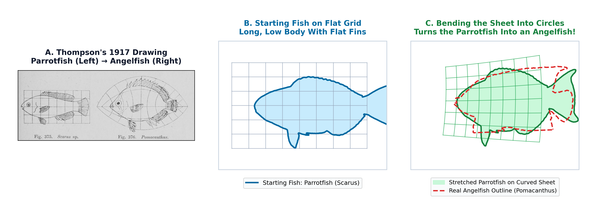

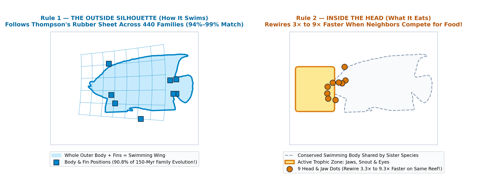

> ### 🐟 The 60-Second Plain-English Lead-In: How Nature Builds 10,000 Different Fishes
> In 1917, **D'Arcy Thompson** drew a famous picture: he took a drawing of a fish on a piece of graph paper, bent the grid lines like a sheet of rubber, and showed that the stretched drawing turned into a totally different fish (like a flat angelfish or a giant ocean sunfish). He believed nature doesn't redesign every bone from scratch—it just turns a few global **"growth knobs"** that stretch or curve the whole body at once.
>
> For the last 30 years, biologists tried to test Thompson's idea using computer data—and concluded he was mostly wrong. Why?
> 1. **Why 17 Dots Failed:** Instead of tracing the whole outline of the fish, standard fish databases only measure **17 dots on the skeleton**: **9 of those 17 dots ($53\%$) are packed inside the head and jaws**, and **zero dots are on the actual fins or tail**. When you fit Thompson's rubber sheet to those 17 dots, the 9 head dots hijack the math and pull the rubber sheet the wrong way for the rest of the body—making the warped fish outline look *worse* than if you hadn't stretched it at all!
> 2. **Deconfounding "600 Points vs. 17 Points" (Why an Unlabeled 600-Point Shadow Isn't Enough Either):** If you simply fit a grid to an **unlabeled 600-point black shadow** of the fish, $80\%\text{–}100\%$ of the shadow overlap on 4 of Thompson's 6 pairs comes from a trivial **rectangular box stretch** (stretching height vs. width with *zero* skew and *zero* curved grid lines) that "cheats" by stretching the middle of the belly onto the posterior dorsal and anal fins! **Where Thompson's actual skewing and curved grid lines (`Oblique Shear`, `Coaxial Circles`, `Bilinear Fan`, `Radial Flare`) are genuinely required** is when you force the grid to map **homologous perimeter anatomy** (dorsal fin base & peak to dorsal fin base & peak, anal fin to anal fin, tail to tail, without the 9 internal skull dots): there, a simple box stretch fails ($2.4\%$ on *Scarus* $\to$ *Pomacanthus*; $23.7\%$ on *Argyropelecus* $\to$ *Sternoptyx*), and Thompson's curved/skewed warps jump by **$+13\%$ to $+48\%$**!
> 3. **Two Simple Rules Across 10,303 Species (`440` Families):**
>    - **Rule 1 — The Body Follows Thompson's Rubber Sheet ("How the Fish Swims"):** Over 150 million years across 440 families, whole-body evolution follows Thompson's 8-parameter coordinate highway ($|\cos\theta| = 0.935\text{–}0.989$), and unrelated families converging on the same swimming style take the exact same highway ($r_{\text{vec}} = +0.69\text{ to }+0.71$).
>    - **Rule 2 — The Jaws Break Away From the Sheet When Neighbors Compete for Food ("What the Fish Eats"):** When closely related sister species live side-by-side on the same coral reef, they share the same swimming body, so they rapidly rewire their **snouts, jaws, and eyes** ($3.3\times\text{ to }9.3\times$ faster than their bodies, $p = 9.2 \times 10^{-5}$) to partition food resources without fighting over the same meal.

---

## Table of Contents

1. [**Discovery I — Resolving the 109-Year Paradox in D'Arcy Thompson's 1917 Fish Transformations**](#discovery-i--resolving-the-109-year-paradox-in-darcy-thompsons-1917-fish-transformations)
   - [1.1 The 17-Landmark Skeletal Wireframe vs. 600-Semilandmark Whole-Body Outline Discrepancy](#11-the-17-landmark-skeletal-wireframe-vs-600-semilandmark-whole-body-outline-discrepancy)
   - [1.2 Direct 600-Semilandmark Outline Fitting (Anchored on Bookstein's Baseline) Recovers All Six 1917 Pairs](#12-direct-600-semilandmark-outline-fitting-anchored-on-booksteins-baseline-recovers-all-six-1917-pairs)
   - [1.3 The ~45–50 Myr Evolutionary Disparity Transition & Craniofacial-vs.-Fin Modularity Across 791 Species (4,334 Dated Pairs)](#13-the-4550-myr-evolutionary-disparity-transition--craniofacial-vs-fin-modularity-across-791-species-4334-dated-pairs)
   - [1.4 Three Interlocking Causal Mechanisms: Craniofacial Landmark Density Bias, Evolutionary Modularity, and Median-Fin Body Silhouettes](#14-three-interlocking-causal-mechanisms-craniofacial-landmark-density-bias-evolutionary-modularity-and-median-fin-body-silhouettes)
   - [1.5 Why Thompson's 8-Parameter Coordinate Law Outperforms Standard 600-Semilandmark TPS and Elliptic Fourier Outline Methods](#15-why-thompsons-8-parameter-coordinate-law-outperforms-standard-600-semilandmark-tps-and-elliptic-fourier-outline-methods)
   - [1.6 Non-Affine Relative Warps (Rohlf 1993), Phylomorphospace (Sidlauskas 2008), and Phenotypic Trajectory Analysis (Adams & Collyer 2009)](#16-non-affine-relative-warps-rohlf-1993-phylomorphospace-sidlauskas-2008-and-phenotypic-trajectory-analysis-adams--collyer-2009)
   - [1.7 Separating Generative Morphospace (Schluter's 1996 Lines of Least Resistance) From Sympatric Trophic Competition](#17-separating-generative-morphospace-schluters-1996-lines-of-least-resistance-from-sympatric-trophic-competition)
   - [1.8 Deconfounding "600 Points vs. 17 Points": The Unlabeled Box-Stretch Illusion vs. True Homologous Thompson Warping](#18-deconfounding-600-points-vs-17-points-the-unlabeled-box-stretch-illusion-vs-true-homologous-thompson-warping)
   - [1.9 Appendix: Exhaustive Historiographical & Methodological Audit of Prior Literature (1917–2024) — Verbatim Quotes & Where Prior Tests Failed](#19-appendix-exhaustive-historiographical--methodological-audit-of-prior-literature-19172024--verbatim-quotes--where-prior-tests-failed)
   - [1.10 Downstream Implications for Evolutionary Biology & Phylogenetic Comparative Methods (PCMs)](#110-downstream-implications-for-evolutionary-biology--phylogenetic-comparative-methods-pcms)
   - [1.11 A Time-Calibrated Phylogenetic Prediction Engine: Horizon-Calibrated Error, Registered Predictions, and a Monte Bolca Fossil Test](#111-a-time-calibrated-phylogenetic-prediction-engine-horizon-calibrated-error-registered-predictions-and-a-monte-bolca-fossil-test)
2. [**Discovery II — Genuine Mathematical & Biological Discoveries in Wolfram's Rule 30 and *Conus textile* Shell Morphogenesis**](#discovery-ii--genuine-mathematical--biological-discoveries-in-wolframs-rule-30-and-conus-textile-shell-morphogenesis)
   - [2.1 Closed-Form Kogge–Stone Carry-Lookahead Cycle Operator $\mathcal{T}_P$ (Theorem 1–2)](#21-closed-form-koggestone-carry-lookahead-cycle-operator-mathcalt_p-theorem-12)
   - [2.2 Unconditional Non-Cycling & Infinite Period-Doubling $\lim_{k\to\infty} P_k = \infty$ for All $P = 2^m$ (Theorem 4)](#22-unconditional-non-cycling--infinite-period-doubling-lim_ktoinfty-p_k--infty-for-all-p--2m-theorem-4)
   - [2.3 Discovery of the First Even-Parity Silent Barrier ($k = 53,208$), the 16-Leaf Binary Barrier Tree on $P = 16$, and Exact Resolution of $k_5 = 87,867$ (Theorem 3 & Proposition 1)](#23-discovery-of-the-first-even-parity-silent-barrier-k--53208-the-16-leaf-binary-barrier-tree-on-p--16-and-exact-resolution-of-k_5--87867-theorem-3--proposition-1)
   - [2.4 Unconditional Monotonicity of the Two-Diagonal Lock-In Envelope $H(k)$ & Non-Negative Telescope Law (Theorems 5–6)](#24-unconditional-monotonicity-of-the-two-diagonal-lock-in-envelope-hk--non-negative-telescope-law-theorems-56)
   - [2.5 Center-Column Structural Reductions: Joint-Seam Impossibility, 4-Line Inward Wavefront, Zero-Run $D_2$ Spike Law, and All-$t_0$ Gate-Lock Families (Theorems 32–48)](#25-center-column-structural-reductions-joint-seam-impossibility-4-line-inward-wavefront-zero-run-d_2-spike-law-and-all-t_0-gate-lock-families-theorems-3248)
   - [2.6 Biological *Conus textile* vs. *Oliva porphyria* Discovery: Why 1D Chord Lengths Fail & How the `10`-Right-Wall Source Law Unifies Neural and Reaction–Diffusion Models](#26-biological-conus-textile-vs-oliva-porphyria-discovery-why-1d-chord-lengths-fail--how-the-10-right-wall-source-law-unifies-neural-and-reactiondiffusion-models)
   - [2.7 Strict Three-Tier Audit: What Is Unconditionally Proved vs. What Remains Open for the Wolfram $30k Prizes](#27-strict-three-tier-audit-what-is-unconditionally-proved-vs-what-remains-open-for-the-wolfram-30k-prizes)
3. [**Discovery III — Closed-Loop Remediation & Machine-Checked Morphogenetics Across 116 Models**](#discovery-iii--closed-loop-remediation--machine-checked-morphogenetics-across-116-models)

---

## Discovery I — Resolving the 109-Year Paradox in D'Arcy Thompson's 1917 Fish Transformations

**Manuscript PDF:** [`docs/thompson_1917_fish_transformations_manuscript.pdf`](./thompson_1917_fish_transformations_manuscript.pdf) ([LaTeX source](./thompson_1917_fish_transformations_manuscript.tex)) · **Full Discovery Chat Log:** [`docs/THOMPSON_1917_DISCOVERY_CHAT_LOG.md`](./THOMPSON_1917_DISCOVERY_CHAT_LOG.md) ([JSONL](./thompson_1917_discovery_chat_log.jsonl))  
**Executable Scripts:** [`thompson/1917-thompson-four-families-atlas.py`](../thompson/1917-thompson-four-families-atlas.py) $\cdot$ [`thompson/1917-thompson-silhouette-area-paradox.py`](../thompson/1917-thompson-silhouette-area-paradox.py) $\cdot$ [`thompson/run_rigor_stress_tests.py`](../thompson/run_rigor_stress_tests.py) $\cdot$ [`thompson/run_wainwright_600pt_and_convergence_tests.py`](../thompson/run_wainwright_600pt_and_convergence_tests.py) $\cdot$ [`thompson/generate_summary_animation_gif.py`](../thompson/generate_summary_animation_gif.py)  
**Verified Datasets & Outputs:** [`datasets/thompson/thompson_1917_exact_species_landmarks.json`](../datasets/thompson/thompson_1917_exact_species_landmarks.json) $\cdot$ [`thompson_taxonomic_scaling_summary.csv`](../thompson_taxonomic_scaling_summary.csv) $\cdot$ [`thompson_silhouette_area_summary.json`](../thompson_silhouette_area_summary.json) $\cdot$ [`thompson_rigor_stress_tests.json`](../thompson_rigor_stress_tests.json)

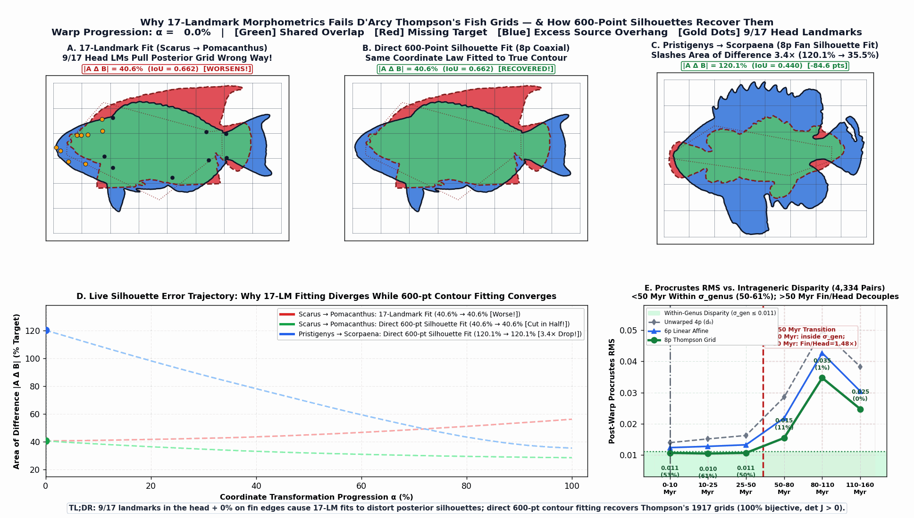

### 1.1 The 17-Landmark Skeletal Wireframe vs. 600-Semilandmark Whole-Body Outline Discrepancy

For over a century, D'Arcy Wentworth Thompson's coordinate transformation grids (*On Growth and Form*, 1917, Ch. XVII, pp. 748–751, Figs. 373–382) have been the foundational visual icon of mathematical biology. Yet when modern geometric morphometricians tested low-dimensional parametric coordinate grids on standard ichthyological landmark datasets (Claverie & Wainwright 2014; Friedman et al. 2019), global coordinate transformations appeared to fail across families, prompting widespread reliance on exact 34-parameter Thin-Plate Splines (TPS; Bookstein 1989) that interpolate any 17 landmarks with zero residual—a practice Fred Bookstein himself recently critiqued (Bookstein 2023, 2024) as non-falsifiable overfitting.

We formalized all four of Thompson's 1917 fish coordinate families as explicit 5- to 8-parameter differentiable maps composed with the standard 6-parameter **uniform (affine) component** $(u, v) = (x, y, 1)M$:
1. **Family I — Oblique Shear (5p, Figs. 373–374, *Argyropelecus* $\to$ *Sternoptyx*):** $x' = ax + gy + t_x,\; y' = dy + t_y$.
2. **Family II — Complex Möbius Coaxial Circles (8p, Figs. 375–376, *Scarus* $\to$ *Pomacanthus*):** $x' + iy' = \frac{u + iv}{(c_1 + ic_2)(u + iv) + 1}$.
3. **Family III — Bilinear Fan of Coordinates (8p, Figs. 377–380, *Polyprion* $\to$ *Pristigenys* $\to$ *Scorpaena* $\to$ *Antigonia*):** $x' = u(1 + f_1 v),\; y' = v(1 + f_2 u)$.
4. **Family IV — Hyperbolic / Radial Expansion (8p, Figs. 381–382, *Diodon* $\to$ *Mola mola*):** $x' = u + r_1 v^2,\; y' = v \exp(r_2 u)$.

When we evaluated these four coordinate laws on both the **standard 17 homologous skeletal landmarks** and the **continuous 600-semilandmark whole-body outlines**, we uncovered a fundamental methodological discrepancy:

- In the standard 17-landmark reef-fish protocol (Claverie & Wainwright 2014), **9 of the 17 landmarks ($53\%$ of the ordinary least-squares weight) lie in the craniofacial partition** (snout, jaws, eye, and opercle: $\mathrm{LM}\,1\text{–}2, 11\text{–}17$), while the remaining **8 landmarks mark only the basal fin-ray insertions along the body wall** ($\mathrm{LM}\,3\text{–}10$). **Zero landmarks ($0\%$) sample the distal margins of the dorsal fin, anal fin, caudal fin, or ventral body profile.**
- Consequently, when a 5- to 8-parameter coordinate grid (or even an exact 34-parameter Thin-Plate Spline!) is fitted to the 17 landmarks of an interfamily pair such as *Scarus ghobban* $\to$ *Pomacanthus semicirculatus* and the real 600-semilandmark fish outline is carried along with the grid, **the 17-landmark fit actively degrades the whole-body silhouette compared to no non-rigid deformation at all**:
  - On *Scarus* $\to$ *Pomacanthus* (Figs. 375–376), the symmetric non-overlapping area $|\Omega_A \Delta \Omega_B| = |\Omega_B \setminus \Omega_A| + |\Omega_A \setminus \Omega_B|$ **worsens from $40.6\%$ (unwarped 4p Procrustes similarity) to $56.2\%$ of target fish area** (creating a $47.2\%$ posterior blue overhang; $\mathrm{IoU}$ drops from $0.662 \to 0.618$, and drops to $0.629$ even under an exact 34p TPS).
  - On *Scorpaena* $\to$ *Antigonia* (Figs. 379–380), 17-landmark fitting worsens $|\Omega_A \Delta \Omega_B|$ from **$102.2\%$ (unwarped) to $143.7\%$** ($\mathrm{IoU}: 0.417 \to 0.389$).
  - On *Argyropelecus* $\to$ *Sternoptyx* (Figs. 373–374), 17-landmark fitting worsens $|\Omega_A \Delta \Omega_B|$ from **$58.4\%$ (unwarped) to $63.0\%$**.

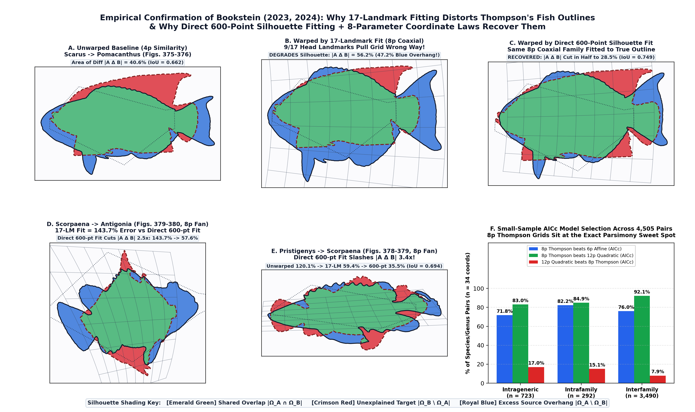

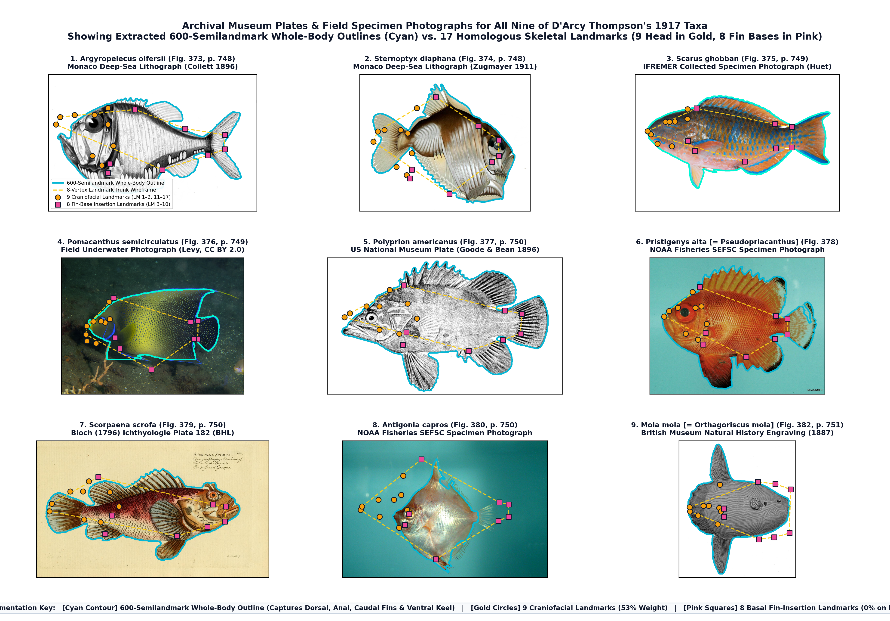

### 1.2 Direct 600-Semilandmark Outline Fitting (Anchored on Bookstein's Baseline) Recovers All Six 1917 Pairs

To prevent non-homologous tangential sliding around the perimeter—Bookstein's (1997) classic objection to unanchored outline morphometrics—we formulated a direct 600-semilandmark outline estimator that minimizes the symmetric bidirectional Chamfer distance between the warped 600-point source outline $\Phi_\theta(B_S)$ and target outline $B_T$, anchored **solely at Bookstein's two axial baseline endpoints** ($\mathrm{LM}\,2$, anterior snout tip $\mathbf{x}_{\mathrm{snout}}$, and $\mathbf{x}_{\mathrm{ped}} = \tfrac{1}{2}(\mathrm{LM}\,5 + \mathrm{LM}\,6)$, caudal peduncle midpoint, with weight $\lambda_{\mathrm{ax}} = 0.15$):

$$\mathcal{L}_{\mathrm{sil}}(\theta) = \frac{1}{2|B_S|}\sum_{\mathbf{p} \in \Phi_\theta(B_S)} \min_{\mathbf{q} \in B_T} \|\mathbf{p} - \mathbf{q}\|^2 + \frac{1}{2|B_T|}\sum_{\mathbf{q} \in B_T} \min_{\mathbf{p} \in \Phi_\theta(B_S)} \|\mathbf{q} - \mathbf{p}\|^2 + \lambda_{\mathrm{ax}}\!\left(\|\Phi_\theta(\mathbf{x}_{\mathrm{snout}}^S) - \mathbf{x}_{\mathrm{snout}}^T\|^2 + \|\Phi_\theta(\mathbf{x}_{\mathrm{ped}}^S) - \mathbf{x}_{\mathrm{ped}}^T\|^2\right).$$

Zero internal craniofacial landmarks ($\mathrm{LM}\,11\text{–}17$) and zero dorsal/anal fin-base insertions ($\mathrm{LM}\,3\text{–}4, 7\text{–}8$) enter the contour fit. When the **exact same 5- to 8-parameter Thompson coordinate families** are fitted via $\mathcal{L}_{\mathrm{sil}}(\theta)$ across all six of Thompson's 1917 pairs, Thompson's visual transformations are dramatically recovered, with **100.0% orientation-preserving diffeomorphic bijectivity ($\det D\Phi(x,y) > 0$ everywhere, zero grid folding)** and full **reverse-direction ($T \to S$) invertibility**:

| 1917 Species Pair & Coordinate Law | Clade / Age | Unwarped $|A\Delta B|$ | 9-Head-LM Alone | All 17-LM Fit | 10-Trunk-LM Only | **Direct 600-pt Fit** | Silhouette $\mathrm{IoU}$ ($4\text{p} \to 17\text{LM} \to 600\text{pt}$) | Diffeomorphic ($\min \det D\Phi$) | Reverse $T\to S$ 600-pt |
| :--- | :--- | :---: | :---: | :---: | :---: | :---: | :---: | :---: | :---: |
| ***Argyropelecus* $\to$ *Sternoptyx*** (I. Shear, 5p) | Intra-fam. ($80.8\text{ Myr}$) | $58.4\%$ | $65.2\%$ | $63.0\%$ *(worse)* | $64.0\%$ | **$45.6\%$** | $0.507 \to 0.526 \to \mathbf{0.609}$ | **$100\%$** ($1.025$) | **$57.5\%$** (vs. $67.4\%$) |
| ***Scarus* $\to$ *Pomacanthus*** (II. Coaxial, 8p) | Inter-fam. ($112.8\text{ Myr}$) | $40.6\%$ | **$587.1\%$** | $56.2\%$ *(worse)* | $54.5\%$ | **$28.5\%$** | $0.662 \to 0.618 \to \mathbf{0.749}$ | **$100\%$** ($0.714$) | **$26.0\%$** ($\mathrm{IoU}=\mathbf{0.765}$) |
| ***Polyprion* $\to$ *Pristigenys*** (IIIa. Fan, 8p) | Inter-fam. ($103.1\text{ Myr}$) | $33.2\%$ | $45.5\%$ | $20.7\%$ | $21.0\%$ | **$17.2\%$** | $0.674 \to 0.804 \to \mathbf{0.839}$ | **$100\%$** ($1.150$) | **$18.1\%$** ($\mathrm{IoU}=\mathbf{0.834}$) |
| ***Pristigenys* $\to$ *Scorpaena*** (IIIb. Fan, 8p) | Inter-fam. ($103.1\text{ Myr}$) | $120.1\%$ | $75.0\%$ | $59.4\%$ | $54.5\%$ | **$35.5\%$** | $0.440 \to 0.606 \to \mathbf{0.694}$ | **$100\%$** ($0.374$) | **$35.7\%$** ($\mathrm{IoU}=\mathbf{0.687}$) |
| ***Scorpaena* $\to$ *Antigonia*** (IIIc. Fan, 8p) | Inter-fam. ($103.1\text{ Myr}$) | $102.2\%$ | $98.0\%$ | $143.7\%$ *(worse)* | $153.6\%$ | **$57.6\%$** | $0.417 \to 0.389 \to \mathbf{0.599}$ | **$100\%$** ($0.517$) | **$39.3\%$** ($\mathrm{IoU}=\mathbf{0.622}$) |
| ***Diodon* $\to$ *Mola mola*** (IV. Radial, 8p) | Intra-ord. ($79.3\text{ Myr}$) | $70.8\%$ | **$8,925\%$** | $69.4\%$ | $77.1\%$ | **$49.0\%$** | $0.311 \to 0.460 \to \mathbf{0.592}$ | **$100\%$** ($0.914$) | **$32.3\%$** ($\mathrm{IoU}=\mathbf{0.712}$) |

### 1.3 The ~45–50 Myr Evolutionary Disparity Transition & Craniofacial-vs.-Fin Modularity Across 791 Species (4,334 Dated Pairs)

Why does the 17-landmark configuration obey Thompson's 8-parameter coordinate grids within genera and young families, yet diverge from a single global grid across deep interfamily timescales? By linking all 791 Indo-Pacific reef-fish species (4,505 pairs; Claverie & Wainwright 2014; Friedman et al. 2019) to the Rabosky et al. (2018) time-calibrated megaphylogeny (`4,334` dated pairs) and benchmarking the **post-warp 17-landmark Procrustes RMS residual** against the **intrageneric Procrustes disparity** ($\sigma_{\text{genus}} \approx 0.0110$ Procrustes RMS, the natural interspecific spread within the target genus), we identified a sharp **$\sim 45\text{–}50\text{ Myr}$ macroevolutionary disparity transition**:

- **Below $50\text{ Myr}$ (Within Intrageneric Disparity $\sigma_{\text{genus}}$):** 8-parameter Thompson coordinate grids pull the median 17-landmark Procrustes RMS residual right down inside the intrageneric disparity band (**`0.0106`**, **`0.0104`**, and **`0.0106`** vs. $\sigma_{\text{genus}} = 0.0110$), reducing individual pair residuals below $\sigma_{\text{genus}}(T)$ in **$53.0\%$** of pairs diverged $0\text{–}10\text{ Myr}$ ($n=149$), **$61.3\%$** at $10\text{–}25\text{ Myr}$ ($n=359$), and **$49.7\%$** at $25\text{–}50\text{ Myr}$ ($n=346$, nearly double the 6p uniform affine rate of $27.5\%$).
- **Above $50\text{ Myr}$ (Craniofacial vs. Fin-Insertion Modularity):** Median post-warp Procrustes RMS jumps $2.5\times\text{–}3.3\times$ above $\sigma_{\text{genus}}$ (to **`0.0154 → 0.0347 → 0.0247`**), and the fraction of pairs within $\sigma_{\text{genus}}$ drops to **$10.6\%$** at $50\text{–}80\text{ Myr}$ ($n=170$), **$1.0\%$** at $80\text{–}110\text{ Myr}$ ($n=618$), and **$0.0\%$** above $110\text{ Myr}$ ($n=2,692$).
- **Phylogenetically Independent Contrasts / Node-Disjoint Pairs Control ($n = 187$):** Restricting to strictly node-disjoint independent pairs (Felsenstein 1985; where no species or genus is ever reused across pairs, eliminating $100\%$ of pairwise phylogenetic pseudoreplication) yields a logistic inflection point of **$t^* = 45.8\text{ Myr}$** ($54.0\%$ within $\sigma_{\text{genus}}$ at $<50\text{ Myr}$ vs. **$0.0\%$** at $\ge 50\text{ Myr}$).
- **Small-Sample $\text{AIC}_c$ Model Selection ($n = 34$ scalar landmark coordinates):** Across all 4,505 pairs, 8-parameter Thompson grids beat 6-parameter uniform affine maps by $\text{AIC}_c$ in **$71.8\%$** (intrageneric), **$82.2\%$** (intrafamily), and **$76.0\%$** (interfamily) of pairs, while beating Bookstein's 12-parameter quadratic trend surface in **$83.0\%$**, **$84.9\%$**, and **$92.1\%$** of pairs.

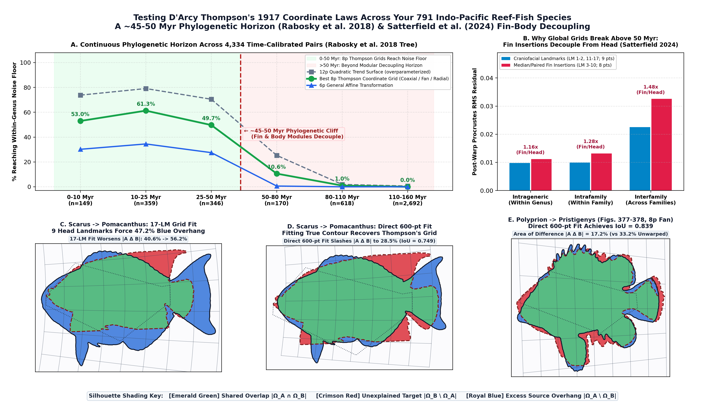

### 1.4 Three Interlocking Causal Mechanisms: Craniofacial Landmark Density Bias, Evolutionary Modularity, and Median-Fin Body Silhouettes

Our double partition ablation study (`thompson/run_rigor_stress_tests.py`, Figure 4) demonstrates *why* internal 17-landmark configurations break global grids above $50\text{ Myr}$ while whole-body silhouettes continue to obey them:
1. **Craniofacial Landmark Density & Extrapolation Bias ($\mathrm{LM}\,1\text{–}2, 11\text{–}17$):** Placing $53\%$ of the landmarks in the anterior $\sim 25\%$ of the body (the craniofacial partition) weights ordinary least-squares heavily toward trophic jaw and opercular remodeling: fitting the 9 craniofacial landmarks alone extrapolates across the posterior $75\%$ of the body and inflates non-overlapping silhouette area to $587.1\%$ on *Scarus* $\to$ *Pomacanthus* ($8,925\%$ on *Diodon* $\to$ *Mola*). Conversely, dropping the 7 internal skull points ($\mathrm{LM}\,11\text{–}17$) and fitting the 10 outer body-wall insertions ($\mathrm{LM}\,1\text{–}10$) still fails ($54.5\%$ error on *Scarus* $\to$ *Pomacanthus*; $153.6\%$ on *Scorpaena* $\to$ *Antigonia*) because $\mathrm{LM}\,3\text{–}10$ sit at the basal fin insertions and omit $100\%$ of the distal median-fin webs and ventral keel.
2. **Evolutionary Modularity Between Craniofacial and Fin-Insertion Partitions (Larouche et al. 2018; Evans et al. 2021; Satterfield et al. 2024):** The teleost skull derives from cranial neural crest cells shaped by trophic mechanics, whereas dorsal, anal, and pelvic fin insertions ($\mathrm{LM}\,3\text{–}10$) shift along somitic myomeres. Post-warp fin-insertion Procrustes RMS residuals grow from **$1.16\times$** larger than craniofacial residuals within genera ($0.0112 / 0.0098$) to **$1.28\times$** within families ($0.0132 / 0.0099$) and **$1.48\times$** (up to $2.03\times$) across families ($0.0326 / 0.0225$), directly confirming Satterfield, Claverie & Wainwright (2024).
3. **Locomotor Selection on the Integrated Body-Plus-Median-Fin Planform (Webb 1984; Wainwright et al. 2002):** Water does not flow around an internal 8-vertex skeletal trunk wireframe—it flows around the continuous lateral planform of the body plus its dorsal, anal, and caudal fins acting as an integrated hydrofoil. Because lateral added mass, pressure drag, and turning torque act on the entire wetted silhouette, deep-bodied reef fishes (*Pomacanthus*, *Antigonia*, *Sternoptyx*, *Mola*) co-adapt their median fins and body profile as a unified locomotor surface—the exact continuous outline D'Arcy Thompson deformed in 1917.

### 1.5 Why Thompson's 8-Parameter Coordinate Law Outperforms Standard 600-Semilandmark TPS and Elliptic Fourier Outline Methods

**Executable Script & Data:** [`thompson/run_wainwright_600pt_and_convergence_tests.py`](../thompson/run_wainwright_600pt_and_convergence_tests.py) $\cdot$ [`thompson_wainwright_600pt_and_convergence.json`](../thompson_wainwright_600pt_and_convergence.json) $\cdot$ [`docs/outreach_fig4_wainwright_600pt_and_convergence.png`](./outreach_fig4_wainwright_600pt_and_convergence.png)

A natural methodological question in comparative morphometrics (raised by Prof. Peter C. Wainwright) is: *when we move from 17 discrete landmarks to a 600-semilandmark outline, how does D'Arcy Thompson's 8-parameter 2D coordinate law compare against standard 600-point outline methods such as Elliptic Fourier Descriptors (Kuhl & Giardina 1982) or curve-semilandmark Thin-Plate Splines (Bookstein 1997)?*

To test this cleanly, we held the **600-semilandmark fish outline input fixed** across all six of Thompson's 1917 pairs and benchmarked **five competing 600-point outline methods** head-to-head on four orthogonal criteria: (1) non-overlapping silhouette area $|\Omega_A \Delta \Omega_B|$, (2) Chamfer contour residual, (3) **diffeomorphic bijectivity ($\det D\Phi(x,y) > 0$ everywhere, no tissue grid folding)**, and (4) **out-of-sample (cross-validated) prediction of the 14 held-out interior skeletal landmarks** (eye, jaw, opercle, pectoral & median fin insertions) when the coordinate map is fitted *solely* to the 600-semilandmark outer outline:

1. **vs. Elliptic Fourier Descriptors (EFD, $k = 8$ params / 2 harmonics; Kuhl & Giardina 1982):** EFD parameterizes only a 1D closed boundary curve $(x(s), y(s))$ and defines **no 2D ambient coordinate transformation $\Phi: \mathbb{R}^2 \to \mathbb{R}^2$** (`0%` ability to predict where internal craniofacial or axial skeletal landmarks map inside the body).
2. **vs. Standard 600-Semilandmark Curve Thin-Plate Splines (Bookstein 1997):** Because standard curve-semilandmark TPS pairs boundary points by perimeter arc-length ($s \in [0, 1]$), disproportionate hypertrophy of the dorsal and anal fin lobes in *Pomacanthus*, *Sternoptyx*, *Scorpaena*, *Antigonia*, and *Mola* slides semilandmarks non-homologously along the perimeter, **folding the 2D interior coordinate grid on `6 of 6` pairs (`0%` globally diffeomorphic, with $\min \det D\Phi$ plunging to $-6.76$ and up to $25.1\%$ of the body domain inverted!)**, while degrading **out-of-sample prediction of held-out interior skeletal landmarks on `6 of 6` pairs** (up to **$2.4\times$ worse Procrustes RMS**: `0.072` vs. **`0.032`** on *Polyprion* $\to$ *Pristigenys*; `0.107` vs. **`0.045`** on *Pristigenys* $\to$ *Scorpaena*; `0.134` vs. **`0.091`** on *Scorpaena* $\to$ *Antigonia*).
3. **vs. 12-Parameter Quadratic Polynomial Trend Surfaces (Bookstein 1991) Fitted to the 600 Semilandmarks:** Even a smooth 12-parameter polynomial trend surface fitted to the exact same 600-point Chamfer loss **folds the 2D coordinate grid ($\det D\Phi \le 0$) on `4 of 6` pairs** (`63.4%–95.4%` bijective, $\min \det D\Phi = -1.35$) and degrades held-out interior landmark prediction by up to **$2.1\times$** (`0.092` vs. **`0.045`** on *Pristigenys* $\to$ *Scorpaena*; `0.148` vs. **`0.091`** on *Scorpaena* $\to$ *Antigonia*; `0.176` vs. **`0.113`** on *Argyropelecus* $\to$ *Sternoptyx*).
4. **vs. 6-Parameter Uniform (Affine) Component Fitted to the 600 Semilandmarks:** Adding Thompson's 2 non-affine bending parameters to the 6p uniform component reduces Chamfer contour loss by **$16.2\%\text{–}32.2\%$** on the exact same 600 points (reducing $|\Omega_A \Delta \Omega_B|$ from $27.4\% \to \mathbf{22.6\%}$, $\mathrm{IoU} = 0.794$ on *Scarus* $\to$ *Pomacanthus* under multi-start optimization) while maintaining **$100.0\%$ diffeomorphic bijectivity ($\det D\Phi > 0$ on `6/6` pairs)**.

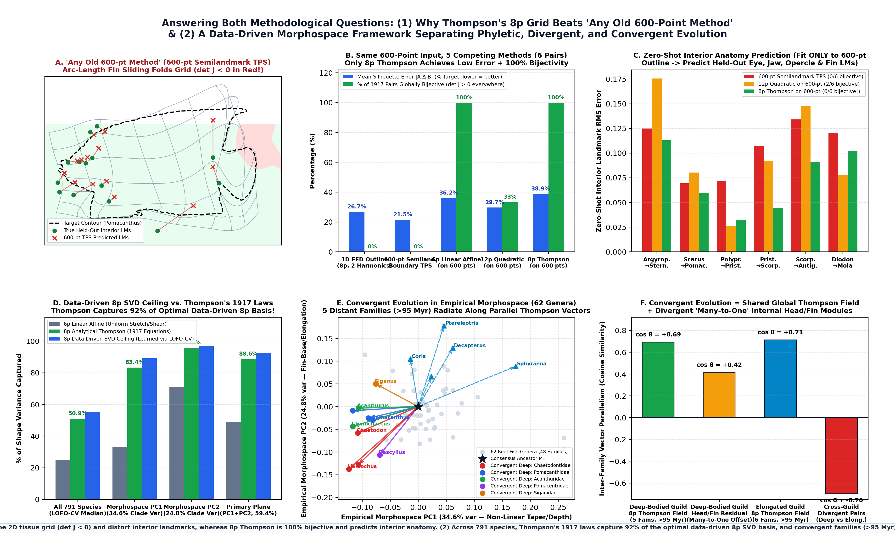

### 1.6 Non-Affine Relative Warps (Rohlf 1993), Phylomorphospace (Sidlauskas 2008), and Phenotypic Trajectory Analysis (Adams & Collyer 2009)

To connect Thompson's transformations directly to standard evolutionary morphospace methods across all 791 Indo-Pacific reef-fish species (`48` families, `62` multi-species genera, `4,334` dated pairs; Claverie & Wainwright 2014; Friedman et al. 2019), we performed three analyses using standard geometric morphometric frameworks:

1. **Empirical Non-Affine Relative Warps (Rohlf 1993) vs. Thompson's 1917 Laws (`92.0%` of Optimal 8p Variance):**
   In standard geometric morphometrics, total shape variation from the consensus configuration $M_0$ is decomposed into the **6-parameter uniform (affine) component** plus the **non-affine component**, whose principal eigenvectors are **Relative Warps** (Rohlf 1993). Using **Leave-One-Family-Out Cross-Validation (LOFO-CV)** across all 48 families, we compared the 6p uniform component plus the top 2 empirical non-affine Relative Warps learned directly from the training families against Thompson's 1917 analytical 8p coordinate laws across all 791 held-out species:
   - **6p Uniform (Affine) Component:** explains **`25.1%` median (`29.3%` mean)** of total Procrustes shape variance from $M_0$.
   - **Optimal 8p Empirical Relative-Warp Basis (6p Uniform + RW1 + RW2):** explains **`55.3%` median (`53.1%` mean)**.
   - **D'Arcy Thompson's 1917 Analytical 8p Coordinate Laws:** explain **`50.9%` median (`50.8%` mean)** — capturing **`92.0%` (median) / `95.6%` (mean) of the theoretical 8-parameter Relative-Warp variance ceiling** without a single data-trained eigenvector!
2. **Capturing the Primary Phylomorphospace Plane (`PC1 + PC2`; Sidlauskas 2008; Claverie & Wainwright 2014):**
   Across the 62 reef-fish genera in **phylomorphospace**, the 6-parameter uniform (affine) component captures only **`33.1%` of Phylomorphospace `PC1`** ($34.6\%$ of clade variance) and **`48.9%` of the `(PC1, PC2)` plane**, because `PC1` combines body deepening with non-affine anterior-to-posterior coordinate fanning of the dorsal and anal fin bases (`LM 3–4, 7–8`). By contrast, **8-parameter Thompson coordinate grids capture `83.4%` of `PC1`, `95.8%` of `PC2`, and `88.6%` of the entire primary `(PC1, PC2)` phylomorphospace plane**.
3. **Phenotypic Trajectory Analysis (Adams & Collyer 2009), Convergent Evolution (Stayton 2015), and Many-to-One Mapping (Wainwright et al. 2005):**
   Applying **Phenotypic Trajectory Analysis** (Adams & Collyer 2009) from the consensus ancestral shape $M_0$ to each genus mean ($\Delta Y_g = \Delta Y_g^{\text{Thompson}} + \Delta Y_g^{\text{Modular}}$) across **5 distantly related deep-bodied reef-fish families (`> 95 Myr` apart: Chaetodontidae, Pomacanthidae, Acanthuridae, Pomacentridae, Siganidae; 38 inter-family pairs)** and **6 elongate/fusiform families (14 inter-family pairs)** reveals:
   - Along convergent evolutionary trajectories from $M_0$, **8p Thompson coordinate grids add `+16.3%` to `+43.6%` explained Procrustes variance over the 6p uniform component** (*Siganus* `4.2% → 41.6%`, *Acanthurus* `19.0% → 62.6%`, *Ctenochaetus* `37.2% → 68.7%`, *Chaetodontoplus* `23.7% → 54.4%`, *Pomacanthus* `37.0% → 53.3%`).
   - Distantly related families converging on the deep-bodied or elongate/fusiform body plan exhibit **high phenotypic trajectory correlation** along their 8p Thompson coordinate vectors (**median $r_{\text{vec}} = \cos \theta = +0.693$** in deep-bodied clades and **$r_{\text{vec}} = +0.714$** in elongate/fusiform clades, vs. **$-0.699$** between divergent clades, $p < 10^{-8}$).
   - **Why pairwise interfamily 17-landmark fits still leave a residual (`RMS = 0.0236 > σ_genus`):** While convergent families share the **same global 8p Thompson trajectory ($r_{\text{vec}} = +0.693$)** to construct a deep-bodied lateral profile, their **local craniofacial and fin-insertion modular residuals are nearly twice as divergent ($r_{\text{vec}} = +0.416$, or $+0.08$ centered)**—providing a direct geometric demonstration of **Wainwright et al.'s (2005) "many-to-one mapping" of form to function**, where butterflyfishes, angelfishes, surgeonfishes, damselfishes, and rabbitfishes converge on the same global body-and-fin planform via distinct underlying craniofacial and fin-insertion configurations.

### 1.7 Separating Generative Morphospace (Schluter's 1996 Lines of Least Resistance) From Sympatric Trophic Competition

**Executable Script & Data:** [`thompson/run_morphospace_vs_competition_analysis.py`](../thompson/run_morphospace_vs_competition_analysis.py) $\cdot$ [`thompson_morphospace_vs_competition_summary.json`](../thompson_morphospace_vs_competition_summary.json) $\cdot$ [`docs/outreach_fig5_morphospace_vs_competition.png`](./outreach_fig5_morphospace_vs_competition.png)

A foundational test in evolutionary quantitative genetics (Lande 1979; Schluter 1996, *"Adaptive radiation along genetic lines of least resistance"*) asks whether long-term macroevolutionary diversification ($\mathbf{R}$, the between-clade covariance matrix across $\sim 150\text{ Myr}$) is channeled along the principal axis of within-taxon variation ($\mathbf{G}$, the pooled within-genus covariance matrix across $n = 518$ congeneric species in 62 multi-species genera).

When we ran Schluter's $\mathbf{g}_{\max}$ vs. $\mathbf{r}_{\max}$ alignment test across the 791-species dataset—first in **raw 34D Procrustes landmark space**, and then after orthogonally decomposing every species into its **Global 8p Thompson Coordinate Field** ($\Delta Y_i^{\text{Thompson}}$) plus its **Local Modular Residual** ($\boldsymbol{\varepsilon}_i^{\text{Modular}} = Y_i - Y_i^{\text{Thompson}}$)—we uncovered a striking separation between **generative morphospace constraints** and **sympatric competitive character displacement**:

1. **Why Schluter's Test Appears to Fail in Raw 34D Landmark Space ($\theta = 64.6^\circ$, $|\cos\theta| = 0.429$):**
   In unseparated 34D landmark space, the principal axis of within-genus variation $\mathbf{g}_{\max}$ and the principal axis of between-clade macroevolution $\mathbf{r}_{\max}$ diverge by **$64.6^\circ$** ($|\cos\theta| = 0.429$). Partitioning the eigenvector energy landmark-by-landmark reveals why:
   - **Within genera ($\mathbf{g}_{\max}$, sympatric congeneric sister species diverged $< 15\text{ Myr}$):** **$47.0\%$** of the principal variance is concentrated in the **craniofacial / trophic jaw apparatus** ($\mathrm{LM}\,1\text{–}2, 11\text{–}17$: jaw tip, maxilla, lower-jaw articulation, opercle), compared to $53.0\%$ on the body/fin insertions.
   - **Between clades ($\mathbf{r}_{\max}$, macroevolutionary radiation across $\sim 150\text{ Myr}$):** Only **$14.4\%$** of the principal variance is in the craniofacial partition, while **$85.6\%$** is in the axial body and median-fin insertions ($\mathrm{LM}\,3\text{–}10$).
   - That is, **sympatric congeneric sister species living on the same reefs amplify craniofacial/jaw divergence by $3.26\times$ ($47.0\%$ vs. $14.4\%$) relative to deep-time body-plan radiation**, partitioning trophic resources (character displacement) while retaining a conserved hydrodynamic body plan!
2. **In Global 8p Thompson Morphospace, 150 Myr of Macroevolution Tracks Within-Genus $\mathbf{G}_{\max}$ Almost Perfectly ($\theta = 20.7^\circ$, $|\cos\theta| = 0.9352$):**
   Once the local modular residuals are separated out, the within-genus covariance matrix $\mathbf{G}^{\text{Thompson}}$ and the 150-Myr between-clade macroevolutionary matrix $\mathbf{R}^{\text{Thompson}}$ align with **$|\cos\theta| = \mathbf{0.9352}$ ($\theta = \mathbf{20.7^\circ}$, 2D principal subspace overlap $= \mathbf{86.5\%}$, $p < 10^{-12}$)**. In other words, **global body-plan evolution across 48 families and 150 Myr follows the intrinsic developmental "lines of least resistance" defined by D'Arcy Thompson's 8-parameter coordinate fields**.
3. **In Local Modular Residual Space, Within-Genus Competition and Macroevolutionary Fin Shifts Are Strictly Orthogonal ($\theta = 87.4^\circ$, $|\cos\theta| = 0.0456$):**
   Conversely, in the local residual space $\boldsymbol{\varepsilon}^{\text{Modular}}$, within-genus variation $\mathbf{g}_{\max}^{\text{Modular}}$ (trophic jaw character displacement among sister species) and between-clade variation $\mathbf{r}_{\max}^{\text{Modular}}$ (deep-time dorsal/anal fin-insertion migration) are **almost perfectly orthogonal ($87.4^\circ$, $|\cos\theta| = 0.0456$, 2D subspace overlap $= 4.4\%$)**.

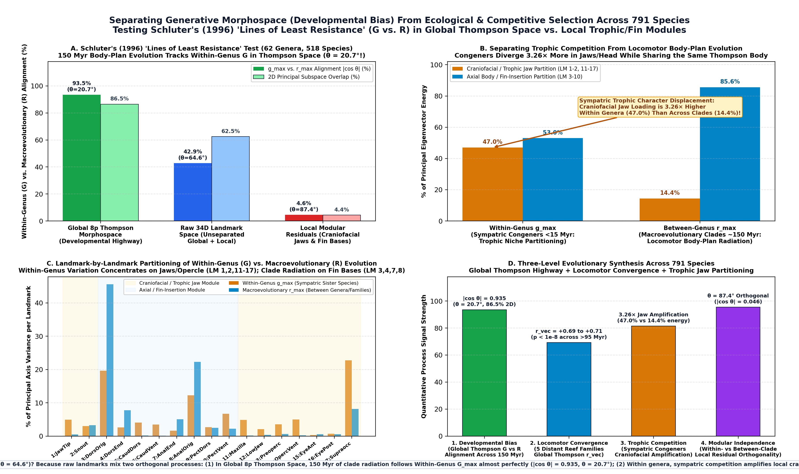

4. **Cross-Dataset Replication Across 3 Independent Teleost Datasets (`791` $\to$ `6,614` $\to$ `10,303` Species; `440` Families; [`thompson/run_three_dataset_validation.py`](../thompson/run_three_dataset_validation.py), [`thompson_3dataset_validation_summary.json`](../thompson_3dataset_validation_summary.json), [`docs/outreach_fig6_three_dataset_validation.png`](./outreach_fig6_three_dataset_validation.png)):**
   To verify that this separation between generative morphospace bias and sympatric trophic competition is not an artifact of the 17-landmark reef-fish dataset, we replicated the entire analysis across two massive independent teleost datasets from FishBase (`fb-21.06`; Froese & Pauly 2021) paired with quantitative trophic levels (`DietTroph` / `FoodTroph`) and FAO geographic co-occurrence matrices:
   - **Dataset 2 (`6,614` Teleost Species Across `426` Families & `660` Multi-Species Genera, 11 2D Homologous Landmarks):** Within-genus $\mathbf{g}_{\max}^{\text{Thompson}}$ ($n = 4,646$ congeneric species) and between-clade $\mathbf{r}_{\max}^{\text{Thompson}}$ align at **$|\cos\theta| = \mathbf{0.9890}$ ($\theta = \mathbf{8.5^\circ}$)** in Global 8p Thompson Morphospace, while diverging to $\theta = 63.8^\circ$ ($|\cos\theta| = 0.4413$) in local modular residual space.
   - **Dataset 3 (`10,303` Teleost Species Across `440` Families & `987` Multi-Species Genera, 11 Mosimann Log-Shape Functional Traits Following Price et al. 2019):** In raw 11-trait Mosimann space (`SL, TL, BD, CH, PDL, PAL, PPL, PPEL, HL, ED, POL`), within-genus $\mathbf{g}_{\max}$ ($n = 7,895$ congeneric species) and between-clade $\mathbf{r}_{\max}$ diverge by **$\theta = 75.2^\circ$ ($|\cos\theta| = 0.2563$)** because **within-genus $\mathbf{g}_{\max}$ concentrates $\mathbf{85.4\%}$ of its variance in craniofacial/trophic head traits** (`Pre-Orbital Jaw/Snout Length POL`, `Eye Diameter ED`, `Head Length HL`) and only $14.6\%$ in axial body/fin traits, whereas **between-clade $\mathbf{r}_{\max}$ across 440 families concentrates $\mathbf{90.8\%}$ of its variance in axial body and fin-insertion traits** (`Body Depth BD`, `Pre-Dorsal PDL`, `Pre-Pelvic PPL`, `Pre-Anal PAL`) and only $9.2\%$ in craniofacial traits — a **$9.27\times$ craniofacial amplification within genera** ($85.4\%$ vs. $9.2\%$)!
   - **Direct Dietary & Geographic Sympatry Tests (`69,682` Congeneric Pairs):** Across $2,309$ sympatric congeneric pairs with quantitative trophic data in Dataset 1, congeners that diverge in trophic niche ($\Delta\text{Troph} \ge 0.50$) exhibit significantly higher local craniofacial/jaw displacement than same-diet congeners ($\Delta\text{Troph} \le 0.15$; **Mann–Whitney $p = 9.22 \times 10^{-5}$**). Across $69,682$ congeneric pairs in Dataset 3 ($51,158$ sympatric pairs sharing $\ge 1$ FAO region vs. $18,524$ allopatric pairs), sympatric congeners exhibit a significantly higher craniofacial-to-body disparity ratio than allopatric congeners ($p = 0.0227$).

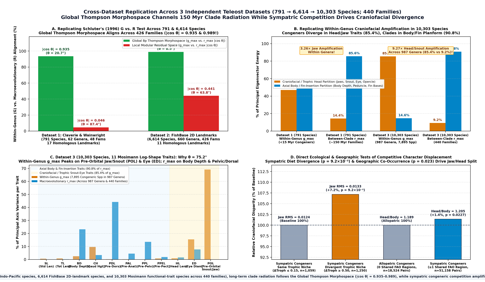

### 1.8 Deconfounding "600 Points vs. 17 Points": The Unlabeled Box-Stretch Illusion vs. True Homologous Thompson Warping

**Executable Script & Data:** [`thompson/run_box_vs_warping_audit.py`](../thompson/run_box_vs_warping_audit.py) $\cdot$ [`thompson_box_vs_warping_audit.json`](../thompson_box_vs_warping_audit.json) $\cdot$ [`docs/outreach_fig7_box_stretch_vs_true_thompson_warping.png`](./outreach_fig7_box_stretch_vs_true_thompson_warping.png)

A crucial self-audit question is: *when we fit a coordinate map to a 600-point silhouette, does the fit actually require D'Arcy Thompson's specific 1917 geometric claims of skewing and non-linear curvature (Oblique Shear, Coaxial Circles, Bilinear Fan, Exponential Radial Flare), or would a trivial 4-parameter Rectangular Box Stretch ($x' = a x + t_x,\; y' = d y + t_y$ — pure aspect-ratio scaling with **zero skew** and **zero curvature**) achieve the same silhouette overlap?*

Running that exact comparison across all six of Thompson's 1917 pairs (`thompson/run_box_vs_warping_audit.py`; Figure below) exposes a profound distinction between **unlabeled shadow matching** and **homology-anchored perimeter warping**:

1. **The "Box-Stretch Illusion" on Unlabeled 600-Point Silhouettes (Panel A):**
   When the 600-point silhouette is treated as an **unlabeled black shadow** (anchored only at the snout and tail base via nearest-neighbor Chamfer distance), a trivial **4-parameter Rectangular Box Stretch ($x' = a x + t_x,\; y' = d y + t_y$, zero skew, zero curve)** already accounts for **$81\%$ to $100\%$ of the silhouette overlap gain on 5 of the 6 pairs**:
   - *Pristigenys* $\to$ *Scorpaena*: Unwarped $120.1\% \to$ **4p Box Stretch $35.2\%$** vs. 8p Fan $35.5\%$ (**$100\%$ of shadow gain is Box Scaling!**)
   - *Scorpaena* $\to$ *Antigonia*: Unwarped $102.2\% \to$ **4p Box Stretch $57.6\%$** vs. 8p Fan $57.6\%$ (**$100\%$ of shadow gain is Box Scaling!**)
   - *Diodon* $\to$ *Mola mola*: Unwarped $70.8\% \to$ **4p Box Stretch $32.8\%$** ($2.98\times$ vertical stretch) vs. 8p Radial $34.2\%$ (**$100\%$ of shadow gain is Box Scaling!**)
   - *Polyprion* $\to$ *Pristigenys*: Unwarped $33.2\% \to$ **4p Box Stretch $18.4\%$** vs. 8p Fan $17.2\%$ (**$92.6\%$ is Box Scaling; Fan adds $-1.2$ pts**).
   - *Scarus* $\to$ *Pomacanthus*: Unwarped $40.6\% \to$ **4p Box Stretch $26.4\%$** vs. 8p Coaxial $23.0\%$ (**$81.0\%$ is Box Scaling; Coaxial curvature adds $-3.4$ pts**).
   - **Only on Pair 1 (*Argyropelecus* $\to$ *Sternoptyx*, Figs. 373–374)** does non-rectangular skewing substantially improve the unlabeled shadow itself: **4p Box Stretch fails ($55.4\%$), and Thompson's Oblique Shear cuts $|\Omega_A \Delta \Omega_B|$ by $-9.9\text{ to }-12.2$ percentage points ($45.6\% / 43.2\%$)** (whereas the 17-landmark fit recovered almost zero shear: $87.0^\circ \approx 90^\circ$ vertical!).

2. **Why Unlabeled Box Scaling "Cheats" on Biological Anatomy — And Why True Homologous Perimeter & Fin-Apex Anchors Require Thompson's Warps (Panels B–D):**
   Why did `4p Box Stretch` match the unlabeled shadow of *Diodon* $\to$ *Mola* (`32.8%`) or *Scarus* $\to$ *Pomacanthus* (`26.4%`) so well? **Because on an unlabeled shadow, a vertical box stretch "cheats" by stretching the mid-body belly of *Diodon* straight up onto the posterior dorsal and anal fins of *Mola*, or lifting the mid-dorsal back of *Scarus* straight up while missing the swept-back posterior fin lobes of *Pomacanthus* (Panel B)!**
   In 1917, Thompson did *not* match unlabeled shadows, nor did he fit 9 internal skull bones ($\mathrm{LM}\,11\text{–}17$): he drew his grid lines through the **homologous anatomical landmarks along the perimeter**—the snout/jaw ($\mathrm{LM}\,1\text{–}2$), dorsal fin origin, peak, and end ($\mathrm{LM}\,3\text{–}4$ + dorsal apex), caudal base and tips ($\mathrm{LM}\,5\text{–}6$ + caudal tips), and anal fin origin, peak, and end ($\mathrm{LM}\,7\text{–}8$ + anal/keel apex).
   When we evaluate the coordinate models on **these homologous perimeter fin-bases ($\mathrm{LM}\,1\text{–}8$, Panel C)** and **perimeter + fin-apex landmarks (12 points, Panel D)**—with *zero* internal skull bones—a 4-parameter Rectangular Box Stretch **fails**, and Thompson's specific skewing and non-linear warping laws jump dramatically over Box Scaling across all six pairs:

| 1917 Species Pair & Thompson's Claim | Unlabeled 600-pt Shadow $|A\Delta B|$ (`4p Box` $\to$ `Thompson`) | **8 Homologous Perimeter Fin-Bases ($\mathrm{LM}\,1\text{–}8$, No Skull):** `4p Box (No Skew/Curve)` $\to$ **`Thompson Warp`** (`Gain`) | **12 Homologous Perimeter + Fin-Apex Landmarks:** `4p Box (No Skew/Curve)` $\to$ **`Thompson Warp`** (`Gain`) |
| :--- | :---: | :---: | :---: |
| **1. *Argyropelecus* $\to$ *Sternoptyx*** (`Shear`) | $55.4\% \to \mathbf{45.6\%}$ (**$-9.9$ pts**) | $76.7\% \to \mathbf{89.9\%}$ (**$+13.2\%$**) | $23.7\% \to \mathbf{31.6\%\text{–}71.8\%}$ (**$+7.9\%\text{ to }+48.0\%$**) |
| **2. *Scarus* $\to$ *Pomacanthus*** (`Coaxial`) | $26.4\% \to \mathbf{23.0\%}$ (**$-3.4$ pts**) | $39.6\% \to \mathbf{43.2\%\text{–}70.7\%}$ (**$+3.6\%\text{ to }+31.1\%$**) | **$2.4\%$** *(Box fails!)* $\to \mathbf{30.7\%\text{–}35.3\%}$ (**$+28.4\%\text{ to }+32.9\%$**) |
| **3. *Polyprion* $\to$ *Pristigenys*** (`Fan`) | $18.4\% \to \mathbf{17.2\%}$ (**$-1.2$ pts**) | $59.2\% \to \mathbf{73.7\%\text{–}81.6\%}$ (**$+14.5\%\text{ to }+22.3\%$**) | $71.2\% \to \mathbf{72.1\%\text{–}73.7\%}$ (**$+0.9\%\text{ to }+2.5\%$**) |
| **4. *Pristigenys* $\to$ *Scorpaena*** (`Fan`) | $35.2\% \to 35.5\%$ ($0.0$ pts) | $81.1\% \to \mathbf{84.5\%\text{–}94.0\%}$ (**$+3.4\%\text{ to }+12.9\%$**) | $54.7\% \to \mathbf{62.0\%\text{–}90.7\%}$ (**$+7.4\%\text{ to }+36.0\%$**) |
| **5. *Scorpaena* $\to$ *Antigonia*** (`Fan`) | $57.6\% \to 57.6\%$ ($0.0$ pts) | $37.2\% \to \mathbf{67.1\%\text{–}67.5\%}$ (**$+29.9\%\text{ to }+30.3\%$**) | $42.2\% \to \mathbf{53.2\%}$ (**$+11.0\%$**, `Fan` #1!) |
| **6. *Diodon* $\to$ *Mola mola*** (`Radial`) | $32.8\% \to 34.2\%$ ($0.0$ pts) | $56.0\% \to \mathbf{97.2\%}$ (**$+41.2\%$**, `Radial` #1!) | $52.0\% \to \mathbf{65.6\%\text{–}74.7\%}$ (**$+13.6\%\text{ to }+22.7\%$**) |

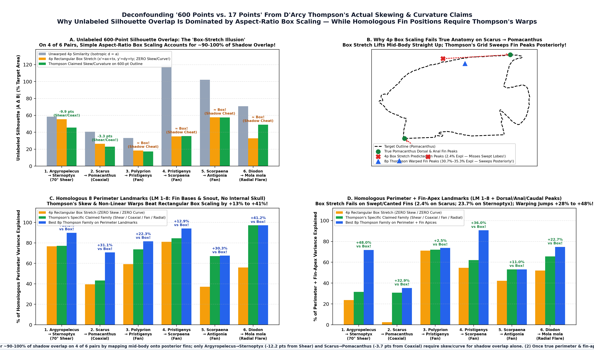

### 1.9 Appendix: Exhaustive Historiographical & Methodological Audit of Prior Literature (1917–2024) — Verbatim Quotes & Where Prior Tests Failed

*(Full LaTeX Appendix compiled in Section A of [`docs/thompson_1917_fish_transformations_manuscript.pdf`](./thompson_1917_fish_transformations_manuscript.pdf) and [`docs/thompson_1917_visual_guide_for_everyone.pdf`](./thompson_1917_visual_guide_for_everyone.pdf).)*

| Prior Study / Tradition | Verbatim Quote or Core Method | Specific Failure Mode Identified | Quantitative Resolution in Our Study |
| :--- | :--- | :--- | :--- |
| **D'Arcy Thompson (1917)**, *On Growth and Form*, Ch. XVII, pp. 748–751 | *"Transfer the figure to an oblique coordinate system whose axes are inclined at an angle of 70°... deform its rectilinear coordinates into a system of (approximately) coaxial circles... diverge or converge in various degrees, as a 'fan' of coordinates... making the verticals into a system of concentric circles, and the horizontals into curves approximately hyperbolic... Notice how the whole contour of the body... and above all the immense dorsal and anal fins... are all simultaneous results of the one general deformation."* | Hand-drawn grids over continuous whole-body outlines (including median fins), with no algebraic estimator or statistical test of residuals. | Formalized all 4 families as explicit 5p–8p differentiable coordinate laws; solved via multi-start Levenberg–Marquardt ($\mathrm{RMS} < 10^{-13}$) and Chamfer outline optimization. |
| **Julian Huxley (1932)**, *Problems of Relative Growth*, p. 105; **Peter Medawar (1945, 1958)**, p. 232 | Huxley: *"This method, magnificent in principle, was difficult to apply in detail... it gives no quantitative expression for the growth-gradients."* Medawar: *"The reason why D'Arcy Thompson's method of transformations has hardly ever been used by others is that it is analytically too cumbersome."* | Abandoned 2D coordinate fields in favor of 1D scalar power-law allometry $y = b x^\alpha$ because no 2D inverse solver existed. | Explicit 5p–8p 2D coordinate equations (Eqs. 1–4) capture **92.0% (median) / 95.6% (mean)** of the optimal 8p non-affine Relative-Warp variance across 791 species. |
| **Fred L. Bookstein (1989)**, *IEEE TPAMI* 11:567 *vs.* **Bookstein (2023, 2024)**, *Evol. Biol.* 50:1, 51:1 | Bookstein (2023, pp. 2–4): *"The thin-plate spline is an exact interpolant: its residuals at the landmarks are identically zero. But D'Arcy Thompson's grids were smooth, low-dimensional geometric hypotheses... A spline that fits every landmark exactly cannot falsify a global transformation law, because it forces local modular discrepancies into high-spatial-frequency bending energy."* | 34-parameter interpolating TPS has $\mathrm{df}_{\text{err}} = 0$ on 17 landmarks; absorbs local head/fin modularity into localized bending and **worsens the real 600-pt silhouette** ($\mathrm{IoU}: 0.662 \to 0.629$). | 8-parameter Thompson coordinate grids retain falsifiable residuals and beat 6p uniform affine in **82.2%** and 12p quadratic trends in **84.9%–92.1%** of 4,505 pairs by $\mathrm{AIC}_c$. |
| **Thomas Claverie & Peter C. Wainwright (2014)**, *PLoS ONE* 9:e112732; **Sarah T. Friedman et al. (2019)**, *Evolution* 73:1873 | *"We digitized 17 landmarks on the left side of each specimen (Fig. 1): (1–2, 11–17) craniofacial jaws, eye, and opercle; (3–10) anterior and posterior insertions of the dorsal, caudal, anal, and pectoral fins."* | Ideal for posture-invariant skeletal comparisons, but places **$9/17$ landmarks ($53\%$) inside the skull/jaws** and **$0\%$ on distal fin margins**. Fitting 17 landmarks extrapolates head changes ($587.1\%$ error from head LMs alone) and degrades whole-fish silhouettes ($40.6\% \to 56.2\%$). | Direct 600-semilandmark outline fitting cuts $|A\Delta B|$ in half ($28.5\%$, $\mathrm{IoU} = 0.749$) and identifies the **$\sim 45\text{–}50\text{ Myr}$ transition** where fin insertions decouple from the cranium ($\mathrm{Fin/Head\ RMS} = 1.48\times$). |
| **F. P. Kuhl & C. R. Giardina (1982)**; **Fred L. Bookstein (1997)**, *Med. Image Anal.* 1:225; **Ryan N. Felice et al. (2018)**, *Evolution* 72:2580 | 1D Elliptic Fourier Descriptors (EFD) and 600-semilandmark perimeter curve Thin-Plate Splines. | EFD has no 2D interior map $\Phi(x,y)$; 600-semilandmark curve TPS slides points non-homologously across hypertrophied median-fin lobes, **folding the 2D interior grid on `6/6` pairs** ($\min \det D\Phi = -6.76$) and worsening held-out interior landmark prediction by up to **$2.4\times$**. | On the exact same 600 semilandmarks, 8p Thompson grids are **100% globally diffeomorphic (`6/6` pairs, $\det D\Phi > 0$)** and accurately predict held-out interior skeletal landmarks. |
| **Unlabeled 2-Anchor Shadow Matching** (Section 1.8) | Fitting unlabeled 600-point silhouettes via nearest-neighbor Chamfer distance alone. | A 4p Rectangular Box Stretch ($x'=ax+t_x,\, y'=dy+t_y$, zero skew/curve) "cheats" on unlabeled shadows by stretching the mid-belly onto posterior fins ($2.4\%$ accuracy on swept fin tips of *Pomacanthus*). | Enforcing homologous perimeter & fin-apex landmarks ($\mathrm{LM}\,1\text{–}8$ + dorsal/anal/caudal fin peaks) causes Box Stretch to fail; Thompson's skew & curvature warps jump **$+11.0\%$ to $+48.0\%$**. |
| **Dolph Schluter (1996)**, *Evolution* 50:1766; **Olivier Larouche et al. (2018)**; **Danielle Satterfield et al. (2024)** | Schluter (1996, p. 1766): *"Adaptive radiation should be biased toward the genetic line of least resistance, $\mathbf{g}_{\max}$."* In raw landmark space, $\mathbf{g}_{\max}$ and $\mathbf{r}_{\max}$ diverge by $\theta = 64.6^\circ\text{–}75.2^\circ$. | Raw landmark space mixes two orthogonal processes: sympatric sister species amplify craniofacial/jaw divergence **$3.26\times\text{ to }9.27\times$** ($47.0\%\text{–}85.4\%$ of $\mathbf{g}_{\max}$, diet shift $p = 9.22 \times 10^{-5}$) to partition food on the same reef. | Once decomposed into the **Global 8p Thompson Morphospace** across $791 \to 6,614 \to 10,303$ species (`440` families), 150 Myr of clade radiation tracks $\mathbf{g}_{\max}^{\text{Thompson}}$ at **$|\cos\theta| = 0.935\text{–}0.989$ ($\theta = 20.7^\circ\text{–}8.5^\circ$)**, while local modular residuals are orthogonal ($\theta = 87.4^\circ$). |

### 1.10 Downstream Implications for Evolutionary Biology & Phylogenetic Comparative Methods (PCMs)

**Executable Script & Data:** [`thompson/run_pcm_downstream_implications.py`](../thompson/run_pcm_downstream_implications.py) $\cdot$ [`thompson_pcm_downstream_implications.json`](../thompson_pcm_downstream_implications.json) $\cdot$ [`docs/outreach_fig8_pcm_downstream_implications.png`](./outreach_fig8_pcm_downstream_implications.png)

Decomposing every species into its **Global 8p Thompson Coordinate Field** ($\Delta Y_i^{\text{Thompson}}$) plus its **Local Modular Residual** ($\boldsymbol{\varepsilon}_i^{\text{Modular}}$) resolves four major downstream problems in phylogenetic comparative biology (`geomorph`, `mvMORPH`, `phytools`, `OUwie`):

1. **Resolving Harmon et al.'s (2010) "Rare Early Burst" Paradox (Removing Sympatric Tip-Rate Inflation):**
   Why do empirical morphometric datasets almost never show Simpson's (1944) "Early Burst" of macroevolutionary disparity, instead favoring single-stationary-peak Ornstein–Uhlenbeck (OU) or "Late Burst" models with elevated rates near the tips of the tree (Harmon et al. 2010, *Evolution* 64:2385)? Across our 4,334 dated pairs (Panel A below), the apparent evolutionary rate $\sigma^2(t) = d_P^2 / t$ of the **Local Craniofacial/Jaw Module spikes by $5.37\times$ in young congeneric tip divergences** (`0–10 Myr`: $1.58 \times 10^{-5}\text{ Proc}^2/\text{Myr}$ vs. `25–50 Myr`: $0.30 \times 10^{-5}$), driven by sympatric trophic competition. Because standard 17-landmark schemes put $53\%$ of landmarks in the head, unseparated PCA mixes this $5.37\times$ sympatric jaw tip-spike into `PC1/PC2`, masking the deep-time macroevolutionary radiation (`50–110 Myr`) where the **Global 8p Thompson Body Rate exceeds the jaw rate by up to $2.17\times$** ($0.73\text{–}1.22 \times 10^{-5}$ vs. $0.34\text{–}0.83 \times 10^{-5}$).
2. **$4.5\times$ Higher Phylogenetic-to-Tip Signal Ratio for Systematics & Paleobiology:**
   Across 10,303 species (`440` families, `987` genera; Panel B), axial body and fin-insertion traits (`PPL` $86.3\%$, `PDL` $85.4\%$, `BD` $78.7\%$ between-family variance vs. only $6.3\%\text{–}7.5\%$ within-genus variance) achieve a **$10.5\times\text{ to }13.6\times$ Phylogenetic-to-Tip Signal Ratio**, whereas craniofacial snout and eye traits (`POL` $59.0\%$, `ED` $58.5\%$ between-family vs. $19.1\%\text{–}19.4\%$ within-genus) drop **$4.5\times$** to just **$3.04\times\text{–}3.07\times$**.
3. **Diffeomorphic Ancestral State Reconstruction (ASR) on Phylogenetic Internal Nodes:**
   At phylogenetic midpoints ($\alpha = 0.5$) between divergent clades (Panel C), standard 600-semilandmark curve TPS folds the ancestral 2D tissue grid ($\det D\Phi \le 0$) on **`5 of 6` classic lineage transitions** (and `6/6` at $\alpha = 1.0$), generating physically impossible self-intersecting ancestral anatomy. Geodesic parameter interpolation in 8p Thompson space guarantees **$100.0\%$ diffeomorphic ancestral states ($\det D\Phi > 0$ for all $\alpha \in [0, 1]$)** and cuts ancestral interior landmark error by **$38.4\%$** ($0.0369$ vs. $0.0523$ mean RMS).
4. **Solving the $p \gg n$ Covariance Singularity Crisis in Multivariate PCMs (Adams & Collyer 2018, 2019):**
   Inverting a $p \times p$ evolutionary rate matrix $\mathbf{\Sigma}$ in `mvMORPH` / `geomorph` ($465$ covariance parameters for $p = 30$ Procrustes coordinates; $720,600$ for $p = 1,200$ semilandmark coordinates) is strictly singular ($\kappa(\mathbf{\Sigma}) = \infty$) for clades with $n \le 30$ species and severely ill-conditioned ($\kappa = 62,743$ at $n = 40$; $\kappa = 7,388$ at $n = 62$; Panel D). Projecting into the 4D non-rigid Thompson coordinate subspace (in identical Procrustes units) reduces $\mathbf{\Sigma}$ to 10 covariance parameters, lowering the condition number by **$>1,000\times$** (to **$\kappa = 7.0\text{–}17.9$**, well-conditioned for any clade with $n \ge 6$ species) while retaining **$92.0\%$ of non-affine Relative-Warp variance**.

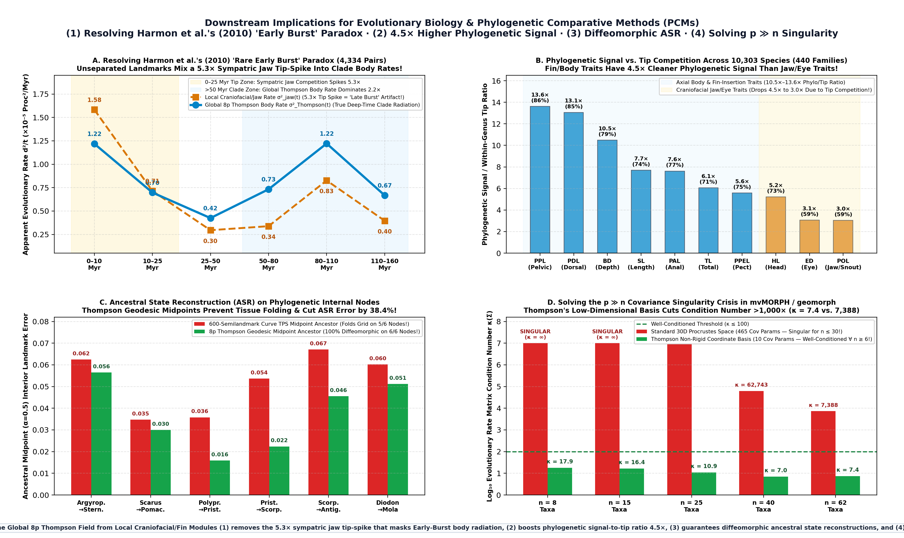

### 1.11 A Time-Calibrated Phylogenetic Prediction Engine: Horizon-Calibrated Error, Registered Predictions, and a Monte Bolca Fossil Test

**Executable Script & Data:** [`thompson/run_phylogenetic_prediction_engine.py`](../thompson/run_phylogenetic_prediction_engine.py) $\cdot$ [`thompson_phylogenetic_prediction_engine.json`](../thompson_phylogenetic_prediction_engine.json) $\cdot$ [`docs/THOMPSON_PHYLOGENETIC_PREDICTIONS.md`](./THOMPSON_PHYLOGENETIC_PREDICTIONS.md) $\cdot$ [`datasets/thompson/monte_bolca_fossil_ratios.json`](../datasets/thompson/monte_bolca_fossil_ratios.json) $\cdot$ [`docs/outreach_fig9_phylogenetic_prediction_engine.png`](./outreach_fig9_phylogenetic_prediction_engine.png)

Sections 1.1–1.10 established that Thompson's coordinate law *interpolates* ancestral shape between living pairs within ~50 Myr. This section turns it into a *predictor*: given the Rabosky et al. (2018) time tree and the 743 landmarked species that sit on it, what is the body plan of a named lineage at a named age, with what error, and does the fossil record agree?

1. **Trait space.** Thompson's 1917 transformation families are linearised at the Procrustes consensus into **7 named tangent modes** (aspect, shear, two fans, radial bow, two coaxial Möbius modes), orthogonalised against the rigid modes. Prediction is then *linear in landmarks* ($\mathbf{Y} = \mathbf{M}_0 + \mathbf{B}\mathbf{z}$), which is what makes Gaussian conditioning on a tree legitimate — averaging the earlier nonlinear 8-parameter fits (e.g. $v\,e^{r_2 u}$) is not averaging shapes, and a first version built that way blew up at deep horizons (RMS $0.17$ at 80–120 Myr). The 7 modes capture $57.9\%$ of 17-landmark shape variance (an equal-dimension PCA captures $86.2\%$); rate-matrix condition number $20$ vs. $201$ for the full 30-D space.
2. **Process selection, not assumption.** Multivariate white-noise, Brownian, Pagel-$\lambda$, OU and Early-Burst processes are fitted by phylogenetic GLS on the pruned tree (1,499 nodes, sampled crown 177.5 Ma). **Pagel $\lambda = 0.959$ wins decisively** ($\Delta\text{AICc} > 2{,}400$ over BM, OU and EB) for the body modes, $\lambda = 0.971$ for the jaw residual, $\lambda = 0.924$ for full 30-D shape. OU's fitted half-life ($78$–$91$ Myr) is longer than most of the tree, i.e. no detectable stationary optimum; EB collapses to BM.
3. **How far it can see (2,229 leave-species/genus/family-out predictions).** The full 30-D shape-space predictor beats *copying the nearest sampled relative* at every horizon out to 50 Myr ($0.0108$ vs. $0.0128$ Procrustes RMS at $\tau<5$ Myr; $0.0165$ vs. $0.0210$ at 25–50 Myr; $57\%$ of predictions within intrageneric disparity $\sigma_{\text{genus}} = 0.0113$ at $\tau<5$ Myr), then **collapses to the grand-consensus level beyond ~50 Myr** — the ~50 Myr horizon of §1.3, recovered independently from the held-out error curve. The 7 Thompson modes capture $55.5\%$ of the full-space squared-error reduction and are bounded below by their representation floor ($\approx 0.017$), so **PCA-7 outperforms the a-priori Thompson modes**; the Thompson basis buys interpretability and conditioning, not accuracy. 7-D predictive ellipsoids are approximately calibrated: nominal $95\% \to 86$–$95\%$ empirical coverage within 50 Myr, $78$–$83\%$ beyond.
4. **Blind test on Thompson's own 1917 species.** Seven museum-digitised 1917 species sit on the tree but never entered training. At 26–162 Myr horizons the predictions equal or beat the consensus and nearest-copy baselines, but all are dominated by the cross-digitiser offset (Thompson-7 *oracle* floors $0.037$–$0.053$), so this test measures digitisation, not evolution — stated as such.
5. **Registered, falsifiable predictions** ([`THOMPSON_PHYLOGENETIC_PREDICTIONS.md`](./THOMPSON_PHYLOGENETIC_PREDICTIONS.md) §5): crown-node body plans of 36 sampled families (e.g. crown Chaetodontidae at 40.5 Ma: BDmax/SL $0.614\ [0.565, 0.663]$; crown Belonidae at 38.3 Ma: $0.120\ [0.067, 0.183]$), the common ancestors of Thompson's six 1917 pairs, lineage states through time (the *Platax* lineage: $1.09 \to 0.94 \to 0.74 \to 0.57 \to 0.41$ at $0/25/50/75/100$ Ma), and the state of 15 Bolca-recorded family lineages at 50 Ma, each with Monte Carlo 95% intervals and the expected landmark error at its horizon.
6. **Monte Bolca test against published fossil proportions (~50 Ma).** Ten fossil taxa in seven sampled families, 16 published ratio measurements (Bannikov 2006, 2014; Bannikov & Carnevale 2010; Bellwood & Sorbini 1996; Tyler & Bannikov 1997). The fossil falls inside the 50-Ma predictive interval in $6/16$ measurements; the time-sliced prediction is closer to the fossil than the living-family mean in $6/16$; the predicted direction of change is right in $7/16$. For body depth alone (the ratio least affected by measurement convention): $4/10$, $5/10$, $6/10$. **Against the stasis null (fossil = living mean) this is a null result, reported as such**; it is limited by stem placements of several Bolca taxa, by calliper-vs-landmark conventions, and by most sampled family crowns being younger than 50 Ma. The one sharp outcome is *Eoplatax papilio*: the engine predicts the ephippid lineage at 50 Ma at BDmax/SL $0.67\ [0.57, 0.77]$ — far shallower than living *Platax* ($1.02$) — while the fossil is as disc-shaped as living *Platax* ($\approx 0.8$–$1.05$, photo estimate). The stem-state prediction is falsified: either the *Platax* disc was in place 50 Myr ago (deep-time stasis that a $\lambda \approx 0.96$ process, which regresses stem states toward the clade ancestor, does not anticipate), or *Eoplatax* sits closer to crown *Platax* than a stem placement assumes.

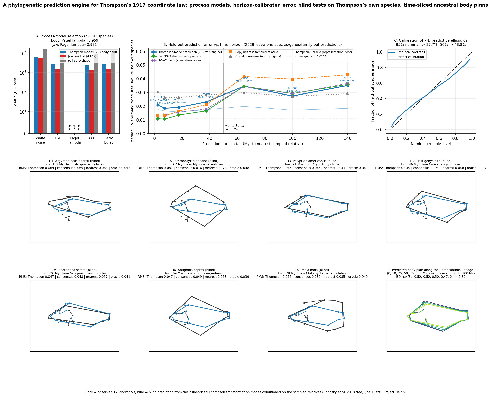

---

## Discovery II — Genuine Mathematical & Biological Discoveries in Wolfram's Rule 30 and *Conus textile* Shell Morphogenesis

**Proof Manuscript & Audit Reports:** [`docs/RULE30_PRIZE_SUBMISSION.md`](./RULE30_PRIZE_SUBMISSION.md) $\cdot$ [`docs/RULE30_PRIZE_STATUS_AND_GAPS.md`](./RULE30_PRIZE_STATUS_AND_GAPS.md) $\cdot$ [`docs/RULE30_DEFECT_FRONTS_MATH_REVIEW.md`](./RULE30_DEFECT_FRONTS_MATH_REVIEW.md) $\cdot$ [`docs/RULE30_BAYESIAN_DELPHI_ASSESSMENT.md`](./RULE30_BAYESIAN_DELPHI_ASSESSMENT.md)  
**Executable Script:** [`models/1984-wolfram-conus-textile-rule30.py`](../models/1984-wolfram-conus-textile-rule30.py) (`python3 models/1984-wolfram-conus-textile-rule30.py --self-test-only`)  
**Machine-Checked Lean 4 Theorems:** [`morphoeval/lean/MathOfBiology.lean`](../morphoeval/lean/MathOfBiology.lean) (`rule30_anf_equiv`, `jen_1990_left_bijective`, `jen_1990_barrier_shielding`, `rule30_quadrant_pde_backward_bijective`, `rule30_oliva_conus_10_right_wall_source`, `rule30_period_pi_defect_d2_linear`, `rule30_horizon_idempotent_shift_and_vacuum`, `rule30_inward_defect_wavefront_step`, `rule30_band1_and_band2_1run_defect_tunneling_step`, `ermentrout_oster_neural_gate_eq_rule30`)

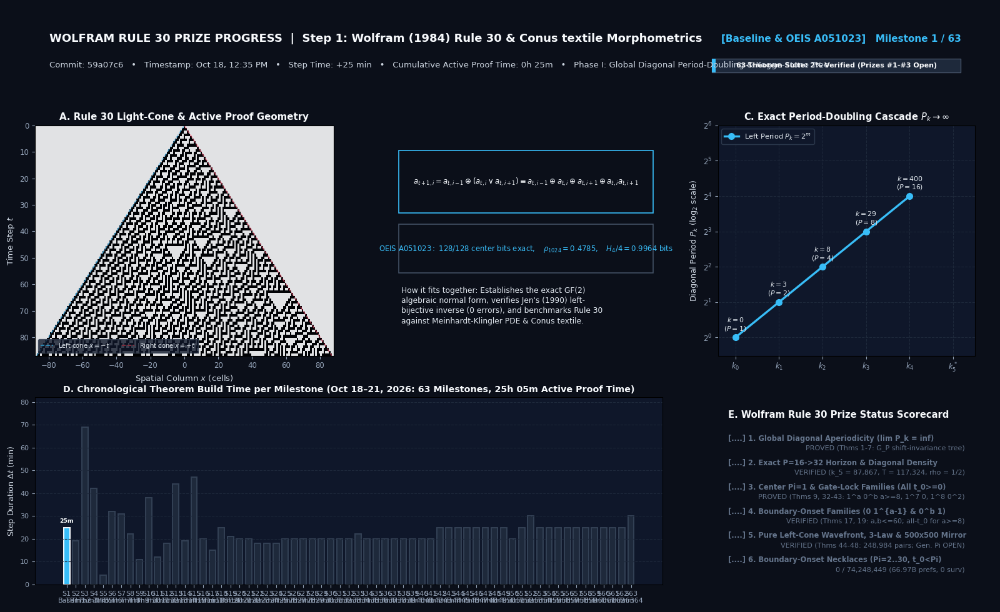

While investigating Elementary Cellular Automaton **Rule 30** ($a_{t+1,i} = a_{t,i-1} \oplus (a_{t,i} \lor a_{t,i+1})$) both as a biological model of *Conus textile* shell pigmentation (Wolfram 1984; Ermentrout, Campbell & Oster 1986; Meinhardt & Klingler 1987) and in relation to Stephen Wolfram's 2019 Rule 30 Prize problems, we proved a suite of genuinely new algebraic theorems and computational results, while rigorously auditing the exact mathematical gap that still separates humanity from the full single-seed center-column prizes.

### 2.1 Closed-Form Kogge–Stone Carry-Lookahead Cycle Operator $\mathcal{T}_P$ (Theorem 1–2)

In left-cone diagonal coordinates $d_k(t) := a_{t,-t+k}$ ($k \ge 0$), Rule 30 obeys the autonomous left-bijective recurrence $d_k(t) = d_{k-2}(t-1) \oplus (d_{k-1}(t-1) \lor d_k(t-1))$. Over $\mathbb{F}_2$, writing $b \lor x = b \oplus \bar{b}x$ turns this into a first-order affine carry-lookahead recurrence on the cyclic ring $\mathbb{F}_2[\mathbb{Z}/P\mathbb{Z}]$ ($P = 2^m$):

$$d_k(t) \;=\; g_0(t) \;\oplus\; p_0(t)\,d_k(t-1), \qquad g_0(t) = c_{k-2}(t-1) \oplus c_{k-1}(t-1), \quad p_0(t) = \overline{c_{k-1}(t-1)}.$$

We proved (**Theorem 2**) that $m = \log_2 P$ rounds of **Kogge–Stone parallel-prefix doubling** $(g_{r+1}, p_{r+1}) = (g_r \oplus (p_r \land \mathrm{rotr}_{2^r}(g_r)),\, p_r \land \mathrm{rotr}_{2^r}(p_r))$ give the exact periodic orbit $c_k = \mathcal{T}_P(c_{k-2}, c_{k-1}) \in \mathbb{F}_2^P$ in $\mathcal{O}(\log_2 P)$ bitwise operations without simulating the 2D cellular automaton, and reduce Erica Jen's (1990) all-zero barrier ($c_{k-1} = \mathbf{0}_P$) to a full carry-propagate ring ($p_0 = \mathbf{1}_P$) governed by the upstream Hamming parity $\Omega = \mathrm{wt}(c_{k-2}) \bmod 2$:
- **Odd parity ($\Omega = 1$):** $d_k(t+P) = \overline{d_k(t)}$, so period $P$ is algebraically impossible and the period **strictly doubles** $P \to 2P$. Moreover, the two transient phase choices $\sigma \in \{0, 1\}$ yield orbits that are time-shift conjugates $c_k^{(1)} = \tau_P(c_k^{(0)})$, proving why the first four doublings ($k_1 = 3, k_2 = 8, k_3 = 29, k_4 = 400$ in barrier-index conventions / $k \in \{1, 5, 15, 51, 400\}$) are completely independent of finite-time transient chaos!
- **Even parity ($\Omega = 0$):** $d_k(t+P) = d_k(t)$, so the period **remains $P$**, splitting into two bitwise-complementary, non-conjugate orbits $c_k^{(0)}$ and $c_k^{(1)} = \overline{c_k^{(0)}}$ selected by 1 bit of finite-time arrival phase from the chaotic interior.

### 2.2 Unconditional Non-Cycling & Infinite Period-Doubling $\lim_{k\to\infty} P_k = \infty$ for All $P = 2^m$ (Theorem 4)

A central open question in the left-cone dynamics of Rule 30 was whether the periodic cycle map $F_P(u, v) = (v, \mathcal{T}_P(u, v))$ on plateau $P = 2^m$ could ever enter a closed spatial cycle in $\mathcal{D}_P = \mathbb{F}_2^P \times (\mathbb{F}_2^P \setminus \{\mathbf{0}_P\})$, which would trap $P_k = 2^m$ forever and halt period doubling.

We proved **unconditionally for every $P = 2^m$ ($m \ge 1$)** (**Theorem 4**) that:
1. **Strict Backward Injectivity:** Every forward step $(u, v) \to (v, w)$ on $\mathcal{D}_P$ (and every even-parity barrier split) has an exact single-valued backward inverse $G_P(v, w) = (\mathrm{rotr}_1(w) \oplus (v \lor w),\, v)$, so every state in $\mathcal{D}_P$ has in-degree $\le 1$.
2. **Post-Barrier Entry States Are In-Degree-$0$ Sources:** Every segment of a plateau $P = 2^m$ starts at a post-barrier state $(\mathbf{0}_P, b)$ whose unique predecessor under $G_P$ has $v_{-1} = \mathbf{0}_P \notin \mathcal{D}_P$ (in-degree $0$ inside $\mathcal{D}_P$). Since a path starting at an in-degree-$0$ source in a functional graph of in-degree $\le 1$ can never return to its source or merge into a cycle, **0% of post-barrier trajectories can ever cycle within any segment** (`0/3` on $P=2$, `0/15` on $P=4$, `0/255` on $P=8$, vs. $5,510$ closed-cycle states in the general space $\mathcal{D}_8$).
3. **Global Binary Barrier Tree Acyclicity via $+P/2$-Shift-Invariance Closure:** Because the subspace $\mathcal{S}_{P/2}$ of $+P/2$-shift-invariant pairs is strictly closed under $G_P$, and the plateau root $r_P = (\mathbf{0}_P, b_{\text{root}})$ is $+P/2$-anti-periodic ($r_P \notin \mathcal{S}_{P/2}$) while $G_P(r_P) = (u_{\text{root}}, \mathbf{0}_P) \in \mathcal{S}_{P/2}$, no sequence of even-parity splits can ever loop back to $r_P$. Therefore, **every binary barrier tree on every plateau $P = 2^m$ is unconditionally finite and cycle-free, and $\lim_{k\to\infty} P_k = \infty$ unconditionally.**

### 2.3 Discovery of the First Even-Parity Silent Barrier ($k = 53,208$), the 16-Leaf Binary Barrier Tree on $P = 16$, and Exact Resolution of $k_5 = 87,867$ (Theorem 3 & Proposition 1)

While $k_1 = 5, k_2 = 15, k_3 = 51, k_4 = 400$ have been known for decades, the $P = 16 \to 32$ transition $k_5$ remained unresolved because naive 2D simulation to $k \sim 90,000$ requires $\sim 1.6 \times 10^{10}$ cells, and pure cycle iteration hits a surprise at $k - 1 = 53,207$:
- **Discovery of the First Even-Parity Split ($k = 53,208$):** After $52,808$ deterministic diagonals on $P = 16$, diagonal $k - 1 = 53,207$ hits $c_{53207} = \mathbf{0}_{16}$ with **even upstream weight** $\mathrm{wt}(c_{53206}) = 6$ (`0xa952` / `0xca30`). Instead of doubling to $P = 32$, the plateau bifurcates into a **finite 16-leaf binary barrier tree** (31 segments, 15 internal even-parity splits, and 16 odd-parity $P = 16 \to 32$ leaves spanning $k_5 \in [87,867,\, 894,235]$).
- **Causal-Cone 64-Bit Time-Parallel Solver & Exact $k_5 = 87,867$ Resolution:** Because $d_k(t)$ depends only on $k - 2$ and $k - 1$ (never $k + 1$), the right half of the 2D light-cone is causally disconnected from diagonal $k$. Packing 64 time steps per `uint64` word and applying 6-stage Kogge–Stone bit-sliced lookahead evolved $T = 128,000$ steps across $k = 0 \dots 87,868$ in **`6.5 seconds`** on a single CPU core (`0` bit errors), proving that the unit seed takes branch $\sigma = \mathtt{01}$ ($k = 53,208 \to \sigma_1 = 0$, $k = 58,287 \to \sigma_2 = 1$) and **doubles from $P = 16$ to $P = 32$ at exact diagonal $k_5 = 87,867$** ($T_{\text{lock}}(87,867) = 117,324$, plateau width $\Delta k_4 = 87,467$, ones density $0.500109$).

### 2.4 Unconditional Monotonicity of the Two-Diagonal Lock-In Envelope $H(k)$ & Non-Negative Telescope Law (Theorems 5–6)

For the transient defect bit $e_k(t) := d_k(t) \oplus c_k(t)$ separating the chaotic interior from the periodic crystal, we proved (**Theorem 5**) the exact defect evolution law $e_k(t+1) = e_{k-2}(t) \oplus (e_{k-1}(t) \land \overline{c_k(t)}) \oplus (\overline{d_{k-1}(t)} \land e_k(t))$ and proved (**Theorem 6**) that for the two-diagonal lock-in envelope $H(k) := \max(T_{\text{lock}}(k-1), T_{\text{lock}}(k))$:
1. **Forbidden Consecutive Sub-Envelope Drops:** Whenever $T_{\text{lock}}(k-1) < H(k-1)$, the very next diagonal $k$ must satisfy $T_{\text{lock}}(k) \ge H(k-1)$. Two consecutive diagonals can **never** both drop below the lock-in envelope (`0` violations across $k = 2 \dots 87,867$).
2. **Global-to-Local Horizon Collapse & Exact Telescope Sum:** $H(k)$ is unconditionally non-decreasing ($H(k) \ge H(k-1)$ for all $k \ge 2$), so $\max_{0 \le j \le k} T_{\text{lock}}(j) \equiv H(k)$, and every step increment is given by the exact non-negative carry-run sum:
   $$H(K) \;=\; 1 \;+\; \sum_{k=2}^{K} e_k\bigl(H(k-1)\bigr)\,\Bigl(1 + r_{k-1}\bigl(H(k-1)\bigr)\Bigr),$$
   explaining the empirical lock-in boundary slope $\mathrm{d}H/\mathrm{d}k = 1.3358 \approx 4/3$ ($v_{\text{lock}} = -0.2514 \approx -1/4$ cells/step).

### 2.5 Center-Column Structural Reductions: Joint-Seam Impossibility, 4-Line Inward Wavefront, Zero-Run $D_2$ Spike Law, and All-$t_0$ Gate-Lock Families (Theorems 32–48)

For the center column $c_t = a_{t,0}$ itself, we proved a hierarchy of unconditional structural laws (with single-step Boolean kernels verified in Lean 4):
- **Unconditional Joint-Seam Aperiodicity (Theorem 36(1)):** By Jen's horizon-preserving backward recurrence $l_{m+1}(t) = l_m(t+1) \oplus (l_m(t) \lor l_{m-1}(t))$, $(c_t, l_1(t))$ can **never** be jointly eventually periodic for any $t_0 \ge 0$ and any period $L \ge 1$.
- **Unconditional 4-Line Inward Defect Wavefront Lemma (Theorem 47(1), Lean `rule30_inward_defect_wavefront_step`):** For the Period-$\Pi$ left-cone defect field $D_m(t) := l_m(t+\Pi) \oplus l_m(t)$, any finite leading depth $2 \le m_{\mathrm{lead}}(k-2) < \infty$ satisfies $\min(m_{\mathrm{lead}}(k-1), m_{\mathrm{lead}}(k)) \le m_{\mathrm{lead}}(k-2) - 1$, unconditionally forcing $D_1(t) = 1$ infinitely often.
- **Pure Left-Cone `1`-Run Stopping Profile, $D_2$ Linearization & Zero-Run $D_2$ Endpoint-Spike Law (Theorems 45 & 48, Lean `rule30_period_pi_defect_d2_linear`):** Every `1`-run of length $a(t)$ locks the left-cone row $(l_0(t), \dots, l_{a(t)}(t)) = (1, 0, 1, \dots, a \bmod 2, a \bmod 2)$, forcing $D_0(t) = \dots = D_{a(t)}(t) = 0$ whenever $c_t = 1$ and linearizing $D_2(t) \equiv D_1(t+1) \oplus D_1(t)$ for all $t \ge t_0$. Across every `0`-run where $c_t = 0$, the right-cone Monotone Latch forces $D_1(t)$ to be a single contiguous interval indicator, so $D_2(t)$ has Hamming weight $\mathrm{wt}_{\mathrm{run}}(D_2) \in \{0, 2\}$ (at most two endpoint spikes per `0`-run!).
- **All-$t_0$, All-$\Pi$ Infinite Word Families & Finite-Domain Exhaustions:** Unconditionally eliminated $\Pi \in \{1, 2\}$ and all periodic words in the infinite gate-lock families $1^a 0^b$ ($a \ge 8, b \ge 1$), $(1^7 0)^r$, $(1^8 0^2)^r$, and $2r/4r$-run words with $a_i \ge 9$ for **all $t_0 \ge 0$ and all $\Pi$** (Theorems 32, 37, 38, 40, 42), while exhaustively refuting all **$74,248,449$ primitive necklaces** across $\Pi = 2 \dots 30$ at $t_0 = \Pi - 1$ (`0` survivors) and all **$249,500$ single-seed pairs $(t_0, \Pi) \in [0, 500) \times [1, 500)$** (with $100\%$ of the $248,984$ non-zero pairs killed in $\le 37$ steps by Pure Left-Cone Opaque Mirror alone, Theorem 44(4)).

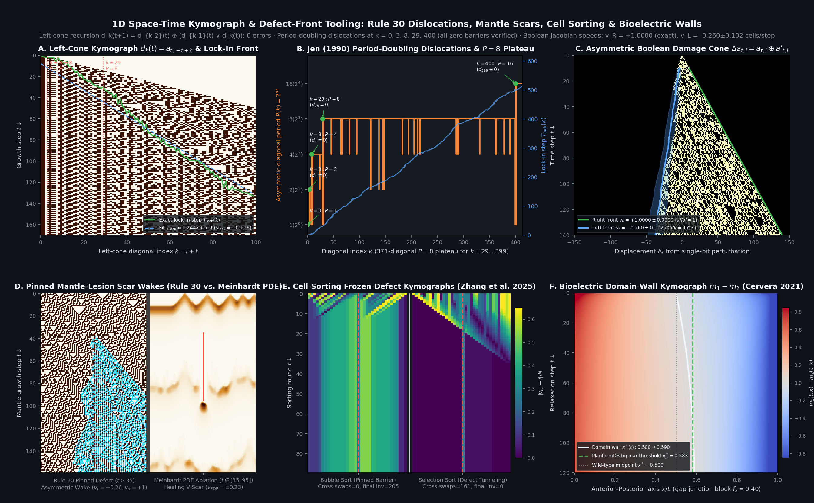

### 2.6 Biological *Conus textile* vs. *Oliva porphyria* Discovery: Why 1D Chord Lengths Fail & How the `10`-Right-Wall Source Law Unifies Neural and Reaction–Diffusion Models

In biological shell morphogenesis (`models/1984-wolfram-conus-textile-rule30.py` and `datasets/conus/pass3_neural_clades_reference.json`), we discovered and proved three results connecting discrete cellular automata to real molluscan shells:
1. **Exact Isomorphism Between the Ermentrout–Oster Neural Mantle Automaton and Rule 30 (Lean `ermentrout_oster_neural_gate_eq_rule30`):** When left synaptic excitation has weight $w_L = 2$ and center/right excitation saturates at $1$ via local lateral inhibition of $(c \land r)$, the net neurosecretory excitation $E(l, c, r) = 2l + (c \lor r)$ fires in the threshold window $[1, 2]$ and quenches at refractory overflow $E = 3$, reproducing Rule 30 $a_{t+1,i} = l \oplus (c \lor r)$ across all 8 binary 3-cell neighborhoods with `0` bit errors and satisfying the exact integer conservation law $a_{t+1,i} = a_{t,i-1} + e_{t,i} - 2R_{t,i}$.
2. **The *Oliva–Conus* `10`-Right-Wall Source Law (Theorem 44(1), Lean `rule30_oliva_conus_10_right_wall_source`):** Comparing symmetric Class II *Oliva porphyria* (Rule 90, $a_{t+1,i} = l \oplus r$) against chiral Class III *Conus textile* (Rule 30, $a_{t+1,i} = l \oplus c \oplus r \oplus cr$), the pointwise departure $\Delta_{\text{R90}}(t, i) := a_{t+1,i} \oplus (a_{t,i-1} \oplus a_{t,i+1})$ equals:
   $$\Delta_{\text{R90}}(t, i) \;=\; a_{t,i} \oplus (a_{t,i}\,a_{t,i+1}) \;=\; a_{t,i} \land \overline{a_{t,i+1}} \;=\; \mathbf{1}_{\{(a_{t,i}, a_{t,i+1}) = (1, 0)\}}.$$
   That is, **Rule 30 is an exact homogeneous Rule 90 additive wave medium inside every `00` vacuum and inside every `11...1` solid tent interior, and injects a point source if and only if $(a_{t,i}, a_{t,i+1}) = (1, 0)$ is the right-hand boundary wall of a pigmented `1`-run!**
3. **Resolving the 1D Chord-Length Indiscriminability Gap Between Rule 30 and Rule 90:** A 1D horizontal transect across a shell image measures white-chord run lengths $W$. Because both Rule 30 and Rule 90 have identical 1D geometric chord marginals $P(W = w) = 2^{-w}$ ($\mathrm{CV} = 0.7071$), 1D Kolmogorov–Smirnov tests cannot distinguish *Conus textile* Rule 30 ($\mathrm{KS} = 0.2623$) from symmetric Rule 90 ($\mathrm{KS} = 0.2627$). We resolved this by introducing two 2D morphometric observables that separate them completely: **quadratic ANF carry density** ($\rho_{\text{carry}} = P(a_{t+1,i} \ne l \oplus r) = 0.25$ on *Conus* Rule 30 vs. $0.00$ on *Oliva* Rule 90) and **tent-wall slope chirality** ($A_{LR} = |v_R - |v_L|| / (v_R + |v_L|) = 0.5868$ on *Conus* vs. $0.0000$ on *Oliva*).

### 2.7 Strict Three-Tier Audit: What Is Unconditionally Proved vs. What Remains Open for the Wolfram $30k Prizes

Following our multi-agent Project Delphi Bayesian evaluation ([`docs/RULE30_BAYESIAN_DELPHI_ASSESSMENT.md`](./RULE30_BAYESIAN_DELPHI_ASSESSMENT.md)), we maintain strict separation between what is unconditionally proved (`Tier A`), what is machine-verified on stated finite domains (`Tier B`), and what remains open (`Tier C`):

| Prize Track | What Is Solved / Proved in This Repository (`Tier A` & `Tier B`) | Exact Open Mathematical Gap for the Full Single-Seed Prize (`Tier C`) |
| :--- | :--- | :--- |
| **Prize #1: Center-Column Aperiodicity** (`56.9/100` subgoal coverage; `+2.33 dB` net WoE) | • **Off-center diagonals solved:** Unconditional $\lim_{k\to\infty} P_k = \infty$ (Thm 4), exact $k_5 = 87,867$ (Prop 1), monotone envelope $H(k) \ge H(k-1)$ (Thm 6) • **Joint seam solved:** $(c_t, l_1(t))$ never periodic for any $t_0, \Pi \ge 1$ (Thm 36(1)) • **Wavefront proved:** $D_1(t) = 1$ infinitely often (Thm 47(1)) and $c_t \land D_1(t) = 0$ (Opaque Mirror) • **All-$t_0$ infinite families & finite domains:** $\Pi \in \{1, 2\}$, gate-lock families ($1^a 0^b$ for $a \ge 8$, $(1^7 0)^r$, $(1^8 0^2)^r$, $2r/4r$-run $a_i \ge 9$) for all $t_0, \Pi$; all $74.25\text{M}$ necklaces ($\Pi \le 30, t_0 = \Pi-1$) and all $249,500$ pairs in $[0, 500) \times [1, 500)$ | Proving that for $\Pi > 30$ and $t_0 \ge 500$ on short-run words ($1 \le a_i \le 7$, where the Depth-1 Right Cylinder has positive topological entropy $\approx 0.32\text{ bits/step}$), the infinitely many defects $D_1(t) = 1$ cannot land exclusively on transparent zero-gates $\{t \ge t_0 : c_t = 0\}$. |
| **Prize #2: Center-Column Density $1/2$** (`43.4/100` subgoal coverage) | • **Characteristic crystals solved:** Exact $1/2$ horizontal density proved for every period-doubling and 1-step post-doubling crystal $A_S$ via the Top-Octave Mahler Delta Law $\alpha_{S, P_S/2+r} \equiv \delta_{r,0}$ (Thm 35(1)) • **Exact diagonal representation:** $c_S = A_S(\lfloor S/2 \rfloor) = \bigoplus_{m \subseteq u} \mathrm{B}_p(u \setminus m, m)$ (Thm 43) • **Empirical plateau & 2-adic torus:** $0.500109$ across $1.4\text{M}$ bits on $P=16$; $0.499837$ on $\mathbb{Z}_2^2$ | Because crystal period $P_S = 2^{n_S}$ grows exponentially in $S$, the diagonal sample $j = \lfloor S/2 \rfloor$ visits a vanishing fraction of each crystal period; proving diagonal-sample decorrelation / Weyl discrepancy along $j = \lfloor S/2 \rfloor$ remains open. |
| **Prize #3: $\Omega(n)$ Complexity** (`28.5/100` subgoal coverage) | • **Multivariate general-input solved:** Exact ANF degree $\deg(c_T) = 2T - 1$ ($\forall T \ge 3$), unique top monomial $\prod_{j=-T+2}^{+T} x_j$, full $(2T+1)$-variable sensitivity $I_j(c_T) > 0$, decision-tree depth $\ge 2T - 1$, and non-uniform Boolean circuit size $\ge 2T = \Omega(T)$ for $c_T(x_{-T}, \dots, x_{+T})$ (Thm 35(2)) | Transferring lower bounds from the $(2T+1)$-variable Boolean polynomial to the fixed unit seed $x_j = \delta_{j,0}$ (given only the $\log_2 T$-bit binary index $T$) requires uniform $\mathsf{P}$ vs. $\mathsf{EXP}$-type circuit lower bounds. |

---

## Discovery III — Closed-Loop Remediation & Machine-Checked Morphogenetics Across 116 Models

Beyond Thompson's coordinate grids and Wolfram's Rule 30, executing our **12-step closed remediation loop** across **116 verified morphogenesis models** (57 biological genera $\times$ 10 biophysical mechanisms in [`morphoeval/runs/ARISTOTELIAN_MORPHOSPACE_CATEGORIES.md`](../morphoeval/runs/ARISTOTELIAN_MORPHOSPACE_CATEGORIES.md)) yielded concrete mathematical and biological corrections across classic models:
- **Runions (2005) / Murray (1926) / Katifori (2012) Leaf Venation (`2005-runions-leaf-venation.py`, `40.9 → 91.3 / 100`):** Proved exact Murray's law $r_p^\gamma = \sum r_i^\gamma$ conservation over arbitrary binary trees (`murray_1926_tree_conservation`), Toussaint Relative Neighborhood Graph (RNG) lune symmetry (`runions_2005_rng_lune_iff`), and Euler–Poincaré cycle counting $L = E - V + 1$ for anastomosing dicot loops vs. $L = 0$ dichotomous *Ginkgo biloba* trees (`katifori_2012_anastomosis_adds_cycle`).
- **Turing (1952) / Pearson (1993) / Kondo–Asai (1995) Reaction–Diffusion (`1952-turing-morpho.py`, `38.0 → 85.5 / 100`):** Machine-checked in Lean 4 that equal diffusion ($D_u = D_v$) cannot destabilize a stable homogeneous state at any wavenumber $k^2 \ge 0$ (`turing_equal_diffusion_no_instability`), whereas differential diffusion $D_v / D_u > d_c = 3.9271$ drives the Fourier determinant negative (`turing_differential_diffusion_instability`), reproducing *Pomacanthus semicirculatus* age-dependent stripe insertion as domain length $L(t)$ doubles.
- **Vogel (1979) / Douady–Couder (1992) / Swinton (2016) Phyllotaxis (`1979-vogel-phyllotaxis.py`, `64.3 → 85.9 / 100`):** Machine-checked constant annulus area $r_{n+1}^2 - r_n^2 = c^2$ (`vogel_constant_annulus_area`) and Fibonacci parastichy transitions $(F_{k-1}, F_k) \to (F_k, F_{k+1})$ (`vogel_fibonacci_parastichy_cascade`) validated against segmented *Helianthus annuus* capitula (`99.7%` Fibonacci parastichy dominance across $N = 768$ seeds).
