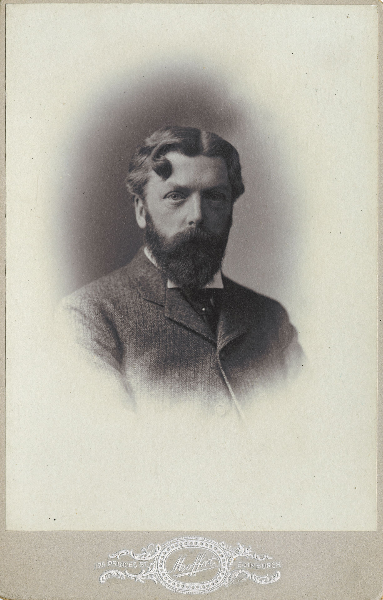
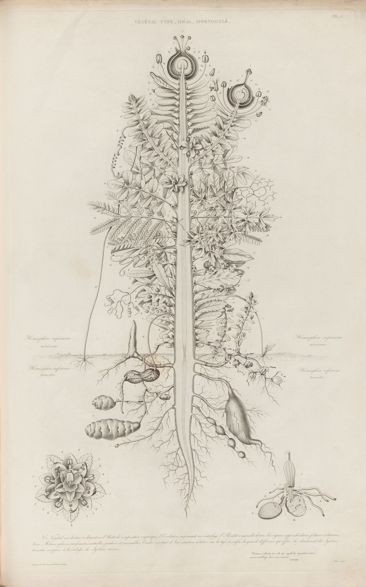
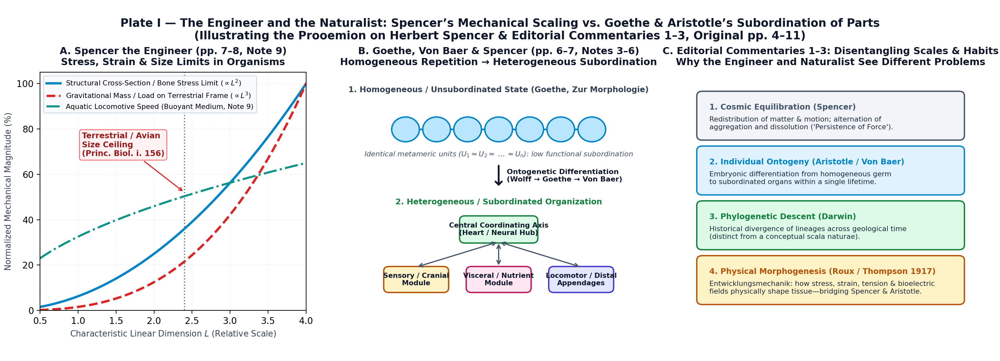
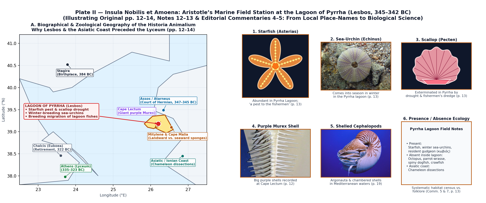
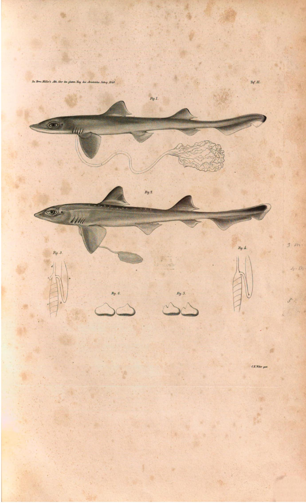
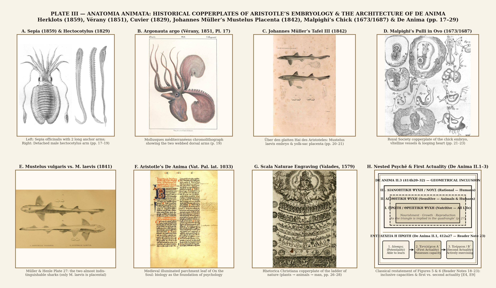
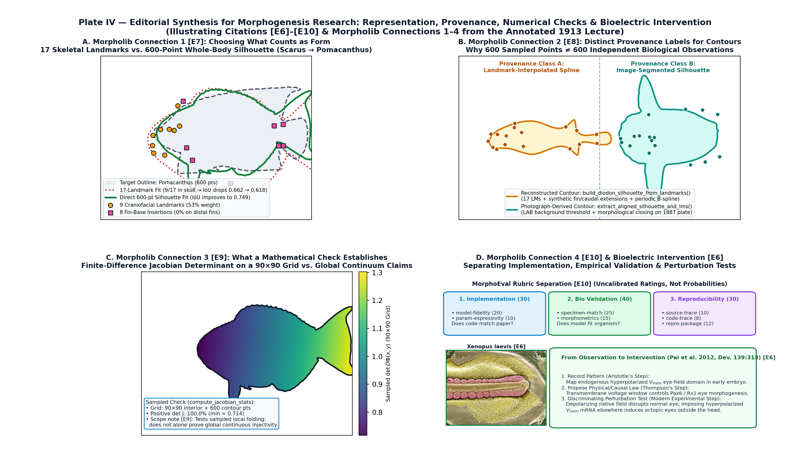

# On Aristotle as a Biologist, With a Prooemion on Herbert Spencer

**D’Arcy Wentworth Thompson**  
*The Herbert Spencer Lecture delivered before the University of Oxford on February 14, 1913*  
*Oxford at the Clarendon Press (1913)*

**Museum-Illustrated & Annotated Edition for Project Delphi (`morpholib`)**  
📄 **[Interactive Museum Reader (`docs/thompson_1913_aristotle_as_a_biologist.html`)](./thompson_1913_aristotle_as_a_biologist.html)** · 🎨 **[Museum Plate Generator (`thompson/generate_aristotle_1913_illustrations.py`)](../thompson/generate_aristotle_1913_illustrations.py)**

---

## EDITORIAL INTRODUCTION

Thompson’s central claim is that Aristotle’s biology helped form his philosophy. The lecture asks us to follow knowledge from the shore and the dissecting table into an account of life, mind, and explanation. Its opening tribute to Herbert Spencer prepares that argument: an engineer and a naturalist may approach the same living world with different expectations about what makes it intelligible.

The commentary below offers a critical reading of that argument and draws connections to morphogenesis research. All added passages are labelled **Editorial commentary** and use a different typeface. Thompson’s full lecture and his 31 notes remain in place. Original page numbers refer to the 1913 printed text; references `[E1]` to `[E20]` identify primary sources and archival museum plates listed after the notes.

*Figure 1 — D’Arcy Wentworth Thompson (1860–1948) around 1906, before the 1913 Oxford lecture and On Growth and Form (1917). Cabinet photograph by Moffat (125 Princes St., Edinburgh), courtesy of University of St Andrews Libraries and Museums, `ms48534-ph-2-5`; CC0 via Wikimedia Commons (`[E12]`).*

---

## PROOEMION ON HERBERT SPENCER

Herbert Spencer was born when last century was young, and this century was in its cradle when he passed away. *Ipse Epicurus obit*, cried the poet of a philosophy which of all the systems of antiquity was most kindred to Spencer’s own. A like thought passed through many men’s hearts when Herbert Spencer died—men of all nations and languages, for while Spencer lived his voice reached far and wide, even to the ends of the earth. He was a philosopher not speaking to the philosophers, nor teaching in the schools; but he had a gift and a message, so in touch with the temper of his time, that it made him a speaker, *ex cathedra*, to the world.

No philosopher of modern times, not Kant himself, has exercised in his lifetime so wide a dominion. Only here and there, among men of a very different stamp, in men like Byron or Rousseau or Tolstoi, do we see that strange power of captivating the imagination of an age, of speaking with a voice that goes out into all lands.

The foundation under whose auspices we gather here, the gift of an Indian scholar, reminds us of Spencer’s influence in the East: in still more distant Japan his counsel was sought when the nation issued from its seclusion to join in the labours and anxieties of the modern world; he stirred the restless blood of Russians and of Poles; in America his books were read far more sedulously than at home; and all this great influence was won without literary art or any charm of magic words, without the fire of Tolstoi, the poetry of Heine or of Byron, the beauty of Rousseau’s prose.

But Spencer had something in common with all those men, as his popularity was commensurate with their own. And that bond of likeness lay in the fact that to men weary of old trammels and of old burdens he seemed to point, he tried to offer,<a href="#note-1">[1]</a> a way of emancipation, a path of deliverance from creeds outworn. By the world which he addressed he was welcomed and acclaimed, in the spirit in which Heine wished to be remembered, as a gallant soldier, *ein tapfrer Krieger*, in the fight for freedom.

Let us recall, with all brevity, some few circumstances of Spencer’s life, that our minds may keep his memory green.

Of that narrow, ascetic, and fiercely independent home of his boyhood we have all read or heard—with its atmosphere of struggle, of criticism, of scientific and political discussion, unrelieved by humour, by letters, or by art. We remember how he went forth as a lad to labour, at an age when men have not yet come up to the University; and how, as an engineer’s assistant, he helped to plan bridges and direct gangs of navvies on the great new road to Birmingham and Crewe, and shared in all the fever and haste of that great period of construction.

These were the years that he spoke of afterwards as ‘the futile part of his life’; but it is as plain as an open book that they were years in which his mind was moulded and his mechanical outlook on phenomena developed and confirmed.

Again, we remember his years of journalism, during which, after the appearance of his first book, he soon emerged from a lonely life, and with the friendship of George Eliot and Lewes, Huxley, Tyndall, and many more, found his place in the world of London. Henceforth, his life was so quiet, simple and retired, that we might say of him, as Heine said of Kant, *‘Er hatte weder Leben noch Geschichte.’*

In 1855, in the *Principles of Psychology*, Spencer affirmed his belief in the ‘development hypothesis’,<a href="#note-2">[2]</a> as accounting for the origin of species; and as accounting also for the successive association of ideas, and so, by their becoming ‘innate’ and transmissible from generation to generation, for the gradual development of mind: which latter investigation, I need hardly say, has since been continued, by a long line of evolutionary psychologists, in their several and divergent ways. It is curious to learn from his *Autobiography* that about this time, in his talks with Huxley, it was the latter who still preserved a guarded attitude, and Spencer who urged upon him, but with still inadequate and unconvincing arguments, the hypothesis of organic evolution.

Five years later, a year after the publication of the *Origin of Species*, Spencer brought out the prospectus of his *Synthetic Philosophy*, that heroic effort to combine, in a Philosophy of Evolution, the whole range of physical, mental, and social science. To discover and trace that one identical phenomenon of Evolution, in the progress of civilization, in the development of mind, in the course of nature, in the history of the Universe, was his single and life-long aim.

He found such tools as he worked with in the current tendencies of political and economic thought, and in the recent discoveries or generalizations of science. Of these latter, on the physical side, the greatest was the principle of the Conservation of Energy, the final result of the doctrine of the correlation of the physical forces, in establishing which Rumford had led the way; while on the biological side he drew inspiration from the fact, indicated by Aristotle, developed by Wolff and Milne-Edwards, made into an aphorism by Von Baer, that as the organism grows it grows continually from the simple to the complex, from the homogeneous to a greater and greater heterogeneity.<a href="#note-3">[3]</a>

But many years before Von Baer a greater than he had enunciated the same truth, and had set it forth in even plainer and better words. It was Goethe, in his *Zur Morphologie*,<a href="#note-4">[4]</a> who laid it down as a law that ‘the more imperfect a being is, the more do its individual parts resemble each other, and the more do these parts resemble the whole. The more perfect the being is, the more dissimilar are its parts. In the former case the parts are more or less a repetition of the whole; in the latter case they are totally unlike the whole. The more the parts resemble each other, the less subordination is there of one to the other; and subordination of parts is the mark of high grade of organization.’<a href="#note-5">[5]</a>

Now these words are found in the *Life of Goethe*, by Lewes, Herbert Spencer’s closest friend. We can scarce avoid the inference that it may have been the poet’s insight and the poet’s words, quite as much as Von Baer’s, that crystallized in his famous formula of evolution. And the inference is confirmed by the fact that, though it was to Von Baer that Spencer was afterwards in the habit of ascribing the law, yet, on the first occasion when he mentions it, he speaks of it as having been established ‘by the investigations of Wolff, Goethe, and Von Baer’.<a href="#note-6">[6]</a>

> **`EDITORIAL COMMENTARY 1 — EVOLUTION IN SEVERAL SENSES`** *(Original pages 5 to 7)*  
> `Spencer’s evolution here encompasses cosmic change, individual development, mental life, and social organization. Darwin’s origin of species is one reference point within that much broader scheme. Thompson’s interest in Goethe makes the distinction especially useful: increasing differentiation within a developing organism is a different claim from descent between species. The lecture moves between these scales easily. A careful reading keeps track of which process is being explained each time.`

*Figure 2 — P. J. F. Turpin’s copperplate engraving “Végétal Type, Idéal, Appendiculé” (published 1837 to illustrate Goethe’s morphological writings). Reading the central axis upward from the roots through cotyledons, foliage leaves, bracts, sepals, petals, stamens, and carpels shows how serial plant organs are compared as differentiated variations of an underlying organ type (`[E13]`, `[E14]`).*

As in former days Descartes, and as Democritus and Epicurus in days of old, so did Spencer find in matter and in motion, or rather in matter and in force, the fabric of a world. He draws a broad picture, confessedly of a mechanical kind, of alternate cosmic rhythms of the Universe, in which as motion is dissipated, so matter cleaves from the dispersed and homogeneous into more coherent and more segregated shapes; until in the turn of the great wheel, a new redistribution of matter and motion takes place, and evolution is inevitably followed by dissolution at its heels; so the whole present order perishes, *exitio terras cum dabit una dies*. Nevertheless, so vast is the cosmic rhythm, that again the wheel turns, and the dust and ashes of a Universe are co-ordinated and integrated anew, to make ‘another and another frame of things, For ever!’

All the while Spencer recognizes that Space, Time, Motion, and Matter itself are remote from Absolute Reality, and have their source in our own Empiricism. The ‘Persistence of Force’ is the only truth which transcends experience; and what we ultimately mean by the persistence of force is a cause which transcends our conception and our knowledge.

In his *Biology* Spencer takes for his keynote his conception of life, as having for its chief characteristic a continuous adjustment of the organism to its environment, of its internal to its external relations. So structure follows upon function and functional need, and hereditary transmission hands on to the next generation the advances that the past generation has made: life produces organization, and not organization life.

Again, in certain chapters which are by no means the least interesting of the book, he shows,<a href="#note-7">[7]</a> after the fashion of the engineer, and from the experience of the bridge-builder,<a href="#note-8">[8]</a> how the principles of stress and strain are concerned in the fabric, and in the physiology, of the organism; how physical and mechanical relations alter in the organism with increasing bulk;<a href="#note-9">[9]</a> and how incident forces of gravity, growth, and pressure control or determine the shape of leaf and bone and single cell.

Under the guidance of a wholesome restraint, a whole school of morphologists, Roux’s school of *Entwickelungsmechanik*, are now investigating these self-same problems, and so bringing to the help of morphology some of those physical concepts which began to be the stock-in-trade of the physiologists when Majendie wrote his *Leçons sur les phénomènes physiques de la Vie* (1830).

> **`EDITORIAL COMMENTARY 2 — THE FUTURE PROGRAMME OF PHYSICAL MORPHOLOGY`** *(Original pages 7 to 8)*  
> `Stress, strain, gravity, and size make this passage a useful bridge to On Growth and Form, published in 1917. In that book Thompson proposes physical explanations for bodily form while treating questions about consciousness separately. [E1] My reading is that the engineer’s perspective supplies something he wants biology to retain, even as he turns toward Aristotle. The contrast between the two thinkers therefore introduces a question about explanatory scope: which features of living organization does a particular method illuminate?`

*Plate I — Museum folio accompanying the Prooemion on Herbert Spencer and Editorial Commentaries 1–2 (Original pp. 4–10): (A) 1913 Oxford Clarendon Press title page; (B) Moffat’s c. 1906 cabinet portrait of D’Arcy Wentworth Thompson (`[E12]`); (C) archival portrait of Herbert Spencer (1820–1903); (D) Joseph Karl Stieler’s 1828 portrait of J. W. von Goethe (`[E13]`); (E) P. J. F. Turpin’s 1837 ideal plant engraving (`[E14]`); (F) Culmann and H. Meyer’s comparison of stress trajectories in a Fairbairn crane-head and the human femur trabeculae from On Growth and Form (1917, Fig. 335, p. 682, `[E1]`); (G) cantilever bridge and quadrupedal backbone stress-diagrams (1917, Figs. 346 & 349, pp. 700–704); and (H) Spencer’s scaling corollary ($\propto L^2$ cross-section vs. $\propto L^3$ gravitational load and buoyant aquatic speed, Note 9).*

In the *Ethics*, Spencer undertakes to establish ‘rules of right conduct’ on a scientific basis, and he does not minimize the difficulty of getting rid of ‘supernatural ethics’, nor of forming a science of ‘what ought to be’. Nevertheless, he does his best to connect absolute Ethics with his universal formula of cosmic evolution and equilibration. Ethics must be based on science, and not on metaphysics. There is, he holds, not only an Ethic for all reasonable beings, but a principle of Ethic for all living things; life and not reason is the essential thing. All conservation implies evolution, and individuality is developed by the inevitable changes of a changing world.<a href="#note-10">[10]</a>

So Spencer labours, but perhaps in vain, to make the best of the *bellum omnium contra omnes*, to find in the biological process of adjustment a continual tendency to happiness, and in sociological evolution a tendency to ultimate harmony; in the which a somewhat complacent altruism shall satisfy the egoist, and pleasure will consist in actions which are salutary to the individual and the race. All very much as Mr. Bridges puts it:

> For Nature did not idly spend  
> Pleasure; she ruled it should attend  
> On every act that doth amend  
> Our life’s condition;  
> ’Tis therefore not well-being’s end  
> But its fruition.

So through all the circle of the sciences, Spencer tried to satisfy that craving inherent in mankind for a constructive system, which shall, in a single unity, frame all the phenomena of the world: for such a unification as in Aristotle’s hands had endured unshaken for nigh two thousand years. To bring the world of fact and the world of Intelligence into the unity of a system is the task which all philosophers essay, in the light of the knowledge and the spirit of their time; but as knowledge grows, and men’s ways and circumstances change, so does Philosophy itself, like all else in the world, undergo its own inevitable and endless evolution—giving place, if not to the better, to the new.<a href="#note-11">[11]</a>

But let me not omit to say a word of Spencer’s attitude to ‘the insoluble mystery’, of his *confessio ignorantis*, of his share in that Agnosticism for which Huxley found a name. ‘At the utmost extent of his tether,’ to borrow words from Locke, ‘he sat down in quiet ignorance of those things which he found to be beyond the reach of his comprehension.’

By a bold abstraction Spencer puts asunder things that our thought insists shall be conjoined. And, through relation, association, and causation, he carried to their bitter end those theories of empiricism, and of the relativity of knowledge, that were no new thing in philosophy, but had percolated down to him through Mansel and through Hamilton, from Locke and Hume and Kant, through all those who had discussed the possibility of knowledge in itself; carried them to their bitter end, and stripped them bare of the garments of the old philosophy, of intuition, or of faith, wherewithal they were wont to be clothed.

And in so doing it may seem to many of us that he stopped short but a little way along that steep and narrow road, that *parvus trames*, which is the Pathway from Appearance to Reality.

*Ipse Epicurus obit, decurso lumine vitae*—‘when the lamp of life ran low’. And so too Spencer died—as it were but yesterday—full of years and of honour. And to the multitude of friends, disciples, mourners, gathered at his grave, a wise and eloquent man spoke a few noble words. He spoke of Spencer’s deep affections and lasting friendships, of the houses that he entered as an habitual guest and honoured friend; of the magnitude of his task, of his unwearied struggle, and of his joy when his work was done; of his ‘coherent, luminous, conception of the evolution of the world’; of his exaltation of man’s individual freedom, of the ethical purpose that underlay his quest of truth.

And, lastly, Lord Courtney spoke of Spencer’s last brave effort, in the *Riddle of the Universe*, to face and scrutinize the implacable facts of life: of how in the end he had confessed himself overawed by the vastness of the unknowable, appalled by the great vision of Everlasting Law, and silent in the contemplation of the Infinite and the Eternal.

And now that I have tried to pay, in not ungrateful words, our annual tribute to Spencer’s memory, as to one who has been a great influence in our world, whose words have become part of our familiar speech, and whose thought has interpenetrated and commingled with our own, let me proceed for what time remains towards another, but I hope a cognate, theme.

---

## ON ARISTOTLE AS A BIOLOGIST

In passing from Spencer to Aristotle, we turn from the one philosopher of our own times who has made biology an intrinsic part of his sociology and his psychology, to the great biologist of antiquity, who is *maestro di color che sanno*, in this science as in so many other departments of knowledge. And by the analogy of contrast, we can scarce think of Herbert Spencer’s biology without recurring to that of Aristotle, so reverting from a great teacher of mechanical causation to him who taught us our first clear lessons of the phenomena of Life. But, save only by repeating what I have said, that Spencer came to the study of biology in the spirit and with the equipment of the engineer, and by declaring that Aristotle seems to me to have been first and foremost a biologist, by inclination and by training, I will not attempt to pursue the comparison. Let us simply glance at some parts of Aristotle’s *Natural History*, and attempt to show, in a partial and elementary way, the influence of that study upon his mind.

> **`EDITORIAL COMMENTARY 3 — TRAINING SHAPES THE QUESTIONS`** *(Original page 11)*  
> `Thompson’s comparison concerns habits of attention. The engineer notices adjustment, forces, and construction; the naturalist notices differences between organisms, activities, and stages of life. This is also an implicit argument about scientific concepts: what researchers repeatedly handle can shape what they regard as an adequate explanation. For a computational morphologist, a useful question follows: which aspects of development become visible through the chosen representation, and which disappear when a living process is reduced to an outline, landmark set, or graph?`

The naturalist is born a naturalist, and we may be sure that Aristotle was a lover and a student of nature from a boy; but it would help us to trace the relation of his biological studies to his philosophical work if we could ascertain when his chief biological work was done. It has often been held that Aristotle devoted himself to biology as an old man’s recreation, after his retirement to Euboea. This theory is not adequate, and I do not think it is true. Another legend, that Alexander sent his pupil specimens from his campaigns, Cuvier accepted and Humboldt denied; there is no evidence for it, direct or indirect, in Aristotle’s writings, and this tradition also I believe to be worthless. But there is evidence, of a geographical kind, that helps us to answer our preliminary question.

> **`EDITORIAL COMMENTARY 4 — A SLIP IN THE PRINTED TEXT`** *(Original page 12)*  
> `The scan really does say that Alexander sent specimens to his pupil. The relationship is reversed: Aristotle was Alexander’s teacher, as Plutarch’s account describes. [E2] The wording has been retained so that this reading copy remains faithful to the printed lecture.`

Among the isles of Greece there is a certain island, *insula nobilis et amoena*, which Aristotle knew well. It lies on the Asian side, between the Troad and the Mysian coast, and far into its bosom, by the little town of Pyrrha, runs a broad and sheltered lagoon. It is the island of Lesbos. Here Aristotle came and spent two years of his life, in middle age, bringing his princess-bride from the petty court of a little neighbouring state where he had already spent three years. It was just before he went to Macedon to educate Alexander; it was ten years later that he went back to Athens to begin teaching in the Lyceum.

Now in the *Natural History* references to places in Greece proper are very few indeed; there is much more frequent mention of places on the northern and eastern coasts of the Aegean, from Aristotle’s own homeland down to the Carian coast; and to places in and round that island of Lesbos, or Mitylene, a whole cluster of Aristotle’s statements and descriptions refer.

Here, for instance, Aristotle mentions a peculiarity of the deer on a neighbouring islet, of the weasels by the wayside near another island town. He speaks of the big purple *Murex* shells at Cape Lectum, and of the different sorts of sponges found on the landward and the seaward side of Cape Malia.

But it is to the lagoon at Pyrrha that Aristotle oftenest alludes. Here were starfish in such abundance as to be a pest to the fishermen; here the scallops had been exterminated by a period of drought, and by the continual working of the fishermen’s dredge; here the sea-urchins come into season in the winter time, an unusual circumstance. Here among the cuttlefishes was found no octopus, either of the common or of the musky kind; here was no parrot-wrasse, nor any kind of spiny fish, nor sea-crawfish, nor the spotted nor the spiny dog-fish; and, again, from this lagoon, all the fishes, save only a little gudgeon, migrated seaward to breed.

And though with no special application to the island, but only to the Asiatic coast in general, I may add that the chameleon, which is the subject of one of Aristotle’s most perfect and minute investigations, is here comparatively common, but is not known to occur in Greece at all.

I take it then as probable, or even proven, that an important part of Aristotle’s work in natural history was done upon the Asiatic coast, and in and near to Mitylene.<a href="#note-12">[12]</a> He will be a lucky naturalist who shall go some day and spend a quiet summer by that calm lagoon, find there all the natural wealth ὅσσον Λέσβος . . . ἐντὸς ἐέργει, and have around his feet the creatures that Aristotle loved and knew. Moreover, it follows for certain, if all this be true, that Aristotle’s biological studies preceded his more strictly philosophical work; and it is of no small importance that we should be (as far as possible) assured of this, when we speculate upon the influence of his biology on his philosophy.<a href="#note-13">[13]</a>

> **`EDITORIAL COMMENTARY 5 — FROM GEOGRAPHY TO INTELLECTUAL INFLUENCE`** *(Original pages 13 to 14)*  
> `Thompson’s geographical inference is more specific than his conclusion about philosophy. Repeated local observations support a connection between Aristotle’s natural history and Lesbos. Establishing that particular observations preceded particular philosophical arguments would require further chronological evidence. Establishing that they caused those arguments requires another step. The progression from location, to date, to intellectual influence is worth watching: a persuasive historical reconstruction can contain claims supported to different degrees.`

*Plate II — Museum folio accompanying Original pp. 12–14, Notes 12–13, and Editorial Commentaries 4–5: (A) British Admiralty Chart No. 1665 of Mityleni Island (Lesbos) with the Gulfs of Adramyti and Sandarli (surveyed by Capt. R. Copeland, R.N., 1832–1849, `[E15]`), showing Port Kalloni (the ancient Lagoon of Pyrrha running “far into its bosom”), the narrow entrance channel inset, Mitylene, and Cape Malia; (B) Pentelic marble bust of Aristotle after Lysippos (Palazzo Altemps, Rome); (C) Ernst Haeckel’s 1904 Tafel 40 lithograph of Asteridea (starfishes); (D) Nicolas Robert’s 17th-century painting of Pecten jacobaeus (scallop) and Wenceslas Hollar’s 17th-century etching of Murex brandaris (`[E16]`); and (E) Duméril and Bibron’s 1836 copperplate of the Chameleon skeleton (`Erpétologie générale`).*

Aristotle is no tyro in biology. When he writes upon Mechanics or on Physics we read him with difficulty: his ways are not our ways; his explanations seem laboured; his science has an archaic look, as it were coming from another world to ours, a world before Galileo. Speaking with all diffidence, I have my doubts as to his mathematics. In spite of a certain formidable passage in the *Ethics*, where we have a sort of *ethica more geometrico demonstrata*, in spite of his favourite use of the equality of the angles of a triangle to two right angles as an example of proof indisputable, in spite even of his treatise *De Lineis Insecabilibus*, I am tempted to suspect that he sometimes passed shyly beneath the superscription over Plato’s door.

But he was, and is, a very great naturalist. When he treats of Natural History, his language is our language, and his methods and his problems are wellnigh identical with our own. He had familiar knowledge of a thousand varied forms of life, of bird and beast, and plant and creeping thing. He was careful to note their least details of outward structure, and curious to probe by dissection into their parts within. He studied the metamorphoses of gnat and butterfly, and opened the bird’s egg to find the mystery of incipient life in the embryo chick.

He recognized great problems of biology that are still ours to-day, problems of heredity, of sex, of nutrition and growth, of adaptation, of the struggle for existence, of the orderly sequence of Nature’s plan. Above all he was a student of Life itself. If he was a learned anatomist, a great student of the dead, still more was he a lover of the living.

Evermore his world is in movement. The seed is growing, the heart beating, the frame breathing. The ways and habits of living things must be known: how they work and play, love and hate, feed and procreate, rear and tend their young; whether they dwell solitary, or in more and more organized companies and societies. All such things appeal to his imagination and his diligence. Even his anatomy becomes at once an *anatomia animata*, as Haller, poet and physiologist, described the science to which he gave the name of physiology. This attitude towards life, and the knowledge got thereby, afterwards helped to shape and mould Aristotle’s philosophy.

I have no reason to suppose that the study of biology ‘maketh a man wise’, but I am sure it helped to lead Aristotle on the road to wisdom. Nevertheless he takes occasion to explain, or to excuse, his devotion to this study, alien, seemingly, to the pursuit of philosophy.

‘Doubtless,’ he says,<a href="#note-14">[14]</a> ‘the glory of the heavenly bodies fills us with more delight than we get from the contemplation of these lowly things; for the sun and stars are born not, neither do they decay, but are eternal and divine. But the heavens are high and afar off, and of celestial things the knowledge that our senses give us is scanty and dim. On the other hand, the living creatures are nigh at hand, and of each and all of them we may gain ample and certain knowledge if we so desire. If a statue please us, shall not the living fill us with delight; all the more if in the spirit of philosophy we search for causes and recognize the evidences of design. Then will Nature’s purpose and her deep-seated laws be everywhere revealed, all tending in her multitudinous work to one form or another of the Beautiful.’

In somewhat similar words does Bacon,<a href="#note-15">[15]</a> retranslate a familiar saying: ‘He hath made all things beautiful according to their seasons; also he hath submitted the world to man’s inquiry.’

On the other hand, a most distinguished philosopher of to-day is struck, and apparently perplexed, by ‘the awkward and grotesque, even the ludicrous and hideous forms of some plants and animals’.<a href="#note-16">[16]</a> I commend him, with all respect, to Aristotle—or to that Aristotelian verity given us in a nutshell by Rodin, *‘Il n’y a pas de laideur!’*

> **`EDITORIAL COMMENTARY 6 — BEAUTY AS A REASON TO INVESTIGATE`** *(Original pages 15 to 16)*  
> `Aristotle’s defence of studying humble animals gives inquiry a philosophical dignity. In Parts of Animals I.5, even creatures that do not please the senses can reward the search for causes and the relation of parts to a whole. [E3] Thompson sharpens this into a claim about beauty. I read the strongest version as an invitation to discover intelligibility wherever it occurs. Beauty can motivate attention; the explanatory account still has to earn its support from the organism.`

To be sure, Aristotle’s notion of beauty was not Rodin’s. He had a philosopher’s comprehension of the Beautiful, as he had a great critic’s knowledge and understanding of Poetry; but wise and learned as he was, he was neither artist nor poet. His style seldom rises, and only in a few such passages as that which I have quoted, above its level didactic plane. Plato saw philosophy, astronomy, even mathematics, as in a vision; but Aristotle does not know this consummation of a dream. The bees have a king, with Aristotle. Had Plato told us of the kingdom of the bees, I think we should have had Shakespearian imagery. The king would have had his ‘officers of sorts’, his magistrates, and soldiers, his ‘singing masons building roofs of gold’. Even Pliny, arid encyclopaedist as he is, can now and then throb and thrill us as Aristotle cannot do—for example, when he throws no little poetry and still more of music into his description of the nightingale’s song.<a href="#note-17">[17]</a>

But let us now come, at last, to exemplify, by a few brief citations, the nature and extent of Aristotle’s zoological knowledge. And here, brevity bids me choose between two ways: either to deal with Aristotle’s theories or his facts, his insight or his erudition. The former are of the highest possible interest to us, and their treatment partly includes the latter. But it would take more than all the time I have, to deal with any one of Aristotle’s theories—of generation, for instance, or of respiration and vital heat, or those still weightier themes of variation and heredity, the central problems of biology, or again the teleological questions of adaptation and design.

Let me therefore confine myself, almost wholly, to a few fragments out of his storehouse of zoological and embryological facts.

Among the bloodless animals, as Aristotle called what we call the Invertebrates, he distinguishes four great genera, and of these the Molluscs are one. These are the cuttle-fish, which have now surrendered their Aristotelian name of ‘molluscs’ to that greater group, which is seen to include them with the shell-fish, or ‘ostracoderma’ of Aristotle. These cuttle-fishes are creatures that we seldom see, but in the Mediterranean they are an article of food, and many kinds are known to the fishermen. All, or wellnigh all, of these common kinds were known to Aristotle, and his account of them has come down to us with singular completeness. He describes their form and their anatomy, their habits, their development, all with such faithful accuracy that what we can add to-day seems of secondary importance.

He begins with a methodical description of the general form, tells us of the body and fins, of the eight arms with their rows of suckers, of the abnormal position of the head. He points out the two long arms of *Sepia* and of the Calamaries, and their absence in the octopus; and he tells us, what was only confirmed of late, that with these two long arms the creature clings to the rock and sways about like a ship at anchor. He describes the great eyes, the two big teeth forming the beak; and he dissects the whole structure of the gut, with its long gullet, its round crop, its stomach and the little coiled caecal diverticulum; dissecting not only one but several species, and noting differences that were not observed again till Cuvier re-dissected them.

He describes the funnel and its relation to the mantle-sac, and the ink-bag, which he shows to be largest in *Sepia* of all others. And here, by the way, he seems to make one of those apparent errors that, as it happens, turn out to be justified: for he tells us that in *Octopus* the funnel is on the upper side; the fact being that when the creature lies prone upon the ground, with all its arms spread and flattened out, the funnel-tube (instead of being flattened out beneath the creature’s prostrate body) is long enough to protrude upwards between arms and head, and to appear on one side or other thereof, in a position apparently the reverse of its natural one.

He describes the character of the cuttle-bone in *Sepia*, and of the horny pen which takes its place in the various Calamaries, and notes the lack of any similar structure in *Octopus*.

He dissects in both sexes the reproductive organs, noting without exception all their essential and complicated parts; and he had figured these in his lost volume of anatomical diagrams. He describes the various kinds of eggs, and, with still more surprising knowledge, shows us the little embryo cuttle-fish, with its great yolk-sac, attached (in apparent contrast to the chick’s) to the little creature’s developing head.

But there is one other remarkable structure that he knew, centuries before it was rediscovered almost in our own time. In certain male cuttle-fishes, in the breeding season, one of the arms develops in a curious fashion into a long coiled whip-lash, and in the act of breeding may then be transferred to the mantle-cavity of the female. Cuvier himself knew nothing of the nature or the function of this separated arm, and indeed, if I am not mistaken, it was he who mistook it for a parasitic worm. But Aristotle tells us of its use and its temporary development, and of its structure in detail, and his description tallies closely with the accounts of the most recent writers.

Among the rarer species of the group he knew well the little *Argonaut*, with its beautiful cockle-shell, and tells how it puts up its two broad arms to sail with, a story that has been rejected by many, but that after all may perhaps be true.

Now in all this there is far more than a mass of fragmentary information gleaned from the fishermen. It is a plain orderly treatise, on the ways and habits, the varieties, and the anatomical structure of an entire group. Till Cuvier wrote there was none so good, and Cuvier lacked knowledge that Aristotle possessed.

> **`EDITORIAL COMMENTARY 7 — WHAT MAKES A BODY OF OBSERVATIONS SCIENTIFIC`** *(Original pages 17 to 19)*  
> `The force of Thompson’s example lies in the organized comparison: several kinds, both sexes, multiple structures, and developmental stages. His Aristotle earns authority through connected observations rather than an isolated striking claim. This gives the lecture a useful standard for a research collection: records become more informative when their relationships, methods, and scope can be inspected together. The stories of rediscovery celebrate continuity across time; they also invite us to check each identification and each assertion of accuracy individually.`

Not less exact and scarcely less copious is the chapter in which Aristotle deals with the crab and lobster, and all such crustacean shell-fish, nor that in which he treats of insects, after their kind. Most wonderful of all, perhaps, are those portions of his books in which he speaks of fishes, their diversities, their structure, their wanderings, and their food. Here we may read of fishes that have only recently been rediscovered,<a href="#note-18">[18]</a> of structures only lately reinvestigated, of habits only of late made known.<a href="#note-19">[19]</a> And many such anticipations of our knowledge, and many allusions to things of which we are perhaps still ignorant, may yet be brought to light; for we are still far from having interpreted and elucidated the whole mass of Aristotle’s recorded erudition: which whole recorded mass is only, after all, *tanquam tabula naufragii*.

There is perhaps no chapter in the *Historia Animalium* more attractive to the anatomist than one which deals with the anatomy and mode of reproduction of the cartilaginous fishes, the sharks and rays, a chapter which moved to admiration that prince of anatomists Johannes Müller.<a href="#note-20">[20]</a> The latter wrote a volume on the text of a page of Aristotle, a page packed full of a multitude of facts, in no one of which did Johannes Müller discover a flaw.

The subject is technical, but the gist of the matter is this: that among these Selachians (as, after Aristotle, we still sometimes call them) there are many diversities in the structure of the parts in question, and several distinct modes in which the young are brought forth or matured.

For in many kinds an egg is laid, which eggs, by the way, Aristotle describes with great minuteness. Other kinds do not lay eggs, but bring forth their young alive, and these include the *Torpedo* and numerous sharks or dogfish. The eggshell is in these cases very thin, and breaks before the birth of the young. But among them there are a couple of sharks, of which one species was within Aristotle’s reach, where a very curious thing happens.

Through the delicate membrane, which is all that is left of the eggshell, the great yolk-sac of the embryo becomes connected with the parental tissues, which infold and interweave with it; and by means of this temporary union the blood of the parent becomes the medium of nourishment for the young. And the whole arrangement is physiologically identical with what obtains in the higher animals, the mammals, or warm-blooded vivipara.

It is true that the yolk-sac is not identical with that other embryonic membrane which comes in the mammals to discharge the function of which I speak; but Aristotle was aware of the difference, and distinguishes the two membranes with truth and accuracy.

It happens that of the particular genus of sharks to which this one belongs, there are two species differing by almost imperceptible characters; but it is in one only of the two, the γαλεὸς λεῖος of Aristotle, that this singular phenomenon of the *placenta vitellina* is found. It is found in the great blue shark of the Atlantic and the Mediterranean; but this creature grows to a very large size before it breeds, and such great specimens are not likely to have come under Aristotle’s hands. Cuvier detected the phenomenon in the blue shark, but paid little attention to it, and, for all his knowledge of Aristotle, did not perceive that he was dealing with an important fact which the Philosopher had studied and explained.

In the seventeenth century, the anatomist Steno actually rediscovered the phenomenon, in the γαλεὸς λεῖος, the *Mustelus laevis* itself, but he was unacquainted with Aristotle. And the very fact was again forgotten until Johannes Müller brought it to light, and showed not only how complete was Aristotle’s account, but how wide must have been his survey of this class of fishes to enable him to record this peculiarity in its relation to their many differences of structure and reproductive habit.

I used to think of this phenomenon as one that Aristotle might have learned from the fishermen, but, after a more careful study of Johannes Müller’s book, I am convinced that this is not the case. It was a discovery that could only have been made by a skilled and learned anatomist.

*Figure 3 — Original copperplate Tafel III (drawn by C. E. Weber) from Johannes Müller’s famous 1842 monograph Über den glatten Hai des Aristoteles, und über die Verschiedenheiten unter den Haifischen und Rochen in der Entwickelung des Eies (Berlin, `[E18]`), depicting the embryo of Aristotle’s γαλεὸς λεῖος (Mustelus laevis) attached by its umbilical stalk to the ruffled yolk-sac placenta (placenta vitellina).*

In a lengthy and beautiful account Aristotle describes the development of the chick. It is on the third day that the embryo becomes sufficiently formed for the modern student to begin its study, and it was after just three days (a little earlier, as Aristotle notes, in little birds, a little later in larger ones) that Aristotle saw the first clear indication of the embryo. Like a speck of blood, he saw the heart beating, and its two umbilical blood-vessels breaking out over the yolk.

A little later he saw the whole form of the body, noting the disproportionate size of head and eyes, and found the two sets of blood-vessels leading, the one to the yolk-sac, the other to the new-formed allantois. In the tiny chick of the tenth day, he saw the stomach and other viscera; he noted the altered position of the heart and great blood-vessels; he traced clearly and fully the surrounding membranes; he opened the little eye to seek, but failed to find, the lens.

And at length he describes in detail the appearance and attitude of the little chick, the absorption of the yolk, the shrivelling of the membranes, just at the time when the little bird begins to chip the shell, and before it steps out into the world.

While this epitome contains but a part of what Aristotle saw (and without a lens it would be hard to see more than he), it includes the notable fact of the early appearance of the heart, the *punctum saliens* of later writers, whose precedence of all other organs was a chief reason for Aristotle’s attributing to it a common, central, or primary sense, and so locating in it the central seat of the soul.

And so it was held to be till Harvey’s time, who, noting the contemporaneous appearance of heart and blood, held that the contained was nobler than that which contained it, and that it was the blood that was ‘the fountain of life, the first to live, the last to die, the primary seat of the soul, the element in which, as in a fountain-head, the heat first and most abounds and flourishes’; so harking back to a physiology more ancient than Aristotle’s—‘for the blood is the life thereof.’

All students of the *Timaeus* know that here Aristotle parted company with Plato, who, following Hippocrates, and Democritus, and others, placed the seat of sensation, the sovereign part of the soul, in the brain.

Right or wrong, it was on observation, and on his rarer use of experiment,<a href="#note-21">[21]</a> that Aristotle relied. The wasp or the centipede still lives when either head or tail is amputated, the tortoise’s heart beats when removed from the body, and the heart is the centre from which the blood-vessels spring.

To these arguments Aristotle added the more idealistic belief that the seat of the soul, the ruling force of the body, must appropriately lie in the centre: and he found further confirmation of this view from a study of the embryo plant, where in the centre, between the seed-leaves, is the point from which stem and root grow. And Ogle reminds us how, until a hundred years ago, botanists still retained an affectionate and superstitious regard for that portion of the plant, calling it now *cor*, now *cerebrum*, the plant’s heart or brain.

> **`EDITORIAL COMMENTARY 8 — OBSERVATION AND THE THEORY BUILT FROM IT`** *(Original pages 22 to 23)*  
> `The beating embryonic heart and the heart’s anatomical position are observations; the conclusion about the soul’s central seat is an interpretation of them. Those statements deserve separate treatment. Thompson gives us enough detail to understand why the inference might have seemed compelling without making the observations logically sufficient for it. For a claim and evidence system, this is an especially clear example: preserving an observation’s provenance should leave room to revise the causal or philosophical claim attached to it.`

*Plate III — Museum folio accompanying Original pp. 17–29, Notes 18–29, and Editorial Commentaries 7–13: (A) J. A. Herklots (1859) lithograph of Sepia officinalis with its two long anchor tentacles beside Cuvier’s (1829) engraving of the detached male hectocotylus arm (`[E17]`); (B) Jean-Baptiste Vérany’s (1851) chromolithograph of Argonauta argo (Plate 17 of Mollusques méditerranéens, `[E17]`); (C) Johannes Müller’s (1842) Tafel III of Mustelus laevis and its yolk-sac placenta (`[E18]`); (D) Marcello Malpighi’s (1673/1687) Royal Society copperplate of the chick embryo in De formatione pulli in ovo showing the area vasculosa and looping heart tubes (`[E19]`); (E) Müller & Henle’s (1841) Plate 27 comparing Mustelus vulgaris and Mustelus laevis; (F) 13th/14th-century illuminated manuscript leaf of Aristotle’s De Anima (`Vaticanus Palatinus latinus 1033`, `[E20]`); (G) Didacus Valades’s (1579) Renaissance engraving of the Scala Naturae (`Rhetorica Christiana`, `[E20]`); and (H) classical geometric diagram of Aristotle’s nested psychē (“as a triangle within a square,” De Anima II.3) and First vs. Second Actuality (ἐντελέχεια ἡ πρώτη).*

And now is it possible to trace directly the influence of Aristotle’s scientific training and biological learning upon his sociology, his psychology, or in general on his philosophy? That such an influence must have been at work is, *prima facie*, obvious. The physician who becomes a philosopher will remain a physician to the end; the engineer will remain an engineer; and the ideas of pure mathematics, Roger Bacon’s ‘alphabet of philosophy’, will find issue and expression in the philosophy of such mathematicians as Plato, Leibnitz, Spinoza, or Descartes.

Moreover, it is not only the special training or prior avocation of the philosopher that so affects his mind. In divers historical periods the rapid progress or the diffused study of a particular science has moulded the philosophy of the time. So on a great scale in the present day does biology; so did an earlier phase of evolutionary biology affect Hegel; and in like manner, in the great days after Lavoisier, the days of Dalton, Davy and Berzelius, did chemistry help, according to John Stuart Mill, to suggest a ‘chemistry of the mind’ to the ‘association’ psychologists.

A certain philosopher,<a href="#note-22">[22]</a> in dealing with this theme, begins by telling us that ‘Mathematics was the only science that had outgrown its merest infancy among the Greeks’. Now it is my particular purpose to-day to show, from Aristotle, that this is not the case.

Whether Aristotle’s biological forerunners were many or few, whether or not the Hippocratics (for instance) had failed to raise physiology and anatomy to the dignity of a science, or having done so, had only reserved them, as a secret cult, to their own guild; in short, whether Aristotle’s knowledge is in the main the outcome of his solitary labours, or whether, as Leibnitz said of Descartes, *praeclare in rem suam vertit aliorum cogitata*, it is at least certain that biology was in his hands a true and comprehensive science, only second to the mathematics of his age.

The influence, then, of scientific study, and in particular of Biology, is not far to seek in Aristotle’s case. It has ever since been a commonplace to compare the state, the body politic, with an organism, but it was Aristotle who first employed the metaphor. Again, in his exhaustive accumulation and treatment of political facts, his method is that of the observer, of the scientific student, and is in the main inductive.

Just as, in order to understand fishes, he gathered all kinds together, recording their forms, their structure, and their habits, so he did with the Constitutions of cities and of states. Those two hundred and more πολιτεῖαι which Aristotle laboriously compiled, after a method of which Plato would never have dreamed, were to form a Natural History of Constitutions and Governments.

And if we see in his concrete, objective treatment of the theme a kinship with Spencer’s *Descriptive Sociology*, again, I think, a difference is soon apparent, between Spencer’s colder catalogue of facts and Aristotle’s more loving insight into the doings and into the hearts, into the motives and the ambitions, of men.

> **`EDITORIAL COMMENTARY 9 — THE LIMITS OF THE ORGANIC METAPHOR`** *(Original page 25)*  
> `Comparing a polity with an organism can direct attention to dependence, coordination, and the relation between parts and wholes. The comparison does not by itself settle what political arrangements are desirable. That is a further argument, involving values as well as descriptions. The same distinction matters when biological cooperation becomes a model for human institutions: specify the relationship being compared before drawing a political conclusion from it.`

But whatever else Aristotle is, he is the great Vitalist, the student of the Body with the Life thereof, the historian of the Soul.

Now we have already seen how and where Aristotle fixed the soul’s seat and local habitation. But the soul has furthermore to be studied according to its attributes, or analysed into its ‘parts’. Its attributes can be variously analysed, as in his *Ethics* Aristotle shows. But it is in the light of Biology alone that what amounts to a scientific analysis, such as is developed in the *De Anima*, becomes possible; and in that treatise it is only after a long preliminary physiological discussion that Aristotle at length formulates his distinctive psychology.

There is a principle of continuity, a συνέχεια, that runs through the scale of structure in living things, and so, little by little, by imperceptible steps, does Nature make the passage from plant, through animal, to man. It is with all the knowledge, summarized in a great passage of the *Natural History*, and embodied in this broad generalization, that Aristotle afterwards proceeds to indicate the same gradation in psychology, and to draw from it a kindred classification of the Soul.

There is a soul which presides over the primary physiological requirement of nutrition, a soul already inherent in the plant and inseparable from life itself; it is ἡ πρώτη ψυχή. Common likewise to all living things are the physiological functions of growth and reproduction, and the psychical agencies directing these are concomitant with, and in fact identical with, the nutrient soul.

Sensation or sensibility, whereby the animal essentially differs from the plant, distinguishes the αἰσθητικὴ ψυχή, the sentient soul; and the soul of movement, undisplayed in the very lowest of animals, presently accompanies the soul of sensibility. At length the reasoning soul, the διανοητικὴ ψυχή, or νοῦς, emerges in man, as the source of his knowledge and his wisdom.<a href="#note-23">[23]</a>

In a brief but very important passage,<a href="#note-24">[24]</a> with a touch of that Platonic idealism never utterly forgotten by him (and so apt to bring Wordsworth to our own minds), Aristotle tells us that this soul ‘cometh from afar’—μόνον θύραθεν ἐπεισιέναι, καὶ θεῖον εἶναι μόνον. Yes, in very plain Greek prose, this is no less than to assert that ‘trailing clouds of glory’, ‘it cometh from afar.’

> **`EDITORIAL COMMENTARY 10 — WHAT SOUL MEANS IN THIS ARGUMENT`** *(Original pages 26 to 27)*  
> `Psychē has a wider range here than a modern reader may expect from soul. Nutrition and growth already qualify plants for this vocabulary; sensation and thought distinguish further capacities. Aristotle’s De Anima II.1 to II.3 connects soul with the form and activity of a living body. [E4] Reading the passage as a classification of capacities helps, provided we also notice the exceptional status given to intellect in the quotation about coming from afar. Calling nutrition psychic here does not establish subjective experience in every living thing.`

But however glorified be the reasoning soul, yet these parts, these subdivisions of the soul, do not stand apart in mutual exclusiveness, but just as we may discern a triangle within a square, so is each lower grade of ψυχή implicit in the higher. And as the higher organisms retain the main physiological faculties of the lower, so do they retain such psychological qualities as these possess: and gradually (more and more as we ascend the ladder) do we find adumbrations of the psychical qualities that will be perfected in the higher forms.

Among the higher animals, at least, a comparative psychology may be developed; for just as their bodily organs are akin to one another’s and to man’s, so also have we in animals an inchoate intelligence, wherein we may study, in one or another, the psychology of such things as fear, anger, courage, and at length of something which we may call sagacity, which stands not far from reason. And, last of all, we have a psychology of childhood, wherein we study in the child, at first little different from the animal, the growing seeds of the mind of man.

But observe before we leave this subject that, though Aristotle follows the comparative method, and ends by tracing in the lower forms the phenomena incipient in the higher, he does not adopt the method so familiar to us all, and on which Spencer insisted, of first dealing with the lowest, and of studying in successive chronological order the succession of higher forms.

The historical method, the realistic method of the nineteenth century, the method to which we so insistently cling, is not the only one. Indeed, even in modern biology, if we compare (for instance) the embryology of to-day with that of thirty years ago, we shall see that the pure historical method is relaxing something of its fascination and its hold.

Rather has Aristotle continually in mind the highest of organisms, in the light of whose integral and constituent phenomena must the less perfect be understood. So was it with one whom the Lord Chancellor of England has called ‘the greatest master of abstract thought since Aristotle died’.

For Hegel,<a href="#note-25">[25]</a> as surely for Aristotle also, *Entwicklung* was not a ‘time-process but a thought-process’. To Hegel, an actual, realistic, outward, historical evolution seemed but a clumsy and materialistic philosophy of nature. In a sense, the ‘time-difference has no interest for thought’. And if the lower animals help us to understand ourselves, it is in a light reflected from the study of Man.

> **`EDITORIAL COMMENTARY 11 — A GRADED ORDER IS DIFFERENT FROM A GENEALOGY`** *(Original pages 27 to 28)*  
> `Thompson explicitly distinguishes conceptual development from a sequence unfolding in historical time. An ordering of capacities can compare organisms without claiming that one evolved from another. This distinction carries directly into morphology: a path through a mathematical space of shapes, a developmental trajectory, and an evolutionary lineage answer different questions. To move between them, identify the additional evidence that would justify the move. An elegant interpolation can suggest a hypothesis while leaving its biological history undecided.`

So grows up, upon a broad basis of Natural History, the whole psychology of Aristotle, and in particular that great doctrine of the tripartite soul, according to which created things ‘by gradual change sublimed, To vital spirits aspire, to animal, To intellectual!’

In this ψυχή of Aristotle there was (in spite of the passage which I have quoted) a trace of the concrete and the all but material, which later Greek as well as Christian thought was not slow to discern and to modify. But, as a philosopher of our own day reminds us, it was in relation to a somewhat idealized Body that Aristotle described that somewhat unspiritual Soul. Such as it is, it has remained at the roots of our psychology, even to this day.

Bergson only partially gets rid of it when he recasts Aristotelian psychology on the lines of that branching tree which modern evolutionary biology substitutes for the *scala Naturae* of Aristotle; and when he sees, for instance, in psychological evolution, not the successive grades of continuous development, through sensibility and instinct to intelligence, but rather the splitting up of an original activity, of which instinct and intelligence are not successive, but separate and diverging, outgrowths.

In our recent science the Aristotelian doctrine is not dead. For but little changed, though dressed in new garments, this Aristotelian entelechy,<a href="#note-26">[26]</a> which so fascinated Leibnitz,<a href="#note-27">[27]</a> enters into the Vitalism of Hans Driesch; and of those who believe with him, that far as physical laws may carry us, they do not take us to the end: that the limitations of induction forbid us to pass in thought and argument from chemistry to consciousness, or (as Spencer well knew) from Matter to Mind;<a href="#note-28">[28]</a> that Life is not merely ‘an outstanding difficulty, but a veritable exception to the universal applicability of mechanical laws’; that not to be comprehended under the category of physical cause, but to be reckoned with apart, is the fundamental conception underlying Life and its Teleology.<a href="#note-29">[29]</a>

> **`EDITORIAL COMMENTARY 12 — ENTELECHY AND THE CLAIM OF VITALISM`** *(Original page 29)*  
> `In De Anima, entelecheia belongs to Aristotle’s account of actuality: the soul is the actuality of an organized body capable of life. That definition does not by itself establish the irreducibility claimed by the vitalism Thompson associates with Driesch. [E4] The intellectual affinity is part of Thompson’s argument; the philosophical positions still need to be distinguished. His later On Growth and Form explicitly commits bodily construction, growth, and working to physical investigation while keeping the explanation of consciousness open. [E1] This comparison clarifies the scope of his physical programme without dissolving the tensions in this lecture.`

It is easy so to sketch in simple words the influence of Aristotle’s biological studies upon his method of work, or to see in his Psychology and his Ethics the results of his biological analysis of the soul. But his natural science seems to send a still deeper influence running through the whole of his philosophy, for better or for worse, which influence I lack the needful learning to fathom and to describe. I can only see dimly, and cannot venture to explain, how his lifelong study of living things led to his rejection of Plato’s idealistic ontology, and affected his whole method of classification, his notion of essentials and accidents, his idea of ‘Nature’ that ‘makes nothing in vain’, his whole analysis of causation, his belief in, and his definition<a href="#note-30">[30]</a> of, Necessity, his faith in design, his particular form of teleology, his conception and apprehension of God.

> **`EDITORIAL COMMENTARY 13 — PURPOSE AND CAUSAL EXPLANATION`** *(Original page 30)*  
> `Aristotle’s final causes concern what a process or part is for; his Physics II.8 allows natural purposiveness without deliberation. [E5] In a modern model, a functional description still leaves questions about mechanism and evidence. Saying that tissue restores an organized form invites us to specify the maintained variable, the disturbances it tolerates, and the processes that produce recovery. That translation is a proposed research strategy, rather than a claim that Aristotle already possessed the modern concepts of feedback or bioelectric regulation.`

And now, to close my story. It is in no derogation of Spencer’s commemorative honour that I have spoken of him together with a greater Philosopher, and one of the greatest of men. So I have used my hour of Oxford to speak, and to salute, the name of Aristotle, here where his spirit has dwelt for six hundred years—I who have humbly loved him since my day began.

We know that the history of biology harks back to Aristotle by a road that is straight and clear, but that beyond him the road is broken and the lights are dim. And we have seen that biology was no mere by-play of Aristotle’s learned leisure, but was a large intrinsic part of the vast equipment of his mind.

This our science is no petty handicraft, no narrow discipline. It was great, and big, in Aristotle’s hands, and it is grown gigantic since his day.

It begins in admiration of Nature’s handiwork, as she strews it by the way. It bids us seek through the land, and search the deep places of the sea. It toils for the health and wealth of men. It speaks of things humble; it whispers of things high. It tells (if I dare use the old theologian’s word<a href="#note-31">[31]</a>) of Laws, ‘whose Voice is the harmony of the World, and whose Seat is the bosom of God.’

Sometimes, as to-day, it brings us by a by-way to the study of the history of human thought and knowledge, and introduces us to a company of great men, dwellers in the ‘clear air’ of Athens.

The little Greek I know, first learnt at my Father’s knee, is but a child’s plaything to that of many a scholar here. But I hear, now and then, a welcome given, in old Hellenic speech, to men who call at that Interpreter’s House wherein Plato and Aristotle show us ‘excellent things, such as will be a help to us in our journey’.

---

## EDITORIAL SYNTHESIS FOR MORPHOGENESIS RESEARCH

`My strongest reading of the lecture is that biology can supply philosophy with disciplined problems of organization. Thompson makes organisms worth attending to in their full activity, while leaving the reader responsible for assessing the explanations built from them. His closing defence of biology also reveals the lecture’s character as a humanistic work: scientific observation, classical learning, and questions about meaning belong within the same intellectual life.`

`For work comparing Thompson’s transformations with measured morphology, keep the descriptive achievement explicit: which correspondences does the map capture, relative to which baseline, and with what error? A proposed developmental mechanism then has a further job: account for the time course, material constraints, and response to perturbation. A mathematical relationship between two adult forms does not on its own identify those processes. This is a methodological inference from the questions raised by the lecture.`

`Bioelectric patterning offers a concrete modern connection in method. Pai and colleagues reported that changing membrane voltage disrupted normal eye development and could induce ectopic eyes in Xenopus laevis. [E6] The explanatory advance depends on intervention as well as observation. Applied to a morphogenesis programme, the useful sequence is to record the pattern, propose the causal relationship, and test a prediction that could discriminate it from alternatives. Aristotle’s organized natural history, Thompson’s physical questions, and present experiments can each contribute at a different step.`

*Plate IV — Museum and computational synthesis of Citations `[E6]`–`[E10]` and Morpholib Connections 1–4: (A) Connection 1 (`[E7]`): Thompson’s 1917 Figs. 375–376 woodcut (`Scarus → Pomacanthus`) paired with the quantitative comparison of 17 skeletal landmarks (`IoU = 0.618`) versus 600-point whole-body silhouette fitting (`IoU = 0.749`); (B) Connection 2 (`[E8]`): Thompson’s 1917 Figs. 381–382 woodcut (`Diodon → Orthagoriscus`) paired with Provenance Class A (`build_diodon_silhouette_from_landmarks`, landmark-interpolated B-spline) versus Provenance Class B (`extract_aligned_silhouette_and_lms`, segmented from the 1887 British Museum engraving); (C) Connection 3 (`[E9]`): 90×90 finite-difference Jacobian determinant check (`compute_jacobian_stats`, 100.0% sampled positivity vs. continuum global injectivity); and (D) Connection 4 (`[E10]`) & `[E6]`: Aristotle’s Four Causes (`[E5]`, `[E11]`), MorphoEval’s three-pillar uncalibrated rating separation, and Pai et al. (2012) bioelectric $V_{\text{mem}}$ perturbation in Xenopus laevis.*

* **`Morpholib connection 1 — Choosing what counts as form.`** `The repository compares a 17-landmark representation for 791 reef-fish species with densely sampled outlines, including 600-point contours. Its current README reports that directly fitting outlines improves the Scarus to Pomacanthus intersection-over-union score from 0.662 to 0.749, while fitting skeletal landmarks can worsen outline agreement. These are repository-reported results, not independently reproduced here. [E7] Their relevance to this lecture is precise: a representation selects the features that an explanatory scheme must answer to. Success on one representation need not transfer to another.`
* **`Morpholib connection 2 — The provenance of an outline.`** `The silhouette script extracts contours from photographs through background estimation, segmentation, and alignment. It also contains a function that constructs a Diodon outline from landmarks, adding fin and tail extensions before smoothing the contour. [E8] A reconstructed contour and a photograph-derived contour therefore need distinct provenance labels in any comparison. Increasing the number of sampled points increases geometric resolution; it does not automatically supply that many independent biological observations.`
* **`Morpholib connection 3 — What a mathematical check establishes.`** `The stress-test script estimates Jacobians by finite differences on a 90 by 90 bounding grid, retaining interior points and adding contour points. It reports the proportion with positive determinant. [E9] That is a useful numerical check for sampled local folding. On its own it does not establish positivity at every point of a continuous domain or global one-to-one correspondence. The commentary’s distinction between observation and inference thus applies within computational work too: record exactly which property was tested and where.`
* **`Morpholib connection 4 — Making the comparison inspectable.`** `MorphoEval separates model implementation, biological validation, and reproducibility, and explicitly defines its scores as uncalibrated ratings rather than probabilities. Its audit records link assessments to evidence and checkpoints. [E10] This supplies a practical counterpart to Thompson’s praise of connected natural history: preserve the model, the measured organism, and the assessment as related but distinct records. A faithful implementation can still have limited empirical support; an improved score becomes useful when the underlying changes and evidence remain available for examination.`

---

## NOTES

Original page and note numbers are given in parentheses.

- **[1]** *(p. 4, note 1)* Compare the opening passage of *Social Studies* (1864). ‘“Give us a guide,” cry men to the philosopher. “We would escape from these miseries in which we are entangled,”’ &c.
- **[2]** *(p. 5, note 1)* As already, in 1852, he had done in his essay on the *Development Hypothesis*.
- **[3]** *(p. 6, note 1)* The ‘law of differentiation’, or of ‘organic progress’, was first propounded by Spencer in his essay on *Progress, its Law and Cause* (1857), where he argued that it was also the law of all progress whatsoever.
- **[4]** *(p. 6, note 2)* 1807 (written in 1795). Republished in *Goethe’s Werke*, xxxvi, p. 7.
- **[5]** *(p. 6, note 3)* Lewes, *Life of Goethe* (1855), 3rd ed. 1875, p. 358.
- **[6]** *(p. 7, note 1)* Von Baer himself claimed no priority. *‘Dieses Gesetz ist wohl nie verkannt worden,’* *Zur Entwicklungsgesch.* (i), p. 153.
- **[7]** *(p. 8, note 1)* As in an earlier essay on *The Law of Organic Symmetry*, 1859.
- **[8]** *(p. 8, note 2)* Even in his *Sociology*, where he discusses the place of the *pontifices* in an archaic priesthood, he seems to dally with peculiar affection over these old bridge-builders.
- **[9]** *(p. 8, note 3)* A curious corollary, or case in point, is found in the fact that definite limits are set to the size of a terrestrial animal, and still more to that of a flying bird, while the aquatic animal, comparatively immune from gravity, increases in locomotive speed, as a ship does, the bigger it becomes (*Princ. of Biology* (2nd ed.), i. 156).
- **[10]** *(p. 9, note 1)* *‘C’est là l’idée capitale qu’il ajoute aux doctrines de Zénon, de Spinoza et de Volney:’* Guyau, *La Morale anglaise contemporaine*, 1885, p. 268.
- **[11]** *(p. 9, note 2)* The last words are quoted from Alden, *A Study of Death* (1895), 1903, p. 176; cf. *North Amer. Review*, January 1913.
- **[12]** *(p. 13, note 1)* Perhaps it was here also that Aristotle found his ‘Lesbian rule’.
- **[13]** *(p. 14, note 1)* Pursuing my geographical inquiries a very little further, I have discovered that of the very large number of place-names mentioned in the *Problems*, by far the greater number are situated in Southern Italy, that is to say in Magna Graecia, or in Sicily; and I live in hopes of seeing this work, or a very large portion of it, expunged, for this and other weightier reasons, from the canonical writings of Aristotle. In the treatise *De Plantis*, which is already acknowledged to be spurious, only three or four geographical names, I think, occur; but they likewise are every one of them situated within the bounds of Magna Graecia.
- **[14]** *(p. 15, note 1)* *De Part. Anim.* i. 5.
- **[15]** *(p. 16, note 1)* *De Sapientia Veterum* (Eccles. iii. 11).
- **[16]** *(p. 16, note 2)* Ward, *op. cit.*, p. 85.
- **[17]** *(p. 17, note 1)* *H. N.* x. 43 (29).
- **[18]** *(p. 19, note 1)* e.g. *Parasilurus Aristotelis*, a siluroid fish of the Achelous.
- **[19]** *(p. 20, note 1)* e.g. the reproduction of the pipe-fishes (*Syngnathi*), the hermaphrodite nature of the *Serrani*, the nest-building of the Wrasses, &c., &c.
- **[20]** *(p. 20, note 2)* Cf. Cavolini, in his classical *Mem. sulla Generazione dei Pesci*, Naples, 1787: *‘E quando io . . . scorro la Storia degli Animali di Aristotile, non posso non essere da stupore preso, in esse leggendo veduti quei fatti, che a noi non si son potuti che a stento manifestare: e rilevati poi con tutta la nettezza, e posti in parallelo coi fatti già riconosciuti nel feto del gallo;’* &c.
- **[21]** *(p. 23, note 1)* Aristotle’s experiments were akin to Voltaire’s, who employed himself in his garden at Ferney in cutting off the horns and heads of snails, to see whether, or how far, they grew again.
- **[22]** *(p. 24, note 1)* Ritchie, *Darwin and Hegel*, p. 39.
- **[23]** *(p. 26, note 1)* I have here borrowed some words from a former address, and from my notes on the *Historia Animalium*.
- **[24]** *(p. 26, note 2)* *De Gen. An.* ii. 3, 736 b 27. Cf. Brentano, *Aristoteles’ Lehre vom Ursprung des menschlichen Geistes*, 1911, p. 18.
- **[25]** *(p. 28, note 1)* Ritchie, *op. cit.* Cf. Höffding, in *Darwin and Modern Science*. Cambridge, 1909, p. 449.
- **[26]** *(p. 29, note 1)* ψυχὴ ἐστὶν ἐντελέχεια ἡ πρώτη σώματος φυσικοῦ δυνάμει ζωὴν ἔχοντος.
- **[27]** *(p. 29, note 2)* Cf. Jacoby, *De Leibnitii studiis Aristotelicis*, Berlin, 1867.
- **[28]** *(p. 29, note 3)* Cf. Spencer, *Princ. of Psychology* (para. 63): ‘Though of the two it seems easier to translate so-called Matter into so-called Spirit, than to translate so-called Spirit into so-called Matter (which latter is indeed wholly impossible); yet no translation can carry us beyond our symbols. Such vague conceptions as loom before us are illusions conjured up by the wrong connotations of our words.’
- **[29]** *(p. 29, note 4)* Cf. Kant’s views in the *Kritik der Urteilskraft* and elsewhere, on the teleological aspect of living organisms, with (for instance) Schleiden in the Preface to his *Grundzüge der Botanik* (1860): *‘. . . durch die Darwinsche Lehre die Teleologie aus der Naturwissenschaft vollständig heraus, und in die erbauliche oder poetische Rede, wo sie hingehört, verwiesen wurde!’* Cf. also Professor Sidgwick’s remarks on Spencer’s ‘avoidance of teleological explanation’, in the *Ethics of T. H. Green*, &c., p. 141.
- **[30]** *(p. 30, note 1)* τὸ μὴ ἐνδεχόμενον ἄλλως ἔχειν.
- **[31]** *(p. 30, note 2)* Hooker.

---

## SOURCES FOR EDITORIAL COMMENTARY & ARCHIVAL PLATES

- **[E1]** Thompson, D’Arcy Wentworth. *On Growth and Form* (1917), Introduction, Chapter XVI (*On Form and Mechanical Efficiency*, Figs. 334–351), and Chapter XVII (*On the Theory of Transformations*, Figs. 373–382). Primary text for the physical programme and the distinction between comparing forms and explaining their production.  
  [https://www.gutenberg.org/files/55264/55264-h/55264-h.htm](https://www.gutenberg.org/files/55264/55264-h/55264-h.htm)
- **[E2]** Plutarch. *Life of Alexander* 7.2 to 7.3, translated by Bernadotte Perrin. Primary account describing Aristotle as Alexander’s teacher.  
  [https://lexundria.com/plut_alex/7/prr](https://lexundria.com/plut_alex/7/prr)
- **[E3]** Aristotle. *Parts of Animals* I.5, translated by William Ogle. Primary text for the defence of studying animals, the search for causes, and the relation of parts to the whole.  
  [https://classics.mit.edu/Aristotle/parts_animals.1.i.html](https://classics.mit.edu/Aristotle/parts_animals.1.i.html)
- **[E4]** Aristotle. *De Anima* II.1 to II.3, translated by J. A. Smith. Primary text for soul, actuality, and the capacities of living things.  
  [https://classics.mit.edu/Aristotle/soul.2.ii.html](https://classics.mit.edu/Aristotle/soul.2.ii.html)
- **[E5]** Aristotle. *Physics* II.3 and II.8–9, translated by R. P. Hardie and R. K. Gaye. Primary text for the four causes, natural purposiveness, and conditional necessity.  
  [https://classics.mit.edu/Aristotle/physics.2.ii.html](https://classics.mit.edu/Aristotle/physics.2.ii.html)
- **[E6]** Pai, V. P., Aw, S., Shomrat, T., Lemire, J. M., and Levin, M. (2012). Transmembrane voltage potential controls embryonic eye patterning in *Xenopus laevis*. *Development* 139, 313–323. doi:10.1242/dev.073759. Primary experimental study.  
  [https://doi.org/10.1242/dev.073759](https://doi.org/10.1242/dev.073759)
- **[E7]** Morpholib README. Current project descriptions and reported landmark versus outline results. Repository claims were read rather than independently rerun.  
  [https://github.com/fractastical/morpholib/blob/main/README.md](https://github.com/fractastical/morpholib/blob/main/README.md)
- **[E8]** Morpholib silhouette comparison script, particularly `extract_aligned_silhouette_and_lms` and `build_diodon_silhouette_from_landmarks`. File blob SHA `16fc2ede91b61e0c0a3ea17d441888dbe91ae935`.  
  [https://github.com/fractastical/morpholib/blob/main/thompson/1917-thompson-silhouette-area-paradox.py](https://github.com/fractastical/morpholib/blob/main/thompson/1917-thompson-silhouette-area-paradox.py)
- **[E9]** Morpholib stress tests, `compute_jacobian_stats`. File blob SHA `775da7711845a273c2798576c8aa59d5336aae08`. Inspected for the numerical method; experiments were not rerun.  
  [https://github.com/fractastical/morpholib/blob/main/thompson/run_rigor_stress_tests.py](https://github.com/fractastical/morpholib/blob/main/thompson/run_rigor_stress_tests.py)
- **[E10]** MorphoEval documentation. Rubric dimensions, score semantics, and checkpointed evidence. File blob SHA `216f0efa9dd9d94f7ec3c1dab38cea48eaf9f33c`.  
  [https://github.com/fractastical/morpholib/blob/main/morphoeval/README.md](https://github.com/fractastical/morpholib/blob/main/morphoeval/README.md)
- **[E11]** Thompson, D’Arcy Wentworth. *On Aristotle as a Biologist, With a Prooemion on Herbert Spencer* (Oxford: Clarendon Press, 1913). Original University of California archival scan (`onaristotleasbio00thomrich`).  
  [https://archive.org/details/onaristotleasbio00thomrich](https://archive.org/details/onaristotleasbio00thomrich)
- **[E12]** Moffat, Edinburgh. Cabinet portrait of D’Arcy Wentworth Thompson, circa 1906. University of St Andrews Libraries and Museums, `ms48534-ph-2-5` (CC0, public domain).
- **[E13]** Stieler, Joseph Karl. Portrait of Johann Wolfgang von Goethe (1828), Neue Pinakothek, Munich (public domain, via Wikimedia Commons).
- **[E14]** Turpin, Pierre Jean François. *Végétal Type, Idéal, Appendiculé* (1837), Plate 3 illustrating Goethe’s *Œuvres d’histoire naturelle*. Houghton Library, Harvard University, `hyde_47587_95_plate_3` (public domain).
- **[E15]** Hydrographic Office of the British Admiralty. *Admiralty Chart No. 1665: Mityleni Island with the Gulfs of Adramyti and Sandarli*, surveyed by Capt. Richard Copeland, R.N. (1832) and Capt. Thomas Graves, R.N. (1848–1849), showing Port Kalloni (the ancient Lagoon of Pyrrha).
- **[E16]** Robert, Nicolas (17th c.), *Pecten jacobaeus*; Hollar, Wenceslas (1607–1677), copperplate etching of *Murex brandaris*; and Haeckel, Ernst (1904), *Kunstformen der Natur*, Tafel 40 (*Asteridea*).
- **[E17]** Herklots, Jan Adrianus (1859), *Sepia officinalis* (*De Weekdieren van Nederland*); Vérany, Jean-Baptiste (1851), *Argonauta argo*, Plate 17 of *Mollusques méditerranéens*; and Cuvier, Georges (1829), *Mémoire sur un ver parasite d’un nouveau genre (Hectocotylus octopodis)*.
- **[E18]** Müller, Johannes (1842). *Über den glatten Hai des Aristoteles, und über die Verschiedenheiten unter den Haifischen und Rochen in der Entwickelung des Eies* (Berlin, Tafel III drawn by C. E. Weber), and Müller & Henle (1841), *Systematische Beschreibung der Plagiostomen*, Plate 27.  
  [https://archive.org/details/10861147bsb](https://archive.org/details/10861147bsb)
- **[E19]** Malpighi, Marcello (1673 / 1687). *Dissertatio epistolica de formatione pulli in ovo* (London: Royal Society, `b30338505_0001` & *Opera omnia* Tom. II, p. 56, Wellcome Collection `L0000170`).  
  [https://archive.org/details/b30338505_0001](https://archive.org/details/b30338505_0001)
- **[E20]** Aristotle, *De Anima*, 13th/14th-century illuminated Latin manuscript leaf (`Biblioteca Apostolica Vaticana, Pal. lat. 1033`); and Valades, Didacus (1579), *Scala Naturae* copperplate in *Rhetorica Christiana* (Perugia).
