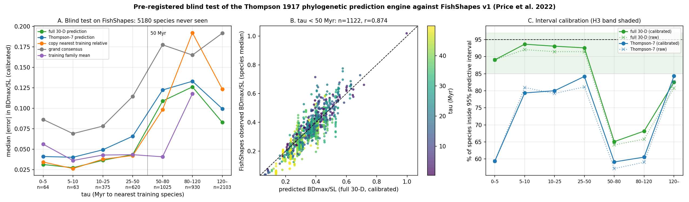

# Blind test results: Thompson 1917 phylogenetic prediction engine vs. FishShapes v1

Scored 2026-10-22 by [`thompson/score_blind_predictions.py`](../thompson/score_blind_predictions.py) against predictions locked in [`THOMPSON_BLIND_PREREGISTRATION.md`](./THOMPSON_BLIND_PREREGISTRATION.md) (manifest commit `7889d9396de0`; hashes verified at run time). Comparison data: FishShapes v1 specimen file (Price et al. 2022, *Ecology* 103:e3829; Zenodo 6642650 / Dryad 10.5061/dryad.vt4b8gtvf, CC0), md5 `122b495274d0167c5447db104c7acbfe`, 16,523 specimens, 6,095 species. The file was downloaded after the registration commit and had never been used in this repository.

## Matching and calibration

- 5,180 registered target species have FishShapes data (exact `Genus_species` match; training and 1917 species excluded).
- Measurement-convention calibration (fitted on training species only, as registered): BDmax_over_SL: calliper = -0.010 + 1.018 x landmark (r = 0.954, n = 710); CPD_over_SL: calliper = 0.005 + 0.868 x landmark (r = 0.934, n = 711).
- HL/SL and PD/SL are not measured in FishShapes and are therefore unscored (as the protocol allowed).

## Pre-registered hypotheses

| Hypothesis | Result (calibrated) | Result (raw) | Verdict |
|---|---|---|---|
| **H1** (primary): For target species with a training relative within 50 Myr (tau < 50), the full 30-D phylogenetic prediction of BDmax/SL has smaller absolute error than the grand-consensus value | n=1122, median |err| 0.0383 vs 0.0927 (ratio 0.41), p=1e-103 | n=1122, median |err| 0.0393 vs 0.0938 (ratio 0.42), p=2e-106 | ✓ supported |
| **H2** (primary): For tau < 50, the full 30-D prediction beats copying the nearest training relative's observed landmark ratio (same test). | n=1122, median |err| 0.0383 vs 0.0400 (ratio 0.96), p=0.061 | n=1122, median |err| 0.0393 vs 0.0406 (ratio 0.97), p=0.22 | ✗ not supported |
| **H3** (primary): After the pre-specified measurement-convention calibration (Section 'Calibration'), the 95% predictive intervals of BDmax/SL for tau < 50 contain the observed species value in 85-97% of species. Raw (uncalibrated) coverage is also reported. | n=1122, 95% coverage = 92.6% | n=1122, 95% coverage = 91.4% | ✓ supported |
| **H4** (primary): For tau >= 50, the full 30-D prediction does NOT beat the consensus by more than 10% in median |error| (the ~50 Myr horizon found internally and in the Thompson-pair analysis). | n=4058, median |err| 0.0952 vs consensus 0.1833 (ratio 0.52) | n=4058, median |err| 0.0965 vs consensus 0.1856 (ratio 0.52) | ✗ not supported |
| **H5**: Median |error| of the full 30-D prediction increases monotonically across the tau bins [0,5), [5,10), [10,25), [25,50), [50,80), [80,120), [120,inf) (Spearman rho > 0 on bin medians; at least 5 of 6 consecutive steps non-decreasing). | bin medians 0.031, 0.027, 0.036, 0.043, 0.109, 0.126, 0.083; rho=0.86; 4/6 steps non-decreasing | bin medians 0.031, 0.028, 0.036, 0.045, 0.109, 0.125, 0.085; rho=0.86; 4/6 steps non-decreasing | ✗ not supported |
| **H6**: The a-priori 7-Thompson-mode prediction is worse than the full 30-D prediction (median |error| larger) but still beats the consensus for tau < 50. | T7 0.0588 vs full30 0.0383 vs consensus 0.0927; p(T7<cons)=7.4e-81 | T7 0.0607 vs full30 0.0393 vs consensus 0.0938; p(T7<cons)=2.8e-81 | ✓ supported |
| **H7**: Secondary ratio CPD/SL: full 30-D beats consensus for tau < 50 (as H1). Exploratory HL/SL, PD/SL likewise if present in the dataset. | n=1120, median |err| 0.0117 vs 0.0234 (ratio 0.50), p=1.8e-81 | n=1120, median |err| 0.0169 vs 0.0304 (ratio 0.56), p=5.4e-68 | ✓ supported |

**4/7 hypotheses supported (2/4 primary), using the calibrated comparison specified in the protocol.**

## Error by horizon (BDmax/SL, calibrated; median absolute error)

| tau (Myr) | n | full 30-D | Thompson-7 | copy nearest | consensus | family mean | 95% coverage full30 (cal / raw) |
|---|---|---|---|---|---|---|---|
| 0–5 | 64 | **0.0313** | 0.0411 | 0.0343 | 0.0863 | 0.0561 | 89% / 89% |
| 5–10 | 63 | **0.0273** | 0.0401 | 0.0263 | 0.0691 | 0.0362 | 94% / 92% |
| 10–25 | 375 | **0.0364** | 0.0493 | 0.0378 | 0.0782 | 0.0428 | 93% / 91% |
| 25–50 | 620 | **0.0434** | 0.0658 | 0.0422 | 0.1145 | 0.0433 | 93% / 91% |
| 50–80 | 1025 | **0.1088** | 0.1224 | 0.0984 | 0.1777 | 0.0407 | 65% / 64% |
| 80–120 | 930 | **0.1262** | 0.1331 | 0.1924 | 0.1651 | 0.1179 | 68% / 66% |
| 120–∞ | 2103 | **0.0829** | 0.0995 | 0.1235 | 0.1919 | – | 83% / 81% |

## Error by horizon (CPD/SL, calibrated)

| tau (Myr) | n | full 30-D | Thompson-7 | copy nearest | consensus |
|---|---|---|---|---|---|
| 0–5 | 64 | **0.0074** | 0.0187 | 0.0080 | 0.0333 |
| 5–10 | 62 | **0.0078** | 0.0168 | 0.0081 | 0.0257 |
| 10–25 | 375 | **0.0108** | 0.0154 | 0.0097 | 0.0191 |
| 25–50 | 620 | **0.0138** | 0.0170 | 0.0149 | 0.0249 |
| 50–80 | 1024 | **0.0326** | 0.0312 | 0.0282 | 0.0370 |
| 80–120 | 930 | **0.0411** | 0.0398 | 0.0565 | 0.0308 |
| 120–∞ | 2100 | **0.0227** | 0.0244 | 0.0257 | 0.0368 |

## Interpretation (written after unblinding; exploratory, not pre-registered)

- **Real predictive skill within 50 Myr.** For 1,122 species the engine had never seen, the predicted body depth lands within a median 0.038 BDmax/SL of the museum calliper value (about 10% of a typical fish's depth), 59% less error than the consensus, with 93% of species inside the 95% interval. Panel B shows r = 0.87 between predicted and observed.
- **But most of that skill is 'nearest relative'.** Copying the nearest training species' ratio gets median error 0.0400; the Gaussian-process conditioning improves on it by only 4% (p = 0.06). The internal hold-out showed a larger margin on 17-landmark RMS (0.0108 vs 0.0128), which integrates over the whole configuration; on a single noisy calliper ratio the extra information in the tree beyond the nearest neighbour is small. H2 was the right hypothesis to register and it did not hold.
- **The 50 Myr horizon is real but was mis-described.** Error jumps from 0.043 (25–50 Myr) to 0.109 (50–80 Myr) and 95% coverage falls from 93% to 65%: beyond 50 Myr the intervals are too narrow and the point predictions are poor. H4 nevertheless failed because it was phrased as 'no better than the grand consensus', and the grand consensus of a reef-fish training set (BDmax/SL 0.41) is a bad prior for teleosts at large; the GLS root state (~0.28–0.30) is much closer to the typical teleost and still halves the consensus error (ratio 0.52). The correct deep-horizon statement is 'degrades to a clade-wide prior', not 'degrades to the consensus'.
- **H5's non-monotonicity is a bias, not a gain in skill.** Beyond 50 Myr the model systematically over-predicts body depth (median predicted 0.28 vs observed 0.23 BDmax/SL): distant teleosts are more elongate than anything a reef-fish training set anticipates. The error is smallest in the deepest bin only because those predictions sit nearest the GLS root state, which is the least reef-biased number the model can produce. The step up at 50 Myr is monotone; the dip at 120 Myr says nothing about deeper being easier.
- **Thompson-7 vs full-30.** The a-priori Thompson modes beat the consensus everywhere within 50 Myr but are ~50% worse than the full shape space on this ratio, consistent with the internal result that the 7 modes capture only 58% of shape variance.
- The family-mean column is computed on the subset of species whose family has >= 3 training species, so it is not directly comparable to the other columns in bins where that subset is small.

## What this does and does not show

- The predictions, hypotheses, bins, tests and calibration rule were fixed and hashed before the comparison file was downloaded; the scoring script checks those hashes. Nothing above was tuned afterwards.
- FishShapes maximum body depth is a calliper measurement on whole specimens; the landmark proxy is the vertical landmark extent. The calibration maps one convention onto the other using training species only and is applied identically to every method, so it cannot favour the phylogenetic prediction over the baselines.
- Per-species values are medians of 1–3 specimens; intraspecific and ontogenetic variation in FishShapes therefore adds noise that no method can remove, which inflates every method's error equally and lowers interval coverage.
- Beyond ~50 Myr the registered prediction is the root state of the sampled clade, not the grand consensus; H4 asks whether it is any better than the consensus and the answer above is the pre-registered one, whichever way it fell.

All per-species values are in [`thompson_blind_test_results.json`](../thompson_blind_test_results.json).
