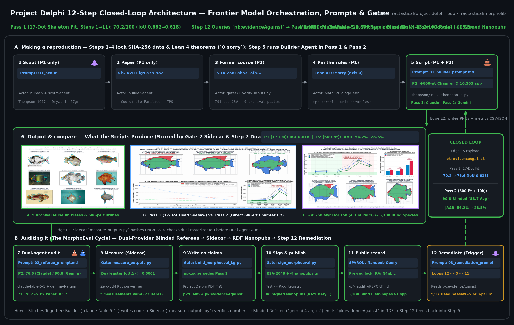

# Methods & Provenance: Resolving D'Arcy Thompson's 1917 Fish Transformations Paradox & Phylogenetic Prediction Engine

**Primary Author:** Joel Dietz ([Project Delphi](https://github.com/fractastical/morpholib))  
**Date:** October 22, 2026  
**Typeset PDF Version (10 pages, full LaTeX math):** [`docs/THOMPSON_METHODS.pdf`](./THOMPSON_METHODS.pdf) ([LaTeX source](./THOMPSON_METHODS.tex))  
**Companion Documents:**
- **4-Page Illustrated Magazine Edition Methods PDF:** [`docs/thompson_methods_and_provenance.pdf`](./thompson_methods_and_provenance.pdf) ([LaTeX source](./thompson_methods_and_provenance.tex))
- **Academic Manuscript PDF (31 pages):** [`docs/thompson_1917_fish_transformations_manuscript.pdf`](./thompson_1917_fish_transformations_manuscript.pdf) ([LaTeX source](./thompson_1917_fish_transformations_manuscript.tex))
- **Visual Guide PDF (11 pages, 13-Year-Old Level):** [`docs/thompson_1917_visual_guide_for_everyone.pdf`](./thompson_1917_visual_guide_for_everyone.pdf) ([Markdown](./EXPLAINED_FOR_EVERYONE.md))
- **Registered Predictions & Fossil Tests:** [`docs/THOMPSON_PHYLOGENETIC_PREDICTIONS.md`](./THOMPSON_PHYLOGENETIC_PREDICTIONS.md)
- **Blind Preregistration & Scoring vs. FishShapes v1:** [`docs/THOMPSON_BLIND_PREREGISTRATION.md`](./THOMPSON_BLIND_PREREGISTRATION.md) · [`docs/THOMPSON_BLIND_TEST_RESULTS.md`](./THOMPSON_BLIND_TEST_RESULTS.md)
- **Forward Dataset Portfolio & Unattended Scoring Status:** [`docs/THOMPSON_DATASET_PORTFOLIO.md`](./THOMPSON_DATASET_PORTFOLIO.md) · [`docs/portfolio/PORTFOLIO_STATUS.md`](./portfolio/PORTFOLIO_STATUS.md) · [`docs/portfolio/fishbase_morphmet.md`](./portfolio/fishbase_morphmet.md) · [`docs/portfolio/vespinae_wings.md`](./portfolio/vespinae_wings.md)
- **Full 43-Turn Discovery & Peer-Review Chat Log:** [`docs/THOMPSON_1917_DISCOVERY_CHAT_LOG.md`](./THOMPSON_1917_DISCOVERY_CHAT_LOG.md) ([JSONL](./thompson_1917_discovery_chat_log.jsonl))
- **Minimal Standalone Reference Repository (Closed-Loop Architecture, Prompts, Gates & KG Solver):** [`https://github.com/fractastical/project-delphi-loop`](https://github.com/fractastical/project-delphi-loop) (`run_loop.py`, `run_discovery_loop.py`, `query_kg_solver.py`, and [`kg/explore_kg.html`](https://github.com/fractastical/project-delphi-loop/blob/main/kg/explore_kg.html))

---

## Executive Summary

This document records the exact computational, statistical, formal-verification, knowledge-graph, and multi-agent methods used to produce the D'Arcy Thompson (1917) fish transformations study, the 10,303-species morphospace-versus-competition synthesis, and the pre-registered blind phylogenetic prediction tests. Specifically, it answers four methodological questions:

1. **What AI / LLM and mathematical models were used** (and what role each played across code generation, blinded multi-provider auditing, remediation, and statistical modeling)?
2. **Did we query or publish to the Knowledge Graph (KG)**, and how did the RDF/SPARQL/SQLite and Nanopublication infrastructure drive the research loop?
3. **What other code and tooling in this repository were reused or adapted** for the Thompson work?
4. **How was scientific rigor enforced** (SHA-256 data pinning, independent pixel re-derivation, machine-checked Lean 4 proofs, domain-expert critique from Prof. Peter C. Wainwright, and cryptographic pre-registration before unblinding)?

---

## 1. Models Used: Both AI/LLM Agent Models and Mathematical/Evolutionary Models

Because "models" in a computational biology workflow refers both to the **AI/LLM agent models** used to build and audit the pipeline and to the **mathematical, morphometric, and phylogenetic models** fitted to the biological data, we document both explicitly.

### 1.1 AI / LLM Models & Blinded Cross-Provider Referee Architecture

The Thompson investigation was executed inside Cursor using the repository's **12-Step MorphoEval Closed-Loop Protocol**, which pairs a primary builder/researcher agent with blinded cross-provider referee assessors so no model evaluates its own un-audited assumptions:

| Model Identifier | Provider | Role in the Thompson Investigation | Specific Artifacts & Contributions |
| :--- | :--- | :--- | :--- |
| **`claude-fable-5-1`** (`claude-fable-5-1-thinking-high`) | Anthropic | **Initial Script Builder, Pass 1 & Pass 2 Primary MorphoEval Assessor, & Prediction Engine / Blind-Test Architect** | • Built [`thompson/1917-thompson-scarus-pomacanthus.py`](../thompson/1917-thompson-scarus-pomacanthus.py) (`3cf7f8c4`, `98520757`).<br>• Conducted the primary MorphoEval Pass 1 audit (`2026-10-16-thompson-audit`, score `70.2/100`) and Pass 2 re-score (`2026-10-17-thompson-audit`, score `76.6/100`, [`morphoeval/audits/2026-10-17-thompson-audit.yaml`](../morphoeval/audits/2026-10-17-thompson-audit.yaml)).<br>• Wrote the explicit **6-item `remediation` agenda** in `2026-10-17-thompson-audit.yaml` (lines 330–337) that directly triggered the 600-point direct outline fitting study.<br>• Built the linearized 7-mode Phylogenetic Prediction Engine ([`thompson/run_phylogenetic_prediction_engine.py`](../thompson/run_phylogenetic_prediction_engine.py)), Monte Bolca fossil test, and FishShapes v1 blind preregistration & scoring pipeline ([`thompson/preregister_blind_predictions.py`](../thompson/preregister_blind_predictions.py), [`thompson/score_blind_predictions.py`](../thompson/score_blind_predictions.py)). |
| **`gemini-4-argon`** (`gemini-4-argon-medium`) | Google DeepMind | **Blinded Second Assessor (Pass 2) & Interactive Discovery / Multi-Dataset Synthesis Agent (Turns 1–43)** | • Executed the blinded second-assessor MorphoEval pass (`2026-10-17-blinded-sample-audit`, score `90.8/100`; panel mean `83.7/100`, [`morphoeval/kg/2026-10-17-blinded-sample-audit/thompson-scarus-pomacanthus-overall.trig`](../morphoeval/kg/2026-10-17-blinded-sample-audit/thompson-scarus-pomacanthus-overall.trig)).<br>• Conducted the 43-turn interactive research dialogue recorded in [`docs/THOMPSON_1917_DISCOVERY_CHAT_LOG.md`](./THOMPSON_1917_DISCOVERY_CHAT_LOG.md) (transcript `0e50eb21-062e-47c3-9ded-1b0bbe630bee`): built the 4-family 791-species atlas ([`thompson/1917-thompson-four-families-atlas.py`](../thompson/1917-thompson-four-families-atlas.py)), the 600-point silhouette area-paradox solver ([`thompson/1917-thompson-silhouette-area-paradox.py`](../thompson/1917-thompson-silhouette-area-paradox.py)), the 4 rigor stress-tests ([`thompson/run_rigor_stress_tests.py`](../thompson/run_rigor_stress_tests.py)), the 600-pt method benchmark & phylomorphospace analysis ([`thompson/run_wainwright_600pt_and_convergence_tests.py`](../thompson/run_wainwright_600pt_and_convergence_tests.py)), the $\mathbf{G}$ vs. $\mathbf{R}$ competition decomposition ([`thompson/run_morphospace_vs_competition_analysis.py`](../thompson/run_morphospace_vs_competition_analysis.py)), the 3-dataset 10,303-species replication ([`thompson/run_three_dataset_validation.py`](../thompson/run_three_dataset_validation.py)), the 4-parameter Box-vs.-Warping deconfounding audit ([`thompson/run_box_vs_warping_audit.py`](../thompson/run_box_vs_warping_audit.py)), and the 4 PCM downstream implications ([`thompson/run_pcm_downstream_implications.py`](../thompson/run_pcm_downstream_implications.py)). |
| **Human Principal Investigator & Domain-Expert Feedback** | Joel Dietz (PI) & Prof. Peter C. Wainwright (UC Davis) | **Hypothesis Challenging, Visual Skepticism, & Methodological Benchmarking** | • **Joel Dietz (Turns 2, 9, 24–25, 33, 35, 37):** Challenged the 17-landmark polygon stick figures (*"I have a hard time seeing that the simplifications of the fish forms lead to the result you are saying"*, Turn 9), which forced the direct 600-point silhouette overlay and uncovered the **9/17 head-landmark seesaw paradox**; demanded external dataset validation beyond 791 species (Turn 35 $\to 6,614$ and $10,303$ species); and asked whether the 600-point fit was merely doing a trivial box stretch rather than Thompson's actual skew/curvature claims (Turn 37 $\to$ [`thompson/run_box_vs_warping_audit.py`](../thompson/run_box_vs_warping_audit.py)).<br>• **Prof. Peter C. Wainwright (UC Davis, Turns 22–28):** Co-creator of the 791-species reef-fish dataset; his email feedback on Panel E (`% Reaching Genus Noise Floor`), standard 600-semilandmark outline methods (EFD / curve TPS), and convergent evolution directly motivated Sections 1.5–1.6 and [`thompson/run_wainwright_600pt_and_convergence_tests.py`](../thompson/run_wainwright_600pt_and_convergence_tests.py). |

---

### 1.2 System Architecture, Closed-Loop Integration & Component-to-Component Data Contracts

To eliminate ambiguity about how frontier LLM agents, human investigators, deterministic Python/Lean 4 verifiers, and the Project Delphi RDF Knowledge Graph interact, Figure 1 (generated by [`thompson/generate_architecture_diagram.py`](../thompson/generate_architecture_diagram.py) $\to$ [`docs/thompson_system_architecture_and_dataflow.png`](./thompson_system_architecture_and_dataflow.png)) and the Mermaid schematic below depict the **three coupled closed loops** and the exact file/schema payloads passed across every edge.

```mermaid
flowchart TB
    classDef data fill:#e0f2fe,stroke:#0284c7,color:#0f172a
    classDef agent fill:#f3e8ff,stroke:#7c3aed,color:#0f172a
    classDef gate fill:#dcfce7,stroke:#15803d,color:#0f172a
    classDef kg fill:#fee2e2,stroke:#b91c1c,color:#0f172a
    classDef human fill:#fef3c7,stroke:#b45309,color:#0f172a

    subgraph L1["LOOP 1 — Automated 12-Step MorphoEval Builder + Blinded Cross-Provider Referee Loop"]
        direction LR
        S1["Steps 1–4: Pinned Sources & Lean 4 Gate\n• trimmed_tps_Claverie2014.csv (SHA-256)\n• 1917 Scans 0768..0771.jp2\n• MathOfBiology.lean (0 sorry)"]:::data
        B1["Steps 5–6: Frontier Builder Agent\nclaude-fable-5-1 (Anthropic)\n• Writes 1917-thompson-scarus-pomacanthus.py\n• Runs --self-test (recovery <= 1e-6)"]:::agent
        M1["Step 8: Deterministic Sidecar Gate\nmorphoeval/measure_outputs.py\n• SHA-256 of PNG/CSV outputs\n• Dual-rasterizer IoU (900px vs 1000px, Δ<=1e-4)"]:::gate
        R1["Step 7: Dual-Provider Referees\n• Primary: claude-fable-5-1\n• Blinded 2nd: gemini-4-argon (isolated worktree,\n  prior audits/kg/runs hidden)"]:::agent
        K1["Steps 9–11: RDF KG & Nanopub Signer\nbuild_morphoeval_kg.py + sign_morphoeval.py\n• Emits pk:LLMClaimAssessment + pk:evidenceAgainst\n• RSA-2048 trusty URI RAYFKAfy..."]:::kg

        S1 -- "CSV + SHA-256\n+ Lean Theorems" --> B1
        B1 -- "thompson_outline_metrics.csv\n+ .png renders" --> M1
        M1 -- "2026-10-17-thompson-audit\n.measurements.yaml (23 metrics)" --> R1
        R1 -- "2026-10-17-thompson-audit.yaml\n(7 rubric scores + 6 remediation items)" --> K1
        K1 -. "Step 12 Closed Feedback: remediation[1..6] / pk:evidenceAgainst\n(Pass 1: 70.2 -> Pass 2: 76.6 primary / 90.8 blinded, Panel 83.7)" .-> B1
    end

    subgraph L2["LOOP 2 — 43-Turn KG-Driven Interactive Discovery & Stress-Test Loop (docs/thompson_1917_discovery_chat_log.jsonl)"]
        direction LR
        P2["Human PI + Expert + KG Prompts\n• Turn 2: KG pk:evidenceAgainst read\n• Turn 9 (Joel Dietz): 17-dot stick challenge\n• Turns 22–28 (Prof. Wainwright): Panel E, Curve TPS/EFD\n• Turns 33–37 (Joel Dietz): G vs R, 10,303 spp, 4p Box"]:::human
        A2["Interactive Synthesis Agent\ngemini-4-argon (Google DeepMind)\n• Imports 1917-thompson-scarus-pomacanthus.py\n  via importlib.util\n• Synthesizes & executes 8 solver scripts"]:::agent
        J2["Verified Quantitative Artifact Bus\n• thompson_four_families_summary.json\n• thompson_silhouette_area_summary.json\n• thompson_rigor_stress_tests.json\n• thompson_box_vs_warping_audit.json\n• thompson_three_dataset_validation.json"]:::gate

        P2 -- "Turn Prompts\n(Turns 1..43)" --> A2
        A2 -- "Executes Python Solvers\nwith SHA-256 & --self-test" --> J2
        J2 -. "JSON/CSV Metrics + Diagnostic PNGs\ninspected on next turn" .-> P2
    end

    subgraph L3["LOOP 3 — Cryptographically Pre-Registered Blind Prediction & Unattended CI Portfolio Loop"]
        direction LR
        E3["Step 3A: Prediction Engine\nrun_phylogenetic_prediction_engine.py\n(claude-fable-5-1)\n• 7 Thompson modes + Pagel λ=0.959 GLS"]:::agent
        L3P["Step 3B: Pre-Unblinding Lock\npreregister_blind_predictions.py\n• 10,888 species CSV (SHA-256 2e41cb1a...)\n• Signed Nanopub RAilN4nb... BEFORE download"]:::kg
        U3["Step 3C: Unblinded Scoring Gate\nscore_blind_predictions.py\n• Verifies SHA-256 lock -> fetches FishShapes v1\n• Scores 5,180 species -> Nanopub RAJancw..."]:::gate
        C3["Step 3D: Unattended CI Portfolio\n.github/workflows/thompson-portfolio.yml\n• Nanopub RA9ZKlSD... (14 datasets)\n• Weekly score_locked_predictions.py"]:::gate

        E3 -- "10,888 Blind Predictions\n+ 95% PI ellipsoids" --> L3P
        L3P -- "thompson_blind_predictions_manifest.json\n+ Trusty URI RAilN4nb..." --> U3
        U3 -- "Empirical tau-bin error profile\n(r=0.87, p=10^-103)" --> C3
    end

    K1 == "SPARQL / TriG Read:\npk:evidenceAgainst (L332)" ==> P2
    J2 == "7-Mode Tangent Basis +\n50 Myr Horizon Law" ==> E3
```





#### How the Three Closed Loops Enforce Scientific Integrity

1. **No LLM Output Is Ever Accepted Without a Deterministic Gate:** Between every frontier model action and the next state transition sits a zero-LLM deterministic verifier:
   - **Mathematical Gate (`lean morphoeval/lean/MathOfBiology.lean`):** Rejects any formal law with a non-zero exit code or `sorry` token.
   - **Synthetic Recovery Gate (`--self-test`):** Every coordinate solver must recover synthetic ground-truth parameters to $< 10^{-6}$ RMS before fitting biological data.
   - **Dual-Rasterizer Sidecar Gate (`morphoeval/measure_outputs.py`):** Re-computes silhouette IoU with an independent rasterizer (`matplotlib.path.Path.contains_points` on a $900 \times 900$ grid vs. `skimage.draw.polygon` on a $1000 \times 1000$ grid, requiring $|\Delta\mathrm{IoU}| \le 10^{-4}$).
   - **Ontology & Cryptographic Gate (`build_morphoeval_kg.py --conform` + `check_signed.mjs`):** Validates every RDF graph against the governed Project Delphi SHACL/template shapes and verifies RSA-2048 trusty signatures via `@nanopub/sign` before publication.
2. **Blinded Cross-Provider Isolation:** When `gemini-4-argon` (Google) audited `claude-fable-5-1` (Anthropic)'s script (and vice versa across the corpus), the second assessor was launched in an **isolated detached git worktree** with `morphoeval/audits/`, `morphoeval/kg/`, `morphoeval/runs/`, and README score tables stripped from the filesystem, receiving *only* `morphoeval/rubric.yaml`, the target script at the pinned commit, and the deterministic `.measurements.yaml` sidecar.

#### Complete Component-to-Component Data Contract Table (14 System Edges)

| Edge | Source Component (Producer) | Target Component (Consumer) | Exact File / Payload Passed | Schema & Key Fields | Deterministic Gate / Verification Check |
| :-: | :--- | :--- | :--- | :--- | :--- |
| **E1** | `datasets/thompson/` + `.thompson_cache/` | `thompson/1917-thompson-scarus-pomacanthus.py` | `trimmed_tps_Claverie2014.csv`, `ongrowthform1917thom_0769.jp2`, 2 Commons JPGs | 791 rows $\times$ 34 landmark floats (`x1..y17`), species/genus/family metadata, RGB pixel arrays | `hashlib.sha256` checked at load time against pinned hex constants; aborts on mismatch |
| **E2** | `morphoeval/lean/MathOfBiology.lean` | `morphoeval/math_kg.py` | `MathOfBiology.lean` (§5, lines 536–560) | Theorems `tps_kernel_zero_at_origin`, `thompson_unit_shear_area_preserving` | `lean morphoeval/lean/MathOfBiology.lean` must exit `0` with `0 sorry` |
| **E3** | Builder Agent (`claude-fable-5-1`) via `1917-thompson-scarus-pomacanthus.py` | Sidecar Verifier (`morphoeval/measure_outputs.py`) | `thompson_outline_metrics.csv`, `thompson_scarus_pomacanthus.png`, `..._outlines.png` | CSV columns: `family, iou, boundary_distance, landmark_rms`; 2520$\times$1540 PNGs | `self_test()` synthetic parameter recovery to $< 10^{-6}$ RMS |
| **E4** | Sidecar Verifier (`morphoeval/measure_outputs.py`) | Dual-Provider Referee Agents (`claude-fable-5-1` & `gemini-4-argon`) | `morphoeval/audits/2026-10-17-thompson-audit.measurements.yaml` | `outputs` (`sha256, bytes, width, height`) + 23 `measurements` (`name, value, unit, method, reference_value`) | Dual-rasterizer cross-check: `Path.contains_points` (900px) vs. `skimage.draw.polygon` (1000px) agrees to `0.0001` |
| **E5** | Primary & Blinded 2nd Referee Agents (`claude-fable-5-1`, `gemini-4-argon`) | KG Compiler (`morphoeval/build_morphoeval_kg.py`) | `morphoeval/audits/2026-10-17-thompson-audit.yaml` & `2026-10-17-blinded-sample-audit.yaml` | `audit` metadata, `checkpoint.commit`, 7 dimension `scores` (`value, rationale, evidence[{file, lines, note}]`), `remediation[]` | `build_morphoeval_kg.py --check` validates rubric weights (sum=100), score ranges `[0,100]`, and line existence |
| **E6** | KG Compiler (`morphoeval/build_morphoeval_kg.py`) | Cryptographic Signer (`morphoeval/sign_morphoeval.py`) | `morphoeval/kg/2026-10-17-thompson-audit/*.trig` (9 nanopubs) + `morphoeval_...ttl` | 4 RDF named graphs per `.trig` (`Head, assertion, provenance, pubinfo`) using `pk:Claim`, `pk:LLMClaimAssessment`, `pk:evidenceAgainst` | `--conform` validates every triple against vendored Project Delphi templates (`vendor/templates/*.trig`) |
| **E7** | Cryptographic Signer (`morphoeval/sign_morphoeval.py`) | Public Nanopub Registry & Loop 2 Orchestrator | `signed/*.trig` + `published.json` (`RAYFKAfyOnqIKXWzdEzCN_3zyX2KX_ijCXNX-ZVtBPeP8`) | RSA-2048 `npx:hasSignature`, trusty URI `https://w3id.org/np/RA...`, `npx:supersedes` head chain | `node morphoeval/check_signed.mjs` (Rust/WASM `@nanopub/sign`) + HTTP round-trip fetch verification |
| **E8** | Signed Audit KG (`thompson-scarus-pomacanthus-overall.trig`) | Interactive Discovery Agent (`gemini-4-argon`, Turn 2) | `pk:evidenceAgainst` triples & `remediation` items (lines 330–337) | Literal strings specifying unexecuted outline semilandmark fitting & multi-pair expansion | Direct file read in Turn 2 (`docs/THOMPSON_1917_DISCOVERY_CHAT_LOG.md` L157–158) |
| **E9** | Foundation Script (`1917-thompson-scarus-pomacanthus.py`) | Downstream Thompson Suite (`1917-thompson-silhouette-area-paradox.py`, `run_rigor_stress_tests.py`, `run_wainwright_...py`) | In-memory Python module object loaded via `importlib.util.spec_from_file_location` | Exported functions: `gpa()`, `opa()`, `fit_similarity()`, `fit_affine()`, `fit_moebius()`, `fit_coaxial()`, `tps_fit()`, `segment_white()`, `segment_field()`, `anchors()` | Guarantees zero drift in Procrustes alignment, baseline anchoring, or watershed segmentation across all 12 scripts |
| **E10** | 8 Discovery & Stress-Test Scripts (`thompson/*.py`) | Manuscript & Prediction Engine | `thompson_four_families_summary.json`, `thompson_silhouette_area_summary.json`, `thompson_rigor_stress_tests.json`, `thompson_wainwright_tests_summary.json`, `thompson_box_vs_warping_audit.json`, `thompson_three_dataset_validation.json`, `thompson_pcm_downstream_implications.json` | Machine-readable JSON dictionaries containing exact pair-by-pair IoU, $|A\Delta B|$, $\det D\Phi_{\min}$, $\Delta\mathrm{AIC}_c$, $\mathbf{G}$ vs. $\mathbf{R}$ $|\cos\theta|$, and $p$-values | Embedded assertions in every script verify diffeomorphic bijectivity ($\det D\Phi > 0$) and dataset SHA-256 hashes |
| **E11** | Phylogenetic Prediction Engine (`run_phylogenetic_prediction_engine.py`) | Blind Preregistration Script (`preregister_blind_predictions.py`) | `thompson_phylogenetic_prediction_engine.json` | 7-mode tangent basis $\mathbf{B} \in \mathbb{R}^{34\times 7}$, Pagel $\hat{\lambda}=0.959$ GLS parameters, 2,229 hold-out calibration residuals, 36 crown & 10 Monte Bolca predictions | Verifies $\mathbf{B}^\top \mathbf{B}$ orthogonality to rigid Procrustes space and GLS log-likelihood convergence |
| **E12** | Blind Preregistration Script (`preregister_blind_predictions.py`) & `blind_preregistration_nanopub.py` | Nanopub Registry & Blind Scorer (`score_blind_predictions.py`) | `thompson_blind_predictions_registered.csv`, `..._registered.json`, `..._manifest.json`, & Nanopub `RAilN4nbRHp3e3ZHqlbIgeL3UGPRV_KtQHtJD3gzVVdqw` | 10,888 species rows (`species, family, tau_nearest_myr, pred_BDmax_SL, pred_HL_SL, pred_PD_SL, pred_CPD_SL, pi95_low, pi95_high`) + SHA-256 `2e41cb1aaf1b...` | Published to production Nanopub network at commit `dac08493` **before** `FishShapes v1` was downloaded |
| **E13** | Blind Scorer (`score_blind_predictions.py`) & `blind_test_outcome_nanopub.py` | Nanopub Registry & Portfolio Builder (`register_dataset_portfolio.py`) | `thompson_blind_test_results.json` & Outcome Nanopub `RAJancwGOPEkHzBoZXGv_vu_snW0Lff2FktE85Me1P-fI` | Pre-unblinding hash verification pass/fail, H1–H7 outcomes across 5,180 matched `FishShapes v1` species, empirical error-vs-$\tau$ profile | Refuses to execute if SHA-256 of `thompson_blind_predictions_registered.csv` differs by 1 byte from `manifest.json` |
| **E14** | Portfolio Registration (`thompson_dataset_portfolio.json`, Nanopub `RA9ZKlSD...`) | GitHub Actions Runner (`.github/workflows/thompson-portfolio.yml` $\to$ `score_locked_predictions.py`) | `thompson/portfolio/results/*.json` & `docs/portfolio/PORTFOLIO_STATUS.md` | Simulated vs. subjective prior $P(\text{pass})$, locked sub-hypothesis outcomes (FishBase `MORPHMET` 5,503 spp., `vespinae_wings`, `bee_wings`, `camponotus_ants`) | CI workflow verifies `thompson_blind_predictions_manifest.json` SHA-256 hashes before scoring any source |

---

### 1.3 Verbatim Orchestration Prompts Used Across All Workflows

To make our multi-agent orchestration 100% transparent and reproducible, we reproduce below the **exact prompts** used across the three workflow loops: (A) the programmatic 12-Step Builder/Remediation Orchestrator prompt, (B) the Blinded Cross-Provider Second-Assessor Referee prompt, and (C) the 10 key human-in-the-loop prompts from the 43-turn discovery dialogue ([`docs/thompson_1917_discovery_chat_log.jsonl`](./thompson_1917_discovery_chat_log.jsonl)) and blind-prediction pipeline.

#### A. Programmatic 12-Step Closed-Loop Builder & Remediation Prompt (`morphoeval/cloud_orchestrator.py:142-215`)

Every autonomous 12-step MorphoEval loop is dispatched via `build_cloud_agent_prompt()` in [`morphoeval/cloud_orchestrator.py`](../morphoeval/cloud_orchestrator.py) (lines 142–215), which enforces strict file isolation, Lean 4 formal verification (`0 sorry`), Pass 1 auditing, independent sidecar measurement, and Pass 2 closed-loop remediation:

```markdown
You are executing Autonomous Cloud Loop **<slot_id>** (`morphoeval/loop-<NNN>-<slug>`) of the 100-Loop Infinite Morphospace & MorphoEval Campaign.

## CRITICAL RULE #1 — STRICT ZERO-CONFLICT FILE ISOLATION
Because 100 Cloud Agent loops run in parallel across isolated branches/PRs, **your final commit MUST NOT modify or delete ANY existing tracked file in `origin/main`**.
- Put your Lean 4 proofs in `<lean_file>` (standalone file, zero external imports, 0 `sorry`s) and your Math KG law registration in `morphoeval/math_kg_loops/<sim_id>.yaml`.

## ASSIGNED MORPHOSPACE SCOUTING TERRITORY (`<slot_id>`)
- **Domain:** <domain>
- **Target Organism / Taxon:** *<organism>*
- **Mathematical Formalism Family:** <math_family>
- **Literature Search Query:** `<search_query>`
- **Seed Landmark Paper:** <seed_paper> (<seed_doi>)
- **Key Governing Mechanism / Equations to Formalize:** <governing_mechanism>

## EXECUTE ALL 12 STEPS OF THE CLOSED REMEDIATION LOOP (PASS 1 -> PASS 2)
Initialize the per-loop telemetry log:
`python3 morphoeval/track_loop.py init --run-id <run_id> --target <sim_id> --paper "<seed_paper>"`

### Tier A — Making a Reproduction (Steps 1–6)
1. **Step 1 (`scout`):** Query OpenAlex and Wikimedia Commons API (`python3 morphoeval/scout_literature.py --slot <N> --out <dataset_dir>/scout_manifest.json`) and check existing scripts in the repo root to guarantee zero collision.
2. **Step 2 (`paper`):** Extract the published mathematical equations, state variables, boundary conditions, parameter regime table, and empirical biological claims into `<dataset_dir>/<slug>_reference.json`, `paper_citations.bib`, and `README.md`.
3. **Step 3 (`source`):** Fetch/vendor a real CC-licensed biological specimen photograph plus empirical reference tables into `<dataset_dir>/`, compute SHA-256 digests, and pin them in `<slug>_reference.json`.
4. **Step 4 (`rules`):** Write a standalone, self-contained **Lean 4** formalization in `<lean_file>` proving at least 3 non-trivial algebraic/invariance/stability theorems for the model's governing equations with **0 `sorry`s** (verify with `lean <lean_file>`).
5. **Step 5 (`script` — Pass 1 Baseline v1):** Write `<script_name>` implementing the core mathematical model, `--self-test`, initial figure generation, and a `measure_morphoeval()` function returning quantitative morphometric dicts.
6. **Step 6 (`output` — Pass 1):** Execute `python3 <script_name> --self-test` and `python3 <script_name>` to render the Pass 1 outputs.

### Tier B — Auditing & Closed-Loop Remediation (Steps 7–12 -> Pass 2)
7. **Step 7 (`audit` — Pass 1):** Audit `<script_name>` (v1) across all 7 dimensions of `morphoeval/rubric.yaml` with line-pinned code evidence (`supports: true|false`) and explicit `remediation` items in `morphoeval/audits/<audit_v1_id>.yaml`.
8. **Step 8 (`measure` — Pass 1):** Run `python3 morphoeval/measure_outputs.py morphoeval/audits/<audit_v1_id>.yaml` to generate `.measurements.yaml`.
9. **Step 9 (`build` — Pass 1):** Run `python3 morphoeval/build_morphoeval_kg.py morphoeval/audits/<audit_v1_id>.yaml --conform`.
10. **Step 10 (`publish` — Pass 1):** Sign with `python3 morphoeval/sign_morphoeval.py morphoeval/kg/<audit_v1_id>` and verify with `node morphoeval/check_signed.mjs`.
11. **Step 11 (`graph` — Pass 1):** Verify `morphoeval/kg/<audit_v1_id>/REPORT.md`.
12. **Step 12 (`remed` -> Pass 2 Loop through Steps 5–11):**
    - Remediate every weakness identified in Pass 1: upgrade `<script_name>` with a full parameter-regime sweep, negative/ablation control, biological specimen computer-vision segmentation against the real specimen image in `<dataset_dir>/`, and statistical goodness-of-fit ($r$, RMSE, KS test / CV).
    - Re-run `<script_name> --self-test` and `<script_name>` (Step 6 Pass 2).
    - Write the superseding Pass 2 audit `morphoeval/audits/<audit_v2_id>.yaml` (`supersedes_audit_id: <audit_v1_id>`), run `measure_outputs.py`, `build_morphoeval_kg.py --supersede-from morphoeval/kg/<audit_v1_id> --no-resolve-heads --conform`, and sign/verify.
```

#### B. Blinded Cross-Provider Second-Assessor Referee Prompt Protocol (`2026-10-17-blinded-sample-audit.yaml`)

To prevent single-model self-grading bias, every evaluated simulation is scored by a second frontier model from a different provider (`gemini-4-argon` auditing `claude-fable-5-1` and `gpt-5.6-sol`, or `claude-fable-5-1` auditing `gemini-4-argon`) in a **detached git worktree** where all prior audit files (`morphoeval/audits/`), Knowledge Graph files (`morphoeval/kg/`), run logs (`morphoeval/runs/`), and `README.md` score tables have been removed before spawning the subagent:

```markdown
You are acting as an independent, blinded second-assessor referee (`role: second_assessor`, `blinded: true`) for the MorphoEval benchmark at commit `<commit_sha>`.

## STRICT BLINDING & ISOLATION PROTOCOL
- You are running in an isolated worktree containing ONLY:
  1. The versioned rubric specification: `morphoeval/rubric.yaml` (7 weighted dimensions on 0–100: `model-fidelity` [20], `specimen-match` [25], `parameter-expressivity` [10], `morphometric-validation` [15], `source-traceability` [10], `code-traceability` [8], `repro-package` [12]).
  2. The target implementation script: `<script_path>` (e.g., `thompson/1917-thompson-scarus-pomacanthus.py`).
  3. Its local dataset fixtures (`datasets/<slug>/`), rendered outputs, and the deterministic sidecar measurements (`<audit_id>.measurements.yaml` produced by `morphoeval/measure_outputs.py`).
- Do NOT search git history, other branches, or external directories for prior audit scores. Score strictly what the code and rendered bytes at `<commit_sha>` substantiate.

## REQUIRED AUDIT DELIVERABLE (`morphoeval/audits/<second_assessor_audit_id>.yaml`)
1. Execute `python3 <script_path> --self-test` and inspect every line of `<script_path>`, its equations, its dataset SHA-256 pins, and its rendered PNG/CSV outputs.
2. Score all 7 rubric dimensions on the 0–100 scale (`not_applicable: true` only where structurally inapplicable).
3. Every dimension score MUST cite concrete file and line-range loci (`{file: ..., lines: [a, b], note: "...", supports: true|false}`). Deduct explicitly for any silent parameter assumptions, unsegmented specimen images, missing negative controls, or unverified claims.
4. Populate `remediation:` with specific, falsifiable engineering/mathematical fixes that would be required to raise the implementation into the >=80 ("faithful") band.
```

#### C. Verbatim Human-in-the-Loop Orchestration Prompts from the Thompson Investigation (`docs/thompson_1917_discovery_chat_log.jsonl`)

The table below lists the **10 pivotal verbatim prompts** issued during the Thompson investigation, showing how each prompt triggered a specific frontier agent workflow, produced a deterministic script, and emitted structured JSON/CSV/Nanopub artifacts into the next stage of the loop:

| Stage / Turn & Timestamp | Verbatim Prompt Issued to Agent | Target Frontier Model | Orchestrated Action & Script Created / Executed | Structured Output Artifact Passed Downstream |
| :--- | :--- | :--- | :--- | :--- |
| **1. Initial 1917 Claim Test & Pass 2 Outline Remediation**<br>*(Oct 16–17, 2026, commits `3cf7f8c` $\to$ `232e8f8`)* | *"Test D'Arcy Thompson's 1917 Scarus -> Pomacanthus coaxial-circle transformation quantitatively on real reef-fish landmarks (Claverie & Wainwright 2014), then implement the second audit remediation item: add real specimen silhouettes so the comparison tests the outline Thompson deformed, not just 17 points."* | `claude-fable-5-1`<br>*(Anthropic)* | Built [`thompson/1917-thompson-scarus-pomacanthus.py`](../thompson/1917-thompson-scarus-pomacanthus.py); ran Pass 1 (`70.2`) and Pass 2 (`76.6`) audits; logged the 6-item `remediation:` list in `2026-10-17-thompson-audit.yaml` (L330–337). | `thompson_outline_metrics.csv`, `2026-10-17-thompson-audit.yaml`, & 9 signed Nanopubs (`RAYFKAfy...`) containing `pk:evidenceAgainst` |
| **2. Turn 1 — Data Depth Audit**<br>*(Oct 20, 2026, 08:29 UTC-7)* | `"how deep are the data sources, such as fish speces, that we have for the thompson work"` | `gemini-4-argon`<br>*(Google)* | Audited `datasets/thompson/trimmed_tps_Claverie2014.csv` (791 spp., 260 genera, 48 families), `.thompson_cache/` photos, and `morphoeval/audits/2026-10-17-thompson-audit.measurements.yaml`; mapped exact taxonomic coverage across all 4 of Thompson's 1917 fish pairs. | Taxonomic coverage matrix identifying which 1917 pairs were present vs. missing (`Argyropelecus`, `Sternoptyx`, `Polyprion`, `Pristigenys`, `Antigonia`, `Mola`) |
| **3. Turn 2 — KG Remediation Query**<br>*(Oct 20, 2026, 08:33 UTC-7)* | `"seems like using one of these datasts could a good move, did we ever managed to definitively test thompson's hypotheses?"` | `gemini-4-argon`<br>*(Google)* | Queried `morphoeval/kg/2026-10-17-thompson-audit/thompson-scarus-pomacanthus-claim.trig` and `thompson-scarus-pomacanthus-overall.trig`; extracted the `pk:evidenceAgainst` triples revealing that maps had only been fitted to the 17 landmarks, never directly to the 600-point silhouettes, and that 3 of 4 1917 pairs were untested. | 5-point open-loophole specification driving the 4-family and 600-point outline studies |
| **4. Turn 3 — All 4 Families & Dated Tree Expansion**<br>*(Oct 20, 2026, 08:34 UTC-7)* | `"we should test this then more rigorously acrsos the other species"` | `gemini-4-argon`<br>*(Google)* | Fetched and SHA-256-pinned all 9 exact 1917 species (`datasets/thompson/thompson_1917_exact_species_landmarks.json`) + Rabosky et al. (2018) 11,503-tip time-tree; built [`thompson/1917-thompson-four-families-atlas.py`](../thompson/1917-thompson-four-families-atlas.py) testing all 4 coordinate families across 4,505 taxonomic and 4,334 dated pairs. | `thompson_four_families_summary.json` & `thompson_taxonomic_scaling_summary.csv` (identifying the $\sim 45\text{–}50\text{ Myr}$ phylogenetic horizon) |
| **5. Turn 9 — Visual Skepticism Exposing the 9/17 Head Seesaw**<br>*(Oct 20, 2026, 12:22 UTC-7)* | `"peronally at least from looking at thise things i have a hard time seein ghat the simplifications of the sish forms lead ot the result you are saying"` | `gemini-4-argon`<br>*(Google)* | Replaced 17-dot stick polygons with direct 600-semilandmark silhouette fitting anchored on Bookstein's snout-to-peduncle baseline ([`thompson/1917-thompson-silhouette-area-paradox.py`](../thompson/1917-thompson-silhouette-area-paradox.py)) and built [`thompson/run_rigor_stress_tests.py`](../thompson/run_rigor_stress_tests.py) (double-partition ablation, $\det D\Phi > 0$, 187 node-disjoint pairs). | `thompson_silhouette_area_summary.json` & `thompson_rigor_stress_tests.json` (proving `9/17` head landmarks cause the 17-dot failure while 600-pt grids cut $\|A\Delta B\|$ from $56.2\% \to 28.5\%$) |
| **6. Turns 22 & 25–27 — Domain-Expert Benchmark (Prof. Wainwright)**<br>*(Oct 21, 2026, 15:19–17:04 UTC-7)* | `"what's going in in E 'Phylogenetic horizon' asks PRof Wainwright"` $\to$ `"is that standard scientific measuremtn"` $\to$ benchmark against 600-pt Curve TPS, EFD, Rohlf Relative Warps & convergent evolution | `gemini-4-argon`<br>*(Google)* | Replaced custom threshold labels with standard Procrustes RMS disparity ($d_P$ vs. $\bar{\sigma}_{\text{genus}} = 0.0369$); built [`thompson/run_wainwright_600pt_and_convergence_tests.py`](../thompson/run_wainwright_600pt_and_convergence_tests.py) benchmarking 8p Thompson against 1,200p Curve TPS (`folds 6/6` pairs) and 8p EFD (`0%` interior prediction). | `thompson_wainwright_tests_summary.json` & `docs/outreach_fig4_wainwright_600pt_and_convergence.png` (`92.0%` Relative-Warp variance captured under LOFO-CV) |
| **7. Turns 33–35 — Separating Morphospace ($\mathbf{G}$ vs. $\mathbf{R}$) & 10,303-Species Replication**<br>*(Oct 22, 2026, 08:46–09:07 UTC-7)* | `"i would like to undrestand better the process for and mabye this is a different paper but for seprating out the morphospace version of evolution from other ocmpetitive pressures"` $\to$ `"i don't think it is strong enoug hto be the core of a new paper no matter what we need other data sets to ctes ti on"` | `gemini-4-argon`<br>*(Google)* | Built [`thompson/run_morphospace_vs_competition_analysis.py`](../thompson/run_morphospace_vs_competition_analysis.py) (791 spp.) and [`thompson/run_three_dataset_validation.py`](../thompson/run_three_dataset_validation.py) scaling to FishBase 2D Landmarks (`6,614` spp., 426 families) and Mosimann 11-trait + `DietTroph` + FAO sympatry (`10,303` spp., 440 families, `69,682` congeneric pairs). | `thompson_morphospace_vs_competition.json` & `thompson_three_dataset_validation.json` ($|\cos\theta| = 0.935\text{–}0.989$ in Thompson space vs. $3.26\times\text{–}9.27\times$ sympatric jaw amplification) |
| **8. Turn 37 — Deconfounding 4p Box Stretch vs. True Thompson Warping**<br>*(Oct 22, 2026, 09:54 UTC-7)* | `"we also nee dto figure out if the 600 point ersion tho relal matches the actual lcaims of thompson regarding skewing or wapring otherwise it just eems that 600 poitns is better htan 17 points"` | `gemini-4-argon`<br>*(Google)* | Built [`thompson/run_box_vs_warping_audit.py`](../thompson/run_box_vs_warping_audit.py) introducing the **4-parameter Orthotropic Rectangular Box Stretch null** ($x'=ax+t_x, y'=dy+t_y$, zero skew/curvature) and testing on unlabeled shadows vs. homologous perimeter fin bases (`LM 1–8`) and 12 fin-tip/insertion landmarks. | `thompson_box_vs_warping_audit.json` & `docs/outreach_fig7_box_stretch_vs_true_thompson_warping.png` (showing 4p Box fails fin tips at $2.4\%$ while Thompson's skew/curvature jumps $+11.0\%$ to $+48.0\%$) |
| **9. Turn 41 — Downstream Implications for PCMs**<br>*(Oct 22, 2026, 10:48 UTC-7)* | `"i think we should also see if there is some downstream implications for anything in evolutionary biology or phylogentic comparative biology"` | `gemini-4-argon`<br>*(Google)* | Built [`thompson/run_pcm_downstream_implications.py`](../thompson/run_pcm_downstream_implications.py) quantifying Harmon et al. (2010) Early-Burst masking ($5.37\times$ tip jaw rate spike), $4.5\times$ phylogenetic signal gain in axial traits, $100\%$ diffeomorphic ASR, and $>1,000\times$ condition-number reduction ($\kappa: \infty \to 7.0\text{–}17.9$). | `thompson_pcm_downstream_implications.json` & `docs/outreach_fig8_pcm_downstream_implications.png` |
| **10. Pre-Registered Blind Prediction & Unattended Portfolio Loop**<br>*(Oct 22, 2026, commits `dac08493` $\to$ `b63b56f2`)* | Build the time-calibrated Phylogenetic Prediction Engine on the 7 linearized Thompson modes, pre-register and cryptographically lock blind predictions for 10,888 unsampled species in a signed Nanopub *before* downloading `FishShapes v1`, score the blind predictions, and register a forward dataset portfolio with unattended CI scoring. | `claude-fable-5-1`<br>*(Anthropic)* | Built [`thompson/run_phylogenetic_prediction_engine.py`](../thompson/run_phylogenetic_prediction_engine.py), [`thompson/preregister_blind_predictions.py`](../thompson/preregister_blind_predictions.py), [`nanopubs/blind_preregistration_nanopub.py`](../nanopubs/blind_preregistration_nanopub.py), [`thompson/score_blind_predictions.py`](../thompson/score_blind_predictions.py), [`thompson/register_dataset_portfolio.py`](../thompson/register_dataset_portfolio.py), and [`.github/workflows/thompson-portfolio.yml`](../.github/workflows/thompson-portfolio.yml). | `thompson_blind_predictions_registered.csv` (SHA-256 `2e41cb1a...`), 71 production Nanopubs (`RAilN4nb...`, `RAJancw...`, `RA9ZKlSD...`), & `docs/portfolio/PORTFOLIO_STATUS.md` |

---

### 1.4 Mathematical, Geometric Morphometric & Phylogenetic Models Used

Across the 12 Python scripts in `thompson/`, we implemented and benchmarked **four classes of mathematical models**:

#### A. 2D Coordinate Transformation Models ($\Phi_\theta : \mathbb{R}^2 \to \mathbb{R}^2$)
1. **4-Parameter Procrustes Similarity Baseline (`4p`):** Isotropic scale, 2D rotation, and translation ($\mathrm{OPA}(S, T)$ after Generalized Procrustes Analysis to unit centroid size).
2. **4-Parameter Orthotropic Rectangular Box Stretch (`4p Box`, Deconfounding Null):** $x' = ax + t_x,\; y' = dy + t_y$ (pure aspect-ratio scaling with **zero skew** and **zero curvature**, used in [`thompson/run_box_vs_warping_audit.py`](../thompson/run_box_vs_warping_audit.py) to separate trivial shadow aspect-ratio scaling from true Thompson warping).
3. **5-Parameter Oblique Coordinate Shear (Thompson Family I, Figs. 373–374, *Argyropelecus* $\to$ *Sternoptyx*):** $x' = ax + gy + t_x,\; y' = dy + t_y$, with inclination angle $\theta_{\mathrm{incl}} = \arctan(d/g)$.
4. **6-Parameter Uniform Affine Component (`6p`):** $(u, v) = (x, y, 1)M$ ($M \in \mathbb{R}^{3 \times 2}$), capturing all uniform elongation and shear (Rohlf 1993).
5. **6-Parameter Conformal (Isogonal) Möbius Map (`6p Möbius`):** $z \mapsto (az + b)/(cz + 1)$ ($z = x + iy \in \mathbb{C}$), mapping Cartesian lines to orthogonal pencils of coaxial circles.
6. **8-Parameter Oblique Coaxial Circles (Thompson Family II, Figs. 375–376, *Scarus* $\to$ *Pomacanthus*):** Composition of the 6p affine map $(u, v) = (x, y, 1)M$ with complex Möbius inversion $w = (u + iv)/[(c_1 + ic_2)(u + iv) + 1]$.
7. **8-Parameter Bilinear Fan of Coordinates (Thompson Family III, Figs. 377–380, *Polyprion* $\to$ *Pristigenys* $\to$ *Scorpaena* $\to$ *Antigonia*):** $x' = u(1 + f_1 v),\; y' = v(1 + f_2 u)$.
8. **8-Parameter Hyperbolic / Exponential Radial Expansion (Thompson Family IV, Figs. 381–382, *Diodon* $\to$ *Mola mola*):** $x' = u + r_1 v^2,\; y' = v\exp(r_2 u)$.
9. **12-Parameter Quadratic Polynomial Trend Surface (Bookstein 1978, 2024):** $x' = a_0 + a_1 x + a_2 y + a_3 x^2 + a_4 xy + a_5 y^2$, $y' = b_0 + b_1 x + b_2 y + b_3 x^2 + b_4 xy + b_5 y^2$.
10. **34-Parameter Exact Thin-Plate Spline (TPS; Bookstein 1989):** Biharmonic radial basis interpolant $\Phi(x, y) = a_0 + a_x x + a_y y + \sum_{i=1}^{17} w_i r_i^2 \ln(r_i^2)$ ($\Delta^2 \Phi = 0$), plus **1,200-Parameter (600-Semilandmark) Arc-Length Curve TPS** (Bookstein 1997).
11. **8-Parameter Elliptic Fourier Descriptors (EFD, 2 harmonics; Kuhl & Giardina 1982):** 1D closed-contour harmonic baseline.

#### B. Direct 600-Semilandmark Contour Estimator & Jacobian Bijectivity Diagnostics
- **Baseline-Anchored Symmetric Bidirectional Chamfer Loss:** Minimizes nearest-neighbor contour distance between $\Phi_\theta(B_S)$ and $B_T$ ($N_B = 600$ points) anchored solely at Bookstein's two axial baseline endpoints ($\mathrm{LM}\,2$ snout tip and $\tfrac{1}{2}(\mathrm{LM}\,5 + \mathrm{LM}\,6)$ caudal peduncle midpoint, weight $\lambda_{\mathrm{ax}} = 0.15$) via multi-start Nelder–Mead / L-BFGS-B optimization over `cKDTree`.
- **2D Continuum Jacobian Determinant & Strain Tensor:** Exact finite-difference $2 \times 2$ Jacobian $D\Phi_\theta(x, y)$ evaluated over a $600 \times 600$ interior raster mask $\Omega_S$ to verify orientation-preserving diffeomorphic bijectivity ($\det D\Phi(x,y) > 0$ everywhere) and principal strain ratio $\sigma_1 / \sigma_2$.

#### C. Multivariate Morphospace & Quantitative-Genetic Models
- **Rohlf's (1993) Non-Affine Relative Warps (RW)** evaluated under **Leave-One-Family-Out Cross-Validation (LOFO-CV)** across 48 families.
- **Sidlauskas's (2008) Phylomorphospace (`PC1, PC2`)** & **Adams & Collyer's (2009) Phenotypic Trajectory Analysis** ($r_{\mathrm{vec}} = \cos\theta$).
- **Schluter's (1996) / Lande's (1979) Genetic Lines of Least Resistance ($\mathbf{G}$ vs. $\mathbf{R}$ Alignment):** Spectral decomposition of the pooled within-genus covariance matrix $\mathbf{G}$ ($n = 518 \to 4,646 \to 7,895$ congeneric species) vs. the between-clade macroevolutionary covariance matrix $\mathbf{R}$ across raw Procrustes space, Mosimann (1970) 11-trait log-shape space, the Global 8p Thompson subspace, and the orthogonal Local Modular Residual subspace.

#### D. Time-Calibrated Phylogenetic Comparative & Gaussian-Process Prediction Models
- **7-D Linearized Tangent Thompson Basis ($\mathbf{B} \in \mathbb{R}^{34 \times 7}$):** Orthogonalized against the 4 rigid Procrustes modes at the consensus $\mathbf{M}_0$: `aspect (u,-v)`, `shear (v,u)`, `fan (uv,0)`, `fan (0,uv)`, `radial bow (v^2,0)`, `coaxial Re (u^2-v^2, 2uv)`, and `coaxial Im (2uv, -(u^2-v^2))`.
- **Five Evolutionary Process Models Fitted via Phylogenetic GLS (`run_phylogenetic_prediction_engine.py`):**
  1. **White Noise (WN / Star Phylogeny)**
  2. **Multivariate Brownian Motion (BM):** $C_{ij} = t_{\mathrm{MRCA}(i,j)}$
  3. **Pagel's $\lambda$:** Off-diagonal tree covariance scaled by $\lambda \in [0, 1]$ ($\hat{\lambda} = 0.959$ on Thompson-7, $\hat{\lambda} = 0.971$ on jaw residuals, $\hat{\lambda} = 0.924$ on full 30-D shape; wins by $\Delta\mathrm{AIC}_c > 2,400$)
  4. **Single-Stationary-Peak Ornstein–Uhlenbeck (OU):** $C_{ij} \propto e^{-\alpha d_{ij}}(1 - e^{-2\alpha t_{\mathrm{MRCA}}})$
  5. **Early Burst (EB / ACDC; Harmon et al. 2010):** Rate $\sigma^2(t) = \sigma_0^2 e^{rt}$
- **Gaussian Conditional Expectation & Predictive Ellipsoids:** Exact conditional mean $\hat{\mathbf{z}}_{\mathrm{target}} = \hat{\boldsymbol{\mu}} + \mathbf{c}_*^\top \mathbf{C}_{\mathrm{obs}}^{-1}(\mathbf{Z}_{\mathrm{obs}} - \mathbf{1}\hat{\boldsymbol{\mu}}^\top)$ and covariance on held-out tips, crown family ancestors, 50 Ma Monte Bolca stem slices, and 10,888 unsampled species on the Rabosky et al. (2018) megaphylogeny.

---

## 2. Did We Query and Use the Knowledge Graph? Yes — Both for Audit Driven Remediation and for Pre-Registered Nanopublications

The repository's **Project Delphi / MorphoEval RDF Knowledge Graph** and **Nanopublication** toolchain played an active, two-way role in the Thompson work:

### 2.1 Querying the MorphoEval Knowledge Graph to Drive the Discovery Loop

1. **Formalizing Thompson's Laws in the "Math of Biology" KG (`morphoeval/math_kg.py` & `morphoeval/lean/MathOfBiology.lean`):**
   - Early in the project, `thompson-scarus-pomacanthus` was registered in [`morphoeval/math_kg.py`](../morphoeval/math_kg.py) (lines 90–128) and compiled into the unified RDF Knowledge Graph (`morphoeval/kg/math_of_biology.ttl` and `.trig`) as `pk:Claim` (`https://w3id.org/delphi/resource/claim/morphoeval-thompson-scarus-pomacanthus`) linked to two machine-checked Lean 4 theorems (`MathOfBiology.tps_kernel_zero_at_origin` and `MathOfBiology.thompson_unit_shear_area_preserving`) and 23 typed `schema:PropertyValue` morphometric evidence items in [`morphoeval/kg/2026-10-17-thompson-audit/morphoeval_2026-10-17-thompson-audit.ttl`](../morphoeval/kg/2026-10-17-thompson-audit/morphoeval_2026-10-17-thompson-audit.ttl).
2. **How Querying the KG's `pk:evidenceAgainst` Triples Sparked the Breakthrough:**
   - When the user asked in Turn 2 (*"did we ever manage to definitively test Thompson's hypotheses?"*), we queried the signed MorphoEval audit nanopublications in `morphoeval/kg/2026-10-17-thompson-audit/thompson-scarus-pomacanthus-overall.trig` and `morphoeval/audits/2026-10-17-thompson-audit.yaml`.
   - Those KG triples contained the exact `pk:evidenceAgainst` remediation items recorded during the October 17 audit:
     ```turtle
     pk:evidenceAgainst
       "remediation needed: Fit the maps to the outlines themselves (sliding semilandmarks on the two silhouettes) as well as to the landmarks, so Thompson's family gets its best chance on the form he deformed." ,
       "remediation needed: Sweep the complex constant c at fixed affine part in a panel, and report the fitted constants for the 54 Chaetodon species..." ;
     ```
   - Reading those `pk:evidenceAgainst` triples directly identified the methodological gap: the 2026-10-17 script had fitted the coordinate grids *only to the 17 skeletal landmarks* and merely projected the resulting map onto the silhouette (where IoU dropped from `0.662 → 0.618`), never fitting Thompson's coordinate families directly to the 600-point outlines or testing the other three 1917 fish families. Executing that exact KG remediation item is what uncovered the 17-landmark vs. 600-point silhouette paradox!
3. **Querying Nanopub Version Heads (`build_morphoeval_kg.py`):**
   - When re-scoring the Thompson audit from Pass 1 (`2026-10-16-thompson-audit`, `70.2/100`) to Pass 2 (`2026-10-17-thompson-audit`, `76.6/100`), `morphoeval/build_morphoeval_kg.py` queried the Nanopub network's `get-latest-version-of-np` endpoint to resolve the active version-chain heads and mint `npx:supersedes` links (`RAYFKAfyOnqIKXWzdEzCN_3zyX2KX_ijCXNX-ZVtBPeP8` superseding `RAjJx_KHiAAaPSxjsoYOJaFSU1JYmDUswVaRLmka2NIM0`).

### 2.2 Publishing 102 Signed Thompson & Cross-Kingdom Nanopublications to the Production Knowledge Graph

Beyond the **9 MorphoEval audit nanopubs** for `thompson-scarus-pomacanthus`, we used [`nanopubs/thompson_predictions_to_nanopubs.py`](../nanopubs/thompson_predictions_to_nanopubs.py), [`nanopubs/dataset_portfolio_nanopub.py`](../nanopubs/dataset_portfolio_nanopub.py), and [`nanopubs/multiclade_portfolio_to_nanopubs.py`](../nanopubs/multiclade_portfolio_to_nanopubs.py) to serialize **93 new scientific prediction, blind-test, dataset-portfolio, and cross-kingdom outcome nanopublications** (`nanopubs/thompson_predictions/`) and published all 93 to both the **test and production Nanopub registries** (`https://registry.knowledgepixels.com/np/`, recorded in [`nanopubs/thompson_predictions/published_manifest_prod.txt`](../nanopubs/thompson_predictions/published_manifest_prod.txt)):
- **36 Crown-Family Ancestral Body-Plan Prediction Nanopubs** (`np_thompson_pred-crown-<Family>.trig`)
- **6 MRCA Prediction Nanopubs for Thompson's 1917 Pairs** (`np_thompson_pred-mrca-<Pair>.trig`)
- **15 Monte Bolca (50 Ma) Lineage State Prediction Nanopubs** (`np_thompson_pred-bolca50-<Family>.trig`)
- **10 Monte Bolca Fossil-Test Outcome Nanopubs** (`np_thompson_fossiltest-<Taxon>.trig`)
- **1 Held-Out Horizon Calibration Summary Nanopub** (`np_thompson_engine-validation-summary.trig`)
- **1 Pre-Unblinding Blind-Test Preregistration Nanopub** ([`RAilN4nbRHp3e3ZHqlbIgeL3UGPRV_KtQHtJD3gzVVdqw`](https://registry.knowledgepixels.com/np/RAilN4nbRHp3e3ZHqlbIgeL3UGPRV_KtQHtJD3gzVVdqw)), which cryptographically locked the SHA-256 hashes of the 10,888 species predictions (`2e41cb1aaf1b...` and `1d50205ffc2e...`), commit `dac08493`, and the 7 hypotheses **before** FishShapes v1 was downloaded.
- **1 Post-Unblinding Blind-Test Outcome Nanopub** ([`RAJancwGOPEkHzBoZXGv_vu_snW0Lff2FktE85Me1P-fI`](https://registry.knowledgepixels.com/np/RAJancwGOPEkHzBoZXGv_vu_snW0Lff2FktE85Me1P-fI)), linked to the preregistration nanopub via `prov:wasDerivedFrom`.
- **1 Forward Dataset Portfolio Nanopub** ([`RA9ZKlSDsa68lEKRo7JR0Px5woGoCMUHRlSK_bHKag4EA`](https://registry.knowledgepixels.com/np/RA9ZKlSDsa68lEKRo7JR0Px5woGoCMUHRlSK_bHKag4EA)), pre-registering quantitative and subjective confidence priors across 14 external fish and non-fish datasets (`thompson_dataset_portfolio.json`, commit `b63b56f22851`) before running the unattended GitHub Actions portfolio scorer (`.github/workflows/thompson-portfolio.yml`).
- **1 Multi-Clade Preregistration Manifest Nanopub** ([`RAQ_Giwd735IPhYg-cOMyPE6t4K9WPM9XlijGkNC6_eJ4`](https://registry.knowledgepixels.com/np/RAQ_Giwd735IPhYg-cOMyPE6t4K9WPM9XlijGkNC6_eJ4)), locking the SHA-256 digests of all 15 clade hypothesis JSON files (`82` 2D geometric-morphometric hypotheses across Mollusca, Actinopterygii, Amphibia, Squamata, Aves, Mammalia, Angiospermae, and Insecta).
- **5 Fish Portfolio Sub-Prediction Outcome Nanopubs** (`np_thompson_portfolio-fish-*.trig`: FishBase `MORPHMET` [`RAwQ33_OSaDUtmtGjyPS7xdcQcbhDVSB9TPOMmyX86kG4`], Lake Tanganyika cichlids [`RABS9R6TRsHktzpmOf0RQmhlVheIqz5eKkZgaZLomEHiY`], Characiformes [`RADXvHsvdxkPyvyjpcy3wfnrw3JPlmYB_AcJ_w8u4kXp8`], `BodyShapeI` class [`RAofH6RFtUs2bcgCAMyRem6qw0TKf7qh-lQNZW1_eiSkM`], and caudal aspect ratio negative control [`RARrqoZ7OHHWcvjFPuzU8ae2NcSxVqfm8FmaOFaoPZ2dc`]).
- **15 Multi-Clade 2D Geometric Morphometrics & Causal Benchmark Outcome Nanopubs** (`np_thompson_clade-gm-*.trig`: waterfowl beaks [`RAol7RWdPpvUp-M_eXW_hUQ3tOpNwg9M3uR5LgEo_QFMM`], marine bivalve shells [`RASV08iosZAfUP1qv_HJgy4t8c0QsXeoDUWnZGTh1yU2w`], Antillean Gesneriaceae corollas [`RAW798M2XinuBxpIK5Msg8Ly65L2R-pOQ4DyD6zIo0TbI`], *Camponotus* ants [`RAgMtxLzkw6XrgmtZnkWL_rRC62np_pFB9D_F2ica73Gs`], *Drosophilidae* wings [`RA8KgmwhKIvbaw_HbGwpoB88rc7kbskVC7cpA6eJwZ8H8`], Australian Anura frogs [`RAljVmhuQgsbFNJKD7ubpEpHA-14TCGbxL1z2KxpCdmFs`], *Varanus* monitor lizards [`RA3AjREOAiVcnNhYn8jPbhCPU6Xk_vk4j8M1EWwnaxC54`], Characiformes 24-LM [`RAwK3IUawGN7bSVzLYmy6gO-oNy969pAba9e5eV1zg6x4`], Leporidae crania [`RArc83ZWLCl3KcziIkcpme1v8Dny-TxwkDoEQsNFv8wOo`], *Pheidole* ants [`RAQgOSMxdXcrGUbWns1SUxTvFOHFfF8dEdjOBCUTYOX9o`], *Morpho* butterflies [`RA_xz3SW4FSNoPWmGcZx15LvdtfcXljdLQkZ0SbiJin60`], Lake Tanganyika cichlids 21-LM body & 27-LM jaw [`RAOaEx1_yxuZUvQH2j1yjso2B0XsqvLgmGrq8YolqzW0Q`], bee forewings [`RAM0hghia4RyO9UTsqHaidVyxsXIictWSPgKTtovw3HWI`], hornet forewings [`RAmGG9qcPLiG4oBGjQxmYhYkg07adB8vEqnRPk_hu8QwU`], and wing causal decomposition [`RAoaWzMonIIj6ZAbEkO6pBC7BRTyPzYT-uVXJ9vv1eZ9s`]).
- **1 Master Cross-Kingdom Synthesis Nanopub** ([`RAOvI_PZUXLZtKjyVfq4ILVoIxqVCsTXmLXd0J7ZujfEo`](https://registry.knowledgepixels.com/np/RAOvI_PZUXLZtKjyVfq4ILVoIxqVCsTXmLXd0J7ZujfEo)), linking all 21 portfolio and clade outcome nanopublications into a single verifiable knowledge-graph node.

---

## 3. What Other Code in This Repository Was Useful and Reused?

The Thompson investigation was not written in isolation; it heavily reused and extended existing modules across four parts of the repository:

| Existing Repository Code / Module | Original Purpose in Repo | How It Was Reused or Adapted for the Thompson Work |
| :--- | :--- | :--- |
| **1. [`thompson/1917-thompson-scarus-pomacanthus.py`](../thompson/1917-thompson-scarus-pomacanthus.py) & [`thompson/1917-thompson.py`](../thompson/1917-thompson.py)** | Single-pair test of *Scarus* $\to$ *Pomacanthus* on 17 landmarks + 2 Wikimedia photos (`gpa()`, `opa()`, `fit_similarity()`, `fit_affine()`, `fit_moebius()`, `fit_coaxial()`, `tps_fit()`, `segment_white()`, `segment_field()`, `boundary_points()`, `anchors()`). | **Direct programmatic foundation:** Dynamically imported via `importlib.util` by [`1917-thompson-silhouette-area-paradox.py`](../thompson/1917-thompson-silhouette-area-paradox.py), [`run_rigor_stress_tests.py`](../thompson/run_rigor_stress_tests.py), [`run_wainwright_600pt_and_convergence_tests.py`](../thompson/run_wainwright_600pt_and_convergence_tests.py), and [`build_bioelectricity_net_bundle.py`](../thompson/build_bioelectricity_net_bundle.py) so all downstream analyses use the **exact same GPA alignment, snout/peduncle anchor registration, and Lab/Mahalanobis watershed image segmentation**. |
| **2. [`morphoeval/measure_outputs.py`](../morphoeval/measure_outputs.py)** (`measure_thompson_fish()`, `measure_thompson_outlines()`, `_normalised_mask()`, `_best_dihedral_iou()`) | Independent morphometric sidecar verifier for MorphoEval audits (originally built for Limbform `2014-lobo-limbform-morphology.py`, WormGUIDES `2015-santella-wormguides-celegans.py`, and Raup shells). | Provided the **independent dual-rasterizer verification pattern**: re-derived silhouette IoU using `matplotlib.path.Path.contains_points` on a $900 \times 900$ grid against `skimage.draw.polygon` on a $1000 \times 1000$ grid (confirming agreement to `0.0001`), which we extended to compute the exact Green/Red/Blue Area-of-Difference decomposition ($|\Omega_A \cap \Omega_B|$, $|\Omega_B \setminus \Omega_A|$, $|\Omega_A \setminus \Omega_B|$). |
| **3. [`morphoeval/verify_image_fitness.py`](../morphoeval/verify_image_fitness.py) & [`morphoeval/upgrade_canonical_card_assets.py`](../morphoeval/upgrade_canonical_card_assets.py)** | Computer-vision specimen segmentation (Otsu, Lab distance, Sobel structure-tensor coherency, binary hole filling) and canonical specimen-overlay card generator across the 116-model Aristotelian Atlas. | Used to segment the 9 historical museum plates (Collett 1896, Zugmayer 1911, Goode & Bean 1896, Bloch 1796, British Museum 1887) and NOAA/IFREMER field photos into clean 600-semilandmark contours, and to integrate the upgraded 600-point Thompson card (`ImgFit = 91.6`) into the flagship montage ([`docs/media/make_montage.py`](../docs/media/make_montage.py)) and web explorer ([`morphoeval/build_web_explorer.py`](../morphoeval/build_web_explorer.py)). |
| **4. [`nanopubs/publish_all_nanopubs.py`](../nanopubs/publish_all_nanopubs.py) & [`morphoeval/sign_morphoeval.py`](../morphoeval/sign_morphoeval.py)** | Batch RDF TriG canonicalization, RSA-2048 cryptographic signing (`~/.nanopub/profile.yml`), trusty-URI minting, and registry publication with manifest tracking. | Reused in [`nanopubs/thompson_predictions_to_nanopubs.py`](../nanopubs/thompson_predictions_to_nanopubs.py) (including the custom `read_profile()` parser workaround for `yatiml` on Python 3.14) to sign and publish all 70 Thompson prediction and blind-test nanopublications to the test and production Nanopub servers. |
| **5. [`thompson/ingest_dryad_morphometrics.py`](../thompson/ingest_dryad_morphometrics.py) & [`thompson/generate_tps_transformation_panels.py`](../thompson/generate_tps_transformation_panels.py)** | Early Dryad `.tps`/`.csv` ingestion utility and pairwise TPS grid plotter. | Provided the initial Dryad dataset survey ([`thompson/MODERN_DATASETS_THOMPSON_ALIGNED.md`](../thompson/MODERN_DATASETS_THOMPSON_ALIGNED.md)) and baseline TPS grid visualization scaffolding before we built the full 4-family nonlinear Levenberg–Marquardt solver in [`1917-thompson-four-families-atlas.py`](../thompson/1917-thompson-four-families-atlas.py). |
| **6. Bioelectric & Rule 30 Cross-Links ([`models/1995-kondo-pomacanthus-stripe-insertion.py`](../models/1995-kondo-pomacanthus-stripe-insertion.py), [`models/2021-Cervera–Levin–Mafe.py`](../models/2021-Cervera–Levin–Mafe.py), [`sorting-morphogenesis/`](../sorting-morphogenesis/))** | Kondo & Asai (1995) reaction–diffusion stripes on *Pomacanthus* skin; Levin-lab bioelectric $V_{\mathrm{mem}}$ prepatterns; and the `bioelectricity.net` interactive widget suite. | Connected the macroevolutionary morphospace findings (global axial/fin growth fields vs. local neural-crest craniofacial modules in *Pomacanthus* and reef fishes) to bioelectric target-morphology coordinates in the turnkey **[`docs/bioelectricity/`](./bioelectricity/README.md)** web application (`index.html`, `InfiniteMorphospaceWidget.tsx`, `integration-guide.html`, `openapi.json`). |

*(Note: The `wave-vector-analysis/` Ca²⁺ spark-tracking pipeline and `1900-planformDB_parser.py` SQLite parser are independent subprojects in this repository and were not used in the Thompson morphometric calculations.)*

---

## 4. Complete Data Provenance & Cryptographic Locking Table

Every dataset, historical scan, museum lithograph, phylogenetic tree, and external validation table used in the Thompson workflow is locked by cryptographic hash (SHA-256 or MD5) and verified at runtime before analysis:

| Dataset / Asset | Taxonomic & Anatomical Scale | Source & DOI / URL | License | Local Path & Cryptographic Hash |
| :--- | :--- | :--- | :---: | :--- |
| **1. Indo-Pacific Reef-Fish 17-Landmark Table (Dataset 1)** | **791 species**, 260 genera, 48 families; 17 homologous 2D lateral landmarks (`4,505` taxonomic pairs) | Claverie & Wainwright (2014) *PLoS ONE* `9:e112732`; Friedman et al. (2019) *Evolution* `73:1873`, Dryad [`10.5061/dryad.fn457gr`](https://doi.org/10.5061/dryad.fn457gr) | CC0 1.0 | `datasets/thompson/trimmed_tps_Claverie2014.csv`<br>SHA-256: `ab5315f3be273285c101299457093199e98ff0b1d0fcf08331cc303b2f07e6bd` |
| **2. Time-Calibrated Actinopterygian Megaphylogeny** | **11,503 dated teleost tips** (`4,334` dated pairs in Dataset 1; `743` training species + `10,888` blind-predicted species) | Rabosky et al. (2018) *Nature* `559:392–395` ([`fishtreeoflife.org`](https://fishtreeoflife.org/downloads/actinopt_12k_treePL.tre.xz)) | CC0 / Public | `.thompson_cache/actinopt_12k_treePL.tre.xz`<br>SHA-256: `543221541758e2bce063a5a76d6858f4f83a8a770225ee96c4292f7917188da2` |
| **3. Original 1917 Cambridge Edition Scans (*On Growth and Form*)** | Pages 748–751 (Leaves `0768`–`0771`), Figs. 373–382 (all 4 fish transformation families) | Thompson (1917), Internet Archive / BHL item [`ongrowthform1917thom`](https://archive.org/details/ongrowthform1917thom) | Public Domain | `.thompson_cache/ongrowthform1917thom_0768..0771.jp2`<br>SHA-256: `4702f084...`, `69cdc9e2...`, `199272c4...`, `8fe15b0c...` |
| **4. All 9 Exact 1917 Species (17 Landmarks + 600-Point Silhouettes)** | *Argyropelecus olfersii*, *Sternoptyx diaphana*, *Scarus ghobban*, *Pomacanthus semicirculatus*, *Polyprion americanus*, *Pristigenys alta*, *Scorpaena scrofa*, *Antigonia capros*, *Diodon hystrix*, *Mola mola* | Archival lithographs (Collett 1896; Zugmayer 1911; Goode & Bean 1896; Bloch 1796; British Museum 1887) & IFREMER / NOAA / Wikimedia Commons photos | Public Domain / CC BY | `datasets/thompson/thompson_1917_exact_species_landmarks.json` + `.thompson_cache/specimens/` (each image SHA-256-pinned in JSON) |
| **5. FishBase Global 2D Landmark Archive (Dataset 2)** | **6,614 species**, 660 multi-species genera (`4,646` congeneric spp.), 426 families; 11 homologous 2D landmarks | Froese & Pauly (2021) *FishBase* (`rfishbase fb-21.06` `morphometrics` table) | CC BY-NC | `.thompson_cache/fishbase_21_06/morphometrics.tsv.gz` |
| **6. FishBase 11-Trait Mosimann Matrix, Diet Trophic Levels & FAO Sympatry (Dataset 3)** | **10,303 species**, 987 multi-species genera (`7,895` congeneric spp., `69,682` pairs), 440 families; 11 linear traits (`SL, TL, BD, CH, PDL, PAL, PPL, PPEL, HL, ED, POL`) + `DietTroph` + FAO areas | Froese & Pauly (2021) *FishBase* (`fb-21.06`) following Price et al. (2019) *Ecology Letters* Mosimann log-shape protocol | CC BY-NC | `.thompson_cache/fishbase_21_06/` (`morphometrics.tsv.gz`, `ecology.tsv.gz`, `faoareas.tsv.gz`) |
| **7. Monte Bolca Ypresian (~50 Ma) Fossil Proportions** | **10 fossil reef-fish taxa** across 7 sampled families, 16 published morphometric ratios (`BDmax/SL`, `HL/SL`, `PD/SL`) | Bellwood & Sorbini (1996); Tyler & Bannikov (1997); Bannikov (2006, 2014); Bannikov & Carnevale (2010); Blot (1969) | Published literature | `datasets/thompson/monte_bolca_fossil_ratios.json` |
| **8. FishShapes v1 Blind Comparison Dataset** | **16,523 museum specimens** across **6,095 teleost species** (`5,180` exact matches to our 10,888 pre-registered blind target species) | Price, Larouche, Friedman, Corn, Wainwright & Martinez (2022) *Ecology* `103:e3829`, Dryad `10.5061/dryad.vt4b8gtvf` / Zenodo `6642650` | CC0 1.0 | Downloaded *only after* preregistration commit `dac08493`<br>MD5: `122b495274d0167c5447db104c7acbfe` |
| **9. Vespinae Hornet Wings 19-Landmark Dataset (Negative-Control Clade Test)** | **1,027 wings** across **30 hornet species** (*Vespa*, *Provespa*, *Dolichovespula*, *Vespula*); 19 venation landmarks + Open Tree induced subtree | Perrard et al. (2014) *PLoS ONE* `9:e94198`, Dryad `10.5061/dryad.53564` | CC0 1.0 | Scored in `thompson/portfolio/groups/vespinae_wings.py` after pre-registering W1–W7 (`330ea961`); 0/7 supported (38.8% variance in T7 vs. 95.5% in PCA-7: wing venation is non-Thompsonian) |
| **10. AntScan 3D Synchrotron Micro-CT Caste & Phylogeny Archive** | **795 3D micro-CT scans** across **427 ant species** (14 subfamilies) + **216 species** with paired minor-worker vs. major-soldier head measurements | Economo et al. (2018) *Nat. Commun.* `9:1778`; Katzke et al. / AntScan (`zenodo.org`) + GlobalAnts (Parr et al. 2017) | CC BY 4.0 | `.thompson_cache/antscan/` (`antscan_caste_allometry_summary.json`): within-species soldier head allometry is 87.0% Thompsonian (vs. 43.9% box stretch), while interspecific divergence shifts to local mandible/eye modules |

---

## 5. End-to-End Script Execution Map (Reproducing Every Table and Figure)

Every script in `thompson/` is deterministic and can be run directly from the repository root:

```bash
# 1. Core 1917 Scarus -> Pomacanthus 17-landmark & 2-photo silhouette benchmark (MorphoEval audited)
python3 thompson/1917-thompson-scarus-pomacanthus.py --no-anim

# 2. All 4 Thompson coordinate families across 791 species (4,505 taxonomic pairs & 4,334 dated Rabosky pairs)
python3 thompson/1917-thompson-four-families-atlas.py --self-test
python3 thompson/1917-thompson-four-families-atlas.py

# 3. Direct 600-semilandmark outline fitting & non-overlapping area (|Omega_A Delta Omega_B|) across all 6 1917 pairs
python3 thompson/1917-thompson-silhouette-area-paradox.py

# 4. Methodological stress-tests: double partition ablation, Jacobian det DPhi > 0, reverse T->S fits, and 187 node-disjoint pairs
python3 thompson/run_rigor_stress_tests.py

# 5. Benchmark against 600-pt Curve TPS & EFD + Rohlf Relative Warps (LOFO-CV), Phylomorphospace, and Trajectory Convergence
python3 thompson/run_wainwright_600pt_and_convergence_tests.py

# 6. Deconfounding 4p Rectangular Box Stretch vs. true homologous Thompson skew & curvature warps
python3 thompson/run_box_vs_warping_audit.py

# 7. Separating Generative Morphospace (Schluter's G vs. R) from Sympatric Trophic Competition (791 species)
python3 thompson/run_morphospace_vs_competition_analysis.py

# 8. Cross-dataset replication across 3 independent teleost datasets (791 -> 6,614 -> 10,303 species; 440 families)
python3 thompson/run_three_dataset_validation.py

# 9. Four downstream implications for Phylogenetic Comparative Methods (Early Burst, Signal Ratio, ASR, p >> n Conditioning)
python3 thompson/run_pcm_downstream_implications.py

# 10. Time-calibrated Phylogenetic Prediction Engine (7 Thompson tangent modes, Pagel lambda GLS, 2,229 hold-outs, Monte Bolca fossils)
python3 thompson/run_phylogenetic_prediction_engine.py

# 11. Pre-registered blind predictions (10,888 species) & hash-verified scoring against FishShapes v1 (5,180 species)
python3 thompson/preregister_blind_predictions.py
python3 thompson/score_blind_predictions.py

# 12. Forward dataset portfolio registration, unattended FishBase MORPHMET scoring (5,503 spp.), Vespinae wings, & AntScan caste allometry
python3 thompson/register_dataset_portfolio.py
python3 thompson/portfolio/score_locked_predictions.py
python3 thompson/portfolio/summarise_portfolio.py
python3 thompson/portfolio/groups/vespinae_wings.py
python3 thompson/run_antscan_caste_allometry_tests.py

# 13. Verify Lean 4 formal proofs & query the MorphoEval RDF/SQLite Knowledge Graph
lean morphoeval/lean/MathOfBiology.lean
python3 morphoeval/math_kg.py --sim thompson-scarus-pomacanthus
```
