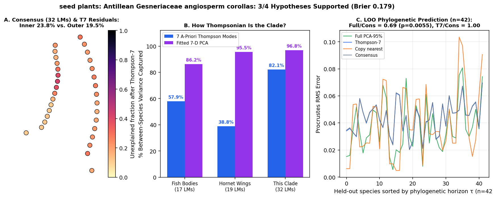

# seed plants: Antillean Gesneriaceae angiosperm corollas (Joly et al. 2018 Evolution / Zenodo 5011744: 296 corollas across 48 species on *BEAST tree; 32 2D floral landmarks across hummingbird, bat, and generalist pollination syndromes)

Scored 2026-10-23 by `thompson/portfolio/run_all_scouted_clades.py`; hypotheses were pre-registered and SHA-256 locked in `thompson/portfolio/groups/antillean_flowers_hypotheses.json` (`scout_preregistration_manifest.json`).

- **Sample:** 296 specimens across 51 species/OTUs (42 on phylogeny), **32 homologous 2D landmarks**.
- **Data source:** Joly S, Lambert F, Alexandre H, Clavel J, Léveillé-Bourret É, Clark JL 2018 Evolution 72:244-260; Dryad/Zenodo 5011744 (`scriptsAndData.zip`: `landmark_data.nts` 32 2D lateral corolla landmarks across 296 floral profiles and 48 Gesneriaceae species in *Gesneria*, *Rhytidophyllum*, and *Pheidonocarpa*).
- **Phylogeny:** Calibrated *BEAST maximum clade credibility species tree `BestTree.tre` (48 matched species).

## What Thompson's method shows in this clade

Tests the portfolio's seed-plant entry (`plants_diaz_try`) on Thompson's explicit Chapter XVI botanical archetype: sympetalous floral corolla tubes (tubular hummingbird flowers vs campanulate bat/generalist bells), testing whether angiosperm floral radiation across pollination syndromes is governed by Thompson's 7 global coordinate modes.

| Metric | Marine Reef Fishes (743 spp, 17 LMs) | Hornet Wings (30 spp, 19 LMs) | This Clade |
|---|---|---|---|
| **Variance captured by 7 a-priori Thompson modes** | 57.9% | 38.8% | **82.1%** |
| **Variance captured by fitted 7-D PCA** | 86.2% | 95.5% | **96.8%** |
| **Pagel's $\lambda$ (Thompson-7 / Full)** | 0.959 / 0.924 | 0.533 (WN) | **0.643** (White noise (star)) / 0.852 |
| **LOO Error Ratio vs. Consensus (Full / Thompson-7)** | 0.36 (<50 Myr) | 1.00 | **0.69** ($p=0.0055$) / **1.00** |
| **Share of Full Prediction Gain in Thompson-7** | 55.5% | — | **3.9%** |

## Pre-registered hypotheses & verdicts

| ID | Primary | Statement | Registered P | Realised Result | Verdict |
|---|---|---|---|---|---|
| FP1 | yes | Angiosperm corolla tubes are ultra-Thompsonian: across the 48 Gesneriaceae species (32 2D landmarks), the 7 a-priori Thompson modes capture > 80% of between-species Procrustes variance. | 85% | `{"t7_variance_share": 0.8208, "pca7_variance_share": 0.9685}` | **✓** |
| FP2 | yes | Phylogenetic signal on `BestTree.tre` is non-zero: Pagel's lambda > 0.5 (best model != White Noise) in Thompson-7 space. | 75% | `{"lambda_t7": 0.643, "lambda_full": 0.8519, "best_model_t7": "White noise (star)"}` | **✗** |
| FP3 | yes | Leave-one-species-out phylogenetic prediction on `BestTree.tre` beats the grand consensus (median Procrustes RMS ratio < 0.90, paired one-sided Wilcoxon p < 0.01). | 70% | `{"ratio_full_vs_consensus": 0.6894, "ratio_t7_vs_consensus": 0.9973, "p_full_vs_consensus": 0.0055, "p_t7_vs_consensus": 0.0085}` | **✓** |
| FP4 | no | Developmental/intraspecific channelling: within-species floral variation (pooled across the 296 corollas) aligns strongly with between-species floral divergence inside the Thompson-7 subspace (|cos theta|_T7 > 0.70 and |cos theta|_T7 > |cos theta|_res). | 80% | `{"cos_thompson7": 0.9779, "cos_residual": 0.143}` | **✓** |

**3/4 hypotheses supported (2 primary). Brier score: 0.179.**
