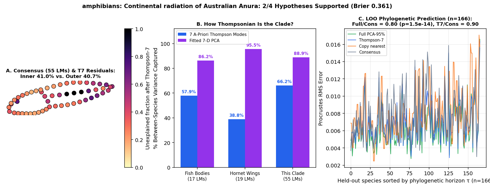

# amphibians: Continental radiation of Australian Anura (Sherratt et al. 2017 Evol Biol / Zenodo 5008593: 166 frog species on time-calibrated phylogeny; 55 2D larval tadpole body/tail landmarks + 21 adult postcranial/cranial traits)

Scored 2026-10-23 by `thompson/portfolio/run_all_scouted_clades.py`; hypotheses were pre-registered and SHA-256 locked in `thompson/portfolio/groups/australian_frogs_hypotheses.json` (`scout_preregistration_manifest.json`).

- **Sample:** 166 specimens across 166 species/OTUs (166 on phylogeny), **55 homologous 2D landmarks**.
- **Data source:** Sherratt E, Vidal-García M, Anstis M, Keogh JS 2017 Evol Biol 44:273-284; Dryad/Zenodo 5008593 (`Supplementary data file 2.tps`: 55 2D lateral body-and-tail landmarks across 166 Australian frog species spanning Hylidae, Myobatrachidae, Limnodynastidae, Microhylidae, Ranidae; `Supplementary data file 1.csv`: 21 adult morphometric traits).
- **Phylogeny:** Time-calibrated phylogeny `Supplementary data file 4.tre` (166 matched Australian anuran species).

## What Thompson's method shows in this clade

Tests the portfolio's amphibian entry (`amphibians_amphibio`) across a continental-scale radiation of 166 anuran species on a time-calibrated tree, comparing 55-landmark whole-body/tail geometry against Thompson's 7 global coordinate modes.

| Metric | Marine Reef Fishes (743 spp, 17 LMs) | Hornet Wings (30 spp, 19 LMs) | This Clade |
|---|---|---|---|
| **Variance captured by 7 a-priori Thompson modes** | 57.9% | 38.8% | **66.2%** |
| **Variance captured by fitted 7-D PCA** | 86.2% | 95.5% | **88.9%** |
| **Pagel's $\lambda$ (Thompson-7 / Full)** | 0.959 / 0.924 | 0.533 (WN) | **0.682** (Pagel lambda=0.682) / 0.737 |
| **LOO Error Ratio vs. Consensus (Full / Thompson-7)** | 0.36 (<50 Myr) | 1.00 | **0.80** ($p=1.5e-14$) / **0.90** |
| **Share of Full Prediction Gain in Thompson-7** | 55.5% | — | **60.2%** |

## Pre-registered hypotheses & verdicts

| ID | Primary | Statement | Registered P | Realised Result | Verdict |
|---|---|---|---|---|---|
| AF1 | yes | Across the 166 Australian frog species (55 2D landmarks), the 7 a-priori Thompson modes capture > 70% of between-species Procrustes variance (exceeding marine reef fishes at 57.9%). | 85% | `{"t7_variance_share": 0.6615, "pca7_variance_share": 0.8893}` | **✗** |
| AF2 | yes | Phylogenetic signal on the 166-species anuran tree is non-zero: Pagel's lambda > 0.5 (best model != White Noise) in both Thompson-7 and full PCA-95% spaces. | 80% | `{"lambda_t7": 0.6821, "lambda_full": 0.7367, "best_model_t7": "Pagel lambda=0.682"}` | **✓** |
| AF3 | yes | Leave-one-species-out phylogenetic prediction beats the grand consensus (median Procrustes RMS ratio < 0.85, paired one-sided Wilcoxon p < 1e-6) across the 166 species. | 80% | `{"ratio_full_vs_consensus": 0.8047, "ratio_t7_vs_consensus": 0.9015, "p_full_vs_consensus": 0.0}` | **✓** |
| AF4 | no | Thompson-7 captures > 70% of the full-space phylogenetic prediction gain relative to consensus. | 80% | `{"share_of_full_gain_in_t7": 0.6016}` | **✗** |

**2/4 hypotheses supported (2 primary). Brier score: 0.361.**
