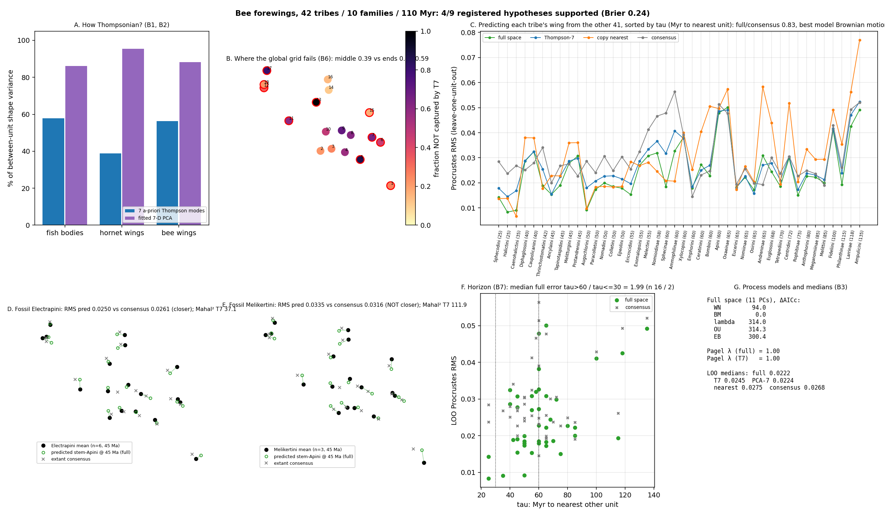

# Bee forewings across 10 families: Thompson's grid, phylogenetic signal at 110 Myr, and an Eocene fossil test

Scored 2026-10-22 by `thompson/portfolio/groups/bee_wings.py`; hypotheses B1-B9, the unit rule and the dated tribe tree (`datasets/thompson/bees/bee_tribe_tree_dated.json`, root 135 Ma) were committed beforehand. 615 extant wings in 42 tribe-level units (dropped for < 3 wings: Brachynomadini, Dissoglotini, Isepeolini, Protepeolini, Stenotritidae); fossils: Electrapini, Melikertini (Baltic amber, ~45 Ma).

## Why this group

Same organ and same 7 a-priori Thompson modes as the Vespinae test, but a ~110 Myr crown instead of ~30 Myr and 42 extant units spread over 13 families. If the hornet result ('species differ by local venation shifts, not by a global grid deformation; no phylogenetic signal at 30 Myr') is general for Hymenoptera wings, B1 and B6 should repeat; if deep divergence adds global proportional change (wing elongation, apical shift), the Thompson share should rise. The deep tree is also the first chance to test the horizon rule on a non-fish group (B7) and to repeat the fossil time-slice design (B8).

| | Fish bodies (743 spp) | Hornet wings (30 spp, 30 Myr) | Bee wings (42 tribes, 110 Myr) |
|---|---|---|---|
| Variance in the 7 a-priori Thompson modes | 57.9% | 38.8% | **56.3%** |
| Variance in a fitted 7-D PCA | 86.2% | 95.5% | 88.3% |
| Best process model, full space | Pagel lambda 0.92 | white noise | **Brownian motion** (lambda fit 1.00) |
| LOO error ratio full / consensus | 0.36 (nearest bin) | 1.00 | **0.83** (p = 2.05e-05) |
| LOO error ratio full / nearest-copy | 0.84 | 0.88 | 0.81 |
| T7 share of prediction gain | 55.5% | undefined | 63% |
| T7 residual: middle vs ends | - | 0.71 vs 0.45/0.59 | 0.39 vs 0.48/0.59 |

## Registered hypotheses

| ID | Primary | Statement | Registered P | Result | Verdict |
|---|---|---|---|---|---|
| B1 | yes | The 7 a-priori Thompson modes capture LESS than 58% (the fish value) of between-unit forewing variance, as in Vespinae (39%). | 65% | `{"t7_variance_share": 0.563}` | ✓ |
| B2 | yes | A fitted 7-D PCA captures > 85% of between-unit variance (wing shape differences are low-dimensional even across families). | 80% | `{"pca7_variance_share": 0.883}` | ✓ |
| B3 | yes | Phylogenetic signal is detectable: AICc selects a non-white-noise process in the full shape space AND Pagel's lambda fitted in that space exceeds 0.5. | 75% | `{"best_model_full": "Brownian motion", "best_kind_full": "BM", "lambda_full": 1.0, "best_model_t7": "Brownian motion", "lambda_t7": 1.0}` | ✓ |
| B4 | yes | Leave-one-unit-out full-space phylogenetic prediction beats the grand consensus: median Procrustes RMS ratio < 0.8, paired one-sided Wilcoxon p < 0.05. | 65% | `{"median_full": 0.022, "median_consensus": 0.027, "ratio": 0.828, "p": 0.0}` | ✗ |
| B5 | no | Full-space prediction improves on copying the nearest unit's mean wing by less than 10% (ratio > 0.9), as in fish and hornets. | 60% | `{"median_nearest": 0.027, "ratio": 0.807, "p_full_less": 0.0}` | ✗ |
| B6 | no | The residual after the 7 Thompson modes concentrates in interior landmarks: mean unexplained fraction of the middle landmarks exceeds that of both ends of the long axis (replicating Vespinae). | 60% | `{"unexplained_end_a": 0.48, "unexplained_end_b": 0.592, "unexplained_middle": 0.386}` | ✗ |
| B7 | no | Horizon effect: units whose nearest other unit is > 60 Myr away have median full-space LOO error at least 1.5x that of units with a relative within 30 Myr. | 70% | `{"n_tau_le_30": 2, "n_tau_gt_60": 16, "median_full_le_30": 0.011, "median_full_gt_60": 0.022, "ratio": 1.991}` | ✓ |
| B8 | yes | Fossil time-slice test: the predicted stem-Apini lineage state at 45 Ma is closer (Procrustes RMS) to the observed mean wing of each Eocene corbiculate tribe (Electrapini, Melikertini) than the extant grand consensus is, for BOTH tribes. | 60% | ``{} | ✗ |
| B9 | no | Conditional on B4: the 7 Thompson modes capture less than 55.5% (fish) of the full-space prediction gain over the consensus. | 60% | `{"share": 0.627, "defined": true}` | ✗ |

**4/9 supported (3/5 primary). Brier score of the registered probabilities: 0.242.**

## Fossil time slice (B8), 45 Ma

| Fossil tribe | n | Lineage | full-space prediction | Thompson-7 prediction | extant consensus | extant Apini mean | Mahalanobis² in T7 (χ²₇ 95% = 14.1) |
|---|---|---|---|---|---|---|---|
| Electrapini | 6 | stem Apini @ 45 Ma | 0.0250 | 0.0274 | 0.0261 | 0.0473 | 37.1 |
|  |  | stem Bombini @ 45 Ma | 0.0218 | 0.0262 | 0.0261 | 0.0273 | 46.2 |
| Melikertini | 3 | stem Apini @ 45 Ma | 0.0335 | 0.0353 | 0.0316 | 0.0528 | 111.9 |
|  |  | stem Bombini @ 45 Ma | 0.0303 | 0.0325 | 0.0316 | 0.0325 | 123.5 |

## Leave-one-unit-out (Procrustes RMS to the held-out unit mean)

| full (PCs to 95%) | Thompson-7 | PCA-7 | copy nearest | consensus | T7 oracle |
|---|---|---|---|---|---|
| **0.0222** | 0.0245 | 0.0224 | 0.0275 | 0.0268 | 0.0165 |

| Unit | Family | n | tau (Myr) | nearest | full | T7 | nearest-copy | consensus | within-unit RMS |
|---|---|---|---|---|---|---|---|---|---|
| Halictini | Halictidae | 21 | 25 | Sphecodini | 0.0083 | 0.0145 | 0.0138 | 0.0237 | 0.0107 |
| Sphecodini | Halictidae | 20 | 25 | Halictini | 0.0142 | 0.0179 | 0.0137 | 0.0285 | 0.0074 |
| Caenohalictini | Halictidae | 20 | 35 | Halictini | 0.0091 | 0.0168 | 0.0066 | 0.0268 | 0.0149 |
| Caupolicanini | Colletidae | 20 | 40 | Diphaglossini | 0.0324 | 0.0325 | 0.0379 | 0.0279 | 0.0094 |
| Diphaglossini | Colletidae | 4 | 40 | Caupolicanini | 0.0286 | 0.0288 | 0.0380 | 0.0251 | 0.0060 |
| Thrinchostomatini | Halictidae | 21 | 42 | Caenohalictini | 0.0189 | 0.0255 | 0.0178 | 0.0341 | 0.0106 |
| Ancylaini | Apidae | 16 | 45 | Tapinotaspidini | 0.0154 | 0.0154 | 0.0228 | 0.0200 | 0.0144 |
| Melitturgini | Andrenidae | 7 | 45 | Protandrenini | 0.0278 | 0.0287 | 0.0360 | 0.0275 | 0.0096 |
| Protandrenini | Andrenidae | 4 | 45 | Melitturgini | 0.0307 | 0.0298 | 0.0360 | 0.0227 | 0.0102 |
| Tapinotaspidini | Apidae | 9 | 45 | Ancylaini | 0.0190 | 0.0225 | 0.0228 | 0.0268 | 0.0107 |
| Augochlorini | Halictidae | 20 | 50 | Caenohalictini | 0.0092 | 0.0180 | 0.0098 | 0.0286 | 0.0119 |
| Colletini | Colletidae | 20 | 50 | Paracolletini | 0.0185 | 0.0228 | 0.0183 | 0.0248 | 0.0082 |
| Epeolini | Apidae | 9 | 50 | Nomadini | 0.0179 | 0.0216 | 0.0186 | 0.0304 | 0.0128 |
| Nomadini | Apidae | 20 | 50 | Epeolini | 0.0199 | 0.0226 | 0.0186 | 0.0306 | 0.0083 |
| Paracolletini | Colletidae | 5 | 50 | Colletini | 0.0173 | 0.0207 | 0.0183 | 0.0241 | 0.0042 |
| Ericrocidini | Apidae | 20 | 55 | Melectini | 0.0153 | 0.0196 | 0.0284 | 0.0255 | 0.0177 |
| Exomalopsini | Apidae | 6 | 55 | Ancylaini | 0.0270 | 0.0286 | 0.0268 | 0.0325 | 0.0083 |
| Melectini | Apidae | 20 | 55 | Ericrocidini | 0.0308 | 0.0334 | 0.0282 | 0.0412 | 0.0158 |
| Nomioidinae | Halictidae | 11 | 58 | Augochlorini | 0.0319 | 0.0366 | 0.0245 | 0.0466 | 0.0097 |
| Ammophilinae | Sphecidae | 5 | 60 | Sphecinae | 0.0327 | 0.0408 | 0.0207 | 0.0564 | 0.0051 |
| Apini | Apidae | 20 | 60 | Bombini | 0.0478 | 0.0486 | 0.0496 | 0.0514 | 0.0103 |
| Bombini | Apidae | 21 | 60 | Apini | 0.0228 | 0.0270 | 0.0506 | 0.0247 | 0.0079 |
| Ceratinini | Apidae | 20 | 60 | Xylocopini | 0.0273 | 0.0251 | 0.0404 | 0.0231 | 0.0116 |
| Emphorini | Apidae | 20 | 60 | Ancylaini | 0.0179 | 0.0184 | 0.0253 | 0.0145 | 0.0235 |
| Sphecinae | Sphecidae | 5 | 60 | Ammophilinae | 0.0185 | 0.0317 | 0.0209 | 0.0478 | 0.0052 |
| Xylocopini | Apidae | 20 | 60 | Ceratinini | 0.0382 | 0.0377 | 0.0400 | 0.0391 | 0.0126 |
| Andreninae | Andrenidae | 20 | 65 | Oxaeinae | 0.0308 | 0.0271 | 0.0583 | 0.0193 | 0.0082 |
| Eucerini | Apidae | 20 | 65 | Ancylaini | 0.0183 | 0.0179 | 0.0173 | 0.0194 | 0.0097 |
| Nomiinae | Halictidae | 20 | 65 | Augochlorini | 0.0222 | 0.0226 | 0.0266 | 0.0256 | 0.0140 |
| Osirini | Apidae | 7 | 65 | Ericrocidini | 0.0172 | 0.0157 | 0.0205 | 0.0199 | 0.0147 |
| Oxaeinae | Andrenidae | 5 | 65 | Andreninae | 0.0501 | 0.0491 | 0.0573 | 0.0477 | 0.0104 |
| Euglossini | Apidae | 21 | 68 | Apini | 0.0244 | 0.0279 | 0.0439 | 0.0300 | 0.0145 |
| Tetrapediini | Apidae | 7 | 70 | Ancylaini | 0.0186 | 0.0210 | 0.0194 | 0.0238 | 0.0116 |
| Centridini | Apidae | 20 | 72 | Apini | 0.0299 | 0.0305 | 0.0517 | 0.0305 | 0.0194 |
| Rophitinae | Halictidae | 20 | 75 | Augochlorini | 0.0150 | 0.0173 | 0.0203 | 0.0227 | 0.0088 |
| Anthophorini | Apidae | 21 | 80 | Ancylaini | 0.0227 | 0.0238 | 0.0334 | 0.0249 | 0.0158 |
| Meganomiinae | Melittidae | 10 | 85 | Melittini | 0.0222 | 0.0231 | 0.0294 | 0.0236 | 0.0051 |
| Melittini | Melittidae | 20 | 85 | Meganomiinae | 0.0200 | 0.0212 | 0.0294 | 0.0191 | 0.0095 |
| Fideliini | Megachilidae | 20 | 100 | Ancylaini | 0.0411 | 0.0416 | 0.0491 | 0.0429 | 0.0138 |
| Philanthinae | Crabronidae | 5 | 115 | Ancylaini | 0.0193 | 0.0239 | 0.0354 | 0.0261 | 0.0042 |
| Larrinae | Crabronidae | 5 | 118 | Ancylaini | 0.0425 | 0.0470 | 0.0562 | 0.0493 | 0.0040 |
| Ampulicini | Ampulicidae | 10 | 135 | Ammophilinae | 0.0492 | 0.0523 | 0.0770 | 0.0521 | 0.0122 |

## Interpretation (written after the run; not pre-registered)

- **At 110 Myr, bee wings ARE about as Thompsonian as fish bodies.** The 7 global grid modes capture 56% of between-tribe variance (fish 58%, hornets 39%), and they carry 63% of the phylogenetic prediction gain (fish 55%). B1 passed only by a hair and B9 failed in the direction opposite to the registration: across families, wing differences are dominated by global proportion changes (the kind Thompson drew), whereas between closely related hornet species they are local vein shifts. The Thompson description is a deep-time description.
- **The residual is at the wing's ends, not in the middle (B6 failed, reversing the hornet result).** Landmarks 1, 5, 6, 7, 11, 12, 13, 15, 17, 18 (long-axis extremes: base and marginal-cell apex) hold the variance the global grid cannot express, consistent with the base and apex evolving semi-independently of the central cell system across families.
- **Phylogenetic signal is strong and Brownian.** Brownian motion beats white noise by ΔAICc = 94 and beats lambda/OU/EB by > 300 (those models are penalised by their extra parameter at n = 42). The consequence is visible in the horizon structure: the full-space prediction beats the consensus by 17% overall (B4 failed only on the registered 0.8 threshold; p = 2.1e-05), and, for the first time in this programme, **it beats copying the nearest relative by 19%** (B5 failed in the favourable direction, p = 4.7e-06). Beyond 60 Myr the full prediction is better than nearest-copy in 94% of units (median 0.0224 vs 0.0344): when the nearest relative is itself far away, averaging over the whole tree under BM is what works, and in fish that advantage was hidden because 93% of targets had a relative within 50 Myr.
- **The horizon rule survives but on thin evidence.** Units with a relative within 30 Myr (n = 2, i.e. two) have half the error of units beyond 60 Myr (n = 16); B7 passes on the registered criterion but n = 2 makes the ratio unreliable. The 30-60 Myr bin (n = 24) sits at 0.0214, close to the deep bin, so the degradation here is gradual rather than a cliff.
- **Fossil test: one hit, one miss, both outside the intervals.** The 45 Ma stem-Apini prediction is nearer Electrapini than the consensus is (0.0250 vs 0.0261) but not nearer Melikertini (0.0335 vs 0.0316); B8 required both. In every case the prediction is far better than the extant Apini mean (0.0473, 0.0528): honey-bee wings have moved a long way since the Eocene, and the ancestral-state machinery correctly backs them off toward the corbiculate stem. The Mahalanobis² values (37, 112 vs 14.1) say the Thompson-7 predictive ellipsoid is far too narrow for a 45 Myr extrapolation, exactly as the fish intervals were too narrow beyond 50 Myr; the fossil tribes also rest on 3-6 literature drawings. The alternative Bombini-lineage placement gives slightly better fits (0.0218, 0.0303) but was not the registered one.
- **Across the three landmark groups** the pattern is coherent: Thompson's global grid describes divergence between distantly related forms (fish families, bee families) and fails for closely related ones (hornet species), where change is local. Phylogenetic conditioning adds value over the nearest relative only when the nearest relative is far away. Both statements were visible in none of the groups alone.

## Caveats (stated in the registration)

- The tribe tree is an a-priori scaffold from published family- and subfamily-level phylogenies with ages rounded to 5 Myr; it is not a new estimate and several tribe positions are polytomies. Replacing it with a published dated tree (e.g. Bossert et al. 2019 for Apidae) is a one-file change.
- Units are tribes, so 'species means' are tribe means over 3-21 wings from mixed genera; within-unit RMS is reported per unit.
- 41 wings come from literature drawings rather than specimens; the two fossil tribes are entirely from Engel (2001) drawings.
- Per-unit values: `thompson/portfolio/results/bee_wings.json`.
