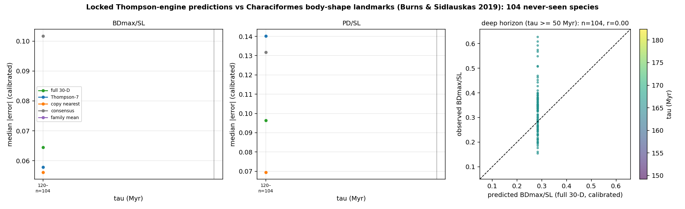

# Portfolio sub-prediction: Characiformes body-shape landmarks (Burns & Sidlauskas 2019)

Scored 2026-10-23 by `thompson/portfolio/score_locked_predictions.py --source burns_sidlauskas2019_characiformes` against the predictions locked at commit `7889d9396de0` (hashes verified at run time). Comparison data: Burns MD & Sidlauskas BL 2019 Evolution 73:569-587; Dryad/Zenodo 4988906 (CC0); `.thompson_cache/burns2019/Disparity_Data.TPS` sha256 `6cacf8b8e07ba09e…`, 1,625 specimens, 259 species; 104 registered target species matched (training and 1917 species excluded).

## Registered claims vs realised outcome (BDmax/SL, calibrated)

Registered in `docs/THOMPSON_DATASET_PORTFOLIO.md` as *C landmark data, same engine, beyond the horizon (Otophysi; tau > 120 Myr for essentially every species)* with status *not downloaded*.

| Claim | Registered probability | Simulated / pass interval | Realised | Verdict |
|---|---|---|---|---|
| P3_deep_horizon | 60% | ratio [0.3, 0.56], coverage [70.0, 95.0] | 0.634 | ✗ |

## Error by horizon: BDmax_over_SL (calibrated median |error|)

| tau (Myr) | n | full 30-D | Thompson-7 | copy nearest | consensus | family mean | 95% cov. full30 (cal / raw) |
|---|---|---|---|---|---|---|---|
| 120–∞ | 104 | **0.0644** | 0.0579 | 0.0561 | 0.1017 | – | 94% / 94% |
Beyond 50 Myr (n=104): ratio vs consensus 0.63, coverage 94%, median predicted 0.284 vs observed 0.328.

## Error by horizon: PD_over_SL (calibrated median |error|)

| tau (Myr) | n | full 30-D | Thompson-7 | copy nearest | consensus | family mean | 95% cov. full30 (cal / raw) |
|---|---|---|---|---|---|---|---|
| 120–∞ | 104 | **0.0964** | 0.1402 | 0.0695 | 0.1318 | – | 83% / 83% |
Beyond 50 Myr (n=104): ratio vs consensus 0.73, coverage 83%, median predicted 0.420 vs observed 0.516.

## Calibration (training species only)

- BDmax_over_SL: {"alpha": 0.0, "beta": 1.0, "r": NaN, "n_training_species": 0, "note": "fewer than 10 overlapping training species: raw scale used"}
- PD_over_SL: {"alpha": 0.0, "beta": 1.0, "r": NaN, "n_training_species": 0, "note": "fewer than 10 overlapping training species: raw scale used"}

## Notes

- Tests, bins, calibration rule and pass thresholds are those registered for the FishShapes blind test and the portfolio; nothing was tuned on this dataset.
- FishBase MORPHMET values are measured on single pictures (often drawings), so measurement noise is larger than for FishShapes callipers and inflates every method's error equally.
- Per-species values are in `thompson/portfolio/results/burns_sidlauskas2019_characiformes.json`.
