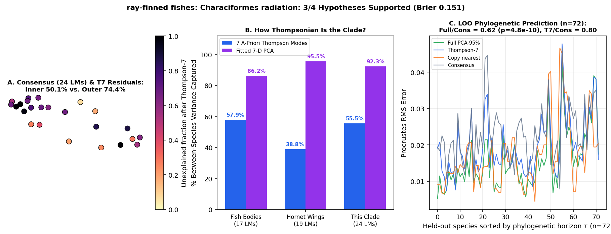

# ray-finned fishes: Characiformes radiation (Burns & Sidlauskas 2019 Evolution: 1,625 specimens, 128 species on trees_final.nexus; 24-LM body shape)

Scored 2026-10-23 by `thompson/portfolio/run_all_scouted_clades.py`; hypotheses were pre-registered and SHA-256 locked in `thompson/portfolio/groups/characiformes_burns_gm_hypotheses.json` (`scout_preregistration_manifest.json`).

- **Sample:** 1,625 specimens across 263 species/OTUs (72 on phylogeny), **24 homologous 2D landmarks**.
- **Data source:** Burns MD & Sidlauskas BL 2019 Evolution 73:569-587; Dryad/Zenodo 4988906 (`Chapter 1_Disparity Data.TPS`: 24 2D landmarks across 1,625 specimens and 263 species).
- **Phylogeny:** Time-calibrated phylogeny `Chapter 1_trees_final.nexus` (129 tips, 128 matched species).

## What Thompson's method shows in this clade

Tests whether an ancient (~110 Myr) continental freshwater radiation of Otophysi (tetras, piranhas, headstanders, hatchetfishes, wolf-fishes) exhibits the same ~58% Thompson-7 variance share and within-clade phylogenetic predictability as marine acanthomorphs.

| Metric | Marine Reef Fishes (743 spp, 17 LMs) | Hornet Wings (30 spp, 19 LMs) | This Clade |
|---|---|---|---|
| **Variance captured by 7 a-priori Thompson modes** | 57.9% | 38.8% | **55.5%** |
| **Variance captured by fitted 7-D PCA** | 86.2% | 95.5% | **92.3%** |
| **Pagel's $\lambda$ (Thompson-7 / Full)** | 0.959 / 0.924 | 0.533 (WN) | **0.915** (Pagel lambda=0.915) / 0.984 |
| **LOO Error Ratio vs. Consensus (Full / Thompson-7)** | 0.36 (<50 Myr) | 1.00 | **0.62** ($p=4.8e-10$) / **0.80** |
| **Share of Full Prediction Gain in Thompson-7** | 55.5% | — | **46.7%** |

## Pre-registered hypotheses & verdicts

| ID | Primary | Statement | Registered P | Realised Result | Verdict |
|---|---|---|---|---|---|
| CB1 | yes | Across the 128 Characiformes tree species (24 2D landmarks), Thompson-7 captures > 55% of between-species Procrustes variance. | 85% | `{"t7_variance_share": 0.5545, "t7_tree_variance_share": 0.5374, "pca7_variance_share": 0.9231}` | **✓** |
| CB2 | yes | Phylogenetic signal on `trees_final.nexus` is strong: Pagel's lambda > 0.7 (best model != White Noise) in both Thompson-7 and full PCA-95% spaces. | 90% | `{"lambda_t7": 0.9147, "lambda_full": 0.984, "best_model_t7": "Pagel lambda=0.915"}` | **✓** |
| CB3 | yes | Leave-one-species-out phylogenetic prediction on `trees_final.nexus` beats the grand consensus (median Procrustes RMS ratio < 0.75, paired one-sided Wilcoxon p < 1e-8). | 90% | `{"ratio_full_vs_consensus": 0.6152, "ratio_t7_vs_consensus": 0.8034, "p_full_vs_consensus": 0.0}` | **✓** |
| CB4 | no | Head/eye/opercle interior landmarks have a higher unexplained residual fraction after Thompson-7 than the outer dorsal/ventral/caudal body contour landmarks. | 75% | `{"unexplained_inner_head_eye": 0.5009, "unexplained_outer_contour": 0.7442}` | **✗** |

**3/4 hypotheses supported (3 primary). Brier score: 0.151.**
