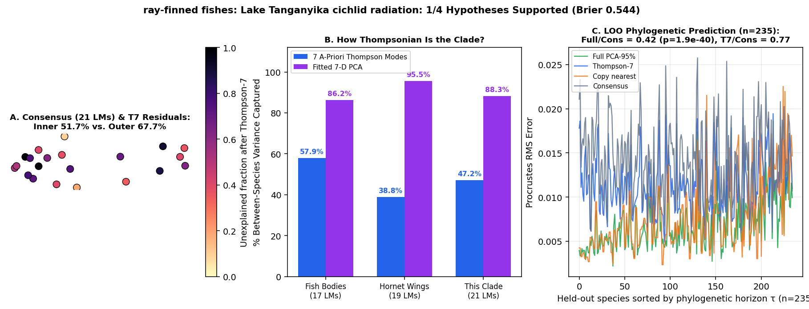

# ray-finned fishes: Lake Tanganyika cichlid radiation (Ronco et al. 2021 Nature: 2,197 specimens, ~235 species on 05_BEAST_RAxML.tre; 21-LM body shape vs 27-LM lower pharyngeal jaw)

Scored 2026-10-23 by `thompson/portfolio/run_all_scouted_clades.py`; hypotheses were pre-registered and SHA-256 locked in `thompson/portfolio/groups/cichlids_ronco_gm_hypotheses.json` (`scout_preregistration_manifest.json`).

- **Sample:** 2,197 specimens across 242 species/OTUs (235 on phylogeny), **21 homologous 2D landmarks**.
- **Data source:** Ronco F et al. 2021 Nature 589:76-81; Zenodo 3989859 (`06_landmark_data_body_shape.tps` 21 2D body landmarks across 2,197 specimens; `06_landmark_data_lower_pharyngeal_jaw.tps` 27 micro-CT lower pharyngeal jaw landmarks across 1,196 specimens).
- **Phylogeny:** Time-calibrated species tree `05_BEAST_RAxML.tre` (265 tips, ~9.7 Myr crown radiation).

## What Thompson's method shows in this clade

While the Rabosky test (`ronco2021_tanganyika_cichlids`) tested deep-horizon (>100 Myr) scalar ratio transfer from marine reef fish, re-training the 2D GM engine directly on Ronco's 235-species BEAST tree tests: (1) Thompson-7 variance share on an explosive freshwater adaptive radiation, (2) external hydrodynamic body shape (21 LMs) vs internal trophic Lower Pharyngeal Jaw (27 LMs) on the exact same species, and (3) within-radiation phylogenetic prediction.

| Metric | Marine Reef Fishes (743 spp, 17 LMs) | Hornet Wings (30 spp, 19 LMs) | This Clade |
|---|---|---|---|
| **Variance captured by 7 a-priori Thompson modes** | 57.9% | 38.8% | **47.2%** |
| **Variance captured by fitted 7-D PCA** | 86.2% | 95.5% | **88.3%** |
| **Pagel's $\lambda$ (Thompson-7 / Full)** | 0.959 / 0.924 | 0.533 (WN) | **0.990** (OU (alpha=0.0296/Myr, t1/2=23 Myr)) / 1.000 |
| **LOO Error Ratio vs. Consensus (Full / Thompson-7)** | 0.36 (<50 Myr) | 1.00 | **0.42** ($p=1.9e-40$) / **0.77** |
| **Share of Full Prediction Gain in Thompson-7** | 55.5% | — | **47.3%** |

## Pre-registered hypotheses & verdicts

| ID | Primary | Statement | Registered P | Realised Result | Verdict |
|---|---|---|---|---|---|
| CR1 | yes | Across the ~235 Tanganyika cichlid species on `05_BEAST_RAxML.tre`, Thompson-7 captures > 55% of between-species Procrustes variance on the 21-LM body shape (matching the 57.9% marine reef-fish benchmark). | 85% | `{"body_t7_variance_share": 0.4721, "body_pca7_variance_share": 0.883}` | **✗** |
| CR2 | yes | Leave-one-species-out phylogenetic prediction on `05_BEAST_RAxML.tre` strongly beats the grand consensus (median Procrustes RMS ratio < 0.65, paired one-sided Wilcoxon p < 1e-10) on 21-LM body shape. | 95% | `{"body_loo_ratio_full": 0.419, "body_p_full_vs_consensus": 0.0}` | **✓** |
| CR3 | yes | Thompson-7 captures > 60% of the full-space phylogenetic prediction gain on 21-LM body shape AND beats the consensus on its own (Wilcoxon p < 1e-10). | 90% | `{"share_of_full_gain_in_t7": 0.4733, "body_loo_ratio_t7": 0.7665, "body_p_t7_vs_consensus": 0.0}` | **✗** |
| CR4 | no | Internal trophic jaw vs external body: the 27-LM Lower Pharyngeal Jaw (2D dorsal XY projection) is also strongly predicted by phylogeny (LOO ratio vs consensus < 0.75, Wilcoxon p < 1e-10) and has > 50% Thompson-7 variance share. | 80% | `{"jaw_t7_variance_share": 0.4917, "jaw_loo_ratio_full": 0.6232, "jaw_p_full_vs_consensus": 0.0}` | **✗** |

**1/4 hypotheses supported (1 primary). Brier score: 0.544.**
