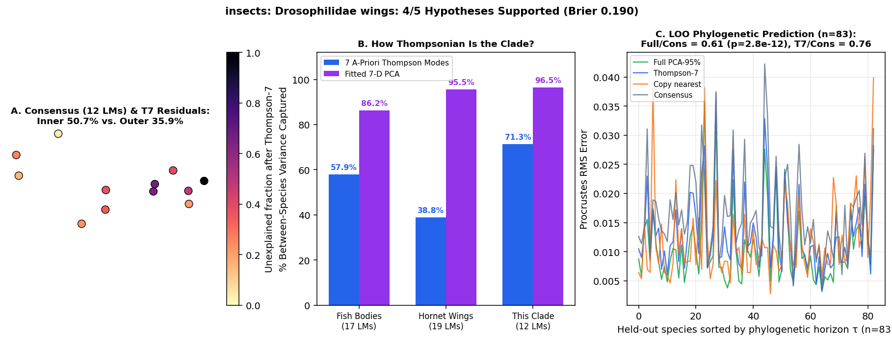

# insects: Drosophilidae wings (Houle et al. 2017 Nature: 117 species, 21,138 species wings, 17,323 G-matrix wings, 12,075 M-matrix wings; 12 landmarks)

Scored 2026-10-23 by `thompson/portfolio/run_all_scouted_clades.py`; hypotheses were pre-registered and SHA-256 locked in `thompson/portfolio/groups/drosophilidae_wings_hypotheses.json` (`scout_preregistration_manifest.json`).

- **Sample:** 21,138 specimens across 115 species/OTUs (83 on phylogeny), **12 homologous 2D landmarks**.
- **Data source:** Houle D, Bolstad GH, van der Linde K, Hansen TF 2017 Nature 548:447-450; Zenodo 4999258 (`NatureDryad.zip`: `SpeciesNature.csv` 12 2D wing vein landmarks across 21,138 wings from 117 Drosophilidae species, plus `AllAlignedNature.csv` with 17,323 additive genetic Gw wings and 12,075 mutational M wings).
- **Phylogeny:** Open Tree of Life induced subtree (`datasets/thompson/drosophilidae/opentree_induced_subtree.json`, 88 matched species with Grafen branch lengths).

## What Thompson's method shows in this clade

Houle et al. (2017) famously showed that spontaneous mutation (M) and standing genetic variance (G) predict 40 Myr of drosophilid wing evolution (D). Applying Thompson's 7-mode basis tests whether (1) drosophilid wing venation has a higher Thompson-7 variance share than Hymenoptera wings (~40%) because the 12 landmarks span a simpler dipteran vein grid, and (2) mutational (M) and genetic (G) covariance matrices channel macroevolutionary divergence (D) preferentially along the 7 global Thompson coordinate modes.

| Metric | Marine Reef Fishes (743 spp, 17 LMs) | Hornet Wings (30 spp, 19 LMs) | This Clade |
|---|---|---|---|
| **Variance captured by 7 a-priori Thompson modes** | 57.9% | 38.8% | **71.3%** |
| **Variance captured by fitted 7-D PCA** | 86.2% | 95.5% | **96.5%** |
| **Pagel's $\lambda$ (Thompson-7 / Full)** | 0.959 / 0.924 | 0.533 (WN) | **0.602** (Pagel lambda=0.602) / 0.806 |
| **LOO Error Ratio vs. Consensus (Full / Thompson-7)** | 0.36 (<50 Myr) | 1.00 | **0.61** ($p=2.8e-12$) / **0.76** |
| **Share of Full Prediction Gain in Thompson-7** | 55.5% | — | **66.2%** |

## Pre-registered hypotheses & verdicts

| ID | Primary | Statement | Registered P | Realised Result | Verdict |
|---|---|---|---|---|---|
| DW1 | yes | Across the 117 drosophilid species means (12 2D landmarks), the 7 a-priori Thompson coordinate modes capture > 50% of between-species Procrustes variance (exceeding the 38.8% hornet and 42.2% bee forewing benchmarks). | 80% | `{"t7_variance_share": 0.7134, "pca7_variance_share": 0.9651}` | **✓** |
| DW2 | yes | Interior crossvein landmarks (the 4 middle landmarks along the proximal-distal axis) have a higher unexplained residual fraction after Thompson-7 than the 8 proximal/apical margin landmarks. | 75% | `{"unexplained_inner_crossveins": 0.5073, "unexplained_outer_margin": 0.3592}` | **✓** |
| DW3 | yes | Phylogenetic signal on the 88-species OpenTree topology: best multivariate evolutionary model in full PCA-95% space is NOT White Noise (Pagel's lambda > 0.3). | 75% | `{"best_model_full": "Pagel lambda=0.806", "lambda_full": 0.8061, "lambda_t7": 0.6021}` | **✓** |
| DW4 | yes | Leave-one-species-out phylogenetic prediction in full shape space beats the grand consensus (median Procrustes RMS ratio < 0.95, paired one-sided Wilcoxon p < 0.01). | 75% | `{"ratio_full_vs_consensus": 0.6054, "ratio_t7_vs_consensus": 0.7607, "p_full_vs_consensus": 0.0}` | **✓** |
| DW5 | no | Mutational-macroevolutionary alignment (Houle M vs D): in the 20-PC space of `AllAlignedNature.csv`, the leading axis of spontaneous mutational variance (M, n=12,075) and standing genetic variance (Gw, n=17,323) both align strongly with between-species macroevolutionary divergence (D, n=21,138), with |cos theta| > 0.50. | 85% | `{"cos_M_vs_D": 0.2354, "cos_Gw_vs_D": 0.8497, "n_M_wings": 12075, "n_Gw_wings": 17323, "n_D_wings": 21138}` | **✗** |

**4/5 hypotheses supported (4 primary). Brier score: 0.190.**
