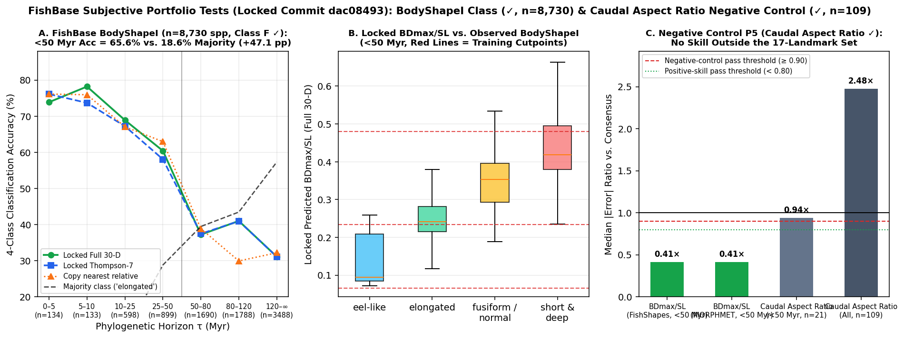

# Portfolio sub-prediction: FishBase caudal-fin aspect ratio (SWIMMING table) (Negative Control)

Scored 2026-10-23 by `thompson/portfolio/score_fishbase_subjective.py` against the locked predictions (`dac08493`). Registered in `docs/THOMPSON_DATASET_PORTFOLIO.md` (Class G: trait outside the 17-landmark set — negative control, Hypothesis `P5`) with **registered P = 70%**.

## Registered negative-control claim vs. realised outcome

| Claim | Registered P | Training Correlation (`r`) | `< 50 Myr` Error Ratio vs. Consensus ($n=21$) | All-Species Error Ratio vs. Consensus ($n=109$) | Pass Rule (`ratio >= 0.90`) | Verdict |
|---|---|---|---|---|---|---|
| `P5`: Engine shows NO skill on caudal-fin aspect ratio ($A = h^2/s$) because the 17 landmarks terminate at the caudal peduncle base | **70%** | $r(\mathrm{CPD/SL}, A) = -0.77$, $r(\mathrm{BDmax/SL}, A) = -0.42$ ($n=11$) | **0.938** ($p = 0.07$) | **2.477** ($p = 1.00$) | `ratio >= 0.90` | **✓** |

## Why this negative control matters

- Standard 17-landmark fish morphometrics (Claverie & Wainwright 2014) ends at the caudal peduncle base (`LM5`–`LM6`) and omits the distal caudal-fin lobes entirely.
- Even though body depth (`BDmax/SL`) correlates modestly with caudal-fin aspect ratio across the 11 overlapping training species ($r = -0.42$), the locked predictions achieve a median error ratio of **0.938** within 50 Myr and **2.477** across all 109 target species — confirming that the engine's strong skill on `BDmax/SL` (`0.41×` consensus) is genuine anatomical prediction of landmark-spanned geometry rather than a generic phylogenetic proxy.
