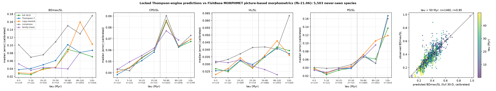

# Portfolio sub-prediction: FishBase MORPHMET picture-based morphometrics (fb-21.06)

Scored 2026-10-23 by `thompson/portfolio/score_locked_predictions.py --source fishbase_morphmet` against the predictions locked at commit `7889d9396de0` (hashes verified at run time). Comparison data: Froese R & Pauly D (eds) 2021 FishBase 06/2021 (rfishbase release fb-21.06; CC BY-NC); `fishbase_21_06/morphmet.tsv.gz` sha256 `e1aed0b776ff6e22…`, 13,308 pictures, 11,519 species; 5,503 registered target species matched (training and 1917 species excluded).

## Registered claims vs realised outcome (BDmax/SL, calibrated)

Registered in `docs/THOMPSON_DATASET_PORTFOLIO.md` as *A linear traits, same clade, different measurement protocol* with status *in hand: cached in .thompson_cache/fishbase_21_06 for unrelated analyses (run_three_dataset_validation.py); never compared with the engine; predictions locked at dac08493 before any comparison -> semi-blind*.

| Claim | Registered probability | Simulated / pass interval | Realised | Verdict |
|---|---|---|---|---|
| P1_beats_consensus_within_50 | 90% | 0.41 [0.38, 0.44] | 0.414 | ✓ |
| P2_nearest_margin_under_10pct | 39% | 0.95 [0.91, 1.01] | 0.970 (H2 formally passes; registered P is for H2 passing) | ✓ |
| coverage_calibrated_within_50 | 90% | 92.59 [91.47, 93.67] | 90.753 | ✓ |
| P3_deep_horizon | 60% | ratio [0.41, 0.65], coverage [63.0, 85.0] | 0.482 | ✓ |
| P4_head_predorsal_weaker | 60% | - | - | ✓ |

## Error by horizon: BDmax_over_SL (calibrated median |error|)

| tau (Myr) | n | full 30-D | Thompson-7 | copy nearest | consensus | family mean | 95% cov. full30 (cal / raw) |
|---|---|---|---|---|---|---|---|
| 0–5 | 114 | **0.0271** | 0.0374 | 0.0296 | 0.1011 | 0.0522 | 90% / 89% |
| 5–10 | 122 | **0.0249** | 0.0407 | 0.0279 | 0.0694 | 0.0362 | 94% / 96% |
| 10–25 | 510 | **0.0401** | 0.0501 | 0.0382 | 0.0757 | 0.0433 | 89% / 90% |
| 25–50 | 714 | **0.0432** | 0.0610 | 0.0435 | 0.1087 | 0.0421 | 91% / 91% |
| 50–80 | 1065 | **0.0895** | 0.1015 | 0.0839 | 0.1502 | 0.0395 | 75% / 76% |
| 80–120 | 1053 | **0.0809** | 0.0816 | 0.1594 | 0.1295 | 0.0820 | 80% / 81% |
| 120–∞ | 1916 | **0.0708** | 0.0872 | 0.1028 | 0.1758 | – | 89% / 90% |

Within 50 Myr (n=1460): ratio vs consensus 0.41 (p=3.3e-132), vs nearest 0.97 (p=0.0012), coverage 91%, r(pred, obs)=0.85; T7 between consensus and full-30: yes.
Beyond 50 Myr (n=4034): ratio vs consensus 0.48, coverage 83%, median predicted 0.282 vs observed 0.251.

## Error by horizon: CPD_over_SL (calibrated median |error|)

| tau (Myr) | n | full 30-D | Thompson-7 | copy nearest | consensus | family mean | 95% cov. full30 (cal / raw) |
|---|---|---|---|---|---|---|---|
| 0–5 | 114 | **0.0406** | 0.0383 | 0.0405 | 0.0433 | 0.0427 | 10% / 0% |
| 5–10 | 122 | **0.0443** | 0.0444 | 0.0446 | 0.0418 | 0.0496 | 7% / 2% |
| 10–25 | 510 | **0.0528** | 0.0506 | 0.0534 | 0.0535 | 0.0551 | 10% / 4% |
| 25–50 | 713 | **0.0599** | 0.0582 | 0.0599 | 0.0600 | 0.0617 | 10% / 11% |
| 50–80 | 1023 | **0.0862** | 0.0851 | 0.0854 | 0.0904 | 0.0771 | 5% / 23% |
| 80–120 | 1036 | **0.0626** | 0.0626 | 0.0637 | 0.0630 | 0.0689 | 11% / 14% |
| 120–∞ | 1794 | **0.0676** | 0.0696 | 0.0695 | 0.0730 | – | 12% / 19% |

**Trait-mapping failure, not a model test:** the training-species calibration between the landmark ratio and the source column has r = 0.17, so the source column does not measure the registered trait (for FishBase `CH` the observed median is 0.25 SL, a caudal-fin height, not a peduncle depth). Results for CPD_over_SL on this source are reported for completeness only and do not count toward any portfolio claim.

Within 50 Myr (n=1459): ratio vs consensus 1.00 (p=0.35), vs nearest 0.98 (p=0.88), coverage 10%, r(pred, obs)=0.03; T7 between consensus and full-30: no.
Beyond 50 Myr (n=3853): ratio vs consensus 0.95, coverage 10%, median predicted 0.291 vs observed 0.238.

## Error by horizon: HL_over_SL (calibrated median |error|)

| tau (Myr) | n | full 30-D | Thompson-7 | copy nearest | consensus | family mean | 95% cov. full30 (cal / raw) |
|---|---|---|---|---|---|---|---|
| 0–5 | 114 | **0.0269** | 0.0255 | 0.0230 | 0.0311 | 0.0320 | 48% / 66% |
| 5–10 | 122 | **0.0248** | 0.0258 | 0.0270 | 0.0333 | 0.0311 | 55% / 70% |
| 10–25 | 509 | **0.0323** | 0.0325 | 0.0343 | 0.0371 | 0.0329 | 51% / 72% |
| 25–50 | 714 | **0.0273** | 0.0298 | 0.0276 | 0.0414 | 0.0287 | 66% / 83% |
| 50–80 | 1066 | **0.0350** | 0.0350 | 0.0360 | 0.0418 | 0.0263 | 65% / 80% |
| 80–120 | 1053 | **0.0417** | 0.0410 | 0.0460 | 0.0403 | 0.0228 | 66% / 70% |
| 120–∞ | 1920 | **0.0393** | 0.0372 | 0.0362 | 0.0633 | – | 74% / 91% |

Within 50 Myr (n=1459): ratio vs consensus 0.77 (p=5.1e-54), vs nearest 1.01 (p=0.18), coverage 59%, r(pred, obs)=0.57; T7 between consensus and full-30: yes.
Beyond 50 Myr (n=4039): ratio vs consensus 0.77, coverage 69%, median predicted 0.270 vs observed 0.265.

## Error by horizon: PD_over_SL (calibrated median |error|)

| tau (Myr) | n | full 30-D | Thompson-7 | copy nearest | consensus | family mean | 95% cov. full30 (cal / raw) |
|---|---|---|---|---|---|---|---|
| 0–5 | 114 | **0.0388** | 0.0344 | 0.0372 | 0.0407 | 0.0339 | 59% / 45% |
| 5–10 | 121 | **0.0230** | 0.0262 | 0.0265 | 0.0384 | 0.0289 | 79% / 36% |
| 10–25 | 510 | **0.0339** | 0.0372 | 0.0376 | 0.0400 | 0.0376 | 73% / 57% |
| 25–50 | 715 | **0.0386** | 0.0384 | 0.0433 | 0.0475 | 0.0402 | 76% / 76% |
| 50–80 | 1064 | **0.0660** | 0.0722 | 0.0720 | 0.0681 | 0.0654 | 61% / 67% |
| 80–120 | 1052 | **0.0614** | 0.0506 | 0.1058 | 0.0510 | 0.0957 | 63% / 66% |
| 120–∞ | 1910 | **0.1368** | 0.1674 | 0.1188 | 0.1603 | – | 40% / 80% |

Within 50 Myr (n=1460): ratio vs consensus 0.81 (p=8.1e-35), vs nearest 0.88 (p=0.0014), coverage 74%, r(pred, obs)=0.88; T7 between consensus and full-30: yes.
Beyond 50 Myr (n=4026): ratio vs consensus 0.84, coverage 52%, median predicted 0.343 vs observed 0.395.

## Calibration (training species only)

- BDmax_over_SL: {"alpha": 0.004049829833006002, "beta": 0.9785375938218601, "r": 0.9571856247172685, "n_training_species": 763, "residual_sd": 0.03972405620355525}
- CPD_over_SL: {"alpha": 0.26448233460759113, "beta": 0.27327772096753267, "r": 0.1725808368627167, "n_training_species": 763, "residual_sd": 0.0597412703727268}
- HL_over_SL: {"alpha": 0.11661125238616168, "beta": 0.6759661281792897, "r": 0.5744045240057347, "n_training_species": 764, "residual_sd": 0.04043656233521325}
- PD_over_SL: {"alpha": -0.008731129277063765, "beta": 0.8361230480634354, "r": 0.8084974631343587, "n_training_species": 764, "residual_sd": 0.05477351187818545}

## Notes

- Tests, bins, calibration rule and pass thresholds are those registered for the FishShapes blind test and the portfolio; nothing was tuned on this dataset.
- FishBase MORPHMET values are measured on single pictures (often drawings), so measurement noise is larger than for FishShapes callipers and inflates every method's error equally.
- Per-species values are in `thompson/portfolio/results/fishbase_morphmet.json`.
