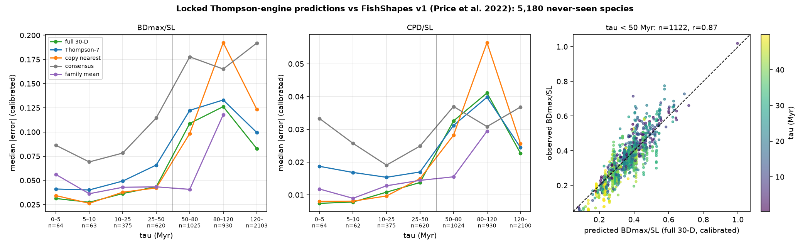

# Portfolio sub-prediction: FishShapes v1 (Price et al. 2022)

Scored 2026-10-23 by `thompson/portfolio/score_locked_predictions.py --source fishshapes_v1` against the predictions locked at commit `7889d9396de0` (hashes verified at run time). Comparison data: Price SA et al. 2022 Ecology 103:e3829; Zenodo 6642650 (CC0); `.thompson_cache/fishshapes_v1/FishShapes_specimensv1.csv` sha256 `7447fdc92c5fd5c9…`, 16,523 specimens, 6,095 species; 5,180 registered target species matched (training and 1917 species excluded).

## Registered claims vs realised outcome (BDmax/SL, calibrated)

Registered in `docs/THOMPSON_DATASET_PORTFOLIO.md` as *A linear calliper traits, same clade* with status *scored 2026-10-22 (anchor for all simulated confidences)*.

| Claim | Registered probability | Simulated / pass interval | Realised | Verdict |
|---|---|---|---|---|

## Error by horizon: BDmax_over_SL (calibrated median |error|)

| tau (Myr) | n | full 30-D | Thompson-7 | copy nearest | consensus | family mean | 95% cov. full30 (cal / raw) |
|---|---|---|---|---|---|---|---|
| 0–5 | 64 | **0.0313** | 0.0411 | 0.0343 | 0.0863 | 0.0561 | 89% / 89% |
| 5–10 | 63 | **0.0273** | 0.0401 | 0.0263 | 0.0691 | 0.0362 | 94% / 92% |
| 10–25 | 375 | **0.0364** | 0.0493 | 0.0378 | 0.0782 | 0.0428 | 93% / 91% |
| 25–50 | 620 | **0.0434** | 0.0658 | 0.0422 | 0.1145 | 0.0433 | 93% / 91% |
| 50–80 | 1025 | **0.1088** | 0.1224 | 0.0984 | 0.1777 | 0.0407 | 65% / 64% |
| 80–120 | 930 | **0.1262** | 0.1331 | 0.1924 | 0.1651 | 0.1179 | 68% / 66% |
| 120–∞ | 2103 | **0.0829** | 0.0995 | 0.1235 | 0.1919 | – | 83% / 81% |

Within 50 Myr (n=1122): ratio vs consensus 0.41 (p=1.1e-103), vs nearest 0.96 (p=0.06), coverage 93%, r(pred, obs)=0.87; T7 between consensus and full-30: yes.
Beyond 50 Myr (n=4058): ratio vs consensus 0.52, coverage 75%, median predicted 0.279 vs observed 0.229.

## Error by horizon: CPD_over_SL (calibrated median |error|)

| tau (Myr) | n | full 30-D | Thompson-7 | copy nearest | consensus | family mean | 95% cov. full30 (cal / raw) |
|---|---|---|---|---|---|---|---|
| 0–5 | 64 | **0.0074** | 0.0187 | 0.0080 | 0.0333 | 0.0118 | 88% / 86% |
| 5–10 | 62 | **0.0078** | 0.0168 | 0.0081 | 0.0257 | 0.0089 | 95% / 92% |
| 10–25 | 375 | **0.0108** | 0.0154 | 0.0097 | 0.0191 | 0.0128 | 93% / 84% |
| 25–50 | 620 | **0.0138** | 0.0170 | 0.0149 | 0.0249 | 0.0144 | 84% / 75% |
| 50–80 | 1024 | **0.0326** | 0.0312 | 0.0282 | 0.0370 | 0.0155 | 58% / 57% |
| 80–120 | 930 | **0.0411** | 0.0398 | 0.0565 | 0.0308 | 0.0294 | 55% / 64% |
| 120–∞ | 2100 | **0.0227** | 0.0244 | 0.0257 | 0.0368 | – | 78% / 79% |

Within 50 Myr (n=1121): ratio vs consensus 0.50 (p=1.8e-81), vs nearest 0.97 (p=0.1), coverage 88%, r(pred, obs)=0.85; T7 between consensus and full-30: yes.
Beyond 50 Myr (n=4054): ratio vs consensus 0.82, coverage 68%, median predicted 0.091 vs observed 0.090.

## Calibration (training species only)

- BDmax_over_SL: {"alpha": -0.010133883453388892, "beta": 1.0182831978209772, "r": 0.954402244105313, "n_training_species": 710, "residual_sd": 0.042403342590594875}
- CPD_over_SL: {"alpha": 0.0049200505871830336, "beta": 0.8676245899023962, "r": 0.9342309398190517, "n_training_species": 711, "residual_sd": 0.012632479530787602}

## Notes

- Tests, bins, calibration rule and pass thresholds are those registered for the FishShapes blind test and the portfolio; nothing was tuned on this dataset.
- FishBase MORPHMET values are measured on single pictures (often drawings), so measurement noise is larger than for FishShapes callipers and inflates every method's error equally.
- Per-species values are in `thompson/portfolio/results/fishshapes_v1.json`.
