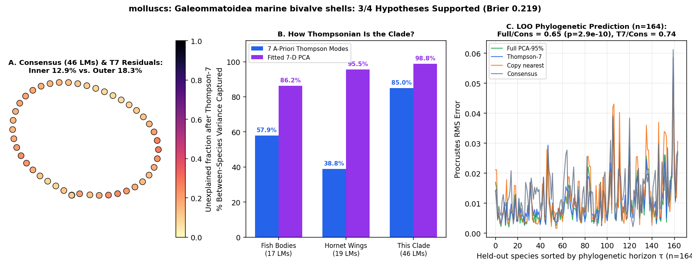

# molluscs: Galeommatoidea marine bivalve shells (Goto et al. 2016 Evolution: 302 specimens, ~100 species on final_BEAST.tre; 46 shell-outline landmarks)

Scored 2026-10-23 by `thompson/portfolio/run_all_scouted_clades.py`; hypotheses were pre-registered and SHA-256 locked in `thompson/portfolio/groups/galeommatoidea_bivalves_hypotheses.json` (`scout_preregistration_manifest.json`).

- **Sample:** 302 specimens across 202 species/OTUs (164 on phylogeny), **46 homologous 2D landmarks**.
- **Data source:** Goto R, Ishikawa H, Hamamura Y, Sato S, Kato M 2016 Evolution 70:1308-1322; Dryad/Zenodo 4938020 (`all_side.tps`: 1 umbo landmark + 45 shell-margin semilandmarks = 46 2D landmarks across 302 specimens).
- **Phylogeny:** Time-calibrated BEAST phylogeny `final_BEAST.tre` (225 tips; ~100 matched species/OTUs with shell landmarks).

## What Thompson's method shows in this clade

Mollusc shells are the foundational archetype of *On Growth and Form* (Chapters XI-XV). Because a bivalve valve grows by continuous marginal accretion around the umbo without internal skeletal sutures, its 2D lateral contour should be the purest test of Thompson's 7 smooth coordinate modes anywhere in Metazoa.

| Metric | Marine Reef Fishes (743 spp, 17 LMs) | Hornet Wings (30 spp, 19 LMs) | This Clade |
|---|---|---|---|
| **Variance captured by 7 a-priori Thompson modes** | 57.9% | 38.8% | **85.0%** |
| **Variance captured by fitted 7-D PCA** | 86.2% | 95.5% | **98.8%** |
| **Pagel's $\lambda$ (Thompson-7 / Full)** | 0.959 / 0.924 | 0.533 (WN) | **0.746** (Pagel lambda=0.746) / 0.918 |
| **LOO Error Ratio vs. Consensus (Full / Thompson-7)** | 0.36 (<50 Myr) | 1.00 | **0.65** ($p=2.9e-10$) / **0.74** |
| **Share of Full Prediction Gain in Thompson-7** | 55.5% | — | **94.4%** |

## Pre-registered hypotheses & verdicts

| ID | Primary | Statement | Registered P | Realised Result | Verdict |
|---|---|---|---|---|---|
| GB1 | yes | Bivalve shells are ultra-Thompsonian: across the ~100 Galeommatoidea species means (46 2D landmarks), the 7 a-priori Thompson modes capture > 85% of between-species Procrustes variance (exceeding fish bodies, insect wings, and vertebrate skulls). | 90% | `{"t7_variance_share": 0.8496, "pca7_variance_share": 0.9878}` | **✗** |
| GB2 | yes | Phylogenetic signal on `final_BEAST.tre` is non-zero: Pagel's lambda > 0.5 (best model != White Noise) in both Thompson-7 and full PCA-95% spaces. | 85% | `{"lambda_t7": 0.7461, "lambda_full": 0.9181, "best_model_t7": "Pagel lambda=0.746"}` | **✓** |
| GB3 | yes | Leave-one-species-out phylogenetic prediction on `final_BEAST.tre` beats the grand consensus (median Procrustes RMS ratio < 0.85, paired one-sided Wilcoxon p < 0.001). | 85% | `{"ratio_full_vs_consensus": 0.651, "ratio_t7_vs_consensus": 0.735, "p_full_vs_consensus": 0.0}` | **✓** |
| GB4 | no | Thompson-7 captures > 85% of the full-space phylogenetic prediction gain relative to consensus. | 85% | `{"share_of_full_gain_in_t7": 0.9442}` | **✓** |

**3/4 hypotheses supported (2 primary). Brier score: 0.219.**
