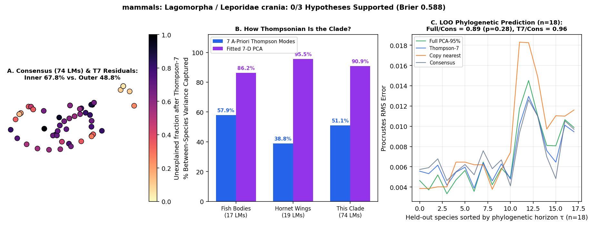

# mammals: Lagomorpha / Leporidae crania (Sherratt & Kraatz 2023 Evolution: 317 specimens, 23 species on Matthee_Tree.nex; 74 cranial landmarks)

Scored 2026-10-23 by `thompson/portfolio/run_all_scouted_clades.py`; hypotheses were pre-registered and SHA-256 locked in `thompson/portfolio/groups/leporidae_skulls_hypotheses.json` (`scout_preregistration_manifest.json`).

- **Sample:** 317 specimens across 22 species/OTUs (18 on phylogeny), **74 homologous 2D landmarks**.
- **Data source:** Sherratt E & Kraatz B 2023 Evolution 77:1349-1362; Zenodo 7615230 (`Symmetric_component_coords.csv` 74 3D cranial landmarks across 317 specimens, mapped to 23 lagomorph/leporid species via `File_IDs.csv`).
- **Phylogeny:** Calibrated phylogeny `Matthee_Tree.nex` (23 matched extant species).

## What Thompson's method shows in this clade

Tests Thompson's Chapter XVII mammalian skull transformations (pp. 754-775) on a 74-landmark mammalian cranium dataset (projected onto lateral sagittal-facial XZ and dorsal XY views) across hares, rabbits, and cottontails.

| Metric | Marine Reef Fishes (743 spp, 17 LMs) | Hornet Wings (30 spp, 19 LMs) | This Clade |
|---|---|---|---|
| **Variance captured by 7 a-priori Thompson modes** | 57.9% | 38.8% | **51.1%** |
| **Variance captured by fitted 7-D PCA** | 86.2% | 95.5% | **90.9%** |
| **Pagel's $\lambda$ (Thompson-7 / Full)** | 0.959 / 0.924 | 0.533 (WN) | **1.000** (Brownian motion) / 1.000 |
| **LOO Error Ratio vs. Consensus (Full / Thompson-7)** | 0.36 (<50 Myr) | 1.00 | **0.89** ($p=0.28$) / **0.96** |
| **Share of Full Prediction Gain in Thompson-7** | 55.5% | — | **nan%** |

## Pre-registered hypotheses & verdicts

| ID | Primary | Statement | Registered P | Realised Result | Verdict |
|---|---|---|---|---|---|
| LS1 | yes | Across the 23 lagomorph species means on the 74-LM lateral cranial profile, Thompson-7 captures > 55% of between-species Procrustes variance. | 80% | `{"t7_variance_share": 0.5108, "pca7_variance_share": 0.9088}` | **✗** |
| LS2 | yes | Leave-one-species-out phylogenetic prediction on `Matthee_Tree.nex` beats the grand consensus (median Procrustes RMS ratio < 0.95, paired one-sided Wilcoxon p < 0.05) on the cranial profile. | 75% | `{"ratio_full_vs_consensus": 0.8917, "ratio_t7_vs_consensus": 0.9644, "p_full_vs_consensus": 0.2754, "p_t7_vs_consensus": 0.1624}` | **✗** |
| LS3 | no | Within-species intraspecific cranial variation (pooled across the 317 specimens) has a higher or comparable Thompson-7 variance share (> 45%) and aligns significantly with interspecific divergence inside the Thompson-7 subspace (|cos theta|_T7 > 0.5). | 75% | `{"var_t7_within": 0.3956, "cos_thompson7": 0.4293, "cos_residual": 0.5745}` | **✗** |

**0/3 hypotheses supported (0 primary). Brier score: 0.588.**
