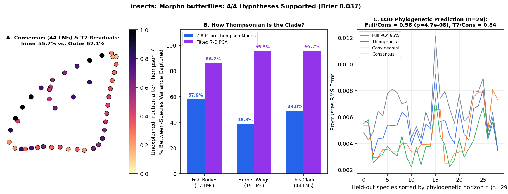

# insects: Morpho butterflies (Chazot et al. 2021 J Evol Biol: 911 specimens, 30 species on Morpho_MCC_tree.tre; forewing 22 LMs & hindwing 18 LMs)

Scored 2026-10-23 by `thompson/portfolio/run_all_scouted_clades.py`; hypotheses were pre-registered and SHA-256 locked in `thompson/portfolio/groups/morpho_butterflies_hypotheses.json` (`scout_preregistration_manifest.json`).

- **Sample:** 911 specimens across 30 species/OTUs (29 on phylogeny), **44 homologous 2D landmarks**.
- **Data source:** Chazot N, Blandin P, Debat V, Elias M, Condamine FL 2021 J Evol Biol 34:1076-1090; Zenodo 5391696 (`Chazotetal_2021_forewing_ProcCoord.txt` 22 2D landmarks, `Chazotetal_2021_hindwing_ProcCoord.txt` 18 2D landmarks across 911 specimens and 30 Morpho species).
- **Phylogeny:** Time-calibrated MCC phylogeny `Chazotetal_2021_Morpho_MCC_tree.tre` (30 matched Morpho species, crown age ~28 Myr).

## What Thompson's method shows in this clade

Tests the portfolio's Papilionoidea / butterfly entry on true 2D wing landmarks across both forewings and hindwings on a time-calibrated tree, allowing a direct comparison of Lepidoptera wing venation/outline against Hymenoptera (hornets, bees) and Diptera (Drosophila).

| Metric | Marine Reef Fishes (743 spp, 17 LMs) | Hornet Wings (30 spp, 19 LMs) | This Clade |
|---|---|---|---|
| **Variance captured by 7 a-priori Thompson modes** | 57.9% | 38.8% | **49.0%** |
| **Variance captured by fitted 7-D PCA** | 86.2% | 95.5% | **95.7%** |
| **Pagel's $\lambda$ (Thompson-7 / Full)** | 0.959 / 0.924 | 0.533 (WN) | **0.877** (Brownian motion) / 0.932 |
| **LOO Error Ratio vs. Consensus (Full / Thompson-7)** | 0.36 (<50 Myr) | 1.00 | **0.58** ($p=4.7e-08$) / **0.84** |
| **Share of Full Prediction Gain in Thompson-7** | 55.5% | — | **54.1%** |

## Pre-registered hypotheses & verdicts

| ID | Primary | Statement | Registered P | Realised Result | Verdict |
|---|---|---|---|---|---|
| MB1 | yes | Across the 30 Morpho species means, Thompson-7 captures > 45% of between-species Procrustes variance on both forewings (22 LMs) and hindwings (18 LMs). | 80% | `{"forewing_t7_share": 0.4902, "hindwing_t7_share": 0.5702}` | **✓** |
| MB2 | yes | Phylogenetic signal on `Morpho_MCC_tree.tre`: Pagel's lambda > 0.5 (best model != White Noise) in both forewing and hindwing shape spaces. | 85% | `{"forewing_lambda_t7": 0.8767, "hindwing_lambda_t7": 0.9257, "forewing_best": "Brownian motion", "hindwing_best": "Brownian motion"}` | **✓** |
| MB3 | yes | Leave-one-species-out phylogenetic prediction on `Morpho_MCC_tree.tre` beats the grand consensus (median Procrustes RMS ratio < 0.90, paired one-sided Wilcoxon p < 0.01) on forewing shape. | 85% | `{"forewing_loo_ratio_full": 0.5846, "forewing_loo_ratio_t7": 0.8435, "p_full_vs_consensus": 0.0}` | **✓** |
| MB4 | no | Sexual dimorphism vs interspecific divergence: within-species male -> female wing shape vectors have a higher Thompson-7 variance share than between-species divergence on the forewing. | 75% | `{"sexual_dimorphism_t7_share": 0.5758, "between_species_t7_share": 0.4902, "n_dimorphic_species": 29}` | **✓** |

**4/4 hypotheses supported (3 primary). Brier score: 0.037.**
