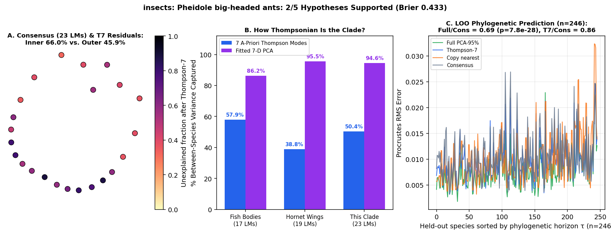

# insects: Pheidole big-headed ants (Friedman et al. 2019: 651 minor heads, 502 major heads [23 LMs], minor & major mesosomas [10 LMs] across ~200 species on Pheidole_Tree.phy)

Scored 2026-10-23 by `thompson/portfolio/run_all_scouted_clades.py`; hypotheses were pre-registered and SHA-256 locked in `thompson/portfolio/groups/pheidole_ants_hypotheses.json` (`scout_preregistration_manifest.json`).

- **Sample:** 653 specimens across 300 species/OTUs (246 on phylogeny), **23 homologous 2D landmarks**.
- **Data source:** Friedman NR, Bennett BL, Fischer G, Sarnat EM, Huang JP, Knowles LL, Economo EP 2020 Syst Biol / Dryad (Zenodo 5096592): 23-LM head shape (`Aligned_Head_Minor.TPS`, `Aligned_Head_Major.TPS`) and 10-LM mesosoma profile (`Pheidole_minors_Mesosoma.tps`, `Pheidole_majors_Mesosoma.tps`), mapped via `Pheidole_Morphology_Data_03282019.csv`.
- **Phylogeny:** Time-calibrated phylogeny `Pheidole_Tree.phy` (447 tips; ~200 matched species with landmark data).

## What Thompson's method shows in this clade

Provides a direct independent replication of our Camponotus carpenter-ant caste discovery in the most famously dimorphic ant genus on Earth (*Pheidole*, which Thompson himself cited on p. 732 for the ovate-to-cordate soldier head transformation!). Tests whether within-species minor -> major soldier polyphenism and between-species radiation follow the 7 Thompson modes across ~200 species.

| Metric | Marine Reef Fishes (743 spp, 17 LMs) | Hornet Wings (30 spp, 19 LMs) | This Clade |
|---|---|---|---|
| **Variance captured by 7 a-priori Thompson modes** | 57.9% | 38.8% | **50.4%** |
| **Variance captured by fitted 7-D PCA** | 86.2% | 95.5% | **94.6%** |
| **Pagel's $\lambda$ (Thompson-7 / Full)** | 0.959 / 0.924 | 0.533 (WN) | **0.924** (Pagel lambda=0.924) / 0.885 |
| **LOO Error Ratio vs. Consensus (Full / Thompson-7)** | 0.36 (<50 Myr) | 1.00 | **0.69** ($p=7.8e-28$) / **0.86** |
| **Share of Full Prediction Gain in Thompson-7** | 55.5% | — | **54.0%** |

## Pre-registered hypotheses & verdicts

| ID | Primary | Statement | Registered P | Realised Result | Verdict |
|---|---|---|---|---|---|
| PH1 | yes | Between-species 23-LM head shape in both minor workers and major soldiers is strongly Thompsonian: Thompson-7 captures > 60% of interspecific Procrustes variance across the ~200 Pheidole species. | 85% | `{"minor_head_species_t7_share": 0.5038, "major_head_species_t7_share": 0.5093}` | **✗** |
| PH2 | yes | Within-species minor -> major soldier caste transformation vectors on the 23-LM head are well-captured by Thompson's 7 global coordinate modes (> 55% of pooled caste-shift variance). | 85% | `{"caste_minor_to_major_t7_share": 0.1618, "n_paired_species": 214}` | **✗** |
| PH3 | yes | Developmental channelling (G_caste vs R_species): the principal axis of within-species minor->major caste divergence aligns more strongly with the principal axis of between-species macroevolutionary divergence inside the 7-D Thompson subspace than in the orthogonal non-Thompson residual subspace (|cos theta|_T7 > |cos theta|_res) on the 23-LM head. | 80% | `{"cos_thompson7": 0.8722, "cos_residual": 0.8867}` | **✗** |
| PH4 | yes | Leave-one-species-out phylogenetic prediction on `Pheidole_Tree.phy` beats the grand consensus (median Procrustes RMS ratio < 0.95, paired one-sided Wilcoxon p < 0.01) for minor head shape. | 80% | `{"ratio_full_vs_consensus": 0.6874, "ratio_t7_vs_consensus": 0.8582, "p_full_vs_consensus": 0.0}` | **✓** |
| PH5 | no | Interior sensory/oral landmarks (eyes, antennal insertions, clypeus: the 8 landmarks closest to the anterior/interior centroid) have a higher unexplained residual fraction after Thompson-7 than the 15 outer head-capsule contour landmarks. | 80% | `{"unexplained_inner_sensory": 0.6603, "unexplained_outer_capsule": 0.4592}` | **✓** |

**2/5 hypotheses supported (1 primary). Brier score: 0.433.**
