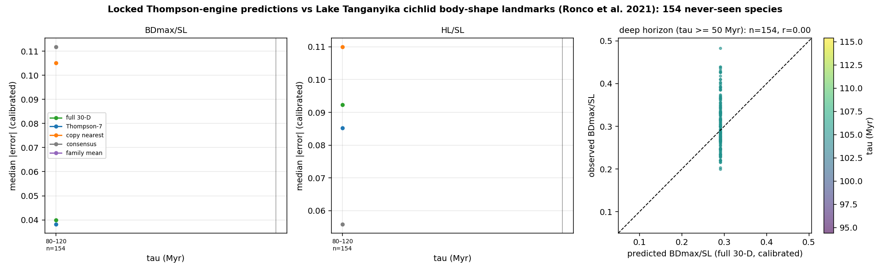

# Portfolio sub-prediction: Lake Tanganyika cichlid body-shape landmarks (Ronco et al. 2021)

Scored 2026-10-23 by `thompson/portfolio/score_locked_predictions.py --source ronco2021_tanganyika_cichlids` against the predictions locked at commit `7889d9396de0` (hashes verified at run time). Comparison data: Ronco F et al. 2021 Nature 589:76-81; Zenodo 3989859 (CC BY 4.0); `.thompson_cache/ronco2021/06_landmark_data_body_shape.tps` sha256 `5256b378a887da88…`, 2,197 specimens, 205 species; 154 registered target species matched (training and 1917 species excluded).

## Registered claims vs realised outcome (BDmax/SL, calibrated)

Registered in `docs/THOMPSON_DATASET_PORTFOLIO.md` as *B landmark geometric morphometrics from another lab, same clade, deep horizon* with status *not downloaded*.

| Claim | Registered probability | Simulated / pass interval | Realised | Verdict |
|---|---|---|---|---|
| P3_deep_horizon | 60% | ratio [0.56, 0.98], coverage [52.0, 84.0] | 0.357 | ✗ |

## Error by horizon: BDmax_over_SL (calibrated median |error|)

| tau (Myr) | n | full 30-D | Thompson-7 | copy nearest | consensus | family mean | 95% cov. full30 (cal / raw) |
|---|---|---|---|---|---|---|---|
| 80–120 | 154 | **0.0399** | 0.0382 | 0.1051 | 0.1118 | – | 100% / 100% |
Beyond 50 Myr (n=154): ratio vs consensus 0.36, coverage 100%, median predicted 0.291 vs observed 0.299.

## Error by horizon: HL_over_SL (calibrated median |error|)

| tau (Myr) | n | full 30-D | Thompson-7 | copy nearest | consensus | family mean | 95% cov. full30 (cal / raw) |
|---|---|---|---|---|---|---|---|
| 80–120 | 154 | **0.0924** | 0.0852 | 0.1100 | 0.0559 | – | 47% / 47% |
Beyond 50 Myr (n=154): ratio vs consensus 1.65, coverage 47%, median predicted 0.236 vs observed 0.328.

## Calibration (training species only)

- BDmax_over_SL: {"alpha": 0.0, "beta": 1.0, "r": NaN, "n_training_species": 0, "note": "fewer than 10 overlapping training species: raw scale used"}
- HL_over_SL: {"alpha": 0.0, "beta": 1.0, "r": NaN, "n_training_species": 0, "note": "fewer than 10 overlapping training species: raw scale used"}

## Notes

- Tests, bins, calibration rule and pass thresholds are those registered for the FishShapes blind test and the portfolio; nothing was tuned on this dataset.
- FishBase MORPHMET values are measured on single pictures (often drawings), so measurement noise is larger than for FishShapes callipers and inflates every method's error equally.
- Per-species values are in `thompson/portfolio/results/ronco2021_tanganyika_cichlids.json`.
