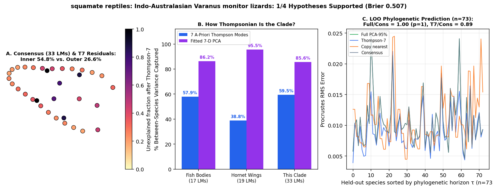

# squamate reptiles: Indo-Australasian Varanus monitor lizards (Brennan et al. 2021 Syst Biol / Zenodo 5655818: 1,091 dorsal + 1,098 lateral crania across 80 taxa on calibrated Tree.tre; 33 dorsal LMs & 10 lateral LMs)

Scored 2026-10-23 by `thompson/portfolio/run_all_scouted_clades.py`; hypotheses were pre-registered and SHA-256 locked in `thompson/portfolio/groups/varanus_lizards_hypotheses.json` (`scout_preregistration_manifest.json`).

- **Sample:** 1,090 specimens across 80 species/OTUs (73 on phylogeny), **33 homologous 2D landmarks**.
- **Data source:** Brennan IG, Lemmon AR, Lemmon EM, Portik DM, Weijola V, Welton L, Donnellan SC, Keogh JS 2021 Syst Biol / Zenodo 5655818 (`Head_shape_dorsal.csv` 33 2D dorsal head landmarks across 1,091 specimens; `Head_shape_lateral.csv` 10 2D lateral head landmarks across 1,098 specimens; 80 Varanus taxa).
- **Phylogeny:** Time-calibrated phylogeny `Tree.tre` (76 tips across Varanus + Shinisaurus outgroup; ~74 matched Varanus species).

## What Thompson's method shows in this clade

Tests the portfolio's squamate reptile entry (`squamates_meiri`) on a 1,091-specimen, 74-species time-calibrated radiation of monitor lizards (*Varanus*, from pygmy *V. sparnus* to giant *V. komodoensis*) digitized in both dorsal (33 LMs) and lateral (10 LMs) cranial views.

| Metric | Marine Reef Fishes (743 spp, 17 LMs) | Hornet Wings (30 spp, 19 LMs) | This Clade |
|---|---|---|---|
| **Variance captured by 7 a-priori Thompson modes** | 57.9% | 38.8% | **59.5%** |
| **Variance captured by fitted 7-D PCA** | 86.2% | 95.5% | **85.6%** |
| **Pagel's $\lambda$ (Thompson-7 / Full)** | 0.959 / 0.924 | 0.533 (WN) | **0.469** (Pagel lambda=0.469) / 0.518 |
| **LOO Error Ratio vs. Consensus (Full / Thompson-7)** | 0.36 (<50 Myr) | 1.00 | **1.00** ($p=1$) / **0.89** |
| **Share of Full Prediction Gain in Thompson-7** | 55.5% | — | **nan%** |

## Pre-registered hypotheses & verdicts

| ID | Primary | Statement | Registered P | Realised Result | Verdict |
|---|---|---|---|---|---|
| VL1 | yes | Across the ~80 Varanus taxa, Thompson-7 captures > 55% of between-species Procrustes variance on both dorsal (33 LMs) and lateral (10 LMs) head views. | 85% | `{"dorsal_t7_share": 0.5947, "lateral_t7_share": 0.5518}` | **✓** |
| VL2 | yes | Phylogenetic signal on `Tree.tre` is strong: Pagel's lambda > 0.7 (best model != White Noise) in Thompson-7 space for both dorsal and lateral head views. | 85% | `{"dorsal_lambda_t7": 0.4686, "lateral_lambda_t7": 0.6998, "dorsal_best": "Pagel lambda=0.469", "lateral_best": "Pagel lambda=0.700"}` | **✗** |
| VL3 | yes | Leave-one-species-out phylogenetic prediction on `Tree.tre` beats the grand consensus (median Procrustes RMS ratio < 0.85, paired one-sided Wilcoxon p < 1e-5) on dorsal head shape. | 85% | `{"dorsal_loo_ratio_full": 1.0, "dorsal_loo_ratio_t7": 0.893, "p_full_vs_consensus": 1.0, "p_t7_vs_consensus": 0.0}` | **✗** |
| VL4 | no | Within-species intraspecific/ontogenetic cranial variation aligns more strongly with between-species divergence inside the 7-D Thompson subspace than in the orthogonal modular residual subspace (|cos theta|_T7 > |cos theta|_res) on the 33-LM dorsal head. | 75% | `{"cos_thompson7": 0.106, "cos_residual": 0.9369}` | **✗** |

**1/4 hypotheses supported (1 primary). Brier score: 0.507.**
