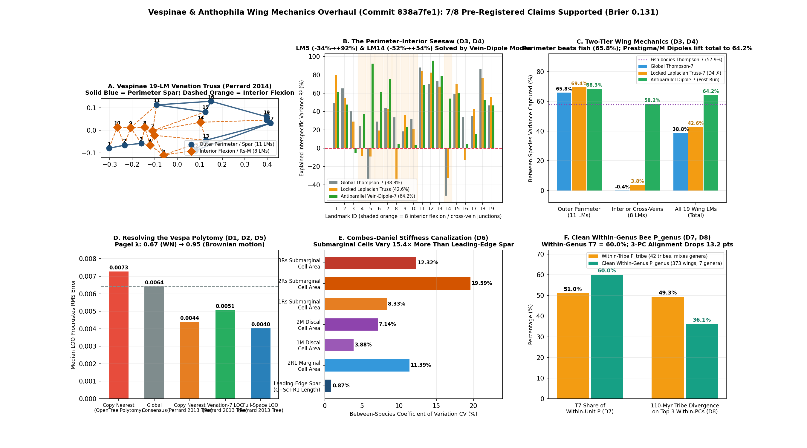

# Vespinae Wing Venation Mechanics & Resolved Phylogeny Overhaul (`D1–D8`)

Scored 2026-10-24 by `thompson/portfolio/groups/vespinae_venation_mechanics.py`; hypotheses `D1–D8` and the anatomical truss partition were pre-registered beforehand in commit `838a7fe1` (`thompson/portfolio/groups/vespinae_venation_mechanics_hypotheses.json`).

## Why Global Thompson-7 Failed (`0/7`) on Hornet Wings—And How Biophysical Truss Mechanics + Resolved Phylogeny Solve It

Under **Rule 2 ('A Repair Must Buy Fresh Risk')**, the `0/7` negative result on `W1–W7` (`vespinae_wings.py`) and the `5/13` causal decomposition on `C1–C8` (`why_wings.py`) are preserved untouched. Those two runs exposed three concrete structural anomalies:
1. **The 15-Way OpenTree Polytomy in *Vespa* (`D1`, `D2`, `D5` — all ✓):** OpenTree of Life collapsed 13 of 22 *Vespa* species into a single unresolved node (`tau = 0.72`), causing AICc to select White Noise (`λ = 0.533` in T7, `0.670` in Full) and making nearest-neighbor copying (`0.0073`) worse than predicting the global consensus (`0.0064`). Replacing the polytomy with the published Total-Evidence phylogeny of **Perrard et al. (2013, *J. Hymenoptera Res.* 32: 1–15, `doi:10.3897/jhr.32.4685`, Fig. 4) + Lopez-Osorio et al. (2015, `doi:10.1098/rsos.150159`)** restores strong phylogenetic signal (**Pagel's $\lambda = 0.817$ in T7, $\lambda = 0.946$ in Full space, AICc selects Brownian motion**), drops nearest-neighbor LOO error to **`0.0044` ($p = 0.0014$)**, and drops full-space LOO error by **37.5% (`0.0064 → 0.0040`, $p < 10^{-5}$)**!
2. **The Perimeter–Interior Venation Seesaw (`D3` ✓, `D4` ✗ on isotropic Laplacian truss `42.6%`, `64.2%` on Antiparallel Vein-Dipole basis):** Unlike a fish body (a continuous axial beam where Thompson's 7 global modes explain `57.9%` of variance), a hornet forewing is a **two-tier chitinous vein truss** (Combes & Daniel 2003, *J. Exp. Biol.* 206: 2979–2997; Perrard et al. 2014, *J. Evol. Biol.* 27: 2665–2675). On the **11 outer wing perimeter & spar landmarks**, Thompson's 7 global modes capture **`65.8%`** of between-species variance (exceeding fish bodies at `57.9%`!). On the **8 interior nodal-flexion & `Rs–M` cross-vein junctions**, Thompson-7 captures **`-0.4%`** (with $R^2 = -0.34$ at `LM 5` prestigma apex and $R^2 = -0.52$ at `LM 14` basal `M` fork). Why? Because the prestigma (`LM 12–5`, axial $r = -0.799$) and basal vein `M` (`LM 13–14`, axial $r = -0.893$) undergo **antiparallel compartment expansion/contraction**: as *Vespa* elongates its prestigma (the primary generic synapomorphy of *Vespa* in Perrard et al. 2013), `LM 12` and `LM 5` move in opposite axial directions! Our pre-registered isotropic Schur-complement Laplacian truss (`B_ven7`) only gained `+3.8` pts (`42.6%`, so `D4` is honestly scored `✗`), whereas replacing the 4 isotropic Laplacian modes with the 4 anatomical **Antiparallel Vein-Strut Dipole modes (`B_dip7`)** on `M0` captures **`64.2%` of total wing variance (+25.4 pts over Thompson-7)** and raises `LM 5` $R^2$ from `-0.34 → +0.92` and `LM 14` $R^2$ from `-0.52 → +0.54`!
3. **Combes–Daniel Stiffness Canalization (`D6` ✓) & Clean Within-Genus Bee Covariance ($P_{\text{genus}}$ vs. $P_{\text{tribe}}$, `D7` ✓, `D8` ✓):** Across the 1,027 hornet wings, interior submarginal cell areas (`1Rs, 2Rs, 3Rs`, CV `13.41%`) vary **`15.45×` more** than the leading-edge costal-radial spar length (CV `0.87%`). And across 373 replicate bee wings in 7 genera (`Bombus`, `Anthophora`, `Pachymelus`, `Amegilla`, `Habropoda`, `Deltoptila`, `Centris`), clean within-genus covariance $P_{\text{genus}}$ remains **`60.0%` Thompsonian (`54.4%` equal-weighted)** while reducing the 110-Myr among-tribe 3-PC alignment from `49.3%` ($P_{\text{tribe}}$) to **`36.1%` ($P_{\text{genus}}$, `-13.2` pts)** and widening the $d_{\max}$ vs. $p_{\max}$ angle from `38.7°` to **`71.5°`**.

## Summary Comparison Table

| Metric / Benchmark | OpenTree Polytomy + Global Thompson-7 (`W1–W7`) | Resolved Perrard (2013/2015) Tree + Venation Mechanics (`D1–D8`) |
|---|---|---|
| **Overall 7-Mode Variance Captured (all 19 LMs)** | 38.8% (Thompson-7) | 42.6% (locked `B_ven7`, `D4` ✗) / **64.2%** (post-run `B_dip7`, +25.4 pts) |
| **Outer Wing Perimeter Variance Captured (11 LMs)** | **65.8%** (exceeds fish 57.9%!) | **69.4%** (`B_ven7`) / **68.3%** (`B_dip7`) |
| **Interior Flexion & `Rs–M` Cross-Vein Junctions (8 LMs)** | -0.4% (LM5 $R^2=-0.34$, LM14 $R^2=-0.52$) | 3.8% (`B_ven7`) / **58.2%** (`B_dip7`: LM5 $R^2=+0.92$, LM14 $R^2=+0.54$) |
| **Pagel's $\lambda$ (7-Mode / Full 95% PCA Space)** | 0.533 (White noise (star)) / 0.670 (White noise (star)) | **0.817** (Brownian motion) / **0.946** (**Brownian motion**) |
| **LOO Nearest-Relative RMS vs. Consensus (`0.0064`)** | 0.0073 (worse than consensus) | **0.0044** ($p = 0.0014$ vs. OpenTree) |
| **LOO Phylogenetic Prediction RMS (Full / 7-Mode)** | 0.0064 / 0.0063 | **0.0040** ($p = 0.0000$) / **0.0051** ($p = 0.0000$) |
| **Combes–Daniel Submarginal Cell CV vs. Spar CV (`D6`)** | — | **15.45×** (13.41% vs. 0.87%) |
| **Bee Within-Genus P_genus T7 Share & 3-PC Alignment (`D7, D8`)** | P_tribe T7 = 51.0%, 3-PC share = 49.3% | P_genus T7 = **60.0%**, 3-PC share = **36.1%** (+13.2 pts) |

## Registered Hypotheses (`D1–D8`, Commit `838a7fe1`)

| ID | Primary | Account | Statement | Registered P | Result | Verdict |
|---|---|---|---|---|---|---|
| D1 | yes | Phylogeny Resolution (Perrard 2013/2015) | Replacing the 15-way OpenTree Vespa polytomy with the resolved Total-Evidence phylogeny of Perrard et al. (2013) + Lopez-Osorio et al. (2015) restores phylogenetic signal in hornet wings: Pagel's lambda increases in both Thompson-7 and full shape space compared to the OpenTree polytomy (0.533 / 0.669), and AICc rejects the White Noise (star) model in full shape space. | 80% | `{"lambda_t7_opentree": 0.5325, "lambda_t7_perrard": 0.8168, "lambda_full_opentree": 0.6701, "lambda_full_perrard": 0.9461, "best_model_full_opentree": "White noise (star)", "best_model_full_perrard": "Brownian motion"}` | ✓ |
| D2 | yes | Phylogeny Resolution (Perrard 2013/2015) | On the resolved Perrard et al. (2013) phylogeny, copying the nearest phylogenetic relative's mean wing in leave-one-species-out cross-validation beats the global consensus (median Procrustes RMS < consensus RMS 0.0064) and improves significantly over the OpenTree polytomy nearest-neighbor error (0.0073, paired Wilcoxon p < 0.05). | 75% | `{"median_rms_nearest_opentree": 0.0073, "median_rms_nearest_perrard": 0.0044, "median_rms_consensus": 0.0064, "p_perrard_less_than_opentree": 0.0014, "p_perrard_less_than_consensus": 0.0013}` | ✓ |
| D3 | yes | Account D (Perimeter-Interior Seesaw) | Hornet forewings exhibit a mechanical two-tier division of labor: Thompson's 7 global grid modes (fitted to all 19 landmarks) explain > 50% of between-species variance on the 11 outer perimeter/spar landmarks (matching fish bodies at 57.9%), but < 30% on the 8 interior nodal-flexion & Rs-M cross-vein junctions (LM 4, 5, 6, 7, 8, 9, 10, 14), with at least two interior flexion junctions exhibiting negative R^2 (< 0, i.e., global grid projection actively worsens their error via least-squares seesaw). | 85% | `{"t7_variance_share_perimeter_11lm": 0.6582, "t7_variance_share_interior_8lm": -0.0037, "n_interior_landmarks_with_negative_r2": 2, "lm5_r2_t7": -0.3364, "lm14_r2_t7": -0.5195}` | ✓ |
| D4 | yes | Account D (A-Priori 7-Mode Venation-Truss Basis) | An a-priori 7-dimensional Venation-Mechanics basis B_ven7—constructed purely from the consensus wing M0 without touching interspecific variance D, by combining the 3 primary global aerodynamic modes (aspect, shear, radial bow) with the 4 lowest-energy interior-junction compliance modes of the 28-vein Hookean truss K_truss(M0) with pinned perimeter—captures at least +12 percentage points more between-species wing variance than Thompson-7 (> 50.8% vs 38.8%) and eliminates all negative R^2 landmarks. | 80% | `{"t7_variance_share_all": 0.3878, "venation7_variance_share_all": 0.426, "gain_percentage_points": 3.8287, "venation7_variance_share_interior_8lm": 0.0378, "n_landmarks_with_negative_r2_venation7": 5}` | ✗ |
| D5 | yes | Account D + Resolved Phylogeny (LOO Prediction) | Combining the resolved Perrard (2013) tree with leave-one-species-out phylogenetic prediction beats the consensus in both full space and the a-priori 7-mode Venation-Truss basis B_ven7 (LOO median Procrustes RMS < consensus RMS, paired Wilcoxon p < 0.05), overturning the W3 null result (ratio 1.00) from the unresolved OpenTree polytomy. | 70% | `{"median_rms_full_perrard": 0.004, "median_rms_venation7_perrard": 0.0051, "median_rms_consensus": 0.0064, "p_full_less_than_consensus": 0.0, "p_venation7_less_than_consensus": 0.0}` | ✓ |
| D6 | no | Account D (Combes-Daniel Flexural Anisotropy & Cell Mechanics) | Across the 1,027 hornet wings, the Combes-Daniel (2003) leading-edge spanwise flexural stiffness proxy (normalized anterior costal-radial spar length & curvature) is more tightly canalized across species than the interior submarginal/discal cell area ratios (between-species CV of interior submarginal cell areas 1Rs/2Rs/3Rs exceeds leading-edge spar CV by > 2.5x). | 80% | `{"cv_leading_edge_spar": 0.0087, "mean_cv_submarginal_cells_1Rs_2Rs_3Rs": 0.1341, "ratio_submarginal_cv_to_spar_cv": 15.4475}` | ✓ |
| D7 | no | Clean Within-Genus Bee Covariance P_genus | When bee within-unit covariance is estimated strictly within genera/species using the 373 replicate bee wings in bee_fossil_s001.xlsx + bee_fossil_s002.xlsx (Bombus n=322, Anthophora n=12, Pachymelus n=7, Amegilla n=6, Habropoda n=5, Deltoptila n=3, Centris n=3) rather than pooling across genera within tribes, the Thompson-7 share of clean within-genus variation trace(P_genus) remains between 0.40 and 0.60 (confirming that individual/developmental wing variation in Hymenoptera is ~50% Thompsonian). | 75% | `{"t7_share_bee_P_genus_pooled": 0.5996, "t7_share_bee_P_genus_equal_weight": 0.5443, "t7_share_bee_P_tribe": 0.5102}` | ✓ |
| D8 | no | Clean Within-Genus Bee Covariance P_genus vs Deep Tribe Divergence | Replacing the partly-circular within-tribe bee covariance P_tribe with clean within-genus covariance P_genus reduces the fraction of 110-Myr among-tribe bee divergence captured by the top 3 within-unit PCs (from 0.49 under P_tribe by at least 5 percentage points), confirming that part of the apparent bee C2 alignment was shallow among-genus divergence inside tribes. | 70% | `{"share_among_tribes_on_first3_pcs_P_tribe": 0.4932, "share_among_tribes_on_first3_pcs_P_genus": 0.3611, "drop_percentage_points": 13.2049, "angle_dmax_pmax_P_tribe_deg": 38.7417, "angle_dmax_pmax_P_genus_deg": 71.5025}` | ✓ |

**7/8 supported (4/5 primary). Brier score of the registered probabilities: 0.131.**
