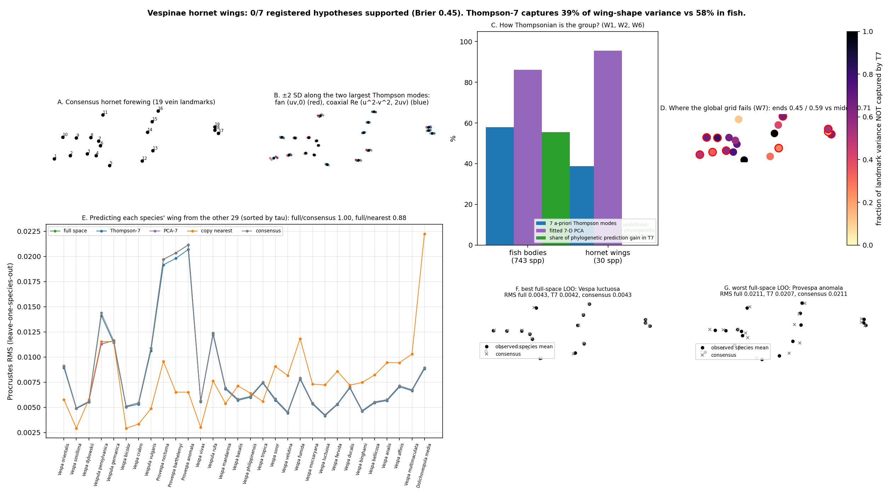

# Vespinae wings: is hornet-wing evolution Thompsonian?

Scored 2026-10-22 by `thompson/portfolio/groups/vespinae_wings.py`; hypotheses W1-W7 and the protocol were committed beforehand in `vespinae_wings_hypotheses.json`. 1,027 wings, 30 species on the tree (dropped: Vespula_nursei). Tree: Open Tree of Life induced subtree, Grafen (relative) branch lengths, so horizons are fractions of crown depth, not Myr.

## What Thompson's method specifically shows here

Thompson (1917) claimed that the difference between related forms is a single smooth deformation of the coordinate grid, describable by a few global parameters. The engine encodes this as 7 generic deformation modes of the plane (aspect, shear, two fans, radial bow, two conformal quadratics) evaluated at the Procrustes consensus; they contain no anatomy and apply unchanged to any 2-D landmark set. The Thompson-specific question for a new group is therefore not 'can the tree predict shape' (that is the phylogenetic engine) but 'is this group's shape evolution Thompsonian', i.e. how much of the between-species variance and of the phylogenetic predictability lives in those 7 global modes. In fishes the answer was: 58% of variance, 55% of the prediction gain, and the full shape space beat Thompson-7 by ~50%.

| | Fish bodies (743 spp, 17 LMs) | Hornet wings (30 spp, 19 LMs) |
|---|---|---|
| Variance captured by the 7 a-priori Thompson modes | 57.9% | **38.8%** |
| Variance captured by a fitted 7-D PCA | 86.2% | 95.5% |
| Share of phylogenetic prediction gain inside the 7 Thompson modes | 55.5% | **139.0%** |
| Pagel lambda on Thompson-7 scores | 0.959 | 0.533 (White noise (star)) |
| LOO error ratio, full space vs consensus | 0.36 (nearest bin) | 1.00 |
| LOO error ratio, full space vs copying nearest relative | 0.84 (nearest bin) | 0.88 |

## Registered hypotheses

| ID | Primary | Statement | Registered P | Result | Verdict |
|---|---|---|---|---|---|
| W1 | yes | The 7 generic Thompson modes capture a LARGER share of between-species wing-shape variance in Vespinae than in fish bodies: > 0.58 (species means after GPA). | 70% | `{"t7_variance_share": 0.388}` | ✗ |
| W2 | yes | Thompson-7 captures a LARGER share of the full-space leave-one-species-out prediction gain (relative to the consensus) than in fish: > 0.555. | 60% | `{"share_of_full_prediction_gain_captured_by_t7": 1.39, "defined": false}` | ✗ |
| W3 | yes | Full-space phylogenetic prediction beats the consensus in leave-one-species-out (median Procrustes RMS ratio < 0.8, paired Wilcoxon p < 0.05 given n = 30). | 80% | `{"median_rms_full": 0.006, "median_rms_consensus": 0.006, "ratio": 1.0, "p": 0.159}` | ✗ |
| W4 | no | Full-space prediction improves on copying the nearest relative's mean wing by less than 10% (ratio > 0.9), as in fish. | 60% | `{"median_rms_nearest": 0.007, "ratio": 0.883, "p_full_less": 0.412}` | ✗ |
| W5 | no | Pagel's lambda fitted on the Thompson-7 scores exceeds 0.7 (strong phylogenetic signal in the global deformation modes). | 65% | `{"lambda_t7": 0.533, "best_model_t7": "White noise (star)"}` | ✗ |
| W6 | no | A data-driven 7-D PCA basis still beats the a-priori Thompson-7 basis in representation (variance captured) AND in prediction, as in fish. | 75% | `{"pca7_variance_share": 0.955, "median_rms_pca7": 0.006, "median_rms_thompson7": 0.006, "p_pca7_less": 1.0}` | ✗ |
| W7 | no | Representation of species differences by Thompson-7 is not uniform across the wing: the residual after the 7 global modes concentrates in the distal/apical landmarks (marginal cell and apex), i.e. the Thompsonian description fails locally where the venation is most variable. | 55% | `{"unexplained_fraction_end_a": 0.449, "unexplained_fraction_end_b": 0.589, "unexplained_fraction_middle": 0.708}` | ✗ |

**0/7 supported (0/3 primary). Brier score of the registered probabilities: 0.448.**

## Leave-one-species-out medians (Procrustes RMS to the held-out species mean)

| full space (PCs to 95%) | Thompson-7 | PCA-7 | copy nearest relative | consensus | Thompson-7 oracle (representation floor) |
|---|---|---|---|---|---|
| **0.0064** | 0.0063 | 0.0064 | 0.0073 | 0.0064 | 0.0041 |

| Species | tau (rel.) | nearest | full | T7 | PCA-7 | nearest-copy | consensus |
|---|---|---|---|---|---|---|---|
| Vespa bicolor | 0.03 | Vespa simillima | 0.0051 | 0.0050 | 0.0051 | 0.0029 | 0.0051 |
| Vespa dybowskii | 0.03 | Vespa orientalis | 0.0056 | 0.0055 | 0.0056 | 0.0058 | 0.0056 |
| Vespa orientalis | 0.03 | Vespa dybowskii | 0.0091 | 0.0089 | 0.0091 | 0.0058 | 0.0091 |
| Vespa simillima | 0.03 | Vespa bicolor | 0.0049 | 0.0049 | 0.0049 | 0.0029 | 0.0049 |
| Vespula germanica | 0.03 | Vespula pensylvanica | 0.0116 | 0.0114 | 0.0116 | 0.0115 | 0.0116 |
| Vespula pensylvanica | 0.03 | Vespula germanica | 0.0113 | 0.0141 | 0.0113 | 0.0115 | 0.0144 |
| Provespa anomala | 0.07 | Provespa barthelemyi | 0.0211 | 0.0207 | 0.0211 | 0.0065 | 0.0211 |
| Provespa barthelemyi | 0.07 | Provespa anomala | 0.0203 | 0.0198 | 0.0203 | 0.0065 | 0.0203 |
| Provespa nocturna | 0.07 | Provespa anomala | 0.0197 | 0.0192 | 0.0197 | 0.0096 | 0.0197 |
| Vespa crabro | 0.07 | Vespa dybowskii | 0.0054 | 0.0053 | 0.0054 | 0.0033 | 0.0054 |
| Vespa vivax | 0.07 | Vespa bicolor | 0.0056 | 0.0056 | 0.0056 | 0.0030 | 0.0056 |
| Vespula vulgaris | 0.07 | Vespula germanica | 0.0109 | 0.0106 | 0.0109 | 0.0049 | 0.0109 |
| Vespa mandarinia | 0.10 | Vespa bicolor | 0.0069 | 0.0068 | 0.0069 | 0.0054 | 0.0069 |
| Vespula rufa | 0.10 | Vespula germanica | 0.0124 | 0.0122 | 0.0124 | 0.0076 | 0.0124 |
| Vespa basalis | 0.24 | Vespa bicolor | 0.0058 | 0.0057 | 0.0058 | 0.0071 | 0.0058 |
| Vespa affinis | 0.72 | Vespa analis | 0.0071 | 0.0070 | 0.0071 | 0.0094 | 0.0071 |
| Vespa analis | 0.72 | Vespa affinis | 0.0058 | 0.0057 | 0.0058 | 0.0095 | 0.0058 |
| Vespa bellicosa | 0.72 | Vespa affinis | 0.0055 | 0.0055 | 0.0055 | 0.0082 | 0.0055 |
| Vespa binghami | 0.72 | Vespa affinis | 0.0047 | 0.0046 | 0.0047 | 0.0075 | 0.0047 |
| Vespa ducalis | 0.72 | Vespa affinis | 0.0070 | 0.0069 | 0.0070 | 0.0072 | 0.0070 |
| Vespa fervida | 0.72 | Vespa affinis | 0.0054 | 0.0053 | 0.0054 | 0.0086 | 0.0054 |
| Vespa fumida | 0.72 | Vespa affinis | 0.0079 | 0.0078 | 0.0079 | 0.0118 | 0.0079 |
| Vespa luctuosa | 0.72 | Vespa affinis | 0.0043 | 0.0042 | 0.0043 | 0.0072 | 0.0043 |
| Vespa mocsaryana | 0.72 | Vespa affinis | 0.0054 | 0.0053 | 0.0054 | 0.0073 | 0.0054 |
| Vespa multimaculata | 0.72 | Vespa affinis | 0.0067 | 0.0067 | 0.0067 | 0.0103 | 0.0067 |
| Vespa philippinensis | 0.72 | Vespa affinis | 0.0061 | 0.0060 | 0.0061 | 0.0064 | 0.0061 |
| Vespa soror | 0.72 | Vespa affinis | 0.0058 | 0.0057 | 0.0058 | 0.0091 | 0.0058 |
| Vespa tropica | 0.72 | Vespa affinis | 0.0075 | 0.0074 | 0.0075 | 0.0056 | 0.0075 |
| Vespa velutina | 0.72 | Vespa affinis | 0.0045 | 0.0044 | 0.0045 | 0.0082 | 0.0045 |
| Dolichovespula media | 0.86 | Provespa anomala | 0.0089 | 0.0088 | 0.0089 | 0.0222 | 0.0089 |

## Interpretation (written after the run; not pre-registered)

- **Hornet wings are not Thompsonian in the sense tested.** The 7 global grid modes capture 39% of between-species wing variance (fish: 58%), while a fitted 7-D PCA captures 96%: species differences are extremely low-dimensional, but the dimension they occupy is not a smooth global deformation of the plane. W1 was the central Thompson-specific claim and it failed in the opposite direction from the one registered.
- **Between-species differences are small but real.** Median Procrustes RMS from a species mean to the consensus is 0.0062 (fish bodies: 0.030), about twice the within-species RMS (0.0034) and ten times the standard error of a well-sampled species mean (0.0006); only 2 species rest on a single wing. Species means are therefore mostly well determined, and the failure of phylogenetic prediction below is not primarily a sampling problem.
- **No phylogenetic signal was detectable with this tree.** AICc picked white noise in both spaces (lambda point estimates 0.53 / 0.67), so the phylogenetic prediction collapsed onto the consensus (ratio 1.00). Copying the nearest relative was *worse* than the consensus (0.0073 vs 0.0064), because on a tree where most of Vespa is one polytomy the 'nearest relative' is an arbitrary pick among ~15 equally close species, and copying it adds that species' idiosyncratic deviation. The Open Tree topology is a large polytomy within Vespa with Grafen lengths; a resolved, dated Vespa tree (Perrard et al. 2013) is the obvious next input and could change W3-W5.
- **What Thompson's method did show:** the residual after the 7 global modes is not concentrated at either extremity of the wing but in the middle (W7 fails), i.e. the species-specific signal is a local repositioning of interior vein intersections. That is a positive, specific finding about wings versus fish bodies: fish differ by global proportions (where T7 does half the work), hornets differ by local venation geometry (where T7 does little).

## Caveats (stated in the registration)

- 30 species: the 'full' space is the within-fold PCA retaining 95% of variance (the registered 'all 30 dims' is singular with n = 30); every space is re-fitted inside each fold.
- Branch lengths are Grafen heights from the Open Tree topology (which contains polytomies within Vespa). Phylogenetic signal and the horizon are therefore measured in relative time. Substituting a dated tree is a one-line change.
- Species means pool castes, sexes and localities (Perrard et al. 2014 sampled mostly workers); intraspecific variance is not modelled.
- Per-species values: `thompson/portfolio/results/vespinae_wings.json`.
