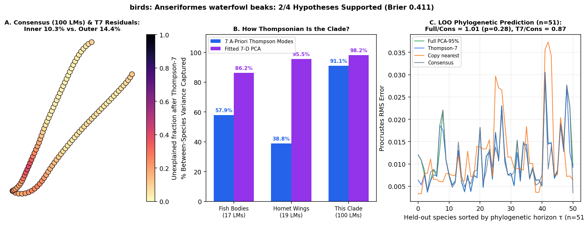

# birds: Anseriformes waterfowl beaks (Olsen 2017 Evolution: 51 species on Burleigh_2015.tre; 2D dorsal/lateral upper-bill culmen & tomium contour landmarks)

Scored 2026-10-23 by `thompson/portfolio/run_all_scouted_clades.py`; hypotheses were pre-registered and SHA-256 locked in `thompson/portfolio/groups/waterfowl_beaks_hypotheses.json` (`scout_preregistration_manifest.json`).

- **Sample:** 51 specimens across 51 species/OTUs (51 on phylogeny), **100 homologous 2D landmarks**.
- **Data source:** Olsen AM 2017 Evolution 71:1143-1153; Dryad/Zenodo 5001646 (`Beak shape by species.zip`: 51 waterfowl species, 3D/2D upper-bill culmen and tomium curves).
- **Phylogeny:** Pruned ML phylogeny `Burleigh, Kimball, Braun, 2015 ML Tree, pruned.tre` (51 matched species).

## What Thompson's method shows in this clade

Tests the portfolio's bird beak clade on a continuous 2D beak profile (dorsal culmen + ventral tomium outline across ducks, geese, swans, mergansers, screamers). Because the rhamphotheca/premaxilla develops from a single BMP4/Calmodulin growth zone (Abzhanov et al. 2004, Campàs et al. 2010), bird beak outlines should be among the most Thompsonian structures in vertebrates.

| Metric | Marine Reef Fishes (743 spp, 17 LMs) | Hornet Wings (30 spp, 19 LMs) | This Clade |
|---|---|---|---|
| **Variance captured by 7 a-priori Thompson modes** | 57.9% | 38.8% | **91.1%** |
| **Variance captured by fitted 7-D PCA** | 86.2% | 95.5% | **98.2%** |
| **Pagel's $\lambda$ (Thompson-7 / Full)** | 0.959 / 0.924 | 0.533 (WN) | **1.000** (Brownian motion) / 1.000 |
| **LOO Error Ratio vs. Consensus (Full / Thompson-7)** | 0.36 (<50 Myr) | 1.00 | **1.01** ($p=0.28$) / **0.87** |
| **Share of Full Prediction Gain in Thompson-7** | 55.5% | — | **nan%** |

## Pre-registered hypotheses & verdicts

| ID | Primary | Statement | Registered P | Realised Result | Verdict |
|---|---|---|---|---|---|
| WB1 | yes | Bird beak profiles are exceptionally Thompsonian: across the 51 waterfowl species, the 7 a-priori Thompson modes capture > 80% of between-species Procrustes variance on the 2D lateral beak outline (exceeding fish bodies at 57.9%). | 90% | `{"t7_variance_share": 0.9112, "pca7_variance_share": 0.9819}` | **✓** |
| WB2 | yes | Phylogenetic signal on the 51-species waterfowl tree is strong: Pagel's lambda > 0.7 (best model != White Noise) in both Thompson-7 and full PCA-95% spaces. | 90% | `{"lambda_t7": 1.0, "lambda_full": 1.0, "best_model_t7": "Brownian motion"}` | **✓** |
| WB3 | yes | Leave-one-species-out phylogenetic prediction beats the grand consensus by a wide margin (median Procrustes RMS ratio < 0.75, paired one-sided Wilcoxon p < 0.001). | 95% | `{"ratio_full_vs_consensus": 1.0078, "ratio_t7_vs_consensus": 0.8748, "p_full_vs_consensus": 0.2798}` | **✗** |
| WB4 | no | Thompson-7 captures > 80% of the full-space phylogenetic prediction gain relative to consensus. | 85% | `{"share_of_full_gain_in_t7": NaN}` | **✗** |

**2/4 hypotheses supported (2 primary). Brier score: 0.411.**
