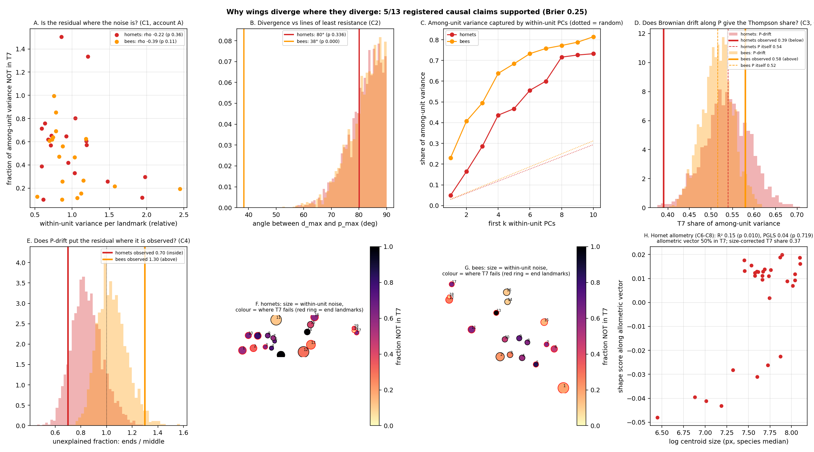

# Why do wings diverge where they diverge? A causal decomposition of the Thompson skew

Scored 2026-10-22 by `thompson/portfolio/groups/why_wings.py`; hypotheses C1-C8 and the protocol were committed beforehand (1da6218f). Hornets: 1,027 wings / 30 species; bees: 615 wings / 42 tribes. 2000 Brownian simulations per group, seed 20261022.

## The question

Thompson (1917, pp. 385-386) proposed 'a mathematical study of ... the deformation of the wing ... from one species to another' and read such deformations causally, as the record of forces during growth. The descriptive runs found that his 7 global grid modes carry 39% of between-species wing variance in hornets (30 Myr) but 56% of between-tribe variance in bees (110 Myr), with the residual central in hornets and at the base/apex in bees. This run asks what produces that skew, using the one causal lever both datasets contain: replicate wings per unit, hence a pooled within-unit covariance P (the direction individuals already vary in), plus a size proxy for hornets.

## Results against the registered accounts

| | Hornets (30 spp, 30 Myr) | Bees (42 tribes, 110 Myr) |
|---|---|---|
| T7 share of among-unit variance (this frame) | 0.389 | 0.580 |
| T7 share of within-unit P (C5) | 0.540 | 0.516 |
| rho(within-unit var, T7-unexplained) per landmark (C1) | -0.22 (p 0.359) | -0.39 (p 0.113) |
| rho(within-unit var, among-unit var) per landmark (descriptive) | 0.62 (p 0.005) | 0.62 (p 0.006) |
| angle d_max vs p_max (C2); random 5th pct / median | 80.1° ; 69.9° / 82.8° | 38.4° ; 70.3° / 83.1° |
| among-unit variance on first 3 within-PCs (C2); random | 0.29 ; 0.088 | 0.49 ; 0.094 |
| p_max share of P / d_max share of D | 0.19 / 0.56 | 0.20 / 0.32 |
| T7 share: P-drift simulation median [5%, 95%] vs observed (C3) | 0.537 [0.448, 0.622] vs **0.389** (below) | 0.515 [0.454, 0.576] vs **0.580** (above) |
| ends/middle unexplained ratio: simulation vs observed (C4) | 0.84 [0.66, 1.07] vs **0.70** (inside) | 1.03 [0.87, 1.25] vs **1.30** (above) |
| tip sampling noise as share of among-unit variance | 1.5% | 1.6% |
| size R² (C6) | 0.146 (perm p 0.0100) | no size |
| size R², phylogenetic GLS (descriptive) | 0.040 (perm p 0.7186); PGLS allometric vector 52% in T7 | - |
| T7 share of allometric vector (C7) | 0.496 | - |
| T7 share after size correction (C8) | 0.371 | - |

## Registered claims

| ID | Account | Group | Statement | Registered P | Verdict |
|---|---|---|---|---|---|
| C1 | A | hornets | The per-landmark fraction of among-unit variance NOT captured by T7 is NOT predicted by per-landmark within-unit variance (Spearman rho <= 0.5 or p >= 0.05). I.e. the residual pattern is not a digitising artefact. | 70% | ✓ |
| C1 | A | bees | The per-landmark fraction of among-unit variance NOT captured by T7 is NOT predicted by per-landmark within-unit variance (Spearman rho <= 0.5 or p >= 0.05). I.e. the residual pattern is not a digitising artefact. | 65% | ✓ |
| C2 | B | hornets | Among-unit divergence is aligned with the within-unit covariance structure: the angle between d_max (leading eigenvector of the among-unit covariance) and p_max (leading eigenvector of pooled within-unit P) is below the 5th percentile of random-direction angles in the tangent space, AND the first 3 within-unit PCs carry more than twice the random-expectation share of among-unit variance. | 70% | ✗ |
| C2 | B | bees | Among-unit divergence is aligned with the within-unit covariance structure: the angle between d_max (leading eigenvector of the among-unit covariance) and p_max (leading eigenvector of pooled within-unit P) is below the 5th percentile of random-direction angles in the tangent space, AND the first 3 within-unit PCs carry more than twice the random-expectation share of among-unit variance. | 55% | ✓ |
| C3 | B | hornets | Brownian motion on the group's tree with rate matrix proportional to P (plus sampling error P/n_u at the tips) reproduces the observed T7 variance share: the observed share lies inside the central 90% of 2000 simulated shares. | 55% | ✗ |
| C3 | B | bees | Brownian motion on the group's tree with rate matrix proportional to P (plus sampling error P/n_u at the tips) reproduces the observed T7 variance share: the observed share lies inside the central 90% of 2000 simulated shares. | 35% | ✗ |
| C4 | B | hornets | The same simulation reproduces the observed residual location: the observed ratio (mean unexplained fraction at the 10 long-axis-end landmarks) / (mean unexplained fraction at the middle landmarks) lies inside the central 90% of simulated ratios. | 50% | ✓ |
| C4 | B | bees | The same simulation reproduces the observed residual location: the observed ratio (mean unexplained fraction at the 10 long-axis-end landmarks) / (mean unexplained fraction at the middle landmarks) lies inside the central 90% of simulated ratios. | 50% | ✗ |
| C5 | B | hornets | The within-unit covariance P is itself less Thompsonian than among-unit divergence: the T7 share of trace(P) is at least 10 percentage points below the T7 share of among-unit variance. | 40% | ✗ |
| C5 | B | bees | The within-unit covariance P is itself less Thompsonian than among-unit divergence: the T7 share of trace(P) is at least 10 percentage points below the T7 share of among-unit variance. | 70% | ✗ |
| C6 | C | hornets | Evolutionary allometry is substantial: log centroid size (pixel, single-lab imaging; species order validated against known body sizes before registration) explains >= 15% of among-species shape variance (multivariate regression, permutation p < 0.05). | 60% | ✗ |
| C7 | C | hornets | The allometric direction is more Thompsonian than divergence in general: the T7 share of the size-regression vector exceeds the overall among-species T7 share (0.388) by at least 10 percentage points. | 60% | ✓ |
| C8 | C | hornets | Removing allometry removes the Thompsonian signal: the T7 share of size-corrected residual shape is at least 5 percentage points below the uncorrected share. | 55% | ✗ |

**5/13 supported. Brier 0.254.**

## Interpretation (written after the run; not pre-registered)

- **Measurement artefact (account A).** Per-landmark digitising noise does not predict where the global grid fails (hornets: rho = -0.22 (p = 0.36); bees: rho = -0.39 (p = 0.11)). The central residual in hornets and the base/apex residual in bees are therefore not where landmarks are imprecise; they are biology.
- **Alignment with the developmental channel, hornets (account B, C2).** The main axis of divergence sits 80° from the main axis of within-unit variation (random pairs: median 83°, 5th percentile 70°); the first three within-unit PCs carry 29% of among-unit variance against a random expectation of 8.8%. Divergence is only weakly channelled by P.
- **Alignment with the developmental channel, bees (account B, C2).** The main axis of divergence sits 38° from the main axis of within-unit variation (random pairs: median 83°, 5th percentile 70°); the first three within-unit PCs carry 49% of among-unit variance against a random expectation of 9.4%. Divergence follows the lines of least resistance.
- **Does drift along P suffice, hornets (C3-C5)?** Brownian motion with rate matrix ∝ P gives a T7 share of 0.54 [0.45, 0.62]; observed 0.39 (below). The ends/middle residual ratio under P-drift is 0.84 [0.66, 1.07]; observed 0.70 (inside). P itself is 54% Thompsonian against 39% for divergence. Divergence is LESS global than P-drift produces: change is more local than the developmental channel predicts, consistent with selection on particular veins/cells.
- **Does drift along P suffice, bees (C3-C5)?** Brownian motion with rate matrix ∝ P gives a T7 share of 0.52 [0.45, 0.58]; observed 0.58 (above). The ends/middle residual ratio under P-drift is 1.03 [0.87, 1.25]; observed 1.30 (above). P itself is 52% Thompsonian against 58% for divergence. Divergence is MORE global than P-drift produces (marginally: observed sits just past the 95th percentile, P(sim ≥ obs) = 0.037): drift along the developmental channel accounts for most of the Thompson share, with a small excess that needs size or function (accounts C/D).
- **Allometry, hornets (account C).** Log size explains 15% of among-species wing shape (permutation p = 0.010); under phylogenetic GLS, which discounts the Vespa-vs-Vespula/Dolichovespula size contrast visible in panel H, it is 4% (p = 0.719; descriptive, not registered). The allometric direction is 50% inside Thompson's 7 modes (52% for the PGLS vector) against 39% for divergence overall; size-corrected divergence is 37% Thompsonian. C6 misses the registered 15% threshold by 0.4 points; C7 passes its 10-point margin (+10.6); more importantly the ordinary-regression signal disappears under PGLS, so what the raw regression picked up is the one deep size contrast in the tree (large Vespa vs small Vespula/Dolichovespula) rather than size tracking shape along branches. Size is not the cause of the hornet pattern.
- **Synthesis.** Three levels, three answers. Within a species, hornet wing variation is 54% in Thompson's global modes: growth variation is Thompsonian, as he assumed. Between hornet species (30 Myr) divergence is 39%, BELOW what drift along that channel would give (45-62%) and not aligned with p_max (80°): what separates close species is local vein/cell geometry that lies off the developmental ridge, the signature of lineage-specific change (selection on particular cells, or local developmental shifts) rather than of accumulated growth variation. Across bee families (110 Myr) divergence is 58% global, aligned with the within-unit channel (38°, 49% of variance on three within-PCs), and marginally above the drift band (45-58%). The causal reading: local between-species differences do not compound over time (they are bounded, reversible or idiosyncratic), while global proportion change accumulates along the lines of least resistance; integrate for 100 Myr and the compounding part is all that is left. Thompson's grid describes deep divergence because deep divergence is the developmental channel integrated over time, not because it is a different kind of change. Per landmark, the amount of among-unit change tracks the amount of within-unit variation in both groups (Spearman 0.62 hornets, 0.62 bees; descriptive, not registered): evolvability predicts divergence (Hansen & Houle 2008) at both time scales even where its direction does not. Caveat on the asymmetry: hornet P is within-species; bee P is within-tribe and so contains shallow among-genus divergence, which makes the bee alignment partly circular and the bee test weaker than the hornet one. A within-species P for bees (per-species replicate wings) is the one dataset that would make the comparison clean. Size in hornets: the raw regression gives 15% (p = 0.010) but phylogenetic GLS gives 4% (p = 0.72); the signal is the single Vespa-vs-Vespula size contrast, not size tracking shape along branches. Thompson's default explanation for a global grid change, growth and size, is therefore not what produces the hornet pattern, and the allometric direction being ~50% Thompsonian only says that the one deep contrast in the tree is global like everything deep. What remains for the local, off-channel differences between close hornet species is lineage-specific selection on particular cells (flight or mating function), which needs flight-ecology covariates to test. For bees, body size per tribe is still worth obtaining, but the hornet result lowers the prior that it will explain the deep-time global change.

## Method notes

- Frame: all wings GPA-aligned, unit means re-aligned to the consensus by OPA, every wing then OPA'd onto the consensus; D = unit means − consensus, W = wing − unit mean; the 4 similarity directions are projected out of both. T7 shares in this frame differ by a few points from the descriptive runs (which used a GPA of unit means).
- P = pooled within-unit SSCP / (N_wings − n_units). For hornets it is within-species (growth/individual variation). For bees 'within-unit' is within-tribe and so mixes genera: bee P contains shallow divergence, which inflates the bee C2 alignment and makes the bee P-drift null partly circular. Treat the bee half as weaker.
- Simulation (C3/C4): X = σ L_C G L_Pᵀ + tip noise with covariance P/n_u, where C is the MRCA-height matrix of the kept tips (Grafen for hornets, dated for bees) and σ² is set so the simulated among-unit variance matches the observed; T7 share and ends/middle ratio are scale-free.
- Allometry: centroid size in pixels from single-lab imaging (Perrard et al. 2014); species ordering checked against known body sizes before registration (soror, mandarinia, ducalis largest; Vespula smallest; within-species CV 5-10%).
- Per-group arrays (simulated shares, null angles) are in `thompson/portfolio/results/why_wings.json`.
