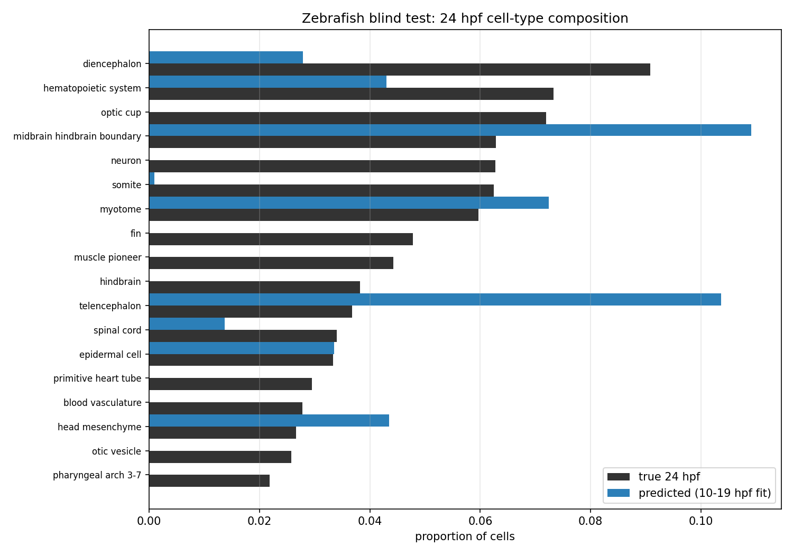

# Blind test results: Zebrahub zebrafish 24 hpf composition

Scored with `--unblind` against predictions locked in `ZEBRAFISH_BLIND_PREREGISTRATION.md` (manifest commit `6bad19d33c1c`; prediction + sealed-file hashes verified before opening).

| Hypothesis | Result | Verdict |
|---|---|---|
| Z1 (primary): TVD primary < both baselines | 0.661 vs last19 0.621, mean 0.757 | ✗ not supported |
| Z2 (primary): >=60% of classes >=2% within factor 2 | 26% of 19 classes | ✗ not supported |
| Z3: emergent-class mass < 0.25 | 0.440 | ✗ not supported |
| Z4: 95% interval coverage >=70% and median width <=0.50 (classes >=1%) | 50% of 24, median width 0.079 | ✗ not supported |

Per-class true vs predicted values are in `zebrafish_blind_results.json`. Label maturation (neural plate -> neural tube etc.) should be inspected per-class before interpreting Z1/Z2 biologically.
