# MorphoEval — faithfulness checkpoints for the morphology simulations

Sibling of **BioEval** (Bioinformatics Paper Evaluator, Zenodo concept DOI
[10.5281/zenodo.20567719](https://doi.org/10.5281/zenodo.20567719)) and
**NeuroEval** (Zenodo concept DOI
[10.5281/zenodo.20622878](https://doi.org/10.5281/zenodo.20622878)). Those score *papers* on a
versioned, weighted rubric; MorphoEval scores *our own simulation scripts* for
faithfulness to the organism and to the source model, and records each scoring
as a knowledge graph so a simulation can be **checkpointed and re-scored** after
every change.

```
morphoeval/
  rubric.yaml                      versioned rubric (7 weighted dimensions, 0-100)
  audits/<date>-<name>.yaml        one audit = scores + evidence + references + checkpoint
  measure_outputs.py               morphology snapshot: sha256 of rendered outputs + morphometrics
                                   -> audits/<audit>.measurements.yaml (merged into the nanopubs)
  build_morphoeval_kg.py           audit -> ProbKnow nanopubs (.trig) + merged .ttl + REPORT.md
  sign_morphoeval.py               sign / publish (test -> prod) -> kg/<audit-id>/signed/ + published.json
  check_signed.mjs                 independent trusty+signature verification (@nanopub/sign, Rust/WASM)
  vendor/probknow-1.3.ttl          vendored ontology (1.x) for the offline --conform check
  vendor/delphi-2.0.ttl            Project Delphi ontology 2.0 (agent/model split; deprecated terms marked)
  vendor/templates/*.trig          the ProbKnow Space's governed template nanopubs (shape check);
                                   *-2.0-staged.STAGEDxx.trig = unpublished 2.0 sources, offline check only
  kg/<audit-id>/                   generated graph for that audit (commit it: it IS the checkpoint)
```

## Rubric 0.1.0

| group | sub-axis | dimension | weight |
|---|---|---|---:|
| faithfulness | model-implementation (30) | model-fidelity — code implements the published model as stated | 20 |
| faithfulness | biological-validation (40) | **specimen-match** — output resembles real specimens / authors' figures | **25** |
| faithfulness | model-implementation (30) | parameter-expressivity — each morphospace parameter visibly controls its feature | 10 |
| faithfulness | biological-validation (40) | morphometric-validation — measured quantities compared to specimens/literature | 15 |
| reproducibility | reproducibility (30) | source-traceability — DOI/PMID/repo/data resolvable | 10 |
| reproducibility | reproducibility (30) | code-traceability — code steps map to source equations/sections | 8 |
| reproducibility | reproducibility (30) | repro-package — pins, seeds, documented run, sane environment | 12 |

To avoid conflating faithful code with valid biology, `faithfulness` (weight 70) is decomposed and reported along two separate sub-axes: **model-implementation fidelity** (`impl.`, weight 30 = `model-fidelity` 20 + `parameter-expressivity` 10) and **biological/empirical validation** (`bio.`, weight 40 = `specimen-match` 25 + `morphometric-validation` 15), alongside **reproducibility** (`repro.`, weight 30).

**Score semantics (`[0, 100]` uncalibrated ratings vs probabilities):** MorphoEval scores are uncalibrated, criterion-referenced ratings on `0–100`, not probabilities ($s = 76$ does not mean $P(\text{faithful}) = 0.76$). When serialized into the governed ProbKnow rubric-assessment template (`RAOAK6Fe`), `score / 100` is written to `pk:hasScore` — defined in ontology ≥ 1.2 as an uncalibrated score on the unit interval, never `pk:hasProbability` ([project-delphi-ontology #12](https://github.com/fractastical/project-delphi-ontology/issues/12)) — and `overall / 100` to the claim's `pk:weightOfEvidence` as the same rescaling (omit it via `--omit-probability`).

**Non-applicable (`not_applicable`) dimensions and baseline-50 shrinkage:** Rule carried over from the siblings: **score only what the evidence supports** — every score needs at least one code locus, and scripts that were not inspected are listed `unevaluated` with no scores. When a dimension is structurally inapplicable (`not_applicable: true`), substituting `50` into the 100-weight sum produces $\bar{s}_{\text{pad}} = (1 - \alpha)\bar{s}_{\text{app}} + 50\alpha$, where $\alpha = w_{\text{NA}} / 100$. Mathematically, substituting `50` is **not** neutral: it shrinks scores toward `50` (penalising scripts with $\bar{s}_{\text{app}} > 50$ and rewarding scripts with $\bar{s}_{\text{app}} < 50$). Only weight renormalisation over applicable dimensions ($\bar{s}_{\text{app}}$) is mathematically neutral; MorphoEval therefore reports **both** the applicable-only renormalised score (`app.`) and the baseline-50 padded score (`pad.`).

## The cycle

The forms in question are the shapes of bodies — how they arise in development and come back in regeneration — and most of the recent papers here share one idea about it: that beside genes and chemical morphogens, a tissue stores its pattern bioelectrically, as a map of membrane voltages shared through gap junctions, so that changing the voltage changes what regrows (the two-headed planarian of the Planform database and the Cervera–Levin–Mafe model). The top-level README opens with a short synopsis. Tier A is how such a form gets into the repository: it starts with a person scouting — choosing a
paper, dataset or claim worth the work and pointing the agent at it — and ends in one of three kinds of script
(reproduce the paper's model from its equations, decode the authors' formal encoding into form, or test a
published claim against measurements). Between the tiers sits what the scripts produce — box 6, the
fifteen animations, each labelled with its paper — which is what tier B scores; a person reads the scores
and decides what to fix or where to go next; the builder agent then re-works the script — its fidelity to
the paper, its sources, its checks — and the fix runs back through box 6 into the script (👤 marks the two
places people decide). Two agent roles are meant to be distinct: the **builder** that writes and re-works the
code and the **assessor** that scores it. For the first nine audits the same model filled both (`claude-fable-5-1`, Anthropic); on 2026-10-17 the Cervera–Levin–Mafe script was
scored across two rounds by a model from another company (`gpt-5.6-sol`, OpenAI), given the rubric, the script and the
fixtures and no opinions, and it found defects the builder had not — an unused morphospace axis, a CSV
that doubles the simulated displacement, a wrong PMID (44.9), and after remediation (55.6) two further threshold/legend bugs the builder had
introduced and overlooked. In addition, a complete 10-script second-assessor pass (`2026-10-17-blinded-sample-audit.yaml`, 80 signed nanopubs) was scored by `gemini-4-argon` (Google) across all 10 active evaluated scripts so that **no script relies solely on its builder grading itself**, showing strong rank-order concordance on overall scores across all 10 scripts (Spearman $\rho = 0.891$, Kendall $\tau = 0.778$, Pearson $r = 0.920$ on padded scores; $\rho = 0.903$ on applicable-only scores; and exact $\rho = 1.00$, $\tau = 1.00$ on the initial 5-script strictly blinded subset; dimension-level $\rho = 0.796$, $r = 0.813$ across all 70 pairs, $\text{MAD} = 10.4$ points) while surfacing concrete defects the builder had missed (e.g. a 65-character SHA-256 typo in `2014-lobo-limbform-morphology.py`). The graph takes any assessor's nanopubs on the same
hypotheses; further remediation is tracked in
[morpholib#1](https://github.com/fractastical/morpholib/issues/1). Each pass pins a commit; scores are 0–100 uncalibrated ratings per dimension with a weighted mean overall; published
nanopubs are immutable and re-scores supersede them. The same figure as an image (for the PDF report
and anything that cannot render Mermaid) is `docs/media/morphoeval_pipeline.png`, drawn by
`morphoeval/report/draw_pipeline.py`; in it box 6 is the reproductions' own animations in
`docs/media/`, each labelled with its paper (author, year, venue, data source). `draw_pipeline.py --gif` writes `morphoeval_pipeline.gif`, the same figure with
the thumbnails playing (used at the top of the root README); the PDF report uses the still ([`morphoeval_pipeline.png`](../docs/media/morphoeval_pipeline.png)).

```mermaid
flowchart TB
    classDef build fill:#dbeafe,stroke:#334155,color:#1e293b
    classDef eval fill:#fde68a,stroke:#334155,color:#1e293b
    classDef pub fill:#bbf7d0,stroke:#334155,color:#1e293b
    classDef loop fill:#fecaca,stroke:#334155,color:#1e293b

    subgraph A["A &nbsp;Making a reproduction — reproduce the paper's model · decode the authors' encoding · test a published claim"]
        direction LR
        SC["👤 1 Scout<br/>a person finds a model of form worth the work —<br/>a classic paper, an open dataset, an untested claim,<br/>a score that is too low — and points the agent at it"]:::build
        P["2 Paper<br/>the model as the authors published it: a set of<br/>equations, a database of drawings, or a claim"]:::build
        S["3 Formal source<br/>the paper's own numbers and records, fetched or<br/>copied in and locked to a fingerprint (SHA-256),<br/>so a changed file is refused"]:::build
        R["4 Pin the rules<br/>prose → exact rule, tested on every record;<br/>the authors' code, where it exists, is read to<br/>settle what they meant, never copied"]:::build
        X["🤖 builder · 5 Script<br/>one program per paper: reproduces, decodes or tests,<br/>then draws, measures and checks itself<br/><small>&lt;year&gt;-&lt;author&gt;-&lt;model&gt;.py</small>"]:::build
        SC --> P --> S --> R --> X
    end

    O["6 Output &amp; compare<br/>what each script produces — its own figure and animation<br/>(the fifteen in docs/media/) — set beside the authors' figures<br/>or real specimens; distinct forms must come out distinct.<br/>This is what gets scored."]:::build
    X -- writes --> O

    subgraph B["B &nbsp;Auditing it — the MorphoEval cycle"]
        direction LR
        AU["🤖🤖 assessors · 7 Dual-agent audit<br/>two assessor agents from different companies —<br/>not just the builder scoring itself — independently score<br/>7 questions (0–100) with line-pinned evidence at one commit<br/><small>audits/&lt;date&gt;-&lt;name&gt;.yaml</small>"]:::eval
        M["8 Measure<br/>outputs hashed and measured independently<br/>against specimens or the paper:<br/>numbers, not opinions<br/><small>measure_outputs.py</small>"]:::eval
        BG["9 Write as claims<br/>each score becomes one small machine-readable<br/>statement: 'this script reproduces X' — what rubric score,<br/>says who, on what evidence, under what licence<br/><small>build_morphoeval_kg.py (RDF, ProbKnow templates)</small>"]:::pub
        PU["10 Sign &amp; publish<br/>each statement is signed and put on a public<br/>network of servers under a permanent address;<br/>test network first, then for real<br/><small>sign_morphoeval.py</small>"]:::pub
        G[("11 Public record<br/>anyone can look a score up, cite it, check its<br/>signature or query across all audits<br/><small>Nanopub Query · kg/&lt;audit&gt;/REPORT.md</small>")]:::pub
        T["👤 12 Remediate<br/>what the audit found wrong becomes a to-do list;<br/>a person picks, the builder agent re-works the<br/>script, and the touched scores are judged again<br/><small>GitHub issue #1</small>"]:::loop
        AU --> M --> BG --> PU --> G --> T
    end

    O -- scored, with evidence --> AU
    T -- "👤 a person picks what to fix; 🤖 the builder re-works the script<br/>(fidelity, sources, checks) → outputs re-made → 🤖 the assessor judges the touched scores again and published anew;<br/>the old statements stay on record, marked as replaced (nothing published is edited)" --> X
    G -. other assessors (models, people) may publish their own<br/>assessment of the same hypotheses .-> BG
```




*What a nanopublication is:* the smallest publishable unit of science — one statement (here "this script's reproduction of Raup 1966 scores 64.1/100 on the MorphoEval rubric (mostly faithful)") packaged with who asserted it, when, on what evidence and under what licence, cryptographically signed, and stored on a public network of servers under a permanent address anyone can cite or fetch. Once published it cannot be edited; a re-score publishes a new statement that points at the one it replaces, so the history stays visible, and other assessors can publish their own assessment of the same hypothesis next to ours.

## Workflow

```bash
# 1. validate an audit against the rubric (weights, ranges, evidence files, refs)
python3 morphoeval/build_morphoeval_kg.py morphoeval/audits/2026-10-13-morphology-audit.yaml --check

# 2. snapshot the morphology: fingerprint the rendered outputs and measure them
#    (re-runs the wing script; ~2 min). Outputs not on disk are reported, never invented.
python3 morphoeval/measure_outputs.py morphoeval/audits/2026-10-13-morphology-audit.yaml

# 3. build the graph, check ProbKnow conformance, run a demo SPARQL ranking
#    (--supersede: changed nanopubs get npx:supersedes <URI in kg/<audit>/published.json>)
python3 morphoeval/build_morphoeval_kg.py morphoeval/audits/2026-10-13-morphology-audit.yaml --conform --query --supersede

# 4. after fixing a simulation: copy the audit file to a new date, re-score the
#    affected dimensions with new line evidence, bump `checkpoint.commit`, and
#    build with --supersede-from <previous kg dir>: same-named nanopubs get
#    npx:supersedes <the URI published from that dir>; nanopubs whose assertion
#    and provenance are unchanged (e.g. the rubric) are not re-emitted.
#    Diff kg/<old>/REPORT.md against kg/<new>/REPORT.md to see the delta.
python3 morphoeval/build_morphoeval_kg.py morphoeval/audits/2026-10-14-morphology-audit.yaml \
    --conform --query --supersede-from morphoeval/kg/2026-10-13-morphology-audit

# 5. a new audit of other scripts: the rubric nanopub lives in one chain
#    (published from kg/2026-10-14-limbform-audit); --rubric-from drops this
#    audit's 00-rubric.trig when it is identical to that dir's, without
#    treating same-named simulation nanopubs as re-scores (unlike --supersede-from)
python3 morphoeval/build_morphoeval_kg.py morphoeval/audits/2026-10-18-phyllotaxis-audit-v2.yaml \
    --conform --rubric-from morphoeval/kg/2026-10-14-limbform-audit
```

## What is in the graph (ProbKnow ontology v1.1)

No MorphoEval-specific namespace. Everything is expressed in the
[ProbKnow / Project Delphi ontology](https://github.com/fractastical/probknow-ontology)
(`pk:` = `https://w3id.org/probknow/ontology/`, individuals under
`pkr:` = `https://w3id.org/probknow/resource/`), vendored in
`vendor/probknow-1.3.ttl` for an offline conformance check (`--conform`). This
puts simulation checkpoints in the same probabilistic knowledge graph as the
Levin-lab claims, so Science Oracle queries work unchanged.

The IRI bases are not hard-wired: if the ontology project renames (e.g. to a
ScienceOracle namespace), set in the audit YAML

```yaml
audit:
  ontology:
    base: https://w3id.org/scienceoracle/ontology/
    resource_base: https://w3id.org/scienceoracle/resource/
```

re-vendor the renamed `.ttl`, and rebuild; `--conform` compares terms by local
name so it works across the rename. Until the rename exists upstream the
default (`probknow`) is the only spec the output can conform to.

Domains: `pk:domain pkr:domain/<slug>` + `rdfs:label` in pubinfo is all a
domain is (no registry); `claims-by-domain.rq` and the Oracle's domain list
simply count them, so `morphogenesis` appears as a new bucket once published.

Since 2026-10-15 every nanopub is shaped by the **governed templates of the
ProbKnow Space** (https://w3id.org/spaces/probknow) and links them from pubinfo
(`nt:wasCreatedFromTemplate` / `…ProvenanceTemplate` / `…PubinfoTemplate`), so
Nanodash renders each one with its form and the Space counts it as conformant.
The template nanopubs are vendored in `vendor/templates/` and `--conform` checks
every assertion, provenance and pubinfo graph against the statements of the
template it links (placeholder prefixes, datatypes, the 0–1 regex on
scores, required/repeatable statements). Earlier nanopubs (2026-10-13 /
2026-10-14) used a freer shape and are being re-issued with `npx:supersedes`.

Since 2026-10-19 the builder targets the **rubric assessment** template
(`RAOAK6Fe`), the **rubric** template (`RAbjeus1`), claim template v3
(`RApE-nGp`) and provenance template v2 (`RAaYeFYF`), following tkuhn's review
in [project-delphi-ontology #12](https://github.com/fractastical/project-delphi-ontology/issues/12):
rubric scores are `pk:hasScore` (ontology ≥ 1.2), never `pk:hasProbability`;
the hypothesis node is gone (the (claim, dimension) pair plays that role);
assessment IRIs no longer carry the audit id, so a re-score supersedes the same
resource instead of leaving the old one dangling. The nanopubs published before
that date (generic LLM-assessment template `RAku3DIN`, `pk:hasProbability`)
are to be re-issued with `--supersede`; `vendor/templates/` keeps their
templates so `--conform` still checks them.

| MorphoEval notion | ProbKnow term (template) |
|---|---|
| "script S faithfully reproduces organism O under source model P" | `pkr:claim/morphoeval-<sim>` a **`pk:Claim`** (claim template v3): `rdfs:label`, `dct:description`, `pk:context` (scripts, output, organism, commit, environment, non-DOI sources) · `pk:derivedFromPaper <doi>` · `pk:hasAssessment` → the 8 assessments · `dct:subject` each script as a `schema:SoftwareSourceCode` (`schema:codeRepository`, `schema:version` = commit, `schema:programmingLanguage`) · `pk:weightOfEvidence` = overall/100 (unit-interval rescaled uncalibrated rubric score, optional via `--omit-probability`) |
| one rubric score | `pkr:assessment/morphoeval-<sim>-<dim>` a **`pk:LLMClaimAssessment`** (rubric-assessment template; stable across re-scores; `-second-assessor-<assessor-id>` suffix for an independent second assessor) · `<claim> pk:hasAssessment <it>` · `dct:subject pkr:concept/morphoeval-0.1.0-<dim>` · `pk:assessmentType "morphoeval/0.1.0/<dim>"` · `pk:assessedBy pkr:model/<assessor>` a `pk:Model` · `pk:hasScore` = score/100 (uncalibrated rubric score on the unit interval, not $P(\text{faithful})$; required by the template) · `pk:hasVerdict` band · `dct:date` · `dct:description` = rationale · `pk:hasEvidence` → one `pk:EvidenceItem` per evidence entry (`rdfs:label` file + line range, `dct:description` note, `prov:wasDerivedFrom` the commit-pinned GitHub `#L<a>-L<b>`) and, on `morphometric-validation`, one per measurement (`schema:PropertyValue` with `schema:name` / `schema:value` / `schema:unitText` / `schema:measurementTechnique` and its `schema:valueReference`) · `pk:evidenceAgainst` for entries marked `supports: false` |
| checkpoint | `…-overall`, the same template, with the rubric itself as `dct:subject` and `pk:assessmentType "morphoeval/0.1.0/overall"`; remediation items and open needs as `pk:evidenceAgainst` |
| the rubric | `pkr:concept/morphoeval-rubric-0.1.0` a `pk:Concept` (rubric template; `skos:narrower` one `pk:Concept` per dimension, the dimension id in its `dct:description`) |
| provenance | "Extracted from a paper by ProbKnow" template v2: `prov:wasAttributedTo` the model and the publisher, `prov:wasDerivedFrom` each source (DOI, dataset or repository URL) with `dct:title` / `dct:date` (the parenthesised year of `venue`, or an explicit `year`), `rdfs:seeAlso` the tracking issue; the rubric uses the generic "Attributed to" template |
| the scorer | `pkr:model/<assessor-id>` (`claude-fable-5-1`, `gpt-5.6-sol`, or `gemini-4-argon`) a `pk:Model` (`dct:identifier`, `prov:actedOnBehalfOf` the publisher's ORCID, in the assertion) |

### Project Delphi ontology 2.0 (`--ontology-version 2.0`)

[Ontology 2.0](https://github.com/fractastical/project-delphi-ontology/blob/main/ONTOLOGY.md#deprecated-in-20--migrating)
deprecates `pk:assessedBy` (→ `prov:wasAttributedTo`), `pk:Model` (→ `prov:SoftwareAgent` for the
assessor + `pk:usesModel` → `pk:LanguageModel` for the model it runs) and `pk:derivedFromPaper`
(→ `prov:wasDerivedFrom`). Published nanopubs keep their meaning (the deprecated terms retain
subsumption axioms); this is about new output. Under `--ontology-version 2.0` (or
`audit.ontology.version: "2.0"`) the builder emits, per assessment:

```turtle
pkr:assessment/morphoeval-<sim>-<dim>  prov:wasAttributedTo pkr:agent/<agent-id> .
pkr:agent/<agent-id>  a prov:SoftwareAgent ; rdfs:label "<assessor.label>" ;
    prov:actedOnBehalfOf <ORCID> ; pk:usesModel pkr:model/<assessor.id> .
pkr:model/<assessor.id>  a pk:LanguageModel ; rdfs:label "<assessor.model_label>" ;
    dct:identifier "<assessor.id>" ; foaf:homepage <assessor.homepage> .
```

`<agent-id>` defaults to `morphoeval-<audit-id>-<assessor.id>` (one agent per audit pass and
model, so a Pass 2 and a Pass 3 referee over the same model are distinct agents; override with
`assessor.agent.id` / `assessor.agent.label`); the model label defaults to `assessor.label` up to
its first parenthesis (override with `assessor.model_label`). The claim's sources move to
`prov:wasDerivedFrom`; `pkr:model/<id>` keeps denoting the model.

**Status (morpholib #23):** the 2.0 claim and rubric-assessment templates are staged upstream
(`project-delphi-ontology/nanopubs/src/04-…`, `18-…`) but not yet signed and published, so a 2.0
build fails closed until their trusty IRIs are supplied — in
`vendor/templates/delphi-2.0-template-iris.json` (`{"claim": "...", "rubric-assessment": "..."}`)
or with `--template-iri claim=<IRI> --template-iri rubric-assessment=<IRI>`. Until then
`--allow-staged-templates` links the vendored staged sources under placeholder IRIs so the 2.0
shape can be exercised offline with `--conform` (which also rejects any term 2.0 deprecates in a
2.0-templated file); `sign_morphoeval.py` refuses such files. Once the IRIs are live: drop them
into the json, vendor the signed templates as `*.<first 8 chars of RA…>.trig`, delete the
`*-staged.*` copies, and make `"2.0"` the default in `build_morphoeval_kg.py`.

Evidence is back as nodes: the rubric-assessment template has a grouped
statement for `pk:EvidenceItem`s (code loci, generated outputs, measurements
with their reference values), so they are no longer folded into a comment
literal; the audit YAML and measurements sidecars are unchanged.

Verdict bands on the 0–100 scale: ≥80 *faithful* · 60–79 *mostly faithful* ·
40–59 *partially faithful* · 20–39 *unfaithful* · <20 *not faithful*.

Each nanopub is one `.trig` on the nanopub temp base
`http://purl.org/nanopub/temp/np001/` (`sub:Head|assertion|provenance|pubinfo`),
with pubinfo `rdfs:label` · `dct:created` (full UTC timestamp; set
`MORPHOEVAL_CREATED` to pin it for a reproducible rebuild) · `dct:creator <ORCID>`
· CC BY 4.0 · `npx:hasNanopubType` · `npx:introduces` · `pk:domain
pkr:domain/<slug>` (`morphogenesis`; `levin-lab` for the planarian script) · the
template links. Before a rebuilt nanopub supersedes a published URI the builder
resolves that URI's current head with Nanopub Query's `get-latest-version-of-np`
(`--no-resolve-heads` skips it), so version chains never fork. Signing mints the
trusty `https://w3id.org/np/RA…` URI. Scripts marked `unevaluated` produce no
nanopubs (nothing has been assessed). `morphoeval_<audit-id>.ttl` is the flat
merge of all assertion graphs for local SPARQL.

## Signing and publishing

```bash
# sign with ~/.nanopub/profile.yml -> kg/<audit-id>/signed/*.trig + kg/<audit-id>/published.json
python3 morphoeval/sign_morphoeval.py morphoeval/kg/2026-10-13-morphology-audit
# verify independently (Rust/WASM nanopub toolkit; `npm install @nanopub/sign` once, outside the repo
# or anywhere above it; or set NANOPUB_SIGN_DIR)
node morphoeval/check_signed.mjs morphoeval/kg/2026-10-13-morphology-audit/signed/*.trig
# publish: test registry first, production only after review (the tool refuses prod before test)
python3 morphoeval/sign_morphoeval.py morphoeval/kg/2026-10-13-morphology-audit --publish test
python3 morphoeval/sign_morphoeval.py morphoeval/kg/2026-10-13-morphology-audit --publish prod
```

Signing is deterministic for a given build (the `dct:created` stamp is in the
file), so sign-only, test and prod yield the same `https://w3id.org/np/RA…`
URIs: what was verified on the test registry is byte-for-byte what goes to
production. `published.json` records each nanopub's URI and furthest stage
(`null` / `test` / `prod`); the signer refuses to re-sign a file whose content
no longer matches its recorded URI, and after each POST it fetches the nanopub
back from the registry it posted to. Published nanopubs are immutable; a
re-score is a new assessment nanopub (`npx:supersedes` the old one), not an edit.

Tooling notes: nanopub-py 2.1.0 on Python 3.14 cannot read `profile.yml`
(the signer builds the `Profile` directly) and its `has_valid_trusty` verifier
is broken (it rejects nanopub-java-signed published nanopubs too), which is why
verification goes through `@nanopub/sign`. `nanopubs/np_utils.py check` is
broken against nanopub-py 2.1 for the same reason. nanopub-py's `publish()` is
not used either: it re-serialises through rdflib, which turns the plain-decimal
`xsd:double` literals the hash was computed over into exponent form, so the
signer posts the signed text verbatim. The registry URL is chosen explicitly in
the signer (nanopub-py only switches to the test registry on its own copy of
the config; reading `conf.use_server` from the outside posts to production,
which is how the 10 Limbform nanopubs of 2026-10-15 reached production
directly — content already verified, but the test step was skipped).

**Status (2026-10-13):** all 46 nanopubs of audit `2026-10-13-morphology-audit`
are **published on the production nanopub network** (`https://w3id.org/np/<RA…>`,
URIs in `kg/<audit>/published.json`), after the same bytes were verified on the
test registry. Earlier test-only iterations (first versions without the
morphology snapshot, and their superseding second versions) are recorded in
`kg/<audit>/published.test-scratch.json`; they exist only on the test registry.
Rubric: https://w3id.org/np/RAjd9dIu9uNVgvT4npxJgWwL6cbp8GCsy3gK86Qkj-iH4

**Re-score (2026-10-14):** the planarian simulation was rewritten
(`2013-lobo-planform-morphology.py`, decoding the Planform region graph
exactly) and re-audited as `2026-10-14-morphology-audit` at commit `161f269`.
Its 9 new nanopubs (claim, 7 dimensions, overall) are on production and each
carries `npx:supersedes` pointing at the 2026-10-13 nanopub it replaces; the
rubric nanopub was unchanged and was not re-issued. The other simulations were
not touched and their 2026-10-13 nanopubs stand. Both audits' measurements
sidecars (`audits/*.measurements.yaml`) pin the rendered outputs by sha256.

**Odonata audit (2026-10-14):** `2026-eshghi-odonata-wing-cells.py` — a data
comparison rather than a generative model, so `parameter-expressivity` is
marked `not_applicable` (neutral 50) — audited as `2026-10-14-odonata-audit`
at commit `fbbcaf6`: overall 76.0. Its 9 nanopubs are on production; the
rubric nanopub was again reused, not re-issued.

**Template conformance (2026-10-15):** following Tobias Kuhn's review on
[project-delphi-ontology#1](https://github.com/fractastical/project-delphi-ontology/issues/1)
(the 64 nanopubs above used declared terms but linked no governed template and
carried `00:00:00` timestamps), the builder now emits the ProbKnow Space's
template shapes with template links and full timestamps (see above). The first
audit published this way is **Limbform** (`2014-lobo-limbform-morphology.py`,
`2026-10-14-limbform-audit` at commit `747c57f`): overall 71.3, 10 nanopubs on
production, and its rubric nanopub
(https://w3id.org/np/RAhBMChdpmgS_yBfy8cfYXpfKktqlUD72A9bxZzvWDkYM) supersedes
the original rubric (whose text is unchanged; only the shape and timestamp
differ). The second is the **C. elegans** audit
(`2015-santella-wormguides-celegans.py`, `2026-10-15-celegans-audit` at commit
`2864784`): overall 67.7, 9 nanopubs (rubric reused), published to the test
registry first with the fixed signer, verified with `check_signed.mjs` and
fetched back from both registries before going to production; overall claim
https://w3id.org/np/RASUT7taw502ymt3A17lN_bXMn4rC1HY3FNs1ai8YkZSQ. It was
re-scored the next day (`2026-10-16-celegans-audit` at commit `303a87e`,
overall 70.2) after the script's calibration was moved from the nuclear cloud
to the atlas's own eggshell mesh; only model-fidelity (75 → 80), specimen-match
(60 → 62) and morphometric-validation (65 → 72) changed, the other four
dimensions keep their rationales with updated line numbers. The 9 new nanopubs
`npx:supersedes` the 2026-10-15 ones (built with `--supersede-from
morphoeval/kg/2026-10-15-celegans-audit --supersede-from
morphoeval/kg/2026-10-14-limbform-audit`, so the shared rubric is not
re-emitted); overall claim
https://w3id.org/np/RAqDf8b5w5WNe3Chr8OWp5uUyU8U1Bz5BrbGdamyd4BOU.

The third is the **Thompson** audit
(`thompson/1917-thompson-scarus-pomacanthus.py`, `2026-10-16-thompson-audit`
at commit `3cf7f8c`): overall 70.2, 9 nanopubs (rubric reused via
`--supersede-from morphoeval/kg/2026-10-14-limbform-audit`), test registry →
`check_signed.mjs` 9/9 → fetched back 9/9 → production; overall claim
https://w3id.org/np/RAjJx_KHiAAaPSxjsoYOJaFSU1JYmDUswVaRLmka2NIM0. It is the
first audit of a data analysis that tests a historical claim rather than of a
model that generates form: Thompson's *Scarus* → *Pomacanthus* "system of
coaxial circles" (1917, p. 749) is read as a Möbius map, fitted by least
squares to 17 homologous landmarks on 22 *Scarus* and 9 *Pomacanthus* species
(Claverie & Wainwright 2014 via Friedman et al. 2019, CC0, vendored with a
SHA-256 pin), and found to explain 1 % (isogonal) to 32 % (oblique) of the
Procrustes distance, against 31 % for a plain affine map, with a residual twice
the within-genus spread. The rubric is read as for the other data-analysis
audits (the "model" is Thompson's family of grids, the "output" the fish it
carries); parameter expressivity is scored as applicable (55) because the family
has constants whose effect is shown, unlike the decoders where it is neutral.
Building this audit exposed a builder bug: `plain_doubles()`, which rewrites
rdflib's exponent-form doubles to plain decimals, also rewrote `1e-17` inside
a description string; it and the matching conformance check now skip string
literals (no previously built checkpoint changes).

**Thompson re-score (2026-10-17-thompson, 70.2 → 76.6):** the audit's second
remediation item — test the outline Thompson deformed, not 17 points — was
done at commits `9852075`/`232e8f8`. The script fetches two CC-licensed
Wikimedia Commons photographs (a collected *Scarus ghobban*, CC BY 4.0; a
living *Pomacanthus semicirculatus*, CC BY 2.0; SHA-256-pinned, cached, not
vendored), segments their silhouettes, registers each to its species' landmarks
by two anchors the silhouette gives, fits the five families to the species'
landmarks and carries the parrotfish silhouette with each. No landmark-fitted
deformation beats the no-deformation baseline on the outline (IoU 0.662 vs
affine 0.652, Möbius 0.645, oblique coaxial 0.618, thin-plate spline 0.629);
the sidecar re-derives the IoU with a different rasteriser (agreement 0.0001).
Model fidelity 72 → 78, specimen match 55 → 72, morphometric validation
82 → 86, source traceability 90 → 92, code traceability 78 → 80; parameter
expressivity and repro package unchanged. Built with `--supersede-from` the
2026-10-16 Thompson, Limbform and Raup dirs (rubric reused), test registry →
`check_signed.mjs` 9/9 → fetched back → production; overall claim
https://w3id.org/np/RAYFKAfyOnqIKXWzdEzCN_3zyX2KX_ijCXNX-ZVtBPeP8.

**Re-issue wave (2026-10-16):** the three earlier audits were rebuilt with
`--supersede` (`2026-10-14-morphology-audit` and `2026-10-14-odonata-audit`
also with `--supersede-from morphoeval/kg/2026-10-14-limbform-audit`, so the
rubric is recognised as already re-issued and not emitted again). Of the 64
pre-template nanopubs, 10 were no longer the heads of their chains (the
original rubric, superseded by RAhBMChd…, and the 9 planarian-animation
nanopubs of 2026-10-13, superseded by the 2026-10-14 re-score); the builder
skipped those and removed their stale unsigned files. The other 54 were
re-emitted in template shape with scores, evidence and measurements unchanged,
each `npx:supersedes` its predecessor (heads confirmed on Nanopub Query first),
published to the test registry, verified (`check_signed.mjs` 64/64 incl. the
retained files), fetched back, then published to production; Nanopub Query now
resolves every old URI to its re-issue. `published.json` keeps the old URI
under `history`. The signer's production gate now checks only the files it is
about to post (manifest entries whose file was superseded elsewhere no longer
block it).

**Cross-cutting remediation (2026-10-17):** three items that every audit's
repro-package or source-traceability rationale had carried were closed in the
working tree (they will show up in the scores only when the scripts are next
re-audited; published nanopubs are not edited): `requirements.txt` now lists
`scikit-image`, `requests` and the morphoeval/nanopub dependencies, and
`requirements.lock.txt` pins the exact versions of the audit environment
(Python 3.14.7; verified to install into a fresh venv and to reproduce the
Thompson numbers); `2013-lobo-planform-morphology.py` records the SHA-256 and
size of the `planformDB_2.5.0.edb` it was verified on
(`datasets/planform/planformDB.sha256`) and checks the file it is given, with
`--strict-db` to refuse any other; and the Odonata audit's "report #7 and
#23/#24 to the authors" item has a draft message in
`datasets/odonata/NOTE_TO_AUTHORS.md`, to be sent by the repository owner.

**Raup re-score (2026-10-17-raup, 37.3 → 64.1):** the first audit's
remediation item ("make the translation scale with the whorls") was done at
commit `ba6fd20`, and doing it exposed two further departures from Raup's
model: the generating curve was drawn in the horizontal plane (every shell a
zero-thickness ribbon) and the axis offset made the rendered inner/outer
margin ratio (1+D)/(3−D) rather than D. The cause sat in the formal source:
`datasets/raup/variables.json` had been written in 2025 without the paper,
and its definition of T was not Raup's. The script now implements the
definitions as restated with equations by Noshita (2014) and Okabe &
Yoshimura (2017), says so, recovers W, D and T from its own rendered mesh
(`recover_parameters`, to 5e-15) and refuses to draw unless they match and
the spire grows monotonically with T; the six per-taxon parameter sets were
replaced by illustrative points labelled "cf." the shells they resemble, with
the old values kept under `empirical_shells_provenance`. Nine nanopubs
supersede the 2026-10-13 ones (rubric reused: the builder was given both
`--supersede-from` dirs so the unchanged rubric was not re-emitted). Still
open: read Raup 1966 and pin the definitions to it; put a measured specimen
beside at least one panel.

## Report and Zenodo deposit

BioEval and NeuroEval each have a Zenodo record bundling an arXiv-style report
PDF with a source archive; MorphoEval follows the same pattern.

- `report/report.md` is the prose; `report/build_report.py` fills its tables
  from the audit YAMLs and `rubric.yaml` (so they cannot drift from the
  published scores), draws the cycle figure (`report/draw_pipeline.py`),
  resolves the head count on Nanopub Query, and renders the PDF with pandoc +
  xelatex into the git-ignored `report/build/`.
- `report/zenodo_deposit.py --build-only` builds the PDF, a `git archive` of
  HEAD (tracked files only: no caches, outputs or local databases) and the
  metadata from `.zenodo.json`; without `--build-only` it creates a *draft*
  deposition (sandbox with `--sandbox`/`ZENODO_SANDBOX_TOKEN`, production with
  `ZENODO_TOKEN`), uploads both files and sets the metadata. Publishing — which
  mints the DOI and cannot be undone — is a separate `--publish --deposition
  <id>` run that asks for a typed `yes`. `--new-version-of <record>` makes a
  new version under the same concept DOI for later checkpoints.
- `CITATION.cff` and `.zenodo.json` at the root also feed GitHub's citation
  box and the GitHub–Zenodo release integration, if that is enabled instead.

## Current checkpoint

Tracked in [morpholib#1](https://github.com/fractastical/morpholib/issues/1). Faithfulness (weight 70) is reported along its two sub-axes — **model-implementation fidelity** (`impl.`, weight 30) and **biological/empirical validation** (`bio.`, weight 40) — alongside **reproducibility** (`repro.`, weight 30). Where a dimension is `not_applicable` (`*`), both the weight-renormalised applicable-only mean (`app.`) and the baseline-50 padded score (`pad.`) are reported.

### Primary checkpoint chain (`role: primary`)

For a complete, step-by-step walkthrough of how a 12-step MorphoEval + Lean 4 run works from Step 1 (`scout`) through Step 7 (`audit`) to Step 12 (`remed` Pass 2 loop), see **[`runs/2026-10-18-runions-venation-loop.md`](./runs/2026-10-18-runions-venation-loop.md)** (`40.9 → 91.3`, `+50.4` pts), **[`runs/2026-10-19-turing-morpho-loop.md`](./runs/2026-10-19-turing-morpho-loop.md)** (`38.0 → 85.5`, `+47.5` pts; `25.1 → 79.1` on `claude-sonnet-5-5-high`), **[`runs/2026-10-18-vogel-phyllotaxis-loop.md`](./runs/2026-10-18-vogel-phyllotaxis-loop.md)** (`64.3 → 85.9`, `+21.6` pts), and **[`runs/2026-10-19-bressloff-v1-loop.md`](./runs/2026-10-19-bressloff-v1-loop.md)** (`53.0 → 62.8`, `+9.8` pts; dual re-score in both passes).

| Simulation | checkpoint | assessor | impl. (30) | bio. (40) | repro. (30) | overall (app.) | overall (pad.) |
|---|---|---|---:|---:|---:|---:|---:|
| Runions leaf venation (`2005-runions-leaf-venation.py`) ([sample run](./runs/2026-10-18-runions-venation-loop.md)) | 365a3cd, audit 2026-10-18-venation-v2 (was 40.9) | Gemini 4 Argon + Claude Sonnet 5.5 | 90.7 | 89.8 | 93.9 | 91.3 | **91.3** |
| Wolfram / Meinhardt *Conus textile* Rule 30 (`1984-wolfram-conus-textile-rule30.py`) | fb234bc, audit 2026-10-18-conus | Gemini 4 Argon (blinded 2nd assessor Claude Fable 5.1: 50.5, see below) | 87.7 | 85.5 | 89.3 | 87.3 | **87.3** |
| Vogel / Douady–Couder golden-angle phyllotaxis (`1979-vogel-phyllotaxis.py`) | c89d18d, audit 2026-10-18-phyllotaxis-v2 (was 64.3) | Gemini 4 Argon + Claude Sonnet 5.5 | 84.7 | 84.8 | 88.7 | 85.9 | **85.9** |
| Turing / Pearson / Kondo–Asai reaction–diffusion (`1952-turing-morpho.py`) ([sample run](./runs/2026-10-19-turing-morpho-loop.md)) | b9976f8, audit 2026-10-19-turing-audit-v2 (was 38.0 in Pass 1; 52.7 at f3fe478) | Gemini 4 Argon + Claude Sonnet 5.5 (79.1; was 25.1 in Pass 1) | 88.3 | 79.4 | 90.3 | 85.5 | **85.5** |
| Hoffmann–Donoughe wing venation (`2018-hoffmann-wing-venation.py`) | f3fe478, audit 2026-10-13 | Claude Fable 5.1 | 81.7 | 80.0 | 71.3 | 77.8 | **77.8** |
| Thompson *Scarus* → *Pomacanthus* (`thompson/1917-thompson-scarus-pomacanthus.py`) | 232e8f8, audit 2026-10-17-thompson (was 70.2) | Claude Fable 5.1 | 70.3 | 77.3 | 82.0 | 76.6 | **76.6** |
| Odonata wing cells, fossil vs extant (`2026-eshghi-odonata-wing-cells.py`) | fbbcaf6, audit 2026-10-14-odonata | Claude Fable 5.1 | 63.3 (`70.0` app.) | 85.0 | 78.0 | 78.9 | **76.0** |
| LimbformDB limb morphologies (`2014-lobo-limbform-morphology.py`) | 747c57f, audit 2026-10-14-limbform | Claude Fable 5.1 | 81.7 | 61.3 | 74.3 | 71.3 | **71.3** |
| WormGUIDES *C. elegans* embryo atlas (`2015-santella-wormguides-celegans.py`) | f39a409, audit 2026-10-16-celegans (was 67.7) | Claude Fable 5.1 | 70.0 (`80.0` app.) | 64.4 | 78.0 | 72.4 | **70.2** |
| PlanformDB planarian morphology (`2013-lobo-planform-morphology.py`) | 161f269, audit 2026-10-14 | Claude Fable 5.1 | 81.7 | 55.0 | 66.7 | 66.5 | **66.5** |
| Raup shell coiling (`create_raup_animations.py`) | ba6fd20, audit 2026-10-17-raup (was 37.3) | Claude Fable 5.1 | 76.7 | 45.0 | 77.0 | 64.1 | **64.1** |
| Bressloff V1 form constants (`2001-bressloff-v1-form-constants.py`) ([sample run](./runs/2026-10-19-bressloff-v1-loop.md)) | 2aac102, audit 2026-10-19-bressloff-v4 (was 67.7 at d6f3c94, 62.8 at 9b18c52, 53.0 at 68c4a1a) | Claude Fable 5.1 (blinded 2nd assessor Gemini 4 Argon: 85.2, see below) | 70.0 | 63.0 | 81.3 | 70.6 | **70.6** |
| Cervera–Levin–Mafe bioelectric synthesis (`2021-Cervera–Levin–Mafe.py`) | a0d6848, audit 2026-10-17-cervera-v2 (was 44.9 at e71ca55) | **GPT‑5.6 Sol (OpenAI)** | 49.3 | 44.3 | 76.9 | 55.6 | **55.6** |
| Chindapol coral flow (`2013-chindapol-coral-flow.py`) | f3fe478, audit 2026-10-13 | Claude Fable 5.1 | 53.3 | 43.8 | 70.0 | 55.5 | **55.5** |
| ~~PlanformDB planarian animation (`1900-planformDB_parser.py`)~~ superseded | f3fe478, audit 2026-10-13 | Claude Fable 5.1 | 9.3 | 2.5 | 36.3 | 14.7 | ~~14.7~~ |
| Petroff stromatolite (`2010-petroff-stromatolite.py`), Kahng coral (`2024-kahng-coral-geometry.py`), Zhang sorting morphogenesis (`sorting-morphogenesis/`), Thompson demo (`thompson/1917-thompson.py`) | — | — | — | — | — | — | *unevaluated* |

### Complete 10-script dual-agent second-assessor pass (`2026-10-17-blinded-sample-audit.yaml`, `role: second_assessor`, `gemini-4-argon`, Google)

All 10 active evaluated scripts were independently scored by `gemini-4-argon` (Google) at commit `5659d5e` so that every evaluated script is dual-scored across two model providers (9 paired with `claude-fable-5-1`, Anthropic; 1 paired with `gpt-5.6-sol`, OpenAI). Across all 10 scripts, rank-order agreement on overall scores is strong (Spearman $\rho = 0.891$, Kendall $\tau = 0.778$, Pearson $r = 0.920$ on padded scores; $\rho = 0.903$ on applicable-only scores; and exact $\rho = 1.00$, $\tau = 1.00$ on the initial 5-script strictly blinded subset; dimension-level Spearman $\rho = 0.796$, Pearson $r = 0.813$ across all 70 dimension pairs, mean signed offset $+6.5$ pts, $\text{MAD} = 10.4$ pts). The 80 signed `pk:LLMClaimAssessment` nanopublications are stored in `morphoeval/kg/2026-10-17-blinded-sample-audit/signed/`.

| simulation | primary (`claude-fable-5-1` / `gpt-5.6-sol`†) app. / **pad.** | 2nd assessor (`gemini-4-argon`) impl. (30) | 2nd bio. (40) | 2nd repro. (30) | 2nd assessor app. / **pad.** | $\Delta$ (pad.) | panel mean **pad.** |
|---|---:|---:|---:|---:|---:|---:|---:|
| `2018-hoffmann-wing-venation.py` | 77.8 / **77.8** | 77.3 | 84.6 | 80.7 | 81.3 / **81.3** | +3.5 | **79.5** |
| `thompson/1917-thompson-scarus-pomacanthus.py` | 76.6 / **76.6** | 90.0 | 89.8 | 93.0 | 90.8 / **90.8** | +14.2 | **83.7** |
| `2026-eshghi-odonata-wing-cells.py` | 78.9 / **76.0** | 75.3 (`88.0` app.) | 93.5 | 91.0 | 91.4 / **87.3** | +11.3 | **81.7** |
| `2014-lobo-limbform-morphology.py` | 71.3 / **71.3** | 86.7 | 77.0 | 89.3 | 83.6 / **83.6** | +12.3 | **77.5** |
| `2015-santella-wormguides-celegans.py` | 72.4 / **70.2** | 72.7 (`84.0` app.) | 77.0 | 86.9 | 81.9 / **78.7** | +8.5 | **74.4** |
| `2013-lobo-planform-morphology.py` | 66.5 / **66.5** | 84.0 | 67.3 | 81.4 | 76.5 / **76.5** | +10.1 | **71.5** |
| `create_raup_animations.py` | 64.1 / **64.1** | 86.0 | 68.5 | 86.4 | 79.3 / **79.3** | +15.2 | **71.7** |
| `2021-Cervera–Levin–Mafe.py`† | 55.6 / **55.6** | 54.0 | 50.2 | 81.6 | 60.7 / **60.7** | +5.1 | **58.1** |
| `2013-chindapol-coral-flow.py` | 55.5 / **55.5** | 49.3 | 44.3 | 78.3 | 56.0 / **56.0** | +0.5 | **55.7** |
| `1952-turing-morpho.py` | 53.6 / **52.7** | 57.0 | 33.1 (`5.0` app.) | 35.0 | 37.8 / **40.9** | −11.9 | **46.8** |

### Blinded second assessor for *Conus textile* (`2026-10-19-conus-second-assessor-audit.yaml`, `role: second_assessor`, `claude-fable-5-1`, Anthropic)

The Conus script was the one evaluated script left out of the pass above (its primary audit post-dates it, and its primary assessor is `gemini-4-argon`, so a Google second assessor would not have been cross-company). It was scored on 2026-10-19 by `claude-fable-5-1` (Anthropic) in a detached worktree at the primary audit's own commit `fb234bc`, with `morphoeval/audits/`, `morphoeval/kg/`, `morphoeval/runs/` and this file removed and the README scoring tables off limits. The outputs were regenerated there and were byte-identical to the primary audit's sidecar (`spec_fingerprint 6baf9ffa…`, `artifact_sha256 b204b836…`), so both assessors judged the same bytes.

| simulation | primary (`gemini-4-argon`) app. / **pad.** | 2nd assessor (`claude-fable-5-1`) impl. (30) | 2nd bio. (40) | 2nd repro. (30) | 2nd assessor app. / **pad.** | $\Delta$ (pad.) | panel mean **pad.** |
|---|---:|---:|---:|---:|---:|---:|---:|
| `1984-wolfram-conus-textile-rule30.py` | 87.3 / **87.3** | 47.3 | 38.8 | 69.2 | 50.5 / **50.5** | −36.8 | **68.9** |

Per dimension (primary → second): model-fidelity 89 → 62, specimen-match 84 → 35, parameter-expressivity 85 → 18, morphometric-validation 88 → 45, source-traceability 90 → 70, code-traceability 89 → 55, repro-package 89 → 78. This is the largest disagreement in the corpus, and unlike the Turing case it is not an N/A-handling artefact: the second assessor verified the cellular-automaton mathematics by hand and agreed it is exact, then deducted on things the primary did not weigh — an unsourced stochastic activator injection and relaxation divisor in the "Meinhardt–Klingler" PDE (`1984-wolfram-conus-textile-rule30.py:645-660`, load-bearing: without the injection the pattern extinguishes), an inert Raup `T` under the ad hoc `axial_ext` envelope (lines 688-703), no parameter sweep anywhere, a white-chord metric that scores Rule 90/150 the same as Rule 30 and Rule 110 better, a box-counting dimension above 2, photographs hashed but never rendered beside the model, and a fixture whose 1,814 chord runs cannot be regenerated from its 148×92 lattice. Nine remediation items are pinned to lines in the audit file. The DOI disagreement it reported was resolved afterwards with Crossref (Wolfram 1986 = `10.1016/0196-8858(86)90028-X`; Meinhardt 1995 = `10.1007/978-3-662-13135-0`; the script header and, until 2026-10-19, `datasets/conus/paper_citations.bib` carried identifiers of unrelated works). The 8 `pk:LLMClaimAssessment` nanopubs are signed and verified (`check_signed.mjs` 8/8) in `morphoeval/kg/2026-10-19-conus-second-assessor-audit/signed/`, not yet published. With this pass, every evaluated script in the repository has been scored by assessors from two different providers.

### Blinded second assessor for Bressloff V1 form constants, four passes (`2026-10-19-bressloff-second-assessor-audit.yaml`, `…-v2.yaml`, `…-v3.yaml`, `…-v4.yaml`, `role: second_assessor`, `gemini-4-argon`, Google)

`2001-bressloff-v1-form-constants.py` was brought into the corpus with the full 12-step loop (`runs/2026-10-19-bressloff-v1-loop.md`; Passes 3 and 4 as their own instrumented runs `runs/2026-10-19-bressloff-v1-loop-pass3.md`, `…-pass4.md`), and all four passes were scored by two assessors in parallel: Claude Fable 5.1 (Anthropic) as primary and Gemini 4 Argon (Google) as the blinded second assessor, each a fresh subagent with no access to `morphoeval/audits/`, `kg/`, `runs/`, this file, the README scoring tables, git history, or each other's work. Pass 1 at `68c4a1a`, Pass 2 at `9b18c52` after the step-12 remediation (exact two-regime retino-cortical map with analytic inverse and hemifield mirroring; rendered wavenumber derived from q* and quantised to torus cycles; the upstream fixture's own paper-expectation checks surfaced, including the Fig. 40 H₀/H_π degeneracy; global vs lattice-local branch selection and stability booleans in the CSV and panel titles; the Rule (2011) overlay labelled diagnostic with its RMS β error; a normalised m4/m6 discriminator; the GIF on the PNG's presets; a new Horton & Hoyt (1991) cortical-magnification fixture; bibliographic, PMID and import fixes).

| simulation | pass | primary (`claude-fable-5-1`) app. / **pad.** | 2nd assessor (`gemini-4-argon`) impl. (30) | 2nd bio. (40) | 2nd repro. (30) | 2nd assessor app. / **pad.** | $\Delta$ (pad.) | panel mean **pad.** |
|---|---|---:|---:|---:|---:|---:|---:|---:|
| `2001-bressloff-v1-form-constants.py` | 1 (`68c4a1a`) | 53.0 / **53.0** | 76.7 | 68.9 | 92.3 | 78.2 / **78.2** | +25.2 | **65.6** |
| `2001-bressloff-v1-form-constants.py` | 2 (`9b18c52`) | 62.8 / **62.8** | 76.0 | 72.8 | 91.1 | 79.2 / **79.2** | +16.4 | **71.0** |
| `2001-bressloff-v1-form-constants.py` | 3 (`d6f3c94`) | 67.7 / **67.7** | 76.0 | 75.9 | 92.5 | 80.9 / **80.9** | +13.2 | **74.3** |
| `2001-bressloff-v1-form-constants.py` | 4 (`2aac102`) | 70.6 / **70.6** | 83.3 | 81.5 | 91.9 | 85.2 / **85.2** | +14.6 | **77.9** |

Per dimension, Pass 1 → 2 → 3 → 4 (primary ∣ second): model-fidelity 55 → 72 → 70 → 74 ∣ 75 → 76 → 76 → 82, specimen-match 52 → 56 → 63 → 66 ∣ 73 → 72 → 74 → 80, parameter-expressivity 35 → 40 → 52 → 62 ∣ 80 → 76 → 76 → 86, morphometric-validation 22 → 45 → 55 → 58 ∣ 62 → 74 → 79 → 84, source-traceability 72 → 80 → 84 → 84 ∣ 92 → 94 → 93 → 93, code-traceability 60 → 68 → 72 → 74 ∣ 90 → 86 → 91 → 89, repro-package 85 → 85 → 86 → 84 ∣ 94 → 92 → 93 → 93. The two assessors agree on the findings and disagree on their weight: in both passes they independently pinned the same defects (Pass 1: the parity test hiding the fixture's failed Fig. 40 check, the Floquet panel drawn from a fixture marked `calibration_claim_allowed = false`, preset-driven renders mislabelled `mode=spiral`, a lattice discriminator that is ≈ 1 for rolls, no empirical comparison; Pass 2: all four gallery presets imposing their lattice while the cubic amplitude equations select hexagons, 11 further upstream expectation failures in `paper-calibration.json` `runs[].checks` that the new ledger does not count, the scalar max-over-φ "contoured" rendering), but the primary charges them against model-fidelity, parameter-expressivity and morphometric-validation while the second assessor treats the exact port of the Rust formalism and the strong provenance as the main evidence. The primary's Pass 2 gain (+9.8) is the smallest of the three sample loops because its re-score reached a second layer of defects the first pass had not: the gallery presets inherit `lateral_wide_sigma = 1.5` while Panel A uses 3.0 (so the rendered q* = 1.45 is not the q* ≈ 1.0 plotted), `drift` is dead, no CLI sweeps a parameter, α = 3/π and β = 1.589/2 are asserted without derivation, and the hex contoured FFT peak at k = 21 is the 2k tanh harmonic rather than the √3·k difference ring the code comment claims. All 15 open findings were pinned to lines in `audits/2026-10-19-bressloff-audit-v2.yaml` under `remediation`. Pass 3 (`runs/2026-10-19-bressloff-v1-loop-pass3.md`: 59.4 min, 284.4k LLM tokens, commit `d6f3c94`) fixed all 15 — `runs[]` parity 24/24 with all 133 fixture checks counted (121 pass), every gallery panel badged SELECTED / STABLE-coexisting / IMPOSED-unstable against the unrestricted cubic selection with the rhombic lattice it selects added as a fifth column, orientation-field line elements via the tangent map, the full-field pullback with seam and mirror symmetry quantified (bilateral-mirror kept as `--hemifield-mode`), α/β provenance moved to upstream `params.rs` plus the 2002 paper's own scale anchors (λ_c 3.1× too long, disclosed), the 2k-harmonic explanation tested, `drift` removed and `--sweep` / Panels F–G added, Floquet amplitudes separated with "no solver" stated, clamp/truncation and Lyapunov tie-break documented, the registry read and Tamekue 2024 / Klüver 1966 cited — and was re-scored blind by fresh subagents: primary 67.7 (+4.9), second 80.9 (+1.7), panel 74.3. The model-fidelity score of the primary went *down* two points (72 → 70) even though every v2 finding was fixed, because making the branch selection honest exposed that the cubic coefficients are bare orientation-overlap integrals (no firing-rate derivative weights or quadratic feedback from Eq. 5.15), so rolls and squares are never stable anywhere in parameter space and three of Klüver's four forms must be imposed; both assessors converged on this as the leading finding, together with sweeps that never change the selected family, the full-field seam spanning most of the 40° disc for oblique modes, the 3.1× wavelength gap, `contour_mode` as a preset flag rather than a derived W₀/W₁ criterion, and `roll_stable` evaluated at the preset angle only. The remaining 15 findings (8 + 7) were pinned under `remediation` in `audits/2026-10-19-bressloff-audit-v3.yaml` and `…-second-assessor-audit-v3.yaml` and became the specification for Pass 4 (`runs/2026-10-19-bressloff-v1-loop-pass4.md`: 88.4 min, 485.1k LLM tokens, commit `2aac102`), the first pass that changed the model rather than its presentation: the exact orientation-space operator is diagonalised and its dominant harmonic derives contoured vs non-contoured (switch at A_loc ≈ 0.24–0.25), the full Eq. 5.15 cubic coefficients are evaluated with sigmoid firing-rate derivative weights and quadratic feedback through the linear resolvent (reducing to the upstream bare overlaps at σ₀ = ½, so fixture parity is kept), roll stability is tested against every θ with η-aware hexagon thresholds and a `near_resonant`/`subcritical` reliability flag, the conformal complex-log map replaces the seamed exact map (seam 0.00, chirality 0.89), k_x and k_y are both torus-quantised, a paper-scale preset reaches λ_c = 2.60 mm and 29–32 rings, and a regime map, two new sweeps and retinal morphometrics were added (self-test 27 → 41). Re-scored blind by fresh subagents: primary 70.6 (+2.9), second 85.2 (+4.3), panel 77.9 — the tunnel and spiral became SELECTED planforms (3 of 5), the second assessor moved into the "faithful" band, and the two assessors' remaining findings are narrower and mostly numerical (5.4° hex distortion from k_y quantisation, σ₀ ≠ ½ feedback-dominated wherever the gallery lives, conjugate-pair harmonic norm, un-projected near-resonant poles at θ = 55°/65°, a 0.8% honeycomb margin, perturbative q* still in the sweep CSVs, no check against the paper's own coefficient curves); 15 findings (8 + 7) under `remediation` in `audits/2026-10-19-bressloff-audit-v4.yaml` and `…-second-assessor-audit-v4.yaml`. Nanopubs: 10 primary + 8 second-assessor per pass, 72 in total, signed and verified (`check_signed.mjs` 72/72) in `kg/2026-10-19-bressloff-audit{,-v2,-v3,-v4}/` and `kg/2026-10-19-bressloff-second-assessor-audit{,-v2,-v3,-v4}/`; none published yet, so each later set records `supersedes_audit_id` in `pk:context` rather than `npx:supersedes` links (those are only minted against published URIs).
