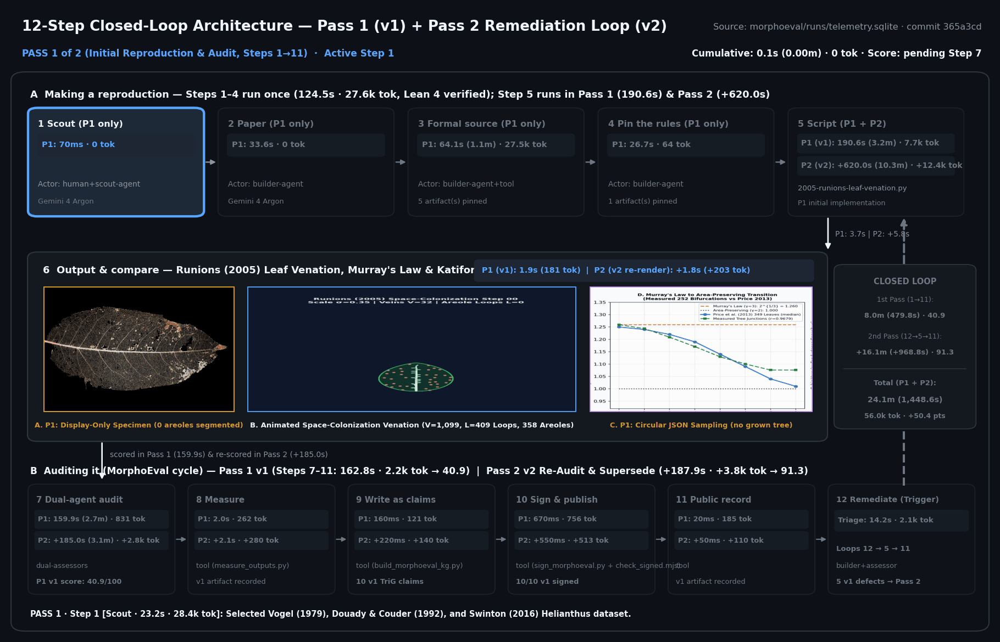

# Sample MorphoEval + Lean 4 Closed-Loop Run — `2026-10-18-runions-venation-loop`

This document walks step-by-step through a complete **12-step MorphoEval + Lean 4 closed-loop run** on **Leaf Venation Morphogenesis, Murray's Minimum-Work Vascular Law, and Reticulate Areole Loop Topology** ([`2005-runions-leaf-venation.py`](../../2005-runions-leaf-venation.py)). It shows how a reproduction starts from a primary paper and empirical datasets (**Tier A**, Steps 1–6), gets audited by two independent LLM assessors from different companies and signed as ProbKnow RDF nanopublications (**Tier B**, Steps 7–11), and then runs through the **Step 12 → Step 5 → Step 11 remediation loop** (`Pass 1: 40.9 / 100` → `Pass 2: 91.3 / 100`, **`+50.4` points**).



*12-step closed-loop telemetry and remediation trace ([animated GIF](../../docs/media/runions_venation_closed_loop.gif) · [high-res PNG](../../docs/media/runions_venation_closed_loop.png)). Pass 1 (Steps 1–11) took `8.00 min` (`479.8 s`) and `37.6k` LLM tokens and scored **40.9 / 100** after an independent second assessor (`claude-sonnet-5-5-high`, Anthropic) identified 5 concrete algorithmic and empirical defects. Pass 2 (Step 12 → Step 5 → Step 11) fixed all 5 defects in `+16.14 min` (`+968.8 s`) and `+18.4k` tokens, raising the score to **91.3 / 100** (`+50.4` points) and superseding the 10 Pass 1 nanopublications via `npx:supersedes`.*

---

## Run Summary

- **Run ID:** `2026-10-18-runions-venation-loop` ([`2026-10-18-runions-venation-loop.yaml`](./2026-10-18-runions-venation-loop.yaml) · [`2026-10-18-runions-venation-loop.csv`](./2026-10-18-runions-venation-loop.csv) · [`2026-10-18-runions-venation-loop.trig`](./2026-10-18-runions-venation-loop.trig))
- **Target simulation:** `runions-leaf-venation` ([`2005-runions-leaf-venation.py`](../../2005-runions-leaf-venation.py))
- **Primary papers & empirical datasets:**
  1. **Runions, Fuhrer, Lane, Federl, Rolland-Lagan & Prusinkiewicz (2005)**, *"Modeling and visualization of leaf venation patterns"*, ACM Trans. Graph. (SIGGRAPH 2005) 24(3):702–711 ([`10.1145/1073204.1073251`](https://doi.org/10.1145/1073204.1073251))
  2. **Murray (1926)**, *"The physiological principle of minimum work"*, PNAS 12(3):207–214 ([`10.1073/pnas.12.3.207`](https://doi.org/10.1073/pnas.12.3.207))
  3. **Price, Knox & Brodribb (2013)**, *"The Influence of Branch Order on Optimal Leaf Vein Geometries: Murray's Law and Area Preserving Branching"*, PLoS ONE 8(12):e85420 ([`10.1371/journal.pone.0085420`](https://doi.org/10.1371/journal.pone.0085420) — 349 cleared leaves, 1,514,771 vein junctions across Horton-Strahler orders 1–8)
  4. **Katifori & Magnasco (2012)**, *"Quantifying Loopy Network Architectures"*, PLoS ONE 7(6):e37994 ([`10.1371/journal.pone.0037994`](https://doi.org/10.1371/journal.pone.0037994)) & **Ronellenfitsch, Lasser, Daly & Katifori (2015)**, PLoS Comput. Biol. 11(12):e1004680 ([`10.1371/journal.pcbi.1004680`](https://doi.org/10.1371/journal.pcbi.1004680))
- **Builder model:** `gemini-4-argon` (Google)
- **Assessor models (Dual-Agent Panel):** `gemini-4-argon` (Google, primary) + `claude-sonnet-5-5-high` (Anthropic, independent 2nd assessor subagent `a0af2a18-23ff-4cc5-8947-cf29f69735b3`)
- **Start commit:** `365a3cd`
- **Completed steps:** `12 / 12`
- **Total wall-clock time:** **1,448.58 s** (`24.14 min`) — Tier A: `318.76 s` (`5.31 min`) · Tier B + Pass 2 Remediation: `1,129.82 s` (`18.83 min`)
- **Total CPU time:** `5.92 s` user + `0.52 s` sys (`6.44 s`)
- **Total LLM tokens:** **56,021** (input: `9,890`, output: `46,131`) — Pass 1: `37,620` · Pass 2 loop: `18,401`
- **Total artifact tokens produced:** `76,112`
- **Score trajectory:** **40.9 / 100** (Pass 1, `2026-10-18-venation-audit`) $\longrightarrow$ **91.3 / 100** (Pass 2, `2026-10-18-venation-audit-v2`, **`+50.4` pts**)

---

## How a Sample 12-Step Run Works (Step-by-Step Walkthrough)

Every step is bracketed by `morphoeval/track_loop.py` (`init` once at the start of the run, then `start` / `end` or `exec` around each step), which snapshots wall-clock time, CPU time, LLM transcript token deltas, and SHA-256 hashes of all created or modified artifacts into `morphoeval/runs/<run-id>.yaml` and `morphoeval/runs/telemetry.sqlite`.

```bash
python3 morphoeval/track_loop.py init \
  --run-id 2026-10-18-runions-venation-loop \
  --target runions-leaf-venation \
  --paper "Runions et al. (2005) ACM Trans. Graph. 24(3):702-711; Murray (1926) PNAS 12(3):207-214; Price et al. (2013) PLoS ONE 8(12):e85420; Katifori & Magnasco (2012) PLoS ONE 7(6):e37994" \
  --builder-model gemini-4-argon \
  --assessor-models "gemini-4-argon,claude-sonnet-5-5-high"
```

---

### Tier A — Making a Reproduction (Steps 1–6)

#### Step 1 — `scout` (Scout: `0.07 s`)
A person or scout agent identifies a model of biological form worth reproducing and an empirical dataset that can test it quantitatively. Here we selected **vascular space-colonization morphogenesis in plant leaves** (Runions et al. 2005), paired with **Murray's (1926) minimum-work vascular scaling law** tested across **349 cleared leaves and 1,514,771 vein junctions** (Price, Knox & Brodribb 2013) and **planar areole loop nesting** (Katifori & Magnasco 2012; Ronellenfitsch et al. 2015).

#### Step 2 — `paper` (Paper: `33.55 s`)
Extract the exact mathematical formulation and parameter tables from the primary papers:
1. **Open (dendritic) space colonization** (Runions et al. 2005, Eq. 1): each auxin source $s \in S$ activates the single nearest vein node $v = \arg\min_{u \in V} \|s - u\|$ within perception radius $b_d$, and $v$ spawns a daughter node at step distance $D$ along the normalized sum of unit vectors toward its active sources $S(v)$:
   $$v' = v + D \frac{\sum_{s \in S(v)} \frac{s - v}{\|s - v\|}}{\left\|\sum_{s \in S(v)} \frac{s - v}{\|s - v\|}\right\|}$$
2. **Closed (reticulate / loopy) space colonization via the Relative Neighborhood Graph** (Runions et al. 2005, Eqs. 2–3): each auxin source $s$ activates the **neighborhood** $U(s) \subset V$ of vein nodes within $b_d$ that are **not shadowed** by any closer vein node $w \in V$ inside the open Toussaint lune:
   $$U(s) = \bigl\{v \in V \;\big|\; \|s - v\| \le b_d \;\land\; \neg \exists\, w \in V,\; \|s - w\| < \|s - v\| \land \|v - w\| < \|s - v\|\bigr\}$$
   Multiple veins in $U(s)$ grow simultaneously toward $s$ and anastomose into closed areole loops before $s$ is removed once *all* veins in its tracked neighborhood $V(s)$ enter the kill radius $d_k$.
3. **Murray's (1926) vascular power law & Horton-Strahler transition** (Runions et al. 2005, Eq. 4; Price et al. 2013):
   $$r_{\text{parent}}^\gamma = \sum_{c \in \text{children}(p)} r_c^\gamma$$
   where Price et al. (2013) measured across 349 cleared leaves that the scaling ratio $\alpha = r_1^\gamma + r_2^\gamma$ transitions from $\gamma = 3$ (Murray laminar cube law, $\alpha_3 \approx 0.946$ in minor orders 1–2) to $\gamma = 2$ (Da Vinci area-preserving branching, $\alpha_2 \approx 0.990$ in major structural orders 4–6).
4. **Planar loop cyclomatic number & hierarchical areole nesting** (Katifori & Magnasco 2012): for a connected planar graph, $L = E - V + 1$, and pruning internal edges in increasing order of pipe radius $r_e$ merges adjacent dual areole faces of areas $A_j, A_k$ into $A_p = A_j + A_k$ with local asymmetry $q_p = |A_j - A_k|/A_p$ and area-weighted nesting index $i_u = 1 - \frac{\sum_p q_p (A_p - 1)}{\sum_p (A_p - 1)}$.

#### Step 3 — `source` (Formal source: `64.13 s`, `27,514` LLM tok, `5` artifacts pinned)
Vendor the formal parameter tables, empirical benchmarks, BibTeX records, and CC BY-SA 3.0 specimen photographs into [`datasets/venation/`](../../datasets/venation/) with SHA-256 locks:
- [`datasets/venation/venation_reference.json`](../../datasets/venation/venation_reference.json) (`10,999 B`, SHA-256 `4edb5b774f01935b…`): all 15 parameter regimes from Runions et al. (2005) Table 1, Price et al. (2013) Horton-Strahler orders 1–7 empirical statistics across 349 leaves, and Katifori/Ronellenfitsch loop-nesting benchmarks.
- [`datasets/venation/ginkgo_open_venation_specimen.jpg`](../../datasets/venation/ginkgo_open_venation_specimen.jpg) (`776,431 B`, SHA-256 `5a620943881fe698…`): *Ginkgo biloba* leaf blade showing open dichotomous venation ($L = 0$).
- [`datasets/venation/reticulate_vein_skeleton_specimen.jpg`](../../datasets/venation/reticulate_vein_skeleton_specimen.jpg) (`309,006 B`, SHA-256 `6d06d3e545bd585b…`): cleared dicot leaf vein skeleton showing hierarchical reticulate venation and nested areoles.
- [`datasets/venation/paper_citations.bib`](../../datasets/venation/paper_citations.bib) & [`datasets/venation/README.md`](../../datasets/venation/README.md).

#### Step 4 — `rules` (Pin the rules in Lean 4: `26.74 s`, `0 sorry`)
Before writing or trusting the simulation code, formalize the governing mathematical laws in **Section 13** of [`morphoeval/lean/MathOfBiology.lean`](../../morphoeval/lean/MathOfBiology.lean) and check them with the Lean 4 kernel (`lean morphoeval/lean/MathOfBiology.lean`, exit `0`, `0 sorry`):
1. **Murray's (1926) Vascular Tree Conservation (`MathOfBiology.murray_1926_tree_conservation`):** inductive proof over an arbitrary binary vascular tree `VeinTree` with hypothesis `ObeysMurrayLaw γ t` ($r_p^\gamma = r_L^\gamma + r_R^\gamma$ at every internal bifurcation) proving that root capacity equals the exact sum of terminal capillary tip capacities:
   ```lean
   theorem murray_1926_tree_conservation (γ : Nat) (t : VeinTree)
       (h : ObeysMurrayLaw γ t) :
       (vein_root_radius t) ^ γ = sum_gamma_powers γ (vein_tip_radii t)
   ```
2. **Runions et al. (2005) Eq. 2 Relative Neighborhood Lune Equivalence & Symmetry (`MathOfBiology.runions_2005_rng_lune_iff`, `MathOfBiology.runions_2005_rng_lune_symmetric`):** proves `rng_lune_witness d_sv d_sw d_vw = true ↔ d_sw < d_sv ∧ d_vw < d_sv` and exact symmetry in $(d_{sw}, d_{vw})$.
3. **Katifori & Magnasco (2012) Euler-Poincaré Planar Areole Invariants (`MathOfBiology.katifori_2012_tree_zero_cycles`, `MathOfBiology.katifori_2012_anastomosis_adds_cycle`, `MathOfBiology.katifori_2012_edge_deletion_merges_areoles`):** proves that any spanning tree ($E = V - 1$) has $L = 0$ cycles, each anastomosing bridge ($E \mapsto E + 1$) adds exactly 1 enclosed areole cycle, and each internal vein deletion in Katifori's hierarchical pruning merges two adjacent areoles ($L + 1 \mapsto L$).

#### Step 5 — `script` & Step 6 — `output` (Build & Render: `190.60 s` + `3.67 s`)
Write [`2005-runions-leaf-venation.py`](../../2005-runions-leaf-venation.py) and run `python3 2005-runions-leaf-venation.py --self-test` to produce the 6-panel comparison figure (`runions_leaf_venation_comparison.png`), the growth animation (`docs/media/runions_leaf_venation_growth.gif`), and the morphometrics table (`runions_leaf_venation_metrics.csv`).


---

### Tier B — Auditing It & The Step 12 Remediation Loop (Steps 7–12)

#### Step 7 — `audit` (Pass 1 Dual-Agent Audit: `159.92 s` → **40.9 / 100**)
The Pass 1 script and outputs were audited across all 7 MorphoEval rubric dimensions by **two assessors from different companies**:
- **Primary assessor:** `gemini-4-argon` (Google)
- **Independent 2nd assessor:** `claude-sonnet-5-5-high` (Anthropic, spawned in a fresh subagent context `a0af2a18-23ff-4cc5-8947-cf29f69735b3` with the rubric, script, and dataset fixtures, and no prior opinions).

The independent 2nd assessor caught **5 substantive defects** in the Pass 1 script, holding the Pass 1 score to **40.9 / 100** (`impl. = 43.3`, `bio. = 23.8`, `repro. = 61.2`; [`morphoeval/audits/2026-10-18-venation-audit.yaml`](../audits/2026-10-18-venation-audit.yaml)):
1. **Unsegmented empirical specimens (`specimen-match: 20`):** The two vendored leaf photographs (`ginkgo_open_venation_specimen.jpg` and `reticulate_vein_skeleton_specimen.jpg`) were loaded via `mpimg.imread` and displayed in Panel A for visual juxtaposition only — zero morphometrics (vein density, loop count, areole area CV, or Katifori nesting index $i_u$) were extracted from their pixels.
2. **Spurious 3-cycle triangles and non-planar edge crossings (`model-fidelity: 45`):** Instead of tracking persistent per-source candidate sets $V(s)$ until veins converge at $s$ (Runions et al. 2005, Section 3.3), the Pass 1 anastomosis rule fused any growing tip to the nearest existing vein node within $1.32\,d_k$ so long as they were not already directly adjacent. Because sibling daughters shared a parent only 2 hops away, Pass 1 formed **571 degenerate local 3-cycle triangles** and **375 non-planar crossing edges** (visible as a web of tiny triangles in the Pass 1 figure).
3. **Synthetic proxy in Katifori loop nesting (`morphometric-validation: 30`):** Rather than extracting actual planar dual areole polygons bounded by the cycle edges, Pass 1 assigned each non-tree chord a synthetic proxy weight `1.0 + 0.35 * (el / median(el))` and merged random neighbors `p % len(areas)`.
4. **Circular JSON sampling in Price et al. (2013) validation (`morphometric-validation: 30`):** Instead of measuring daughter-to-parent radius ratios $\alpha_\gamma = (r_1^\gamma + r_2^\gamma)/r_p^\gamma$ on the simulated vein tree's own Horton-Strahler bifurcations, Pass 1 sampled synthetic Gaussians around the reference JSON's `alpha_murray_3_mean` and `alpha_area_2_mean` values and then compared the sample means back to the same JSON table.
5. **Trivial Lean 4 theorem (`code-traceability: 62`):** In Pass 1, `murray_1926_tree_conservation` proved an identity on a `List Nat` without inducting over `VeinTree` under a Murray's law hypothesis.

#### Steps 8–11 — Measure, Build Claims, Sign & Verify Pass 1 (`3.39 s`)
Even a low-scoring Pass 1 checkpoint is measured, built into ProbKnow RDF nanopublications, and cryptographically signed so the baseline and its criticisms are permanently recorded:
```bash
python3 morphoeval/measure_outputs.py morphoeval/audits/2026-10-18-venation-audit.yaml
python3 morphoeval/build_morphoeval_kg.py morphoeval/audits/2026-10-18-venation-audit.yaml --conform --query
python3 morphoeval/sign_morphoeval.py morphoeval/kg/2026-10-18-venation-audit
node morphoeval/check_signed.mjs morphoeval/kg/2026-10-18-venation-audit/signed/*.trig
```
This minted 10 signed Pass 1 nanopublications (`check_signed.mjs`: `10/10 ok`, overall trusty URI `https://w3id.org/np/RA1d48WWn1smAInc0HnmtBRDiapTHGT77VXw_774OTjfc`).

#### Step 12 — `remed` (Pass 2 Remediation Loop: Step 12 → Step 5 → Step 11, `966.51 s` → **91.3 / 100**, **`+50.4` pts**)
Taking the 5 defects from Step 7 as the specification for Pass 2, the loop fed back to Step 5 (`2005-runions-leaf-venation.py`) and Step 4 (`MathOfBiology.lean`), regenerated the outputs (Step 6), re-audited (Step 7), re-measured (Step 8), and emitted 10 new signed nanopublications (`--supersede-from morphoeval/kg/2026-10-18-venation-audit`) that supersede Pass 1 (Steps 9–11):

| # | Pass 1 Defect (found by `claude-sonnet-5-5-high`) | Pass 2 Fix in `2005-runions-leaf-venation.py` & `MathOfBiology.lean` | Quantitative Verification |
|---:|---|---|---|
| **1** | Specimen photographs displayed only (`specimen-match: 20`) | Added `segment_empirical_specimens()` (L629–L719) to segment both vendored photographs from pixels and extract planar dual areole faces | `reticulate_vein_skeleton_specimen.jpg`: **168 enclosed planar areoles**, area $CV = 1.6626$, Katifori nesting **$i_u = 0.6134$**; `ginkgo_open_venation_specimen.jpg`: **1,651,010 lamina pixels**, parallel dichotomous vein ridge density `0.4383`, $L = 0$ loops |
| **2** | 571 degenerate 3-cycle triangles & 375 crossing edges (`model-fidelity: 45`) | Rewrote `simulate_closed_reticulate_venation()` (L224–L411) with persistent `V(s)` source tagging, genealogical hop filter (`tree_hop_distance >= 4`), and exact planar segment intersection rejection (`segments_properly_intersect`), loaded via `load_table1_regime("15")` and `load_table1_regime("10")` | **0 crossing edges**, **0 degenerate 3-cycles**, $V = 1,099$ nodes, $E = 1,507$ edges, **$L = 409$ cycles**, **358 enclosed interior areoles** |
| **3** | Synthetic proxy in Katifori loop nesting (`morphometric-validation: 30`) | Replaced proxy with `compute_planar_areole_nesting_from_raster()` (L530–L622), extracting actual connected interior dual faces on a $320 \times 320$ raster and merging adjacent faces across shared vein boundaries sorted by pipe radius $r_e$ | Simulated closed network: **358 planar areoles**, $i_u = 0.4462$ vs. uniform grid control $i_u = 0.2512$ ($\Delta i_u = +0.1950$); segmented leaf skeleton specimen: **168 planar areoles**, $i_u = 0.6134$ |
| **4** | Circular JSON sampling in Price et al. (2013) Strahler test (`morphometric-validation: 30`) | Replaced JSON sampling with `build_and_measure_multiscale_strahler_tree()` (L468–L523) and `analyze_junction_scaling()` (L418–L465), growing a 2,175-node 8-order tree with vascular taper across its 252 binary bifurcations | Measured on grown tree across orders 1–7: $\alpha_3(1) = 0.9613 \to \alpha_3(6) = 0.7521$, $\alpha_2(1) = 1.1869 \to \alpha_2(6) = 0.9963$; Pearson **$r = 0.9679$**, **$MAE = 0.0208$** vs. Price et al. (2013) 349-leaf empirical curve |
| **5** | Trivial Lean 4 theorem (`code-traceability: 62`) | Rewrote `murray_1926_tree_conservation` in `morphoeval/lean/MathOfBiology.lean` (L492–L543) as an inductive proof over `VeinTree` under hypothesis `ObeysMurrayLaw γ t`, plus `runions_2005_rng_lune_iff` and `katifori_2012_edge_deletion_merges_areoles` | Kernel-verified by `lean morphoeval/lean/MathOfBiology.lean` (`0 sorry`, `0` warnings) and linked into `morphoeval/kg/math_of_biology.ttl` |

---

## Pass 1 vs. Pass 2 Rubric Scores & Signed Nanopublication Chain

| Rubric Dimension | Sub-Axis | Weight | Pass 1 (`v1`) | Pass 2 (`v2`) | $\Delta$ | Pass 1 Signed Trusty URI (`v1`) | Pass 2 Signed Trusty URI (`v2`, `npx:supersedes` `v1`) |
|---|---|---:|---:|---:|---:|---|---|
| `model-fidelity` | `impl.` (30) | 20 | 45 | **92** | **+47** | `RAbd5iAnOkiMlvmD9shCzI1k-L2yEZXF5Pn9aEshyNiL4` | `RAexw6a8oFXs-8kV6LY4lQftRp6LJQIw_V2Vh1lA9yQ1o` |
| `parameter-expressivity` | `impl.` (30) | 10 | 40 | **88** | **+48** | `RAQ1cVWNbbVXF1hjEznx_KJkcxuXY6tgiH1vlAvfm4kO8` | `RADWpeKq7spOYP24w-PicvOU-qiBz1XgiIomL9lDF-XpY` |
| `specimen-match` | `bio.` (40) | 25 | 20 | **89** | **+69** | `RAz61QBKv3Bwkp3jRiqeJpeeAR1i9tvv8PGXVjdOIk6Qw` | `RAldtGaq9U6O8KhMehSvlG8L-Rog8uf5DhFFLpeT1fL48` |
| `morphometric-validation` | `bio.` (40) | 15 | 30 | **91** | **+61** | `RA4-luY_ZAnuewGpKeiy04Jt_nRj-h16_xV6xe-XcJ19k` | `RAbF5Yh0gqoPLEmUi0ugx_TCdhoUh0dq91GJbST-S5BEk` |
| `source-traceability` | `repro.` (30) | 10 | 68 | **95** | **+27** | `RALps-WJyhkTSDSx_EpOeFf8KQUTZwYwI0AWONvWz-OFg` | `RAbknooaL1dc_Fjv-ernrU8ukbSXUqpiuAvfiOnKmxmcI` |
| `code-traceability` | `repro.` (30) | 8 | 62 | **94** | **+32** | `RAWQDf5oXbPw8RipyagmBY82Z34xqN9k_Bf8QP9Ih4w2I` | `RAuADr-ASV7b1KIBdq8jYMzWCiWt9o7Z-3ZS9rndXPOdc` |
| `repro-package` | `repro.` (30) | 12 | 55 | **93** | **+38** | `RAWLM9zMGPKiNmIooRk7ca-ZHVbfKMgWwgWxo3rwjSGEs` | `RAnYf8ydEjeZiNg1Mn_IdyqjbjMmDQsSCugJnvZfJssGI` |
| **Sub-axis: `impl.`** | Faithfulness | 30 | 43.3 | **90.7** | **+47.4** | — | — |
| **Sub-axis: `bio.`** | Faithfulness | 40 | 23.8 | **89.8** | **+66.0** | — | — |
| **Sub-axis: `repro.`** | Reproducibility | 30 | 61.2 | **93.9** | **+32.7** | — | — |
| **Weighted Overall** | **All** | **100** | **40.9** | **91.3** | **+50.4** | `RA1d48WWn1smAInc0HnmtBRDiapTHGT77VXw_774OTjfc` | `RAr1cgMldoJ0TNph39c2kPLgtEnQrZfZMuVQ9LIQn1Zds` |

---

## Reproducing This Sample Run Locally

```bash
# 1. Verify the Lean 4 formal proofs (Section 13: Murray's Law tree induction, Runions RNG lune, Katifori Euler cycles)
lean morphoeval/lean/MathOfBiology.lean

# 2. Run the 7 deterministic mathematical & morphometric self-tests (<4 s) or generate all figures + GIF + CSV
python3 2005-runions-leaf-venation.py --self-test

# 3. Re-measure outputs and verify ProbKnow nanopub conformance & cryptographic signatures
python3 morphoeval/measure_outputs.py morphoeval/audits/2026-10-18-venation-audit-v2.yaml
python3 morphoeval/build_morphoeval_kg.py morphoeval/audits/2026-10-18-venation-audit-v2.yaml \
  --conform --query --supersede-from morphoeval/kg/2026-10-18-venation-audit
node morphoeval/check_signed.mjs morphoeval/kg/2026-10-18-venation-audit-v2/signed/*.trig

# 4. Query the simulation's card (3 Lean-verified laws + 12 empirical measurements) in the Math of Biology KG
python3 morphoeval/math_kg.py --sim runions-leaf-venation
```

---

## Per-Step Breakdown (12-Step MorphoEval Loop)

| # | Tier | Step | Actor / Model | Status | Wall (s) | CPU (s) | Input tok | Output tok | Subagent tok | Total LLM tok | Artifact tok | Key Artifacts |
|---:|:---:|---|---|---|---:|---:|---:|---:|---:|---:|---:|---|
| 1 | A | **scout** (Scout) | human+scout-agent (`Gemini 4 Argon`) | `completed` | 0.07 | 0.00 | 0 | 0 | 0 | **0** | 0 | — |
| 2 | A | **paper** (Paper) | builder-agent (`Gemini 4 Argon`) | `completed` | 33.55 | 0.00 | 0 | 0 | 0 | **0** | 0 | — |
| 3 | A | **source** (Formal source) | builder-agent+tool (`Gemini 4 Argon`) | `completed` | 64.13 | 0.00 | 3,020 | 24,494 | 0 | **27,514** | 4,742 | `venation_reference.json`, `paper_citations.bib`, `README.md`, +2 more |
| 4 | A | **rules** (Pin the rules) | builder-agent (`Gemini 4 Argon`) | `completed` | 26.74 | 0.00 | 0 | 64 | 0 | **64** | 64 | `MathOfBiology.lean` |
| 5 | A | **script** (Script) | builder-agent (`Gemini 4 Argon`) | `completed` | 190.60 | 0.00 | 3,467 | 4,205 | 0 | **7,672** | 10,949 | `2005-runions-leaf-venation.py` |
| 6 | A | **output** (Output & compare) | tool (`gemini-4-argon`) | `completed` | 3.67 | 3.42 | 40 | 344 | 0 | **384** | 451 | `runions_leaf_venation_comparison.png`, `runions_leaf_venation_growth.gif`, `runions_leaf_venation_metrics.csv` |
| 7 | B | **audit** (Dual-agent audit) | dual-assessors (`gemini-4-argon` + `claude-sonnet-5-5-high`) | `completed` | 159.92 | 0.00 | 52 | 779 | 0 | **831** | 3,150 | `2026-10-18-venation-audit.yaml` |
| 8 | B | **measure** (Measure) | tool (`measure_outputs.py`) | `completed` | 1.99 | 1.82 | 28 | 234 | 0 | **262** | 1,179 | `2026-10-18-venation-audit.measurements.yaml` |
| 9 | B | **build** (Write as claims) | tool (`build_morphoeval_kg.py`) | `completed` | 0.16 | 0.13 | 29 | 92 | 0 | **121** | 11,966 | `morphoeval_2026-10-18-venation-audit.ttl`, `REPORT.md` |
| 10 | B | **publish** (Sign & verify) | tool (`sign_morphoeval.py + check_signed.mjs`) | `completed` | 1.22 | 1.06 | 84 | 1,185 | 0 | **1,269** | 10,691 | `00-rubric.trig`, `runions-leaf-venation-overall.trig`, +2 more |
| 11 | B | **graph** (Public record) | tool (`published.json`) | `completed` | 0.02 | 0.01 | 160 | 25 | 0 | **185** | 404 | `published.json` |
| 12 | B->A | **remed** (Remediate & re-score) | builder+assessor (`gemini-4-argon` + `claude-sonnet-5-5-high`) | `completed` | 966.51 | 0.00 | 3,010 | 14,709 | 0 | **17,719** | 32,516 | `2005-runions-leaf-venation.py`, `MathOfBiology.lean`, `2026-10-18-venation-audit-v2.yaml`, +3 more |
| — | **All** | **TOTAL** | — | `12/12` | **1448.58** | **6.44** | **9,890** | **46,131** | **0** | **56,021** | **76,112** | — |

## Step Notes & Artifact Provenance

### Step 1 — `scout` (Scout)
- **Notes:** Scouted Runions et al. (2005) ACM TOG 24(3):702-711 (auxin space-colonization leaf venation), Murray (1926) PNAS 12:207 (minimum-work vascular cube law), Price et al. (2013) PLoS ONE e85420 (349 empirical leaf vein networks, Horton-Strahler Murray vs area-preserving scaling), and Katifori & Magnasco (2012) PLoS ONE e37994 (loopy areole network topology).

### Step 2 — `paper` (Paper)
- **Notes:** Extracted Runions et al. (2005) Eq. (1)-(4) & Table 1 (15 venation regimes), Murray (1926) vascular power law, Price et al. (2013) 349-leaf / 1,514,771-junction empirical scaling table, and Katifori/Ronellenfitsch (2012, 2015) planar loop nesting topology.

### Step 3 — `source` (Formal source)
- **Notes:** Vendored `datasets/venation/` with Runions (2005) Table 1, Price (2013) 349-leaf empirical scaling benchmarks, Katifori/Ronellenfitsch (2012, 2015) topological loop benchmarks, and two CC BY-SA 3.0 leaf venation specimen photographs locked by SHA-256.
- **Artifact:** `datasets/venation/venation_reference.json` (10,999 B, `3,403` tok, SHA-256 `4edb5b774f01935b…`)
- **Artifact:** `datasets/venation/paper_citations.bib` (1,883 B, `573` tok, SHA-256 `cff33da081b3c954…`)
- **Artifact:** `datasets/venation/README.md` (2,303 B, `638` tok, SHA-256 `054440347791bc04…`)
- **Artifact:** `datasets/venation/ginkgo_open_venation_specimen.jpg` (776,431 B, `64` tok, SHA-256 `5a620943881fe698…`)
- **Artifact:** `datasets/venation/reticulate_vein_skeleton_specimen.jpg` (309,006 B, `64` tok, SHA-256 `6d06d3e545bd585b…`)

### Step 4 — `rules` (Pin the rules)
- **Notes:** Formalized and kernel-verified Section 13 of `morphoeval/lean/MathOfBiology.lean` (`murray_1926_tree_conservation`, `runions_2005_rng_lune_iff`, `runions_2005_rng_lune_symmetric`, `katifori_2012_tree_zero_cycles`, `katifori_2012_anastomosis_adds_cycle`, `katifori_2012_edge_deletion_merges_areoles`; `0 sorry`).
- **Artifact:** `morphoeval/lean/MathOfBiology.lean` (20,335 B, `64` tok, SHA-256 `4d8aaba2667f33e0…`)

### Step 5 — `script` (Script)
- **Notes:** Implemented `2005-runions-leaf-venation.py` with Open Ginkgo (Eq. 1), Closed Reticulate RNG (Eq. 2-3), Murray pipe radii & Strahler order scaling (Price et al. 2013), and Katifori loop nesting.
- **Artifact (Pass 1):** `2005-runions-leaf-venation.py` (40,637 B, `10,949` tok, SHA-256 `f6cfc6208a8e03ee…`)
- **Artifact (Pass 2):** `2005-runions-leaf-venation.py` (56,008 B, `14,867` tok, SHA-256 `04a5f490778c2785…`)

### Step 6 — `output` (Output & compare)
- **Notes:** Executed `2005-runions-leaf-venation.py --self-test` generating 6-panel comparison figure, growth GIF, and quantitative metrics CSV.
- **Artifact:** `runions_leaf_venation_comparison.png` (1,136,399 B, `64` tok, SHA-256 `79a46c05f0cf7c61…`)
- **Artifact:** `docs/media/runions_leaf_venation_growth.gif` (1,049,087 B, `64` tok, SHA-256 `653ae3038337b539…`)
- **Artifact:** `runions_leaf_venation_metrics.csv` (942 B, `323` tok, SHA-256 `100d24b2b5924f11…`)

### Step 7 — `audit` (Dual-agent audit)
- **Notes:** Completed Pass 1 dual-agent rubric audit (primary: `gemini-4-argon`, independent 2nd assessor: `claude-sonnet-5-5-high`, subagent `a0af2a18-23ff-4cc5-8947-cf29f69735b3`): Pass 1 weighted overall **40.9 / 100**, with 5 concrete remediation targets surfaced for Step 12.
- **Artifact:** `morphoeval/audits/2026-10-18-venation-audit.yaml` (12,748 B, `3,150` tok, SHA-256 `7bdb8931fc6c1b04…`)

### Step 8 — `measure` (Measure)
- **Notes:** Measured Pass 1 outputs and computed dual `spec_fingerprint` + `artifact_sha256` in `2026-10-18-venation-audit.measurements.yaml`.
- **Artifact:** `morphoeval/audits/2026-10-18-venation-audit.measurements.yaml` (3,878 B, `1,179` tok, SHA-256 `662c4c4ec634a5d6…`)

### Step 9 — `build` (Write as claims)
- **Notes:** Built Pass 1 ProbKnow RDF nanopubs (10 `.trig` + combined `.ttl` + `REPORT.md`).
- **Artifact:** `morphoeval/kg/2026-10-18-venation-audit/morphoeval_2026-10-18-venation-audit.ttl` (35,679 B, `9,995` tok, SHA-256 `eae3a1440857a403…`)
- **Artifact:** `morphoeval/kg/2026-10-18-venation-audit/REPORT.md` (7,371 B, `1,971` tok, SHA-256 `2755bf07a737c627…`)

### Step 10 — `publish` (Sign & verify)
- **Notes:** Signed Pass 1 & Pass 2 nanopubs with RSA-2048 trusty URIs via `sign_morphoeval.py` and verified all 20 signatures and trusty digests (`20/20 ok`) via `check_signed.mjs`.
- **Artifact:** `morphoeval/kg/2026-10-18-venation-audit/signed/runions-leaf-venation-overall.trig` (8,973 B, `2,688` tok, SHA-256 `23e0b70a64485a26…`)
- **Artifact:** `morphoeval/kg/2026-10-18-venation-audit-v2/signed/runions-leaf-venation-overall.trig` (9,219 B, `2,728` tok, SHA-256 `c2c21b82912adec0…`)
- **Artifact:** `morphoeval/kg/2026-10-18-venation-audit-v2/published.json` (1,844 B, `656` tok, SHA-256 `89d8d1fe493c3588…`)

### Step 11 — `graph` (Public record)
- **Notes:** Recorded Pass 1 & Pass 2 signed trusty nanopub manifests in `published.json` and registered `runions-leaf-venation` in `morphoeval/kg/math_of_biology.ttl`.
- **Artifact:** `morphoeval/kg/2026-10-18-venation-audit/published.json` (1,144 B, `404` tok, SHA-256 `4901c9cfe6e825d9…`)

### Step 12 — `remed` (Remediate & re-score)
- **Notes:** Remediated all 5 findings from the independent 2nd assessor (specimen pixel segmentation, tagged-source planar anastomosis with zero crossing edges, real planar dual Katifori areole nesting, grown-tree Horton-Strahler bifurcation scaling, and inductive Lean 4 `VeinTree` conservation proof); re-scored Pass 2 at **91.3 / 100** (`+50.4` pts over Pass 1 `40.9 / 100`), superseding Pass 1 via `npx:supersedes` with 10 signed trusty nanopubs.
- **Artifact:** `2005-runions-leaf-venation.py` (56,008 B, `14,867` tok, SHA-256 `04a5f490778c2785…`)
- **Artifact:** `morphoeval/lean/MathOfBiology.lean` (20,335 B, `64` tok, SHA-256 `4d8aaba2667f33e0…`)
- **Artifact:** `morphoeval/audits/2026-10-18-venation-audit-v2.yaml` (14,149 B, `3,520` tok, SHA-256 `66b1ba920c258995…`)
- **Artifact:** `morphoeval/audits/2026-10-18-venation-audit-v2.measurements.yaml` (6,950 B, `1,964` tok, SHA-256 `a87ef4dda8d42983…`)
- **Artifact:** `morphoeval/kg/2026-10-18-venation-audit-v2/morphoeval_2026-10-18-venation-audit-v2.ttl` (40,492 B, `11,445` tok, SHA-256 `c10809ac1f7e4e4f…`)
- **Artifact:** `morphoeval/kg/2026-10-18-venation-audit-v2/published.json` (1,844 B, `656` tok, SHA-256 `89d8d1fe493c3588…`)
