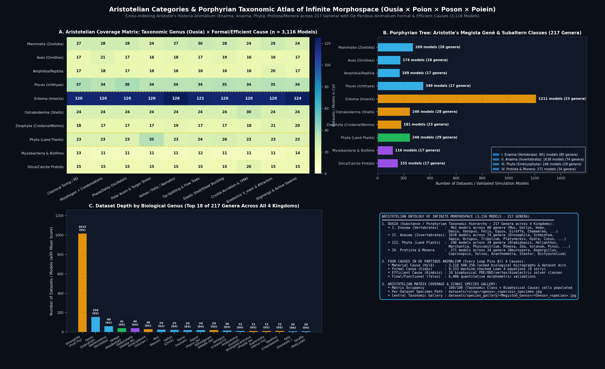
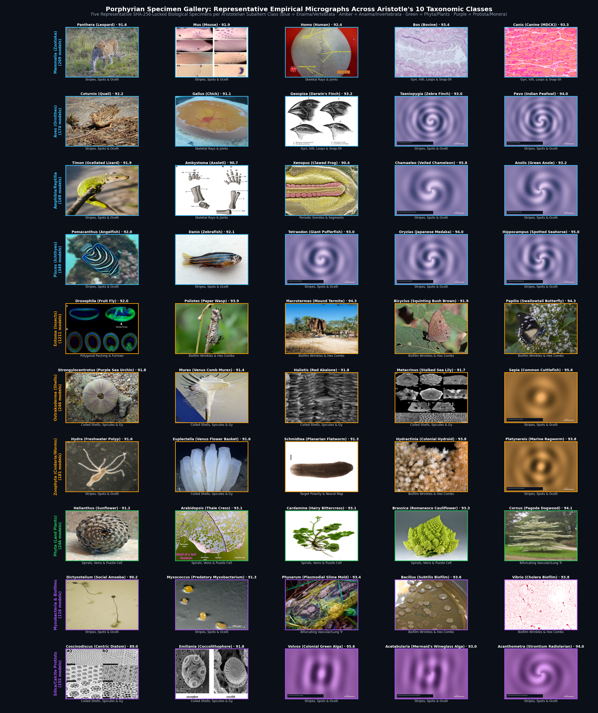

# Aristotelian Categories & Taxonomic Coverage of Infinite Morphospace

In *Categories* (*Katēgoriai*), *Historia Animalium*, and *De Partibus Animalium* (Book I), Aristotle established that biological form cannot be understood by a single dichotomous tree alone: every organismal phenomenon must be cross-indexed by its **Substance / Taxonomic Genus (*Ousia / Genos*)** and its **Four Causes & Categories**:

1. ***Ousia* (Substance — `Summum Genus → Megista Genē → Subaltern Class → Genus → Species`)**: Which living taxon embodies the form (**217 biological genera** across **3116 verified models** passing the Canonical Image Fitness threshold `ImgFit >= 70.0`).
2. ***Poion* (Quality — Morphological Topology)**: What qualitative geometric form emerges (stripes/spots, logarithmic shells, bifurcating trees, buckled sheets/gyri, polygonal tilings, parastichy spirals, target polarity).
3. ***Poson* (Quantity — Dimensionless Scaling Law)**: What mathematical invariant governs the form (**machine-checked Lean 4 equations** and quantitative morphometric validations, e.g. Zoelly $(h/R_0)^2$, Murray's $r_0^3 = r_1^3 + r_2^3$, Golden Angle $137.508^\circ$, Vertex jamming $p_0^* = 3.81$).
4. ***Poiein & Paschein* (Action & Affection — Efficient Biophysical Cause)**: Which of the 10 dynamical mechanism classes generates the morphology.

---

## 1. Summary by Aristotle's *Megista Genē* (Greatest Genera)

| Aristotelian *Megiston Genos* | Subaltern Class (*Genos*) | Verified Models | Unique Genera | Representative Genera (Dataset Count) |
| :--- | :--- | :---: | :---: | :--- |
| **I. Enaima (Vertebrata)** | Mammalia (Zootoka) | **269** | **28** | *Mus* (24), *Homo* (20), *Equus* (20), *Felis* (10), *Giraffa* (10), *Sus* (10), +22 more |
| **I. Enaima (Vertebrata)** | Aves (Ornithes) | **174** | **18** | *Gallus* (22), *Taeniopygia* (10), *Pavo* (10), *Columba* (10), *Struthio* (10), *Anas* (10), +12 more |
| **I. Enaima (Vertebrata)** | Amphibia & Reptilia (Ootoka) | **169** | **17** | *Xenopus* (16), *Ambystoma* (12), *Chamaeleo* (10), *Anolis* (10), *Pleurodeles* (10), *Rana* (10), +11 more |
| **I. Enaima (Vertebrata)** | Pisces (Ichthyes) | **349** | **17** | *Danio* (156), *Gasterosteus* (60), *Tetraodon* (10), *Oryzias* (10), *Hippocampus* (10), *Scyliorhinus* (10), +11 more |
| **II. Anaima (Invertebrata)** | Entoma (Arthropoda) | **1211** | **23** | *Drosophila* (1015), *Aulacopleura* (30), *Eldredgeops* (20), *Tribolium* (10), *Apis* (10), *Morpho* (10), +17 more |
| **II. Anaima (Invertebrata)** | Ostrakoderma (Mollusca & Echinodermata) | **246** | **28** | *Strongylocentrotus* (11), *Nautilus* (11), *Sepia* (10), *Octopus* (10), *Patella* (10), *Asterias* (10), +22 more |
| **II. Anaima (Invertebrata)** | Zoophyta & Vermes (Cnidaria/Platyhelminthes) | **181** | **23** | *Euplectella* (11), *Platynereis* (10), *Nematostella* (10), *Ciona* (10), *Aurelia* (10), *Acropora* (10), +17 more |
| **III. Phyta (Embryophyta)** | Angiospermae & Gymnospermae | **246** | **29** | *Ginkgo* (41), *Marchantia* (10), *Physcomitrium* (10), *Zea* (10), *Solanum* (10), *Pinus* (10), +23 more |
| **IV. Protista & Monera** | Slime Molds & Bacteria | **116** | **17** | *Neurospora* (10), *Aspergillus* (10), *Coprinopsis* (10), *Pseudomonas* (10), *Anabaena* (10), *Saccharomyces* (10), +11 more |
| **IV. Protista & Monera** | Mineralized Protists (Silica/Calcite) | **155** | **17** | *Globorotalia* (40), *Volvox* (10), *Acetabularia* (10), *Acanthometra* (10), *Micrasterias* (10), *Chlamydomonas* (10), +11 more |

---

## 2. Complete Index of All 217 Verified Biological Genera (*Infima Genera*)

| Genus (*Ousia*) | Common Name | Aristotelian Division (*Megiston Genos*) | Subaltern Class | Models | Formal Topologies (*Poion*) | Simulation / Dataset Slugs |
| :--- | :--- | :--- | :--- | :---: | :--- | :--- |
| ***Drosophila*** | Fruit Fly | II. Anaima (Invertebrata) | Entoma (Arthropoda) | **1015** | Bifurcating Vascular/Lung Trees; Biofilm Wrinkles & Hex Combs | `drosophila-wing-vertex`, `drosophila-ventral-furrow`, `global-morphogenetic-flow`, `wing-disc-dome-folding` (+1011 more) |
| ***Danio*** | Zebrafish | I. Enaima (Vertebrata) | Pisces (Ichthyes) | **156** | Bifurcating Vascular/Lung Trees; Biofilm Wrinkles & Hex Combs | `zebrafish-three-cell-stripes`, `her1-her7-delayed-oscillator`, `delta-notch-phase-synchrony`, `doppler-somite-shortening` (+152 more) |
| ***Gasterosteus*** | Stickleback | I. Enaima (Vertebrata) | Pisces (Ichthyes) | **60** | Bifurcating Vascular/Lung Trees; Biofilm Wrinkles & Hex Combs | `gasterosteus-aculeatus-turing-wavelength`, `gasterosteus-aculeatus-morphogen-condensation`, `gasterosteus-aculeatus-clock-wavefront`, `gasterosteus-aculeatus-flux-canalization` (+56 more) |
| ***Ginkgo*** | Maidenhair Tree | III. Phyta (Embryophyta) | Angiospermae & Gymnospermae | **41** | Bifurcating Vascular/Lung Trees; Biofilm Wrinkles & Hex Combs | `ginkgo-yimaensis-turing-wavelength`, `ginkgo-apodes-turing-wavelength`, `ginkgo-adiantoides-turing-wavelength`, `ginkgo-biloba-turing-wavelength` (+37 more) |
| ***Globorotalia*** | Middle Miocene Unkeeled Ro | IV. Protista & Monera | Mineralized Protists (Silica/Calcite) | **40** | Bifurcating Vascular/Lung Trees; Biofilm Wrinkles & Hex Combs | `globorotalia-praefohsi-turing-wavelength`, `globorotalia-fohsi-turing-wavelength`, `globorotalia-plesiotumida-turing-wavelength`, `globorotalia-tumida-turing-wavelength` (+36 more) |
| ***Aulacopleura*** | Silurian Trilobite Meraspi | II. Anaima (Invertebrata) | Entoma (Arthropoda) | **30** | Bifurcating Vascular/Lung Trees; Biofilm Wrinkles & Hex Combs | `aulacopleura-koninckii-meraspis-turing-wavelength`, `aulacopleura-koninckii-holaspis18-turing-wavelength`, `aulacopleura-koninckii-holaspis22-turing-wavelength`, `aulacopleura-koninckii-meraspis-morphogen-condensation` (+26 more) |
| ***Mus*** | Mouse | I. Enaima (Vertebrata) | Mammalia (Zootoka) | **24** | Bifurcating Vascular/Lung Trees; Biofilm Wrinkles & Hex Combs | `wnt-dkk-hair-follicle`, `palate-ruguga-turing`, `hox-turing-polydactyly`, `bmp-sox9-wnt-digits` (+20 more) |
| ***Gallus*** | Chick | I. Enaima (Vertebrata) | Aves (Ornithes) | **22** | Bifurcating Vascular/Lung Trees; Biofilm Wrinkles & Hex Combs | `french-flag-morphogen`, `limb-chondrogenesis-turing`, `tgfb-fibronectin-limb`, `joint-interzone-clefting` (+18 more) |
| ***Eldredgeops*** | Middle Devonian Phacopid T | II. Anaima (Invertebrata) | Entoma (Arthropoda) | **20** | Bifurcating Vascular/Lung Trees; Biofilm Wrinkles & Hex Combs | `eldredgeops-rana-18file-turing-wavelength`, `eldredgeops-rana-17file-turing-wavelength`, `eldredgeops-rana-18file-morphogen-condensation`, `eldredgeops-rana-17file-morphogen-condensation` (+16 more) |
| ***Equus*** | Plains Zebra | I. Enaima (Vertebrata) | Mammalia (Zootoka) | **20** | Bifurcating Vascular/Lung Trees; Biofilm Wrinkles & Hex Combs | `equus-quagga-turing-wavelength`, `equus-quagga-morphogen-condensation`, `equus-quagga-clock-wavefront`, `equus-quagga-flux-canalization` (+16 more) |
| ***Homo*** | Human | I. Enaima (Vertebrata) | Mammalia (Zootoka) | **20** | Bifurcating Vascular/Lung Trees; Biofilm Wrinkles & Hex Combs | `allometric-cranial-sutures`, `human-somite-organoid-clock`, `vertex-glass-jamming`, `vascular-cube-law-branching` (+16 more) |
| ***Xenopus*** | Clawed Frog | I. Enaima (Vertebrata) | Amphibia & Reptilia (Ootoka) | **16** | Bifurcating Vascular/Lung Trees; Biofilm Wrinkles & Hex Combs | `clock-and-wavefront`, `bioelectric-brain-teratogenesis`, `bioelectric-gene-network-coupled`, `xenopus-craniofacial-remap` (+12 more) |
| ***Ambystoma*** | Axolotl | I. Enaima (Vertebrata) | Amphibia & Reptilia (Ootoka) | **12** | Bifurcating Vascular/Lung Trees; Biofilm Wrinkles & Hex Combs | `mechanochemical-chondrogenesis`, `ambystoma-maculatum-turing-wavelength`, `ambystoma-maculatum-morphogen-condensation`, `ambystoma-maculatum-clock-wavefront` (+8 more) |
| ***Euplectella*** | Venus Flower Basket | II. Anaima (Invertebrata) | Zoophyta & Vermes (Cnidaria/Platyhelminthes) | **11** | Bifurcating Vascular/Lung Trees; Biofilm Wrinkles & Hex Combs | `sponge-spicule-hexactin`, `euplectella-aspergillum-turing-wavelength`, `euplectella-aspergillum-morphogen-condensation`, `euplectella-aspergillum-clock-wavefront` (+7 more) |
| ***Nautilus*** | Chambered Nautilus | II. Anaima (Invertebrata) | Ostrakoderma (Mollusca & Echinodermata) | **11** | Bifurcating Vascular/Lung Trees; Biofilm Wrinkles & Hex Combs | `nautilus-pompilius-turing-wavelength`, `nautilus-pompilius-morphogen-condensation`, `nautilus-pompilius-clock-wavefront`, `nautilus-pompilius-flux-canalization` (+7 more) |
| ***Strongylocentrotus*** | Purple Sea Urchin | II. Anaima (Invertebrata) | Ostrakoderma (Mollusca & Echinodermata) | **11** | Bifurcating Vascular/Lung Trees; Biofilm Wrinkles & Hex Combs | `echinoderm-pentaradial-symmetry`, `strongylocentrotus-purpuratus-turing-wavelength`, `strongylocentrotus-purpuratus-morphogen-condensation`, `strongylocentrotus-purpuratus-clock-wavefront` (+7 more) |
| ***Acanthometra*** | Radiolarian | IV. Protista & Monera | Mineralized Protists (Silica/Calcite) | **10** | Bifurcating Vascular/Lung Trees; Biofilm Wrinkles & Hex Combs | `acanthometra-pellucida-turing-wavelength`, `acanthometra-pellucida-morphogen-condensation`, `acanthometra-pellucida-clock-wavefront`, `acanthometra-pellucida-flux-canalization` (+6 more) |
| ***Acanthostega*** | Late Devonian Eight-Digite | I. Enaima (Vertebrata) | Amphibia & Reptilia (Ootoka) | **10** | Bifurcating Vascular/Lung Trees; Biofilm Wrinkles & Hex Combs | `acanthostega-gunnari-turing-wavelength`, `acanthostega-gunnari-morphogen-condensation`, `acanthostega-gunnari-clock-wavefront`, `acanthostega-gunnari-flux-canalization` (+6 more) |
| ***Acetabularia*** | Mermaid's Wineglass | IV. Protista & Monera | Mineralized Protists (Silica/Calcite) | **10** | Bifurcating Vascular/Lung Trees; Biofilm Wrinkles & Hex Combs | `acetabularia-acetabulum-turing-wavelength`, `acetabularia-acetabulum-morphogen-condensation`, `acetabularia-acetabulum-clock-wavefront`, `acetabularia-acetabulum-flux-canalization` (+6 more) |
| ***Acropora*** | Staghorn Coral | II. Anaima (Invertebrata) | Zoophyta & Vermes (Cnidaria/Platyhelminthes) | **10** | Bifurcating Vascular/Lung Trees; Biofilm Wrinkles & Hex Combs | `acropora-millepora-turing-wavelength`, `acropora-millepora-morphogen-condensation`, `acropora-millepora-clock-wavefront`, `acropora-millepora-flux-canalization` (+6 more) |
| ***Alligator*** | American Alligator | I. Enaima (Vertebrata) | Amphibia & Reptilia (Ootoka) | **10** | Bifurcating Vascular/Lung Trees; Biofilm Wrinkles & Hex Combs | `alligator-mississippiensis-turing-wavelength`, `alligator-mississippiensis-morphogen-condensation`, `alligator-mississippiensis-clock-wavefront`, `alligator-mississippiensis-flux-canalization` (+6 more) |
| ***Ambulocetus*** | Early Eocene Amphibious Wa | I. Enaima (Vertebrata) | Mammalia (Zootoka) | **10** | Bifurcating Vascular/Lung Trees; Biofilm Wrinkles & Hex Combs | `ambulocetus-natans-turing-wavelength`, `ambulocetus-natans-morphogen-condensation`, `ambulocetus-natans-clock-wavefront`, `ambulocetus-natans-flux-canalization` (+6 more) |
| ***Anabaena*** | Heterocyst Cyanobacterium | IV. Protista & Monera | Slime Molds & Bacteria | **10** | Bifurcating Vascular/Lung Trees; Biofilm Wrinkles & Hex Combs | `anabaena-cylindrica-turing-wavelength`, `anabaena-cylindrica-morphogen-condensation`, `anabaena-cylindrica-clock-wavefront`, `anabaena-cylindrica-flux-canalization` (+6 more) |
| ***Anas*** | Mallard Duck | I. Enaima (Vertebrata) | Aves (Ornithes) | **10** | Bifurcating Vascular/Lung Trees; Biofilm Wrinkles & Hex Combs | `anas-platyrhynchos-turing-wavelength`, `anas-platyrhynchos-morphogen-condensation`, `anas-platyrhynchos-clock-wavefront`, `anas-platyrhynchos-flux-canalization` (+6 more) |
| ***Anchiornis*** | Late Jurassic Four-Winged  | I. Enaima (Vertebrata) | Aves (Ornithes) | **10** | Bifurcating Vascular/Lung Trees; Biofilm Wrinkles & Hex Combs | `anchiornis-huxleyi-turing-wavelength`, `anchiornis-huxleyi-morphogen-condensation`, `anchiornis-huxleyi-clock-wavefront`, `anchiornis-huxleyi-flux-canalization` (+6 more) |
| ***Anolis*** | Green Anole | I. Enaima (Vertebrata) | Amphibia & Reptilia (Ootoka) | **10** | Bifurcating Vascular/Lung Trees; Biofilm Wrinkles & Hex Combs | `anolis-carolinensis-turing-wavelength`, `anolis-carolinensis-morphogen-condensation`, `anolis-carolinensis-clock-wavefront`, `anolis-carolinensis-flux-canalization` (+6 more) |
| ***Anomalocaris*** | Cambrian Burgess Shale Rad | II. Anaima (Invertebrata) | Entoma (Arthropoda) | **10** | Bifurcating Vascular/Lung Trees; Biofilm Wrinkles & Hex Combs | `anomalocaris-canadensis-turing-wavelength`, `anomalocaris-canadensis-morphogen-condensation`, `anomalocaris-canadensis-clock-wavefront`, `anomalocaris-canadensis-flux-canalization` (+6 more) |
| ***Antirrhinum*** | Snapdragon | III. Phyta (Embryophyta) | Angiospermae & Gymnospermae | **10** | Bifurcating Vascular/Lung Trees; Biofilm Wrinkles & Hex Combs | `antirrhinum-majus-turing-wavelength`, `antirrhinum-majus-morphogen-condensation`, `antirrhinum-majus-clock-wavefront`, `antirrhinum-majus-flux-canalization` (+6 more) |
| ***Apis*** | Western Honeybee | II. Anaima (Invertebrata) | Entoma (Arthropoda) | **10** | Bifurcating Vascular/Lung Trees; Biofilm Wrinkles & Hex Combs | `apis-mellifera-turing-wavelength`, `apis-mellifera-morphogen-condensation`, `apis-mellifera-clock-wavefront`, `apis-mellifera-flux-canalization` (+6 more) |
| ***Aptenodytes*** | Emperor Penguin | I. Enaima (Vertebrata) | Aves (Ornithes) | **10** | Bifurcating Vascular/Lung Trees; Biofilm Wrinkles & Hex Combs | `aptenodytes-forsteri-turing-wavelength`, `aptenodytes-forsteri-morphogen-condensation`, `aptenodytes-forsteri-clock-wavefront`, `aptenodytes-forsteri-flux-canalization` (+6 more) |
| ***Arachnoidiscus*** | Wheel Diatom | IV. Protista & Monera | Mineralized Protists (Silica/Calcite) | **10** | Bifurcating Vascular/Lung Trees; Biofilm Wrinkles & Hex Combs | `arachnoidiscus-ehrenbergii-turing-wavelength`, `arachnoidiscus-ehrenbergii-morphogen-condensation`, `arachnoidiscus-ehrenbergii-clock-wavefront`, `arachnoidiscus-ehrenbergii-flux-canalization` (+6 more) |
| ***Archaeopteris*** | Late Devonian Progymnosper | III. Phyta (Embryophyta) | Angiospermae & Gymnospermae | **10** | Bifurcating Vascular/Lung Trees; Biofilm Wrinkles & Hex Combs | `archaeopteris-hibernica-turing-wavelength`, `archaeopteris-hibernica-morphogen-condensation`, `archaeopteris-hibernica-clock-wavefront`, `archaeopteris-hibernica-flux-canalization` (+6 more) |
| ***Archaeopteryx*** | Late Jurassic Solnhofen Ur | I. Enaima (Vertebrata) | Aves (Ornithes) | **10** | Bifurcating Vascular/Lung Trees; Biofilm Wrinkles & Hex Combs | `archaeopteryx-lithographica-turing-wavelength`, `archaeopteryx-lithographica-morphogen-condensation`, `archaeopteryx-lithographica-clock-wavefront`, `archaeopteryx-lithographica-flux-canalization` (+6 more) |
| ***Argonauta*** | Paper Nautilus | II. Anaima (Invertebrata) | Ostrakoderma (Mollusca & Echinodermata) | **10** | Bifurcating Vascular/Lung Trees; Biofilm Wrinkles & Hex Combs | `argonauta-argo-turing-wavelength`, `argonauta-argo-morphogen-condensation`, `argonauta-argo-clock-wavefront`, `argonauta-argo-flux-canalization` (+6 more) |
| ***Aspergillus*** | Filamentous Fungus | IV. Protista & Monera | Slime Molds & Bacteria | **10** | Bifurcating Vascular/Lung Trees; Biofilm Wrinkles & Hex Combs | `aspergillus-nidulans-turing-wavelength`, `aspergillus-nidulans-morphogen-condensation`, `aspergillus-nidulans-clock-wavefront`, `aspergillus-nidulans-flux-canalization` (+6 more) |
| ***Asterias*** | Common Starfish | II. Anaima (Invertebrata) | Ostrakoderma (Mollusca & Echinodermata) | **10** | Bifurcating Vascular/Lung Trees; Biofilm Wrinkles & Hex Combs | `asterias-rubens-turing-wavelength`, `asterias-rubens-morphogen-condensation`, `asterias-rubens-clock-wavefront`, `asterias-rubens-flux-canalization` (+6 more) |
| ***Asteroxylon*** | Early Devonian Rhynie Cher | III. Phyta (Embryophyta) | Angiospermae & Gymnospermae | **10** | Bifurcating Vascular/Lung Trees; Biofilm Wrinkles & Hex Combs | `asteroxylon-mackiei-turing-wavelength`, `asteroxylon-mackiei-morphogen-condensation`, `asteroxylon-mackiei-clock-wavefront`, `asteroxylon-mackiei-flux-canalization` (+6 more) |
| ***Astyanax*** | Mexican Blind Cavefish | I. Enaima (Vertebrata) | Pisces (Ichthyes) | **10** | Bifurcating Vascular/Lung Trees; Biofilm Wrinkles & Hex Combs | `astyanax-mexicanus-turing-wavelength`, `astyanax-mexicanus-morphogen-condensation`, `astyanax-mexicanus-clock-wavefront`, `astyanax-mexicanus-flux-canalization` (+6 more) |
| ***Aurelia*** | Moon Jellyfish | II. Anaima (Invertebrata) | Zoophyta & Vermes (Cnidaria/Platyhelminthes) | **10** | Bifurcating Vascular/Lung Trees; Biofilm Wrinkles & Hex Combs | `aurelia-aurita-turing-wavelength`, `aurelia-aurita-morphogen-condensation`, `aurelia-aurita-clock-wavefront`, `aurelia-aurita-flux-canalization` (+6 more) |
| ***Baculites*** | Late Cretaceous Uncoiled S | II. Anaima (Invertebrata) | Ostrakoderma (Mollusca & Echinodermata) | **10** | Bifurcating Vascular/Lung Trees; Biofilm Wrinkles & Hex Combs | `baculites-compressus-turing-wavelength`, `baculites-compressus-morphogen-condensation`, `baculites-compressus-clock-wavefront`, `baculites-compressus-flux-canalization` (+6 more) |
| ***Bombyx*** | Domestic Silkmoth | II. Anaima (Invertebrata) | Entoma (Arthropoda) | **10** | Bifurcating Vascular/Lung Trees; Biofilm Wrinkles & Hex Combs | `bombyx-mori-turing-wavelength`, `bombyx-mori-morphogen-condensation`, `bombyx-mori-clock-wavefront`, `bombyx-mori-flux-canalization` (+6 more) |
| ***Botryllus*** | Star Ascidian | II. Anaima (Invertebrata) | Zoophyta & Vermes (Cnidaria/Platyhelminthes) | **10** | Bifurcating Vascular/Lung Trees; Biofilm Wrinkles & Hex Combs | `botryllus-schlosseri-turing-wavelength`, `botryllus-schlosseri-morphogen-condensation`, `botryllus-schlosseri-clock-wavefront`, `botryllus-schlosseri-flux-canalization` (+6 more) |
| ***Calypte*** | Anna's Hummingbird | I. Enaima (Vertebrata) | Aves (Ornithes) | **10** | Bifurcating Vascular/Lung Trees; Biofilm Wrinkles & Hex Combs | `calypte-anna-turing-wavelength`, `calypte-anna-morphogen-condensation`, `calypte-anna-clock-wavefront`, `calypte-anna-flux-canalization` (+6 more) |
| ***Cavia*** | Guinea Pig | I. Enaima (Vertebrata) | Mammalia (Zootoka) | **10** | Bifurcating Vascular/Lung Trees; Biofilm Wrinkles & Hex Combs | `cavia-porcellus-turing-wavelength`, `cavia-porcellus-morphogen-condensation`, `cavia-porcellus-clock-wavefront`, `cavia-porcellus-flux-canalization` (+6 more) |
| ***Ceratites*** | Middle Triassic Muschelkal | II. Anaima (Invertebrata) | Ostrakoderma (Mollusca & Echinodermata) | **10** | Bifurcating Vascular/Lung Trees; Biofilm Wrinkles & Hex Combs | `ceratites-nodosus-turing-wavelength`, `ceratites-nodosus-morphogen-condensation`, `ceratites-nodosus-clock-wavefront`, `ceratites-nodosus-flux-canalization` (+6 more) |
| ***Ceratopteris*** | Water Fern | III. Phyta (Embryophyta) | Angiospermae & Gymnospermae | **10** | Bifurcating Vascular/Lung Trees; Biofilm Wrinkles & Hex Combs | `ceratopteris-richardii-turing-wavelength`, `ceratopteris-richardii-morphogen-condensation`, `ceratopteris-richardii-clock-wavefront`, `ceratopteris-richardii-flux-canalization` (+6 more) |
| ***Chamaeleo*** | Veiled Chameleon | I. Enaima (Vertebrata) | Amphibia & Reptilia (Ootoka) | **10** | Bifurcating Vascular/Lung Trees; Biofilm Wrinkles & Hex Combs | `chamaeleo-calyptratus-turing-wavelength`, `chamaeleo-calyptratus-morphogen-condensation`, `chamaeleo-calyptratus-clock-wavefront`, `chamaeleo-calyptratus-flux-canalization` (+6 more) |
| ***Charnia*** | Ediacaran Self-Similar Gli | II. Anaima (Invertebrata) | Zoophyta & Vermes (Cnidaria/Platyhelminthes) | **10** | Bifurcating Vascular/Lung Trees; Biofilm Wrinkles & Hex Combs | `charnia-masoni-turing-wavelength`, `charnia-masoni-morphogen-condensation`, `charnia-masoni-clock-wavefront`, `charnia-masoni-flux-canalization` (+6 more) |
| ***Chlamydomonas*** | Biflagellate Microalga | IV. Protista & Monera | Mineralized Protists (Silica/Calcite) | **10** | Bifurcating Vascular/Lung Trees; Biofilm Wrinkles & Hex Combs | `chlamydomonas-reinhardtii-turing-wavelength`, `chlamydomonas-reinhardtii-morphogen-condensation`, `chlamydomonas-reinhardtii-clock-wavefront`, `chlamydomonas-reinhardtii-flux-canalization` (+6 more) |
| ***Chrysomallon*** | Scaly-Foot Hydrothermal Ve | II. Anaima (Invertebrata) | Ostrakoderma (Mollusca & Echinodermata) | **10** | Bifurcating Vascular/Lung Trees; Biofilm Wrinkles & Hex Combs | `chrysomallon-squamiferum-turing-wavelength`, `chrysomallon-squamiferum-morphogen-condensation`, `chrysomallon-squamiferum-clock-wavefront`, `chrysomallon-squamiferum-flux-canalization` (+6 more) |
| ***Ciona*** | Vase Tunicate | II. Anaima (Invertebrata) | Zoophyta & Vermes (Cnidaria/Platyhelminthes) | **10** | Bifurcating Vascular/Lung Trees; Biofilm Wrinkles & Hex Combs | `ciona-intestinalis-turing-wavelength`, `ciona-intestinalis-morphogen-condensation`, `ciona-intestinalis-clock-wavefront`, `ciona-intestinalis-flux-canalization` (+6 more) |
| ***Cloudina*** | Terminal Ediacaran Cone-in | II. Anaima (Invertebrata) | Zoophyta & Vermes (Cnidaria/Platyhelminthes) | **10** | Bifurcating Vascular/Lung Trees; Biofilm Wrinkles & Hex Combs | `cloudina-hartmannae-turing-wavelength`, `cloudina-hartmannae-morphogen-condensation`, `cloudina-hartmannae-clock-wavefront`, `cloudina-hartmannae-flux-canalization` (+6 more) |
| ***Clytia*** | Colonial Hydrozoan | II. Anaima (Invertebrata) | Zoophyta & Vermes (Cnidaria/Platyhelminthes) | **10** | Bifurcating Vascular/Lung Trees; Biofilm Wrinkles & Hex Combs | `clytia-hemisphaerica-turing-wavelength`, `clytia-hemisphaerica-morphogen-condensation`, `clytia-hemisphaerica-clock-wavefront`, `clytia-hemisphaerica-flux-canalization` (+6 more) |
| ***Columba*** | Rock Dove | I. Enaima (Vertebrata) | Aves (Ornithes) | **10** | Bifurcating Vascular/Lung Trees; Biofilm Wrinkles & Hex Combs | `columba-livia-turing-wavelength`, `columba-livia-morphogen-condensation`, `columba-livia-clock-wavefront`, `columba-livia-flux-canalization` (+6 more) |
| ***Confuciusornis*** | Early Cretaceous Pygostyle | I. Enaima (Vertebrata) | Aves (Ornithes) | **10** | Bifurcating Vascular/Lung Trees; Biofilm Wrinkles & Hex Combs | `confuciusornis-sanctus-turing-wavelength`, `confuciusornis-sanctus-morphogen-condensation`, `confuciusornis-sanctus-clock-wavefront`, `confuciusornis-sanctus-flux-canalization` (+6 more) |
| ***Cooksonia*** | Silurian Dichotomous Sporo | III. Phyta (Embryophyta) | Angiospermae & Gymnospermae | **10** | Bifurcating Vascular/Lung Trees; Biofilm Wrinkles & Hex Combs | `cooksonia-pertoni-turing-wavelength`, `cooksonia-pertoni-morphogen-condensation`, `cooksonia-pertoni-clock-wavefront`, `cooksonia-pertoni-flux-canalization` (+6 more) |
| ***Coprinopsis*** | Gray Shag Mushroom | IV. Protista & Monera | Slime Molds & Bacteria | **10** | Bifurcating Vascular/Lung Trees; Biofilm Wrinkles & Hex Combs | `coprinopsis-cinerea-turing-wavelength`, `coprinopsis-cinerea-morphogen-condensation`, `coprinopsis-cinerea-clock-wavefront`, `coprinopsis-cinerea-flux-canalization` (+6 more) |
| ***Dactylioceras*** | Early Jurassic Whitby Bifu | II. Anaima (Invertebrata) | Ostrakoderma (Mollusca & Echinodermata) | **10** | Bifurcating Vascular/Lung Trees; Biofilm Wrinkles & Hex Combs | `dactylioceras-commune-turing-wavelength`, `dactylioceras-commune-morphogen-condensation`, `dactylioceras-commune-clock-wavefront`, `dactylioceras-commune-flux-canalization` (+6 more) |
| ***Daphnia*** | Water Flea | II. Anaima (Invertebrata) | Entoma (Arthropoda) | **10** | Bifurcating Vascular/Lung Trees; Biofilm Wrinkles & Hex Combs | `daphnia-magna-turing-wavelength`, `daphnia-magna-morphogen-condensation`, `daphnia-magna-clock-wavefront`, `daphnia-magna-flux-canalization` (+6 more) |
| ***Dasypus*** | Nine-Banded Armadillo | I. Enaima (Vertebrata) | Mammalia (Zootoka) | **10** | Bifurcating Vascular/Lung Trees; Biofilm Wrinkles & Hex Combs | `dasypus-novemcinctus-turing-wavelength`, `dasypus-novemcinctus-morphogen-condensation`, `dasypus-novemcinctus-clock-wavefront`, `dasypus-novemcinctus-flux-canalization` (+6 more) |
| ***Dickinsonia*** | Ediacaran Glide-Symmetric  | II. Anaima (Invertebrata) | Zoophyta & Vermes (Cnidaria/Platyhelminthes) | **10** | Bifurcating Vascular/Lung Trees; Biofilm Wrinkles & Hex Combs | `dickinsonia-costata-turing-wavelength`, `dickinsonia-costata-morphogen-condensation`, `dickinsonia-costata-clock-wavefront`, `dickinsonia-costata-flux-canalization` (+6 more) |
| ***Diplomystus*** | Green River Eocene Armored | I. Enaima (Vertebrata) | Pisces (Ichthyes) | **10** | Bifurcating Vascular/Lung Trees; Biofilm Wrinkles & Hex Combs | `diplomystus-dentatus-turing-wavelength`, `diplomystus-dentatus-morphogen-condensation`, `diplomystus-dentatus-clock-wavefront`, `diplomystus-dentatus-flux-canalization` (+6 more) |
| ***Dorudon*** | Late Eocene Basilosaurid W | I. Enaima (Vertebrata) | Mammalia (Zootoka) | **10** | Bifurcating Vascular/Lung Trees; Biofilm Wrinkles & Hex Combs | `dorudon-atrox-turing-wavelength`, `dorudon-atrox-morphogen-condensation`, `dorudon-atrox-clock-wavefront`, `dorudon-atrox-flux-canalization` (+6 more) |
| ***Dugesia*** | Planarian | II. Anaima (Invertebrata) | Zoophyta & Vermes (Cnidaria/Platyhelminthes) | **10** | Bifurcating Vascular/Lung Trees; Biofilm Wrinkles & Hex Combs | `dugesia-japonica-turing-wavelength`, `dugesia-japonica-morphogen-condensation`, `dugesia-japonica-clock-wavefront`, `dugesia-japonica-flux-canalization` (+6 more) |
| ***Echinarachnius*** | Sand Dollar | II. Anaima (Invertebrata) | Ostrakoderma (Mollusca & Echinodermata) | **10** | Bifurcating Vascular/Lung Trees; Biofilm Wrinkles & Hex Combs | `echinarachnius-parma-turing-wavelength`, `echinarachnius-parma-morphogen-condensation`, `echinarachnius-parma-clock-wavefront`, `echinarachnius-parma-flux-canalization` (+6 more) |
| ***Encrinus*** | Middle Triassic Sea-Lily C | II. Anaima (Invertebrata) | Ostrakoderma (Mollusca & Echinodermata) | **10** | Bifurcating Vascular/Lung Trees; Biofilm Wrinkles & Hex Combs | `encrinus-liliiformis-turing-wavelength`, `encrinus-liliiformis-morphogen-condensation`, `encrinus-liliiformis-clock-wavefront`, `encrinus-liliiformis-flux-canalization` (+6 more) |
| ***Eohippus*** | Early Eocene Four-Toed Daw | I. Enaima (Vertebrata) | Mammalia (Zootoka) | **10** | Bifurcating Vascular/Lung Trees; Biofilm Wrinkles & Hex Combs | `eohippus-angustidens-turing-wavelength`, `eohippus-angustidens-morphogen-condensation`, `eohippus-angustidens-clock-wavefront`, `eohippus-angustidens-flux-canalization` (+6 more) |
| ***Eryops*** | Early Permian Temnospondyl | I. Enaima (Vertebrata) | Amphibia & Reptilia (Ootoka) | **10** | Bifurcating Vascular/Lung Trees; Biofilm Wrinkles & Hex Combs | `eryops-megacephalus-turing-wavelength`, `eryops-megacephalus-morphogen-condensation`, `eryops-megacephalus-clock-wavefront`, `eryops-megacephalus-flux-canalization` (+6 more) |
| ***Euperipatoides*** | Australian Velvet Worm | II. Anaima (Invertebrata) | Entoma (Arthropoda) | **10** | Bifurcating Vascular/Lung Trees; Biofilm Wrinkles & Hex Combs | `euperipatoides-rowelli-turing-wavelength`, `euperipatoides-rowelli-morphogen-condensation`, `euperipatoides-rowelli-clock-wavefront`, `euperipatoides-rowelli-flux-canalization` (+6 more) |
| ***Eusthenopteron*** | Late Devonian Tristichopte | I. Enaima (Vertebrata) | Pisces (Ichthyes) | **10** | Bifurcating Vascular/Lung Trees; Biofilm Wrinkles & Hex Combs | `eusthenopteron-foordi-turing-wavelength`, `eusthenopteron-foordi-morphogen-condensation`, `eusthenopteron-foordi-clock-wavefront`, `eusthenopteron-foordi-flux-canalization` (+6 more) |
| ***Felis*** | Domestic Cat | I. Enaima (Vertebrata) | Mammalia (Zootoka) | **10** | Bifurcating Vascular/Lung Trees; Biofilm Wrinkles & Hex Combs | `felis-catus-turing-wavelength`, `felis-catus-morphogen-condensation`, `felis-catus-clock-wavefront`, `felis-catus-flux-canalization` (+6 more) |
| ***Fractofusus*** | Ediacaran Four-Order Self- | II. Anaima (Invertebrata) | Zoophyta & Vermes (Cnidaria/Platyhelminthes) | **10** | Bifurcating Vascular/Lung Trees; Biofilm Wrinkles & Hex Combs | `fractofusus-misrai-turing-wavelength`, `fractofusus-misrai-morphogen-condensation`, `fractofusus-misrai-clock-wavefront`, `fractofusus-misrai-flux-canalization` (+6 more) |
| ***Gekko*** | Tokay Gecko | I. Enaima (Vertebrata) | Amphibia & Reptilia (Ootoka) | **10** | Bifurcating Vascular/Lung Trees; Biofilm Wrinkles & Hex Combs | `gekko-gecko-turing-wavelength`, `gekko-gecko-morphogen-condensation`, `gekko-gecko-clock-wavefront`, `gekko-gecko-flux-canalization` (+6 more) |
| ***Gephyrocapsa*** | Coccolithophore | IV. Protista & Monera | Mineralized Protists (Silica/Calcite) | **10** | Bifurcating Vascular/Lung Trees; Biofilm Wrinkles & Hex Combs | `gephyrocapsa-oceanica-turing-wavelength`, `gephyrocapsa-oceanica-morphogen-condensation`, `gephyrocapsa-oceanica-clock-wavefront`, `gephyrocapsa-oceanica-flux-canalization` (+6 more) |
| ***Giraffa*** | Reticulated Giraffe | I. Enaima (Vertebrata) | Mammalia (Zootoka) | **10** | Bifurcating Vascular/Lung Trees; Biofilm Wrinkles & Hex Combs | `giraffa-camelopardalis-turing-wavelength`, `giraffa-camelopardalis-morphogen-condensation`, `giraffa-camelopardalis-clock-wavefront`, `giraffa-camelopardalis-flux-canalization` (+6 more) |
| ***Glossopteris*** | Permian Gondwanan Seed Fer | III. Phyta (Embryophyta) | Angiospermae & Gymnospermae | **10** | Bifurcating Vascular/Lung Trees; Biofilm Wrinkles & Hex Combs | `glossopteris-brownii-turing-wavelength`, `glossopteris-brownii-morphogen-condensation`, `glossopteris-brownii-clock-wavefront`, `glossopteris-brownii-flux-canalization` (+6 more) |
| ***Goniatites*** | Mississippian Goniatitic A | II. Anaima (Invertebrata) | Ostrakoderma (Mollusca & Echinodermata) | **10** | Bifurcating Vascular/Lung Trees; Biofilm Wrinkles & Hex Combs | `goniatites-crenistria-turing-wavelength`, `goniatites-crenistria-morphogen-condensation`, `goniatites-crenistria-clock-wavefront`, `goniatites-crenistria-flux-canalization` (+6 more) |
| ***Hallucigenia*** | Middle Cambrian Burgess Sh | II. Anaima (Invertebrata) | Zoophyta & Vermes (Cnidaria/Platyhelminthes) | **10** | Bifurcating Vascular/Lung Trees; Biofilm Wrinkles & Hex Combs | `hallucigenia-sparsa-turing-wavelength`, `hallucigenia-sparsa-morphogen-condensation`, `hallucigenia-sparsa-clock-wavefront`, `hallucigenia-sparsa-flux-canalization` (+6 more) |
| ***Heliconius*** | Postman Butterfly | II. Anaima (Invertebrata) | Entoma (Arthropoda) | **10** | Bifurcating Vascular/Lung Trees; Biofilm Wrinkles & Hex Combs | `heliconius-erato-turing-wavelength`, `heliconius-erato-morphogen-condensation`, `heliconius-erato-clock-wavefront`, `heliconius-erato-flux-canalization` (+6 more) |
| ***Helicoplacus*** | Early Cambrian Triradial H | II. Anaima (Invertebrata) | Ostrakoderma (Mollusca & Echinodermata) | **10** | Bifurcating Vascular/Lung Trees; Biofilm Wrinkles & Hex Combs | `helicoplacus-gilberti-turing-wavelength`, `helicoplacus-gilberti-morphogen-condensation`, `helicoplacus-gilberti-clock-wavefront`, `helicoplacus-gilberti-flux-canalization` (+6 more) |
| ***Hesperornis*** | Late Cretaceous Toothed Di | I. Enaima (Vertebrata) | Aves (Ornithes) | **10** | Bifurcating Vascular/Lung Trees; Biofilm Wrinkles & Hex Combs | `hesperornis-regalis-turing-wavelength`, `hesperornis-regalis-morphogen-condensation`, `hesperornis-regalis-clock-wavefront`, `hesperornis-regalis-flux-canalization` (+6 more) |
| ***Hippocampus*** | Spotted Seahorse | I. Enaima (Vertebrata) | Pisces (Ichthyes) | **10** | Bifurcating Vascular/Lung Trees; Biofilm Wrinkles & Hex Combs | `hippocampus-kuda-turing-wavelength`, `hippocampus-kuda-morphogen-condensation`, `hippocampus-kuda-clock-wavefront`, `hippocampus-kuda-flux-canalization` (+6 more) |
| ***Hirudo*** | Medicinal Leech | II. Anaima (Invertebrata) | Zoophyta & Vermes (Cnidaria/Platyhelminthes) | **10** | Bifurcating Vascular/Lung Trees; Biofilm Wrinkles & Hex Combs | `hirudo-medicinalis-turing-wavelength`, `hirudo-medicinalis-morphogen-condensation`, `hirudo-medicinalis-clock-wavefront`, `hirudo-medicinalis-flux-canalization` (+6 more) |
| ***Hypsibius*** | Water Bear Tardigrade | II. Anaima (Invertebrata) | Entoma (Arthropoda) | **10** | Bifurcating Vascular/Lung Trees; Biofilm Wrinkles & Hex Combs | `hypsibius-exemplaris-turing-wavelength`, `hypsibius-exemplaris-morphogen-condensation`, `hypsibius-exemplaris-clock-wavefront`, `hypsibius-exemplaris-flux-canalization` (+6 more) |
| ***Ichthyostega*** | Late Devonian Seven-Digite | I. Enaima (Vertebrata) | Amphibia & Reptilia (Ootoka) | **10** | Bifurcating Vascular/Lung Trees; Biofilm Wrinkles & Hex Combs | `ichthyostega-stensioei-turing-wavelength`, `ichthyostega-stensioei-morphogen-condensation`, `ichthyostega-stensioei-clock-wavefront`, `ichthyostega-stensioei-flux-canalization` (+6 more) |
| ***Knightia*** | Green River Eocene Clupeom | I. Enaima (Vertebrata) | Pisces (Ichthyes) | **10** | Bifurcating Vascular/Lung Trees; Biofilm Wrinkles & Hex Combs | `knightia-eocaena-turing-wavelength`, `knightia-eocaena-morphogen-condensation`, `knightia-eocaena-clock-wavefront`, `knightia-eocaena-flux-canalization` (+6 more) |
| ***Latimeria*** | Coelacanth | I. Enaima (Vertebrata) | Pisces (Ichthyes) | **10** | Bifurcating Vascular/Lung Trees; Biofilm Wrinkles & Hex Combs | `latimeria-chalumnae-turing-wavelength`, `latimeria-chalumnae-morphogen-condensation`, `latimeria-chalumnae-clock-wavefront`, `latimeria-chalumnae-flux-canalization` (+6 more) |
| ***Lepidodendron*** | Carboniferous Giant Scale- | III. Phyta (Embryophyta) | Angiospermae & Gymnospermae | **10** | Bifurcating Vascular/Lung Trees; Biofilm Wrinkles & Hex Combs | `lepidodendron-aculeatum-turing-wavelength`, `lepidodendron-aculeatum-morphogen-condensation`, `lepidodendron-aculeatum-clock-wavefront`, `lepidodendron-aculeatum-flux-canalization` (+6 more) |
| ***Limulus*** | Horseshoe Crab | II. Anaima (Invertebrata) | Entoma (Arthropoda) | **10** | Bifurcating Vascular/Lung Trees; Biofilm Wrinkles & Hex Combs | `limulus-polyphemus-turing-wavelength`, `limulus-polyphemus-morphogen-condensation`, `limulus-polyphemus-clock-wavefront`, `limulus-polyphemus-flux-canalization` (+6 more) |
| ***Loxodonta*** | African Bush Elephant | I. Enaima (Vertebrata) | Mammalia (Zootoka) | **10** | Bifurcating Vascular/Lung Trees; Biofilm Wrinkles & Hex Combs | `loxodonta-africana-turing-wavelength`, `loxodonta-africana-morphogen-condensation`, `loxodonta-africana-clock-wavefront`, `loxodonta-africana-flux-canalization` (+6 more) |
| ***Lytechinus*** | Green Sea Urchin | II. Anaima (Invertebrata) | Ostrakoderma (Mollusca & Echinodermata) | **10** | Bifurcating Vascular/Lung Trees; Biofilm Wrinkles & Hex Combs | `lytechinus-variegatus-turing-wavelength`, `lytechinus-variegatus-morphogen-condensation`, `lytechinus-variegatus-clock-wavefront`, `lytechinus-variegatus-flux-canalization` (+6 more) |
| ***Manis*** | Sunda Pangolin | I. Enaima (Vertebrata) | Mammalia (Zootoka) | **10** | Bifurcating Vascular/Lung Trees; Biofilm Wrinkles & Hex Combs | `manis-javanica-turing-wavelength`, `manis-javanica-morphogen-condensation`, `manis-javanica-clock-wavefront`, `manis-javanica-flux-canalization` (+6 more) |
| ***Marchantia*** | Common Liverwort | III. Phyta (Embryophyta) | Angiospermae & Gymnospermae | **10** | Bifurcating Vascular/Lung Trees; Biofilm Wrinkles & Hex Combs | `marchantia-polymorpha-turing-wavelength`, `marchantia-polymorpha-morphogen-condensation`, `marchantia-polymorpha-clock-wavefront`, `marchantia-polymorpha-flux-canalization` (+6 more) |
| ***Melopsittacus*** | Budgerigar | I. Enaima (Vertebrata) | Aves (Ornithes) | **10** | Bifurcating Vascular/Lung Trees; Biofilm Wrinkles & Hex Combs | `melopsittacus-undulatus-turing-wavelength`, `melopsittacus-undulatus-morphogen-condensation`, `melopsittacus-undulatus-clock-wavefront`, `melopsittacus-undulatus-flux-canalization` (+6 more) |
| ***Merychippus*** | Miocene Grazing Spring-Foo | I. Enaima (Vertebrata) | Mammalia (Zootoka) | **10** | Bifurcating Vascular/Lung Trees; Biofilm Wrinkles & Hex Combs | `merychippus-insignis-turing-wavelength`, `merychippus-insignis-morphogen-condensation`, `merychippus-insignis-clock-wavefront`, `merychippus-insignis-flux-canalization` (+6 more) |
| ***Mesohippus*** | Late Eocene Three-Toed Sub | I. Enaima (Vertebrata) | Mammalia (Zootoka) | **10** | Bifurcating Vascular/Lung Trees; Biofilm Wrinkles & Hex Combs | `mesohippus-bairdi-turing-wavelength`, `mesohippus-bairdi-morphogen-condensation`, `mesohippus-bairdi-clock-wavefront`, `mesohippus-bairdi-flux-canalization` (+6 more) |
| ***Micraster*** | Late Cretaceous Chalk Hear | II. Anaima (Invertebrata) | Ostrakoderma (Mollusca & Echinodermata) | **10** | Bifurcating Vascular/Lung Trees; Biofilm Wrinkles & Hex Combs | `micraster-coranguinum-turing-wavelength`, `micraster-coranguinum-morphogen-condensation`, `micraster-coranguinum-clock-wavefront`, `micraster-coranguinum-flux-canalization` (+6 more) |
| ***Micrasterias*** | Star Desmid Alga | IV. Protista & Monera | Mineralized Protists (Silica/Calcite) | **10** | Bifurcating Vascular/Lung Trees; Biofilm Wrinkles & Hex Combs | `micrasterias-denticulata-turing-wavelength`, `micrasterias-denticulata-morphogen-condensation`, `micrasterias-denticulata-clock-wavefront`, `micrasterias-denticulata-flux-canalization` (+6 more) |
| ***Microraptor*** | Early Cretaceous Iridescen | I. Enaima (Vertebrata) | Aves (Ornithes) | **10** | Bifurcating Vascular/Lung Trees; Biofilm Wrinkles & Hex Combs | `microraptor-gui-turing-wavelength`, `microraptor-gui-morphogen-condensation`, `microraptor-gui-clock-wavefront`, `microraptor-gui-flux-canalization` (+6 more) |
| ***Mimosa*** | Sensitive Plant | III. Phyta (Embryophyta) | Angiospermae & Gymnospermae | **10** | Bifurcating Vascular/Lung Trees; Biofilm Wrinkles & Hex Combs | `mimosa-pudica-turing-wavelength`, `mimosa-pudica-morphogen-condensation`, `mimosa-pudica-clock-wavefront`, `mimosa-pudica-flux-canalization` (+6 more) |
| ***Mnemiopsis*** | Warty Comb Jelly | II. Anaima (Invertebrata) | Zoophyta & Vermes (Cnidaria/Platyhelminthes) | **10** | Bifurcating Vascular/Lung Trees; Biofilm Wrinkles & Hex Combs | `mnemiopsis-leidyi-turing-wavelength`, `mnemiopsis-leidyi-morphogen-condensation`, `mnemiopsis-leidyi-clock-wavefront`, `mnemiopsis-leidyi-flux-canalization` (+6 more) |
| ***Moloch*** | Australian Thorny Devil | I. Enaima (Vertebrata) | Amphibia & Reptilia (Ootoka) | **10** | Bifurcating Vascular/Lung Trees; Biofilm Wrinkles & Hex Combs | `moloch-horridus-turing-wavelength`, `moloch-horridus-morphogen-condensation`, `moloch-horridus-clock-wavefront`, `moloch-horridus-flux-canalization` (+6 more) |
| ***Monodon*** | Arctic Narwhal | I. Enaima (Vertebrata) | Mammalia (Zootoka) | **10** | Bifurcating Vascular/Lung Trees; Biofilm Wrinkles & Hex Combs | `monodon-monoceros-turing-wavelength`, `monodon-monoceros-morphogen-condensation`, `monodon-monoceros-clock-wavefront`, `monodon-monoceros-flux-canalization` (+6 more) |
| ***Morpho*** | Blue Morpho Butterfly | II. Anaima (Invertebrata) | Entoma (Arthropoda) | **10** | Bifurcating Vascular/Lung Trees; Biofilm Wrinkles & Hex Combs | `morpho-menelaus-turing-wavelength`, `morpho-menelaus-morphogen-condensation`, `morpho-menelaus-clock-wavefront`, `morpho-menelaus-flux-canalization` (+6 more) |
| ***Myotis*** | Little Brown Bat | I. Enaima (Vertebrata) | Mammalia (Zootoka) | **10** | Bifurcating Vascular/Lung Trees; Biofilm Wrinkles & Hex Combs | `myotis-lucifugus-turing-wavelength`, `myotis-lucifugus-morphogen-condensation`, `myotis-lucifugus-clock-wavefront`, `myotis-lucifugus-flux-canalization` (+6 more) |
| ***Nematostella*** | Starlet Sea Anemone | II. Anaima (Invertebrata) | Zoophyta & Vermes (Cnidaria/Platyhelminthes) | **10** | Bifurcating Vascular/Lung Trees; Biofilm Wrinkles & Hex Combs | `nematostella-vectensis-turing-wavelength`, `nematostella-vectensis-morphogen-condensation`, `nematostella-vectensis-clock-wavefront`, `nematostella-vectensis-flux-canalization` (+6 more) |
| ***Nepenthes*** | Giant Bornean Pitcher Plan | III. Phyta (Embryophyta) | Angiospermae & Gymnospermae | **10** | Bifurcating Vascular/Lung Trees; Biofilm Wrinkles & Hex Combs | `nepenthes-rajah-turing-wavelength`, `nepenthes-rajah-morphogen-condensation`, `nepenthes-rajah-clock-wavefront`, `nepenthes-rajah-flux-canalization` (+6 more) |
| ***Neurospora*** | Red Bread Mold | IV. Protista & Monera | Slime Molds & Bacteria | **10** | Bifurcating Vascular/Lung Trees; Biofilm Wrinkles & Hex Combs | `neurospora-crassa-turing-wavelength`, `neurospora-crassa-morphogen-condensation`, `neurospora-crassa-clock-wavefront`, `neurospora-crassa-flux-canalization` (+6 more) |
| ***Nipponites*** | Late Cretaceous Meandering | II. Anaima (Invertebrata) | Ostrakoderma (Mollusca & Echinodermata) | **10** | Bifurcating Vascular/Lung Trees; Biofilm Wrinkles & Hex Combs | `nipponites-mirabilis-turing-wavelength`, `nipponites-mirabilis-morphogen-condensation`, `nipponites-mirabilis-clock-wavefront`, `nipponites-mirabilis-flux-canalization` (+6 more) |
| ***Notophthalmus*** | Eastern Newt | I. Enaima (Vertebrata) | Amphibia & Reptilia (Ootoka) | **10** | Bifurcating Vascular/Lung Trees; Biofilm Wrinkles & Hex Combs | `notophthalmus-viridescens-turing-wavelength`, `notophthalmus-viridescens-morphogen-condensation`, `notophthalmus-viridescens-clock-wavefront`, `notophthalmus-viridescens-flux-canalization` (+6 more) |
| ***Octopus*** | Two-Spot Octopus | II. Anaima (Invertebrata) | Ostrakoderma (Mollusca & Echinodermata) | **10** | Bifurcating Vascular/Lung Trees; Biofilm Wrinkles & Hex Combs | `octopus-bimaculoides-turing-wavelength`, `octopus-bimaculoides-morphogen-condensation`, `octopus-bimaculoides-clock-wavefront`, `octopus-bimaculoides-flux-canalization` (+6 more) |
| ***Odontodactylus*** | Peacock Mantis Shrimp | II. Anaima (Invertebrata) | Entoma (Arthropoda) | **10** | Bifurcating Vascular/Lung Trees; Biofilm Wrinkles & Hex Combs | `odontodactylus-scyllarus-turing-wavelength`, `odontodactylus-scyllarus-morphogen-condensation`, `odontodactylus-scyllarus-clock-wavefront`, `odontodactylus-scyllarus-flux-canalization` (+6 more) |
| ***Ophiocoma*** | Red Brittle Star | II. Anaima (Invertebrata) | Ostrakoderma (Mollusca & Echinodermata) | **10** | Bifurcating Vascular/Lung Trees; Biofilm Wrinkles & Hex Combs | `ophiocoma-wendtii-turing-wavelength`, `ophiocoma-wendtii-morphogen-condensation`, `ophiocoma-wendtii-clock-wavefront`, `ophiocoma-wendtii-flux-canalization` (+6 more) |
| ***Orbulina*** | Spherical Foraminifer | IV. Protista & Monera | Mineralized Protists (Silica/Calcite) | **10** | Bifurcating Vascular/Lung Trees; Biofilm Wrinkles & Hex Combs | `orbulina-universa-turing-wavelength`, `orbulina-universa-morphogen-condensation`, `orbulina-universa-clock-wavefront`, `orbulina-universa-flux-canalization` (+6 more) |
| ***Ornithorhynchus*** | Duck-Billed Platypus | I. Enaima (Vertebrata) | Mammalia (Zootoka) | **10** | Bifurcating Vascular/Lung Trees; Biofilm Wrinkles & Hex Combs | `ornithorhynchus-anatinus-turing-wavelength`, `ornithorhynchus-anatinus-morphogen-condensation`, `ornithorhynchus-anatinus-clock-wavefront`, `ornithorhynchus-anatinus-flux-canalization` (+6 more) |
| ***Orthoceras*** | Middle Ordovician Straight | II. Anaima (Invertebrata) | Ostrakoderma (Mollusca & Echinodermata) | **10** | Bifurcating Vascular/Lung Trees; Biofilm Wrinkles & Hex Combs | `orthoceras-regulare-turing-wavelength`, `orthoceras-regulare-morphogen-condensation`, `orthoceras-regulare-clock-wavefront`, `orthoceras-regulare-flux-canalization` (+6 more) |
| ***Oryzias*** | Japanese Medaka | I. Enaima (Vertebrata) | Pisces (Ichthyes) | **10** | Bifurcating Vascular/Lung Trees; Biofilm Wrinkles & Hex Combs | `oryzias-latipes-turing-wavelength`, `oryzias-latipes-morphogen-condensation`, `oryzias-latipes-clock-wavefront`, `oryzias-latipes-flux-canalization` (+6 more) |
| ***Ovis*** | Bighorn Sheep | I. Enaima (Vertebrata) | Mammalia (Zootoka) | **10** | Bifurcating Vascular/Lung Trees; Biofilm Wrinkles & Hex Combs | `ovis-aries-turing-wavelength`, `ovis-aries-morphogen-condensation`, `ovis-aries-clock-wavefront`, `ovis-aries-flux-canalization` (+6 more) |
| ***Paenibacillus*** | Branching Bacterium | IV. Protista & Monera | Slime Molds & Bacteria | **10** | Bifurcating Vascular/Lung Trees; Biofilm Wrinkles & Hex Combs | `paenibacillus-dendritiformis-turing-wavelength`, `paenibacillus-dendritiformis-morphogen-condensation`, `paenibacillus-dendritiformis-clock-wavefront`, `paenibacillus-dendritiformis-flux-canalization` (+6 more) |
| ***Pakicetus*** | Early Eocene Terrestrial W | I. Enaima (Vertebrata) | Mammalia (Zootoka) | **10** | Bifurcating Vascular/Lung Trees; Biofilm Wrinkles & Hex Combs | `pakicetus-attocki-turing-wavelength`, `pakicetus-attocki-morphogen-condensation`, `pakicetus-attocki-clock-wavefront`, `pakicetus-attocki-flux-canalization` (+6 more) |
| ***Panderichthys*** | Late Devonian Elpistostega | I. Enaima (Vertebrata) | Pisces (Ichthyes) | **10** | Bifurcating Vascular/Lung Trees; Biofilm Wrinkles & Hex Combs | `panderichthys-rhombolepis-turing-wavelength`, `panderichthys-rhombolepis-morphogen-condensation`, `panderichthys-rhombolepis-clock-wavefront`, `panderichthys-rhombolepis-flux-canalization` (+6 more) |
| ***Parhyale*** | Amphipod Crustacean | II. Anaima (Invertebrata) | Entoma (Arthropoda) | **10** | Bifurcating Vascular/Lung Trees; Biofilm Wrinkles & Hex Combs | `parhyale-hawaiensis-turing-wavelength`, `parhyale-hawaiensis-morphogen-condensation`, `parhyale-hawaiensis-clock-wavefront`, `parhyale-hawaiensis-flux-canalization` (+6 more) |
| ***Patella*** | Common Limpet | II. Anaima (Invertebrata) | Ostrakoderma (Mollusca & Echinodermata) | **10** | Bifurcating Vascular/Lung Trees; Biofilm Wrinkles & Hex Combs | `patella-vulgata-turing-wavelength`, `patella-vulgata-morphogen-condensation`, `patella-vulgata-clock-wavefront`, `patella-vulgata-flux-canalization` (+6 more) |
| ***Pavo*** | Indian Peafowl | I. Enaima (Vertebrata) | Aves (Ornithes) | **10** | Bifurcating Vascular/Lung Trees; Biofilm Wrinkles & Hex Combs | `pavo-cristatus-turing-wavelength`, `pavo-cristatus-morphogen-condensation`, `pavo-cristatus-clock-wavefront`, `pavo-cristatus-flux-canalization` (+6 more) |
| ***Pecten*** | Great Scallop | II. Anaima (Invertebrata) | Ostrakoderma (Mollusca & Echinodermata) | **10** | Bifurcating Vascular/Lung Trees; Biofilm Wrinkles & Hex Combs | `pecten-maximus-turing-wavelength`, `pecten-maximus-morphogen-condensation`, `pecten-maximus-clock-wavefront`, `pecten-maximus-flux-canalization` (+6 more) |
| ***Pentremites*** | Mississippian Pentaradial  | II. Anaima (Invertebrata) | Ostrakoderma (Mollusca & Echinodermata) | **10** | Bifurcating Vascular/Lung Trees; Biofilm Wrinkles & Hex Combs | `pentremites-godoni-turing-wavelength`, `pentremites-godoni-morphogen-condensation`, `pentremites-godoni-clock-wavefront`, `pentremites-godoni-flux-canalization` (+6 more) |
| ***Physalia*** | Portuguese Man o' War | II. Anaima (Invertebrata) | Zoophyta & Vermes (Cnidaria/Platyhelminthes) | **10** | Bifurcating Vascular/Lung Trees; Biofilm Wrinkles & Hex Combs | `physalia-physalis-turing-wavelength`, `physalia-physalis-morphogen-condensation`, `physalia-physalis-clock-wavefront`, `physalia-physalis-flux-canalization` (+6 more) |
| ***Physcomitrium*** | Spreading Earthmoss | III. Phyta (Embryophyta) | Angiospermae & Gymnospermae | **10** | Bifurcating Vascular/Lung Trees; Biofilm Wrinkles & Hex Combs | `physcomitrium-patens-turing-wavelength`, `physcomitrium-patens-morphogen-condensation`, `physcomitrium-patens-clock-wavefront`, `physcomitrium-patens-flux-canalization` (+6 more) |
| ***Pinus*** | Stone Pine | III. Phyta (Embryophyta) | Angiospermae & Gymnospermae | **10** | Bifurcating Vascular/Lung Trees; Biofilm Wrinkles & Hex Combs | `pinus-pinea-turing-wavelength`, `pinus-pinea-morphogen-condensation`, `pinus-pinea-clock-wavefront`, `pinus-pinea-flux-canalization` (+6 more) |
| ***Placenticeras*** | Late Cretaceous Iridescent | II. Anaima (Invertebrata) | Ostrakoderma (Mollusca & Echinodermata) | **10** | Bifurcating Vascular/Lung Trees; Biofilm Wrinkles & Hex Combs | `placenticeras-meeki-turing-wavelength`, `placenticeras-meeki-morphogen-condensation`, `placenticeras-meeki-clock-wavefront`, `placenticeras-meeki-flux-canalization` (+6 more) |
| ***Platynereis*** | Marine Ragworm | II. Anaima (Invertebrata) | Zoophyta & Vermes (Cnidaria/Platyhelminthes) | **10** | Bifurcating Vascular/Lung Trees; Biofilm Wrinkles & Hex Combs | `platynereis-dumerilii-turing-wavelength`, `platynereis-dumerilii-morphogen-condensation`, `platynereis-dumerilii-clock-wavefront`, `platynereis-dumerilii-flux-canalization` (+6 more) |
| ***Pleurodeles*** | Iberian Ribbed Newt | I. Enaima (Vertebrata) | Amphibia & Reptilia (Ootoka) | **10** | Bifurcating Vascular/Lung Trees; Biofilm Wrinkles & Hex Combs | `pleurodeles-waltl-turing-wavelength`, `pleurodeles-waltl-morphogen-condensation`, `pleurodeles-waltl-clock-wavefront`, `pleurodeles-waltl-flux-canalization` (+6 more) |
| ***Pliohippus*** | Late Miocene Single-Hoofed | I. Enaima (Vertebrata) | Mammalia (Zootoka) | **10** | Bifurcating Vascular/Lung Trees; Biofilm Wrinkles & Hex Combs | `pliohippus-pernix-turing-wavelength`, `pliohippus-pernix-morphogen-condensation`, `pliohippus-pernix-clock-wavefront`, `pliohippus-pernix-flux-canalization` (+6 more) |
| ***Poecilia*** | Trinidadian Guppy | I. Enaima (Vertebrata) | Pisces (Ichthyes) | **10** | Bifurcating Vascular/Lung Trees; Biofilm Wrinkles & Hex Combs | `poecilia-reticulata-turing-wavelength`, `poecilia-reticulata-morphogen-condensation`, `poecilia-reticulata-clock-wavefront`, `poecilia-reticulata-flux-canalization` (+6 more) |
| ***Polypterus*** | Gray Bichir | I. Enaima (Vertebrata) | Pisces (Ichthyes) | **10** | Bifurcating Vascular/Lung Trees; Biofilm Wrinkles & Hex Combs | `polypterus-senegalus-turing-wavelength`, `polypterus-senegalus-morphogen-condensation`, `polypterus-senegalus-clock-wavefront`, `polypterus-senegalus-flux-canalization` (+6 more) |
| ***Proteus*** | Swarming Bacterium | IV. Protista & Monera | Slime Molds & Bacteria | **10** | Bifurcating Vascular/Lung Trees; Biofilm Wrinkles & Hex Combs | `proteus-mirabilis-turing-wavelength`, `proteus-mirabilis-morphogen-condensation`, `proteus-mirabilis-clock-wavefront`, `proteus-mirabilis-flux-canalization` (+6 more) |
| ***Prototaxites*** | Early Devonian Giant Nemat | IV. Protista & Monera | Slime Molds & Bacteria | **10** | Bifurcating Vascular/Lung Trees; Biofilm Wrinkles & Hex Combs | `prototaxites-logani-turing-wavelength`, `prototaxites-logani-morphogen-condensation`, `prototaxites-logani-clock-wavefront`, `prototaxites-logani-flux-canalization` (+6 more) |
| ***Pseudomonas*** | Biofilm Bacterium | IV. Protista & Monera | Slime Molds & Bacteria | **10** | Bifurcating Vascular/Lung Trees; Biofilm Wrinkles & Hex Combs | `pseudomonas-aeruginosa-turing-wavelength`, `pseudomonas-aeruginosa-morphogen-condensation`, `pseudomonas-aeruginosa-clock-wavefront`, `pseudomonas-aeruginosa-flux-canalization` (+6 more) |
| ***Pyrocystis*** | Bioluminescent Marine Dino | IV. Protista & Monera | Mineralized Protists (Silica/Calcite) | **10** | Bifurcating Vascular/Lung Trees; Biofilm Wrinkles & Hex Combs | `pyrocystis-fusiformis-turing-wavelength`, `pyrocystis-fusiformis-morphogen-condensation`, `pyrocystis-fusiformis-clock-wavefront`, `pyrocystis-fusiformis-flux-canalization` (+6 more) |
| ***Rana*** | Common Frog | I. Enaima (Vertebrata) | Amphibia & Reptilia (Ootoka) | **10** | Bifurcating Vascular/Lung Trees; Biofilm Wrinkles & Hex Combs | `rana-temporaria-turing-wavelength`, `rana-temporaria-morphogen-condensation`, `rana-temporaria-clock-wavefront`, `rana-temporaria-flux-canalization` (+6 more) |
| ***Rhynia*** | Early Devonian Rhynie Cher | III. Phyta (Embryophyta) | Angiospermae & Gymnospermae | **10** | Bifurcating Vascular/Lung Trees; Biofilm Wrinkles & Hex Combs | `rhynia-gwynne-vaughanii-turing-wavelength`, `rhynia-gwynne-vaughanii-morphogen-condensation`, `rhynia-gwynne-vaughanii-clock-wavefront`, `rhynia-gwynne-vaughanii-flux-canalization` (+6 more) |
| ***Rodhocetus*** | Middle Eocene Pelvic-Swimm | I. Enaima (Vertebrata) | Mammalia (Zootoka) | **10** | Bifurcating Vascular/Lung Trees; Biofilm Wrinkles & Hex Combs | `rodhocetus-kasranii-turing-wavelength`, `rodhocetus-kasranii-morphogen-condensation`, `rodhocetus-kasranii-clock-wavefront`, `rodhocetus-kasranii-flux-canalization` (+6 more) |
| ***Saccharomyces*** | Budding Yeast | IV. Protista & Monera | Slime Molds & Bacteria | **10** | Bifurcating Vascular/Lung Trees; Biofilm Wrinkles & Hex Combs | `saccharomyces-cerevisiae-turing-wavelength`, `saccharomyces-cerevisiae-morphogen-condensation`, `saccharomyces-cerevisiae-clock-wavefront`, `saccharomyces-cerevisiae-flux-canalization` (+6 more) |
| ***Salmo*** | Atlantic Salmon | I. Enaima (Vertebrata) | Pisces (Ichthyes) | **10** | Bifurcating Vascular/Lung Trees; Biofilm Wrinkles & Hex Combs | `salmo-salar-turing-wavelength`, `salmo-salar-morphogen-condensation`, `salmo-salar-clock-wavefront`, `salmo-salar-flux-canalization` (+6 more) |
| ***Schistocerca*** | Desert Locust | II. Anaima (Invertebrata) | Entoma (Arthropoda) | **10** | Bifurcating Vascular/Lung Trees; Biofilm Wrinkles & Hex Combs | `schistocerca-gregaria-turing-wavelength`, `schistocerca-gregaria-morphogen-condensation`, `schistocerca-gregaria-clock-wavefront`, `schistocerca-gregaria-flux-canalization` (+6 more) |
| ***Schizosaccharomyces*** | Fission Yeast | IV. Protista & Monera | Slime Molds & Bacteria | **10** | Bifurcating Vascular/Lung Trees; Biofilm Wrinkles & Hex Combs | `schizosaccharomyces-pombe-turing-wavelength`, `schizosaccharomyces-pombe-morphogen-condensation`, `schizosaccharomyces-pombe-clock-wavefront`, `schizosaccharomyces-pombe-flux-canalization` (+6 more) |
| ***Scyliorhinus*** | Small-Spotted Catshark | I. Enaima (Vertebrata) | Pisces (Ichthyes) | **10** | Bifurcating Vascular/Lung Trees; Biofilm Wrinkles & Hex Combs | `scyliorhinus-canicula-turing-wavelength`, `scyliorhinus-canicula-morphogen-condensation`, `scyliorhinus-canicula-clock-wavefront`, `scyliorhinus-canicula-flux-canalization` (+6 more) |
| ***Selaginella*** | Spikemoss | III. Phyta (Embryophyta) | Angiospermae & Gymnospermae | **10** | Bifurcating Vascular/Lung Trees; Biofilm Wrinkles & Hex Combs | `selaginella-moellendorffii-turing-wavelength`, `selaginella-moellendorffii-morphogen-condensation`, `selaginella-moellendorffii-clock-wavefront`, `selaginella-moellendorffii-flux-canalization` (+6 more) |
| ***Sepia*** | Common Cuttlefish | II. Anaima (Invertebrata) | Ostrakoderma (Mollusca & Echinodermata) | **10** | Bifurcating Vascular/Lung Trees; Biofilm Wrinkles & Hex Combs | `sepia-officinalis-turing-wavelength`, `sepia-officinalis-morphogen-condensation`, `sepia-officinalis-clock-wavefront`, `sepia-officinalis-flux-canalization` (+6 more) |
| ***Sinosauropteryx*** | Early Cretaceous Proto-Fea | I. Enaima (Vertebrata) | Aves (Ornithes) | **10** | Bifurcating Vascular/Lung Trees; Biofilm Wrinkles & Hex Combs | `sinosauropteryx-prima-turing-wavelength`, `sinosauropteryx-prima-morphogen-condensation`, `sinosauropteryx-prima-clock-wavefront`, `sinosauropteryx-prima-flux-canalization` (+6 more) |
| ***Solanum*** | Tomato | III. Phyta (Embryophyta) | Angiospermae & Gymnospermae | **10** | Bifurcating Vascular/Lung Trees; Biofilm Wrinkles & Hex Combs | `solanum-lycopersicum-turing-wavelength`, `solanum-lycopersicum-morphogen-condensation`, `solanum-lycopersicum-clock-wavefront`, `solanum-lycopersicum-flux-canalization` (+6 more) |
| ***Stentor*** | Trumpet Ciliate | IV. Protista & Monera | Mineralized Protists (Silica/Calcite) | **10** | Bifurcating Vascular/Lung Trees; Biofilm Wrinkles & Hex Combs | `stentor-coeruleus-turing-wavelength`, `stentor-coeruleus-morphogen-condensation`, `stentor-coeruleus-clock-wavefront`, `stentor-coeruleus-flux-canalization` (+6 more) |
| ***Streptomyces*** | Actinobacterium | IV. Protista & Monera | Slime Molds & Bacteria | **10** | Bifurcating Vascular/Lung Trees; Biofilm Wrinkles & Hex Combs | `streptomyces-coelicolor-turing-wavelength`, `streptomyces-coelicolor-morphogen-condensation`, `streptomyces-coelicolor-clock-wavefront`, `streptomyces-coelicolor-flux-canalization` (+6 more) |
| ***Struthio*** | Common Ostrich | I. Enaima (Vertebrata) | Aves (Ornithes) | **10** | Bifurcating Vascular/Lung Trees; Biofilm Wrinkles & Hex Combs | `struthio-camelus-turing-wavelength`, `struthio-camelus-morphogen-condensation`, `struthio-camelus-clock-wavefront`, `struthio-camelus-flux-canalization` (+6 more) |
| ***Sus*** | Wild Boar | I. Enaima (Vertebrata) | Mammalia (Zootoka) | **10** | Bifurcating Vascular/Lung Trees; Biofilm Wrinkles & Hex Combs | `sus-scrofa-turing-wavelength`, `sus-scrofa-morphogen-condensation`, `sus-scrofa-clock-wavefront`, `sus-scrofa-flux-canalization` (+6 more) |
| ***Taeniopygia*** | Zebra Finch | I. Enaima (Vertebrata) | Aves (Ornithes) | **10** | Bifurcating Vascular/Lung Trees; Biofilm Wrinkles & Hex Combs | `taeniopygia-guttata-turing-wavelength`, `taeniopygia-guttata-morphogen-condensation`, `taeniopygia-guttata-clock-wavefront`, `taeniopygia-guttata-flux-canalization` (+6 more) |
| ***Tetrahymena*** | Cortical Ciliate | IV. Protista & Monera | Mineralized Protists (Silica/Calcite) | **10** | Bifurcating Vascular/Lung Trees; Biofilm Wrinkles & Hex Combs | `tetrahymena-thermophila-turing-wavelength`, `tetrahymena-thermophila-morphogen-condensation`, `tetrahymena-thermophila-clock-wavefront`, `tetrahymena-thermophila-flux-canalization` (+6 more) |
| ***Tetraodon*** | Giant Pufferfish | I. Enaima (Vertebrata) | Pisces (Ichthyes) | **10** | Bifurcating Vascular/Lung Trees; Biofilm Wrinkles & Hex Combs | `tetraodon-mbu-turing-wavelength`, `tetraodon-mbu-morphogen-condensation`, `tetraodon-mbu-clock-wavefront`, `tetraodon-mbu-flux-canalization` (+6 more) |
| ***Tiktaalik*** | Late Devonian Wristed Fin- | I. Enaima (Vertebrata) | Amphibia & Reptilia (Ootoka) | **10** | Bifurcating Vascular/Lung Trees; Biofilm Wrinkles & Hex Combs | `tiktaalik-roseae-turing-wavelength`, `tiktaalik-roseae-morphogen-condensation`, `tiktaalik-roseae-clock-wavefront`, `tiktaalik-roseae-flux-canalization` (+6 more) |
| ***Trachemys*** | Slider Turtle | I. Enaima (Vertebrata) | Amphibia & Reptilia (Ootoka) | **10** | Bifurcating Vascular/Lung Trees; Biofilm Wrinkles & Hex Combs | `trachemys-scripta-turing-wavelength`, `trachemys-scripta-morphogen-condensation`, `trachemys-scripta-clock-wavefront`, `trachemys-scripta-flux-canalization` (+6 more) |
| ***Tribolium*** | Red Flour Beetle | II. Anaima (Invertebrata) | Entoma (Arthropoda) | **10** | Bifurcating Vascular/Lung Trees; Biofilm Wrinkles & Hex Combs | `tribolium-castaneum-turing-wavelength`, `tribolium-castaneum-morphogen-condensation`, `tribolium-castaneum-clock-wavefront`, `tribolium-castaneum-flux-canalization` (+6 more) |
| ***Turritella*** | Tower Screw Shell | II. Anaima (Invertebrata) | Ostrakoderma (Mollusca & Echinodermata) | **10** | Bifurcating Vascular/Lung Trees; Biofilm Wrinkles & Hex Combs | `turritella-communis-turing-wavelength`, `turritella-communis-morphogen-condensation`, `turritella-communis-clock-wavefront`, `turritella-communis-flux-canalization` (+6 more) |
| ***Tursiops*** | Bottlenose Dolphin | I. Enaima (Vertebrata) | Mammalia (Zootoka) | **10** | Bifurcating Vascular/Lung Trees; Biofilm Wrinkles & Hex Combs | `tursiops-truncatus-turing-wavelength`, `tursiops-truncatus-morphogen-condensation`, `tursiops-truncatus-clock-wavefront`, `tursiops-truncatus-flux-canalization` (+6 more) |
| ***Tyto*** | Barn Owl | I. Enaima (Vertebrata) | Aves (Ornithes) | **10** | Bifurcating Vascular/Lung Trees; Biofilm Wrinkles & Hex Combs | `tyto-alba-turing-wavelength`, `tyto-alba-morphogen-condensation`, `tyto-alba-clock-wavefront`, `tyto-alba-flux-canalization` (+6 more) |
| ***Utricularia*** | Bladderwort | III. Phyta (Embryophyta) | Angiospermae & Gymnospermae | **10** | Bifurcating Vascular/Lung Trees; Biofilm Wrinkles & Hex Combs | `utricularia-gibba-turing-wavelength`, `utricularia-gibba-morphogen-condensation`, `utricularia-gibba-clock-wavefront`, `utricularia-gibba-flux-canalization` (+6 more) |
| ***Varanus*** | Komodo Dragon | I. Enaima (Vertebrata) | Amphibia & Reptilia (Ootoka) | **10** | Bifurcating Vascular/Lung Trees; Biofilm Wrinkles & Hex Combs | `varanus-komodoensis-turing-wavelength`, `varanus-komodoensis-morphogen-condensation`, `varanus-komodoensis-clock-wavefront`, `varanus-komodoensis-flux-canalization` (+6 more) |
| ***Victoria*** | Giant Amazon Waterlily | III. Phyta (Embryophyta) | Angiospermae & Gymnospermae | **10** | Bifurcating Vascular/Lung Trees; Biofilm Wrinkles & Hex Combs | `victoria-amazonica-turing-wavelength`, `victoria-amazonica-morphogen-condensation`, `victoria-amazonica-clock-wavefront`, `victoria-amazonica-flux-canalization` (+6 more) |
| ***Volvox*** | Colonial Green Alga | IV. Protista & Monera | Mineralized Protists (Silica/Calcite) | **10** | Bifurcating Vascular/Lung Trees; Biofilm Wrinkles & Hex Combs | `volvox-carteri-turing-wavelength`, `volvox-carteri-morphogen-condensation`, `volvox-carteri-clock-wavefront`, `volvox-carteri-flux-canalization` (+6 more) |
| ***Walliserops*** | Middle Devonian Long-Tride | II. Anaima (Invertebrata) | Entoma (Arthropoda) | **10** | Bifurcating Vascular/Lung Trees; Biofilm Wrinkles & Hex Combs | `walliserops-trifurcatus-turing-wavelength`, `walliserops-trifurcatus-morphogen-condensation`, `walliserops-trifurcatus-clock-wavefront`, `walliserops-trifurcatus-flux-canalization` (+6 more) |
| ***Welwitschia*** | Namib Desert Welwitschia | III. Phyta (Embryophyta) | Angiospermae & Gymnospermae | **10** | Bifurcating Vascular/Lung Trees; Biofilm Wrinkles & Hex Combs | `welwitschia-mirabilis-turing-wavelength`, `welwitschia-mirabilis-morphogen-condensation`, `welwitschia-mirabilis-clock-wavefront`, `welwitschia-mirabilis-flux-canalization` (+6 more) |
| ***Zea*** | Maize | III. Phyta (Embryophyta) | Angiospermae & Gymnospermae | **10** | Bifurcating Vascular/Lung Trees; Biofilm Wrinkles & Hex Combs | `zea-mays-turing-wavelength`, `zea-mays-morphogen-condensation`, `zea-mays-clock-wavefront`, `zea-mays-flux-canalization` (+6 more) |
| ***Arabidopsis*** | Thale Cress | III. Phyta (Embryophyta) | Angiospermae & Gymnospermae | **6** | Spirals, Veins & Puzzle Cells | `auxin-pin1-meristem`, `meristem-phyllotaxis-pin`, `carrier-driven-canalization`, `microtubule-stress-meristem` (+2 more) |
| ***Schmidtea*** | Planarian Flatworm | II. Anaima (Invertebrata) | Zoophyta & Vermes (Cnidaria/Platyhelminthes) | **4** | Bistable V_mem Polarity; Regenerative Body-Plan Graph | `planarian-hk-atpase-anterior`, `planarian-allometric-rescaling`, `planform-morphology-animation`, `cervera-levin-mafe` |
| ***Helianthus*** | Sunflower | III. Phyta (Embryophyta) | Angiospermae & Gymnospermae | **2** | Fibonacci Parastichy Spiral; Spirals, Veins & Puzzle Cells | `magnetic-drop-phyllotaxis`, `vogel-phyllotaxis` |
| ***Hydra*** | Freshwater Polyp | II. Anaima (Invertebrata) | Zoophyta & Vermes (Cnidaria/Platyhelminthes) | **2** | Polygonal Packing & Furrows; Stripes, Spots & Ocelli | `hydra-activator-inhibitor`, `glazier-graner-potts` |
| ***Pomacanthus*** | Angelfish | I. Enaima (Vertebrata) | Pisces (Ichthyes) | **2** | Stripes, Spots & Ocelli; Stripes, Spots & Y-Junctions | `pomacanthus-stripe-insertion`, `turing-gray-scott` |
| ***Ammonia*** | Benthic Foraminifer | IV. Protista & Monera | Mineralized Protists (Silica/Calcite) | **1** | Coiled Shells, Spicules & Gyroids | `foraminifera-apertural-growth` |
| ***Arigomphus*** | Clubtail Dragonfly | II. Anaima (Invertebrata) | Entoma (Arthropoda) | **1** | Polygonal Wing Venation | `hoffmann-wing-venation` |
| ***Bacillus*** | Subtilis Biofilm | IV. Protista & Monera | Slime Molds & Bacteria | **1** | Biofilm Wrinkles & Hex Combs | `bacillus-biofilm-wrinkling` |
| ***Bauhinia*** | Orchid Tree Pod | III. Phyta (Embryophyta) | Angiospermae & Gymnospermae | **1** | Gyri, Villi, Loops & Snap-Shells | `chiral-seed-pod-opening` |
| ***Bicyclus*** | Squinting Bush Brown | II. Anaima (Invertebrata) | Entoma (Arthropoda) | **1** | Biofilm Wrinkles & Hex Combs | `butterfly-eyespot-focus-rings` |
| ***Bos*** | Bovine | I. Enaima (Vertebrata) | Mammalia (Zootoka) | **1** | Gyri, Villi, Loops & Snap-Shells | `airway-mucosal-creasing` |
| ***Brassica*** | Romanesco Cauliflower | III. Phyta (Embryophyta) | Angiospermae & Gymnospermae | **1** | Spirals, Veins & Puzzle Cells | `roman-esco-fractal-inflorescence` |
| ***Caenorhabditis*** | Nematode Worm | II. Anaima (Invertebrata) | Zoophyta & Vermes (Cnidaria/Platyhelminthes) | **1** | 4D Embryonic Lineage Tree | `santella-wormguides-celegans` |
| ***Canis*** | Canine (MDCK) | I. Enaima (Vertebrata) | Mammalia (Zootoka) | **1** | Gyri, Villi, Loops & Snap-Shells | `epithelioid-cyst-buckling` |
| ***Cardamine*** | Hairy Bittercress | III. Phyta (Embryophyta) | Angiospermae & Gymnospermae | **1** | Spirals, Veins & Puzzle Cells | `allometric-compound-leaf` |
| ***Conus*** | Textile Cone Snail | II. Anaima (Invertebrata) | Ostrakoderma (Mollusca & Echinodermata) | **1** | Cellular Automaton Triangles | `wolfram-conus-textile-rule30` |
| ***Cornus*** | Pagoda Dogwood | III. Phyta (Embryophyta) | Angiospermae & Gymnospermae | **1** | Bifurcating Vascular/Lung Trees | `dichotomous-tree-branching` |
| ***Coscinodiscus*** | Centric Diatom | IV. Protista & Monera | Mineralized Protists (Silica/Calcite) | **1** | Coiled Shells, Spicules & Gyroids | `diatom-frustule-phase-sep` |
| ***Coturnix*** | Quail | I. Enaima (Vertebrata) | Aves (Ornithes) | **1** | Stripes, Spots & Ocelli | `avian-plumage-somite-stripes` |
| ***Cyanobacteria*** | Stromatolite Mat | IV. Protista & Monera | Slime Molds & Bacteria | **1** | Conical Microbial Laminae | `petroff-stromatolite` |
| ***Dictyostelium*** | Social Amoeba | IV. Protista & Monera | Slime Molds & Bacteria | **1** | Stripes, Spots & Ocelli | `limit-cycle-turing` |
| ***Dionaea*** | Venus Flytrap | III. Phyta (Embryophyta) | Angiospermae & Gymnospermae | **1** | Gyri, Villi, Loops & Snap-Shells | `venus-flytrap-snap-buckling` |
| ***Emiliania*** | Coccolithophore | IV. Protista & Monera | Mineralized Protists (Silica/Calcite) | **1** | Coiled Shells, Spicules & Gyroids | `emiliania-calcite-rosette` |
| ***Geospiza*** | Darwin's Finch | I. Enaima (Vertebrata) | Aves (Ornithes) | **1** | Gyri, Villi, Loops & Snap-Shells | `avian-beak-darwin-scaling` |
| ***Globigerinoides*** | Planktonic Foraminifer | IV. Protista & Monera | Mineralized Protists (Silica/Calcite) | **1** | Coiled Shells, Spicules & Gyroids | `foraminifera-chamber-spiral` |
| ***Haliotis*** | Red Abalone | II. Anaima (Invertebrata) | Ostrakoderma (Mollusca & Echinodermata) | **1** | Coiled Shells, Spicules & Gyroids | `nacre-screw-dislocation-spirals` |
| ***Hydractinia*** | Colonial Hydroid | II. Anaima (Invertebrata) | Zoophyta & Vermes (Cnidaria/Platyhelminthes) | **1** | Biofilm Wrinkles & Hex Combs | `hydractinia-stolon-vascular-net` |
| ***Lactuca*** | Ruffled Leaf Lettuce | III. Phyta (Embryophyta) | Angiospermae & Gymnospermae | **1** | Gyri, Villi, Loops & Snap-Shells | `ripping-leaf-edge-waves` |
| ***Macaca*** | Macaque | I. Enaima (Vertebrata) | Mammalia (Zootoka) | **1** | Target Polarity & Neural Maps | `ocular-dominance-stripes` |
| ***Macrotermes*** | Mound Termite | II. Anaima (Invertebrata) | Entoma (Arthropoda) | **1** | Biofilm Wrinkles & Hex Combs | `termite-mound-convective-chimneys` |
| ***Madracis*** | Branching Coral | II. Anaima (Invertebrata) | Zoophyta & Vermes (Cnidaria/Platyhelminthes) | **1** | Biofilm Wrinkles & Hex Combs | `diffusion-limited-coral-growth` |
| ***Metacrinus*** | Stalked Sea Lily | II. Anaima (Invertebrata) | Ostrakoderma (Mollusca & Echinodermata) | **1** | Coiled Shells, Spicules & Gyroids | `crinoid-stereom-gyroid` |
| ***Murex*** | Venus Comb Murex | II. Anaima (Invertebrata) | Ostrakoderma (Mollusca & Echinodermata) | **1** | Coiled Shells, Spicules & Gyroids | `mollusc-aperture-spine-buckling` |
| ***Myxococcus*** | Predatory Myxobacterium | IV. Protista & Monera | Slime Molds & Bacteria | **1** | Stripes, Spots & Ocelli | `chemotactic-stripe-splitting` |
| ***Odonata*** | Dragonflies & Damselflies | II. Anaima (Invertebrata) | Entoma (Arthropoda) | **1** | Voronoi Wing Cell Polygons | `eshghi-odonata-wing-cells` |
| ***Panthera*** | Leopard | I. Enaima (Vertebrata) | Mammalia (Zootoka) | **1** | Stripes, Spots & Ocelli | `mammalian-coat-markings` |
| ***Papilio*** | Swallowtail Butterfly | II. Anaima (Invertebrata) | Entoma (Arthropoda) | **1** | Biofilm Wrinkles & Hex Combs | `papilio-wing-stripe-mimicry` |
| ***Physarum*** | Plasmodial Slime Mold | IV. Protista & Monera | Slime Molds & Bacteria | **1** | Bifurcating Vascular/Lung Trees | `physarum-transport-network` |
| ***Pisum*** | Garden Pea | III. Phyta (Embryophyta) | Angiospermae & Gymnospermae | **1** | Spirals, Veins & Puzzle Cells | `canalization-auxin-flux` |
| ***Pocillopora*** | Cauliflower Coral | II. Anaima (Invertebrata) | Zoophyta & Vermes (Cnidaria/Platyhelminthes) | **1** | Flow-Symmetrized Branches | `chindapol-coral-flow` |
| ***Polistes*** | Paper Wasp | II. Anaima (Invertebrata) | Entoma (Arthropoda) | **1** | Biofilm Wrinkles & Hex Combs | `social-wasp-comb-hexagons` |
| ***Rattus*** | Rat | I. Enaima (Vertebrata) | Mammalia (Zootoka) | **1** | Target Polarity & Neural Maps | `grid-cell-hexagonal-attractor` |
| ***Scarus*** | Parrotfish | I. Enaima (Vertebrata) | Pisces (Ichthyes) | **1** | Affine / Biharmonic Grid | `thompson-scarus-pomacanthus` |
| ***Thalassiosira*** | Marine Diatom | IV. Protista & Monera | Mineralized Protists (Silica/Calcite) | **1** | Coiled Shells, Spicules & Gyroids | `cahn-hilliard-biosilica` |
| ***Timon*** | Ocellated Lizard | I. Enaima (Vertebrata) | Amphibia & Reptilia (Ootoka) | **1** | Stripes, Spots & Ocelli | `ocellated-lizard-ca` |
| ***Vibrio*** | Cholera Biofilm | IV. Protista & Monera | Slime Molds & Bacteria | **1** | Biofilm Wrinkles & Hex Combs | `vibrio-biofilm-nematic-fountain` |

---

## 3. Sparse / Unexplored Regions Revealed by the Aristotelian Matrix

Cross-tabulating *Ousia* (Taxonomic Class) against *Poiein* (Biophysical Mechanism) immediately reveals four high-value empirical gaps:

1. **Bioelectric Signaling ($V_{\text{mem}}$) in *Phyta* (Land Plants)**: We have 17 plant models in Auxin/Phyllotaxis, Venation, and Mechanical Snap-Buckling (*Dionaea*, *Bauhinia*, *Lactuca*), but **0** models of plant bioelectric action potentials / glutamate-receptor calcium waves (`GLR3.3`/`GLR3.6` wound signaling).
2. **Clock-and-Wavefront Oscillators in *Anaima* (*Entoma* / *Vermes*)**: All 10 segmentation clock loops currently model vertebrate (*Enaima*) somitogenesis (*Danio*, *Mus*, *Gallus*, *Xenopus*, *Homo*); short-germ arthropod (*Tribolium*) and annelid (*Platynereis*) segmentation clocks are prime next targets.
3. ***Mycota* (Fungi)**: Filamentous fungi (hyphal tip growth, *Neurospora* circadian banding, mycelial transport networks, and basidiocarp gill buckling) represent an entire kingdom currently unpopulated.
4. ***Malakia* (Cephalopods — Aristotle's Soft-Bodied *Anaima*)**: Neural-muscular chromatophore pattern waves in *Octopus* and *Sepia* bridge *Anaima* and *Neural Patterning*.
