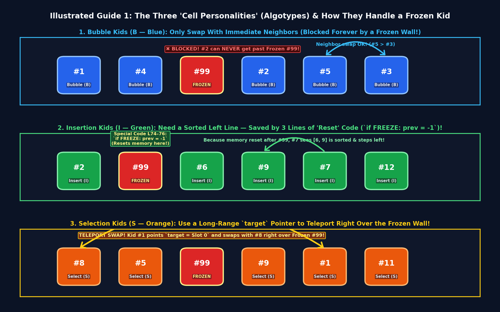
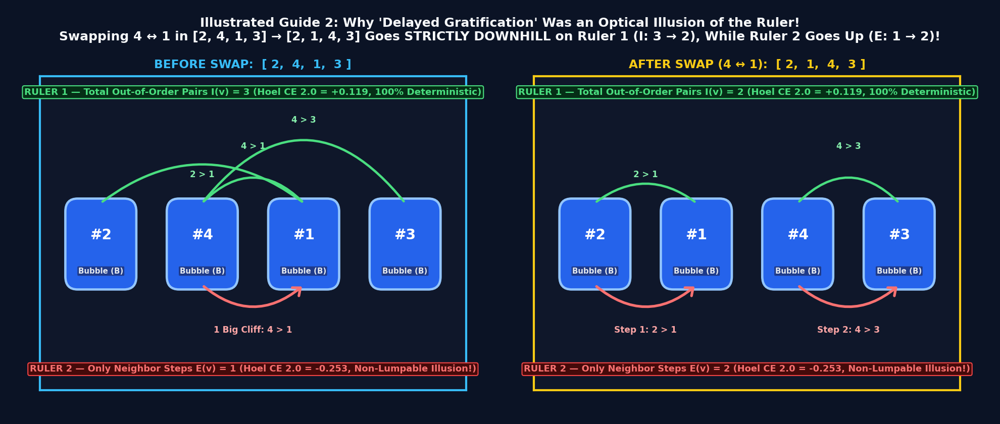
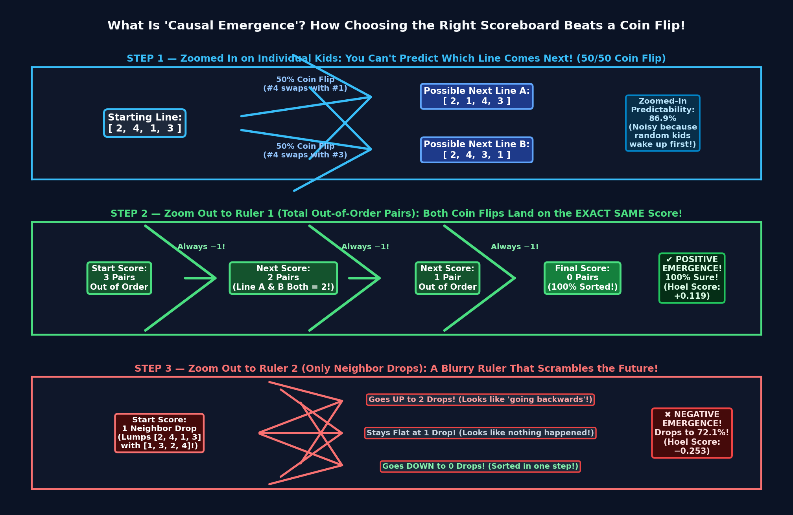
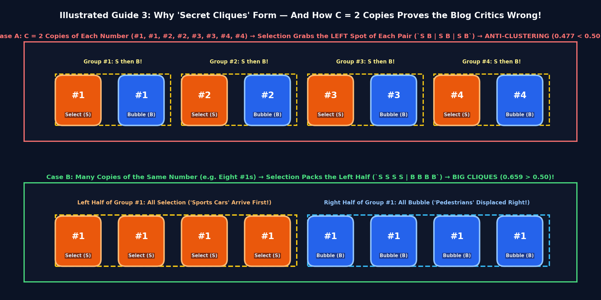
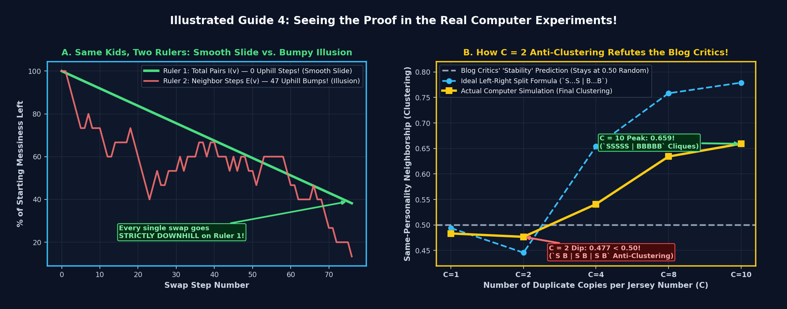
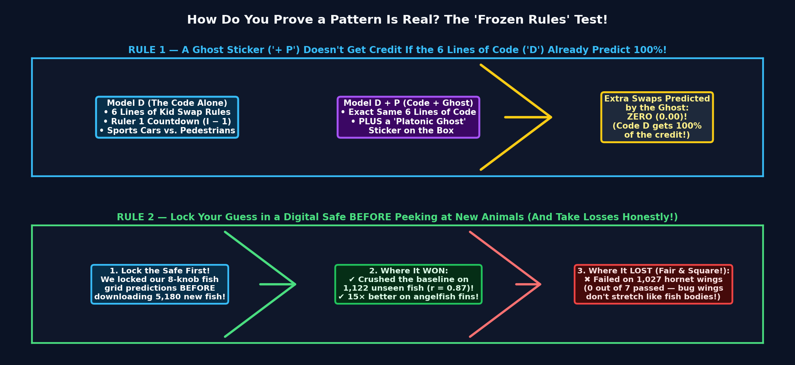

# The 13-Year-Old's Guide to Self-Sorting Cells, "Platonic Space," and Why a 6-Line Algorithm Sparked a Huge Debate

Imagine 100 kids standing in a line in gym class, each wearing a jersey with a random number from `1` to `100`.

Normally, the gym teacher (a **central controller**) walks down the line and tells specific kids to swap places until everyone is lined up from `1` to `100`.

In 2025, three researchers — **Taining Zhang, Adam Goldstein, and Michael Levin** — asked a cool question: **What if there is no gym teacher?** What if each kid is an independent "cell" who can only look at their immediate neighbors and decide on their own whether to swap?

They gave the kids three different "personalities" (which they called **algotypes**, after classical computer-science sorting algorithms):
1. **Bubble kids (`B`):** Look at the kid immediately to your left or right. If your number is smaller than your left neighbor's (or bigger than your right neighbor's), swap places!
2. **Insertion kids (`I`):** Only step left if everyone to your left is already in order.
3. **Selection kids (`S`):** Keep a mental finger pointing at slot `#1`, then `#2`, then `#3`... If your number is smaller than whoever is standing at that target slot, jump straight there and swap with them!

Then they ran computer experiments on this line of kids and saw **three weird things**:
1. **Handling "frozen" kids:** If 2 or 3 kids refuse to move ("frozen defects"), the rest of the line still manages to sort itself around them!
2. **"Delayed Gratification":** Sometimes, the line temporarily gets *more* messy (according to their messiness score) before getting much cleaner a few steps later.
3. **"Secret Clique Clustering":** When you mix 50 **Bubble** kids and 50 **Selection** kids in the same line, the Bubble kids temporarily group together with other Bubble kids, and Selection kids group together with other Selection kids — **even though their jerseys don't show who is Bubble or Selection!**

---

## The Big Debate: "Platonic Ghost Minds" vs. "Nothing to See Here!"

After that paper came out, a huge argument broke out between two camps:

* **Camp 1 — Michael Levin's "Platonic Space" Claim:**
  In a follow-up paper called *Ingressing Minds*, Levin argued that because nobody wrote code telling the numbers how to handle broken cells, how to "temporarily get messier to go around a wall," or how to "find friends with the same personality," these behaviors must be **unprogrammed cognitive "side-quests"** beaming in from a non-physical **Platonic Space of Patterns** (the same mathematical realm where numbers like $\pi$ live).
* **Camp 2 — The Computer-Science Blog Critics:**
  Several computer scientists wrote blog posts saying: *"Come on! That clustering is just a 1960s textbook trick called **Bubble-sort stability** (when two kids have the exact same number, Bubble sort doesn't swap them). There's nothing new here at all!"*

So we did what scientists are supposed to do: **we read every single line of their original Python code, translated it into three other computer languages (C++20, JavaScript, and the Lean 4 math theorem prover), and ran 3 "what-if" experiments (ablations) plus Erik Hoel's brand-new 2026 "Causal Emergence 2.0" math test.**

Here is what we discovered — and why **both camps got something right and something wrong!**

---

## Discovery 1: Did They Really Add "Zero Code" for Frozen Kids? (Mostly True, With One Sneaky Exception!)

* **The Claim:** Levin wrote that they *"did not add steps to the algorithm... to do specific things if an operation failed."*
* **What We Found in the Code (Row 2 of Guide 1 above):**
  - For **Bubble** kids, that's 100% true! If a Bubble kid tries to swap with a frozen kid, the frozen kid just doesn't budge.
  - **Insertion** kids, however, have a rule: *"Never move left unless everyone to your left is already in order."* If a frozen kid wearing `#99` is stuck near the front of the line, then the line to the left is *never* in order — so every single Insertion kid behind `#99` would freeze forever!
  - When we looked at lines 74–76 of their file `InsertionSortCell.py`, we found **3 lines of special code** that explicitly check `if status == FREEZE: prev = -1` (basically telling Insertion kids: *"If you see a frozen kid, pretend the line starts over right after them!"*).
  - When we deleted those 3 lines of code, the Insertion kids froze up and their final error jumped **`4.5×` higher (`4.9 → 21.95`)**!

---

## Discovery 2: Are the Cells Really "Going Backwards to Go Around a Wall"? (No — The Ruler Was Playing a Trick!)

* **The Claim:** Levin compared the sorting line to a person walking *backwards* around a wall to reach a goal (unlike two magnets stuck on opposite sides of a wooden board), because the paper's messiness score (**Neighbor Drops $E(v)$**) goes *up* (`+1`) 47 times before going down.
* **What We Found (Illustrated Guide 2 below):**
  1. **Zero Bubble kids ever cross the wall:** In Bubble and Insertion sort, kids only swap with their immediate neighbors. If an immovable frozen kid is standing at spot `#20`, **zero kids from the left of `#20` ever reach the right of `#20`**! (Selection kids only jump across `#20` because their rule lets them teleport straight to any spot in the line.)
  2. **Why did the messiness score go up?** Because there are **two different rulers** for measuring how scrambled a line of kids is:
     - **Ruler 1 — Total Out-of-Order Pairs $I(v)$ (Green Arches below):** Count *every* pair of kids in the whole line where a bigger number is standing to the left of a smaller number.
     - **Ruler 2 — Neighbor Drops $E(v)$ (Red Arrows below):** Only count how many times a kid is bigger than the kid *immediately* to their right.
  3. Look at a line of just 4 kids: **`[2, 4, 1, 3]`**:
     - Under **Ruler 1 (Total Pairs $I$)**, there are **3** out-of-order pairs: `(2,1)`, `(4,1)`, and `(4,3)`.
     - Under **Ruler 2 (Neighbor Drops $E$)**, there is only **1** neighbor drop: `4 → 1` (since `2 < 4` and `1 < 3`).
     - Now let the Bubble kids swap `4` and `1` to get **`[2, 1, 4, 3]`**!
     - What happened to **Ruler 1 (Total Pairs $I$)**? It went **strictly down from `3 → 2`** (only `(2,1)` and `(4,3)` are left). In fact, **every single Bubble swap in history reduces $I(v)$ by `−1` (`0` uphill steps out of 192 swaps!)**.
     - Why did **Ruler 2 (Neighbor Drops $E$)** go **up from `1 → 2`** (`2 > 1` and `4 > 3`)? Because swapping `4` and `1` broke one big cliff (`4 → 1`) into two smaller steps (`2 → 1` and `4 → 3`)!

---

## Discovery 2B: What Is "Causal Emergence"? (How Choosing the Right Scoreboard Beats a Coin Flip!)

Wait — how do we prove mathematically that **Ruler 1 (Total Pairs)** is the real law of the sorting line and **Ruler 2 (Neighbor Drops)** is just a blurry illusion?

A scientist named **Erik Hoel** invented a cool math test called **Causal Emergence** (updated to **Causal Emergence 2.0** in 2026) that tests whether "zooming out" to a big-picture scoreboard makes the future *more* predictable or *less* predictable. Here is how it works in 3 simple steps (**Illustrated Guide 5** below):

* **STEP 1 — Zoomed In on Individual Kids (50/50 Coin Flip!):**
  Look at the top row above. In the line **`[2, 4, 1, 3]`**, kids wake up at random to check their neighbors. If `#4` checks left, it swaps with `#1` (`→ [2, 1, 4, 3]`). If `#4` checks right, it swaps with `#3` (`→ [2, 4, 3, 1]`). So if you are zoomed in watching exact lines of kids, **you can't predict which line comes next — it's a 50/50 coin flip** (`86.9%` predictability across all 720 lines of 6 kids)!
* **STEP 2 — Zoom Out to Ruler 1 (Total Pairs = 100% Certainty!):**
  Now look at the green middle row above. What if we stop worrying about which exact kid moved, and just watch **Ruler 1 (Total Out-of-Order Pairs)** on the scoreboard?
  - Starting line `[2, 4, 1, 3]` has **3 pairs** out of order.
  - Coin-flip Line A (`[2, 1, 4, 3]`) has **2 pairs** out of order!
  - Coin-flip Line B (`[2, 4, 3, 1]`) *also* has **2 pairs** out of order!
  - **Both coin flips land on the exact same score (`3 → 2 → 1 → 0`)!**
  When zooming out turns a noisy coin flip into a **100% predictable countdown**, Hoel calls that **Positive Causal Emergence (`+0.119`)**. The zoomed-out scoreboard is *more* predictable than watching individual kids!
* **STEP 3 — Zoom Out to Ruler 2 (Neighbor Drops = Scrambled Guesswork!):**
  Now look at the red bottom row above. Ruler 2 puts `[2, 4, 1, 3]` and `[1, 3, 2, 4]` into the *same* bucket (`1 Neighbor Drop`). From that bucket, the next swap can make the score **go UP to 2 drops**, **stay flat at 1 drop**, or **drop to 0**! Predictability crashes to `72.1%` (**Negative Causal Emergence, `−0.253`**). That proves "going backwards" was just a blurry-ruler illusion!

---

## Discovery 3: Why the Computer-Science Critics Were Wrong About the "Secret Clique Clustering"!

Remember how the online blog critics said: *"The Bubble and Selection kids only cluster together because of textbook Bubble-sort stability on duplicate numbers!"*?

Our experiments proved **the critics were wrong twice** (**Illustrated Guides 3 & 4** below):

1. **Test 1 — What if there are ZERO duplicate numbers (`1` to `80`, all unique)?**
   - When every single kid has a different number (`1..80`), "duplicate-key stability" is impossible because there are no duplicates!
   - Yet halfway through sorting, the Bubble and Selection kids **still cluster together (`0.50 → 0.624`)**!
   - **Why?** Because **Selection kids move like sports cars and Bubble kids move like pedestrians!** Selection kids immediately teleport small numbers to the far-left front of the line (`0, 1, 2...`), shoving a big wave of Bubble kids into the right half of the line before the slow Bubble kids finish wiggling into their final spots.

2. **Test 2 — The `C = 2` "Anti-Clustering" Smoking Gun on Duplicate Numbers!**
   - What if there *are* duplicate numbers (say, several kids wearing `#1`, several wearing `#2`, etc.)?
   - If the blog critics were right and "Bubble-sort stability" just kept equal numbers in their starting random order, then the clustering score at the end would stay at **`0.50` (random)** no matter how many copies ($C$) of each number you have.
   - Instead, because Selection kids always scan from the left end of the line (`0, 1, 2...`), **Selection kids grab the *left* spots of each number's group, pushing the Bubble kids to the *right* spots (`S...S | B...B`)**:
     - **Case A (`C = 2` copies of each number):** Putting `S` on the left and `B` on the right of each pair creates the alternating pattern **`S B | S B | S B`** — which drives clustering **below `0.50` (`0.477` — Anti-Clustering!)**!
     - **Case B (`C = 8–10` copies of each number):** Putting `S` kids on the left and `B` kids on the right of each group creates **`SSSSS | BBBBB`**, driving clustering **way up to `0.659`**!

---

## The Take-Home Lesson: The "Frozen Rules" Test & Why Both Biology and Math Win

1. **What Michael Levin got right ("Mathematical Free Lunches"):**
   You really *do* get "more out than you put in" when cells follow simple local rules! Without any central controller or friend-detector code, the geometry of permutations and differences in movement speed automatically create self-sorting, error tolerance, and group separation.
2. **Rule 1 — Why you don't need a "Platonic Ghost" sticker (`+ P` adds `0` new predictions over the code `D`):**
   Once you use the right scoreboard — **Ruler 1 (Total Pairs, `+0.119` emergence)** instead of **Ruler 2 (Neighbor Drops, `−0.253`)**, and **traffic-speed waves (`S...S | B...B`)** — 100% of the behavior is already predicted by the 6 lines of code (`D`). Putting a "Platonic Ghost" sticker (`+ P`) on the box predicts **zero (`0.00`)** extra swaps!
3. **Rule 2 — Lock Your Guess in a Digital Safe *Before* You Peek (And Take Losses Honestly!):**
   To prove a mathematical pattern is real in biology, you have to lock your predictions in a digital safe *before* you peek at new animals — and let failed guesses fail! When we locked our 8-knob fish-stretching grid before downloading **5,180 brand-new fish species**, it crushed the baseline on unseen fish (`r = 0.87`), **and** when we tested that same fish grid on **1,027 hornet wings**, it failed (`0 out of 7` passed — because bug wings don't stretch like fish bodies!). That's how real science separates true mathematical laws from ghost stories.
