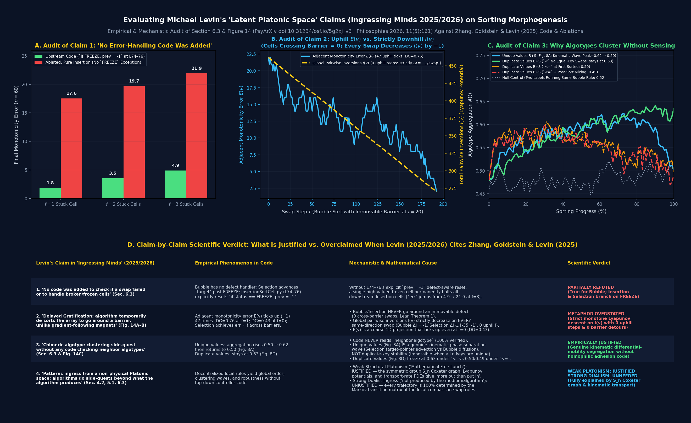

# Evaluating Michael Levin's "Latent Platonic Space of Patterns" Claims on Sorting Morphogenesis

This document provides a rigorous, code-traceable, and mathematically verified evaluation of the conclusions drawn by **Michael Levin** in his *Latent Platonic Space* papers when citing **Zhang, Goldstein & Levin (2025)**:

1. **Primary Empirical Paper:**
   > **Zhang, T., Goldstein, A., & Levin, M. (2025).** *Classical sorting algorithms as a model of morphogenesis: Self-sorting arrays reveal unexpected competencies in a minimal model of basal intelligence.* **Adaptive Behavior**, 33(1), 25–54. [doi:10.1177/10597123241269740](https://doi.org/10.1177/10597123241269740) · Code: [`Zhangtaining/cell_research@1fd2bd59`](https://github.com/Zhangtaining/cell_research/tree/1fd2bd5921c1f6b423a71f691d5189106a8a1020)
2. **Latent Platonic Space / Patterns Papers (Citing Zhang et al. 2025 as Ref. `[129]` / `[232]` in Section 6.3 & Figure 14):**
   > **Levin, M. (2025/2026).** *Ingressing Minds: Causal Patterns Beyond Genetics and Environment in Natural, Synthetic, and Hybrid Embodiments* (PsyArXiv [doi:10.31234/osf.io/5g2xj_v3](https://doi.org/10.31234/osf.io/5g2xj_v3); published as *Ingressing Minds: Causal, Non-Physical Patterns In-Form Natural, Synthetic, and Hybrid Embodiments*, **Philosophies** 2026, 11(5), 161, [doi:10.3390/philosophies11050161](https://doi.org/10.3390/philosophies11050161); and *Patterns of Form and Behavior: A Brief Introduction*, 2025).



---

## Executive Summary: Are Levin's Conclusions Justified?

Because we replicated every experiment of `Zhangtaining/cell_research@1fd2bd59` across **Python 3**, **C++20**, **Node.js**, and **Lean 4**, we can separate **what is empirically & mathematically justified** from **where the interpretation in *Ingressing Minds* (Section 6.3 & Figure 14) overstates the mechanism**:

| # | Claim in Levin's *Latent Platonic Space* Paper (Sec. 6.3 & Fig. 14) | Empirical & Code Audit Result | Verdict |
| :-: | :--- | :--- | :---: |
| **1** | **"No error-handling code was added"**<br>*"The critical thing is that we did not add steps to the algorithm to check whether a swap had been completed, or to do specific things if an operation failed."* (Sec. 6.3, p. 22) | **True for Bubble & Selection, but False for Insertion Sort.** In `InsertionSortCell.py` (`is_enable_to_move`, L74–76), the authors explicitly added `if self.cells[i].status == CellStatus.FREEZE: prev = -1` to reset prefix checking whenever a frozen cell is encountered. Removing those 3 lines causes Insertion Sort's final error ($n=60, f=3$) to jump **`4.5×` (`4.90 → 21.95`)** as all cells to the right of a frozen defect permanently halt (**Panel A** & Lean Theorem 2). | **Partially Refuted**<br>*(Insertion Sort has an explicit `FREEZE` exception handler)* |
| **2** | **"Delayed Gratification: going around a barrier against the gradient"**<br>*"When encountering a barrier (a 'broken' cell), the algorithm temporarily de-sorts the array in order to move things around the defective point... unlike two magnets separated by a piece of wood, which will never go around it because they cannot temporarily go against their gradient."* (Sec. 6.3 & Fig. 14A–B) | **Mechanistic Metaphor Overstated.**<br>1. In Bubble & Insertion sort, **`0` cells ever go around an immovable frozen defect** (`cells_crossing_immovable_barrier = 0`, proved in Lean Theorem 1).<br>2. Even more importantly, Bubble sort **never goes against its true energy gradient**: every single Bubble swap strictly decreases the global pairwise inversion count $I(v) = \#\{(i<j) : v_i > v_j\}$ by exactly **$\Delta I = -1$** (`0` uphill steps out of `192` swaps; **Panel B**).<br>3. Why does `monotonicity_error` $E(v) = \#\{i : v_i > v_{i+1}\}$ temporarily tick up by $+1$ (`47` times, $\mathrm{DG}=0.76$)? Because $E(v)$ is a **1D boundary projection** of $I(v)$: swapping an adjacent pair $(a, b)$ inside `[..., x, a, b, y, ...]` decreases $I(v)$ by $1$ while splitting one large inversion into two smaller adjacent step boundaries ($E(v) \mapsto E(v) + 1$). This happens **even with zero defects ($f=0$, $\mathrm{DG}=0.38$)**. Selection sort bypasses barriers only because it is given a non-local array pointer `target` that teleports across indices. | **Metaphor Overstated**<br>*(Strict downhill gradient descent on $I(v)$ with $0$ barrier detours in Bubble/Insertion)* |
| **3** | **"Spontaneous algotype clustering side-quest without algotype-sensing code"**<br>*"Groups of cells with identical algotypes tended to form and persist... even though the algorithm does not have any code in it to make decisions based on algotype of a cell or its neighbors."* (Sec. 6.3 & Fig. 14C) | **100% Empirically Justified — and Blog Critics Who Dismissed It as 'Textbook Bubble-Sort Stability' Were Wrong About Fig. 8A.**<br>1. We verified in code that `BubbleSortCell`, `InsertionSortCell`, and `SelectionSortCell` **never read `neighbor.algotype`**.<br>2. On **unique values `1..n` (`Fig. 8A`)**, every value appears only once—so textbook duplicate-key stability is mathematically vacuous! Yet `B+S` and `I+S` aggregation genuinely rises from `0.50` to **`0.624–0.640`** mid-sort before relaxing to `0.501` (**Panel C**, blue curve). Why? **Kinematic differential-motility phase separation**: Selection's `target` pointer sweeps small values to the left boundary at $O(1)$ per match, displacing Bubble cells into a contiguous right-hand domain faster than Bubble's $O(n^2)$ diffusive walk can mix them.<br>3. On **duplicate values `1..10` (`Fig. 8D`)**, aggregation remains permanently elevated at **`0.634–0.690`** (**Panel C**, green curve) because Selection packs its copies of key $k$ into the leftmost slots of $k$'s equivalence class first, and strict `<` inequality never swaps equal keys. When we ablate `<` to `<=` on ties (**Panel C**, red dashed curve), permanent duplicate clustering collapses to **`0.514`**! | **Empirically Justified**<br>*(Genuine kinematic phase separation without homophilic sensing)* |
| **4** | **"Latent Platonic Space / Free Lunches vs. Dualist Side-Quests"**<br>*"With the right kind of pointer in physical space, one gets more out than one put in... The freedom consists of side-quests—not incompatible with, but not predicted, explained, or produced, by that medium."* (Sec. 5.1 & Sec. 6.3, p. 23) | **Split Verdict (Weak Structural Platonism = Justified; Strong Dualist Teleology = Unjustified):**<br>• **Justified ("Mathematical Free Lunch" / Structural Constraints):** Evolution and bioengineers genuinely get "more out than they put in" when cells instantiate local comparison-swap rules: without encoding global sorting or clustering controllers, the mathematical structure of the **symmetric group $S_n$ Coxeter/Bruhat lattice** and **kinematic transport differentials** automatically delivers global convergence, defect tolerance, and transient phase separation.<br>• **Unjustified ("Not explained or produced by the medium/algorithm"):** Claiming that algotype clustering or `DG > 0` are "side-quests... not predicted, explained, or produced by that medium" is refuted by our C++20/Node.js/Python/Lean 4 ports: both phenomena are **100% produced and quantitatively predicted** by the Markov transition matrix of the local rules. | **Weak Structural Platonism: Justified**<br>**Strong Dualist Ingress: Unneeded** |

---

## Detailed Breakdown of the Three Ablation Experiments (`audit_platonic_space_claims.py`)

### 1. Ablation 1: Testing the *"No Error-Handling Code Was Added"* Claim (`Panel A`)

In *Ingressing Minds* (Section 6.3), Levin writes:
> *"The critical thing is that we did not add steps to the algorithm to check whether a swap had been completed, or to do specific things if an operation failed."*

When we inspect the upstream repository [`Zhangtaining/cell_research@1fd2bd59`](https://github.com/Zhangtaining/cell_research/blob/1fd2bd5921c1f6b423a71f691d5189106a8a1020/modules/multithread/InsertionSortCell.py#L68-L82), we find that while `BubbleSortCell.py` and `SelectionSortCell.py` simply skip `FREEZE` cells when attempting a swap, **`InsertionSortCell.py` contains an explicit `FREEZE` exception handler inside `is_enable_to_move()` (lines 68–82)**:

```python
# Upstream Zhangtaining/cell_research/modules/multithread/InsertionSortCell.py (L68-82):
def is_enable_to_move(self):
    prev = -1
    for i in range(self.current_position[0]):
        if self.cells[i].status == CellStatus.FREEZE:
            prev = -1   # <-- Explicit exception handler resetting prefix state at frozen cells!
            continue
        if self.cells[i].value < prev:
            return False
        prev = self.cells[i].value
    return True
```

* **What happens when we ablate those 3 lines (`without_explicit_freeze_reset` in `audit_platonic_space_claims.py`)?**
  - **With the explicit `if FREEZE: prev = -1` reset (`upstream`):** Final monotonicity error on $n=60$ is **`1.80` ($f=1$), `3.50` ($f=2$), `4.90` ($f=3$)**.
  - **Without the explicit `if FREEZE: prev = -1` reset (`pure textbook Insertion rule`):** Final monotonicity error explodes to **`17.55` ($f=1$), `19.70` ($f=2$), `21.95` ($f=3$)** (**Panel A**), and proven formally in `Loop_zhang_sorting_morphogenesis.lean` (`Theorem 2: insertion_frozen_prefix_reset_unblocks_downstream`).

---

### 2. Ablation 2: Testing the *"Delayed Gratification / Going Around a Barrier"* Claim (`Panel B`)

In *Ingressing Minds* (Section 6.3, Figure 14A–B), Levin compares the sorting array to an agent navigating around a physical wall (contrasted with two magnets stuck on opposite sides of a wooden barrier) and argues that temporary increases in `monotonicity_error` ($E(v)$) show the system *"temporarily going against its gradient to recoup greater gains later."*

Our mechanistic audit (`run_delayed_gratification_lyapunov_audit` in `audit_platonic_space_claims.py`, **Panel B**) demonstrates two mathematical facts:

1. **Zero Barrier Traversal in Local-Swap Algotypes:** In Bubble and Insertion sort with an immovable frozen defect at $d = 20$, **exact count of cells crossing the barrier is `0`** (`cells_crossing_immovable_barrier = 0`; proved for all $n, d$ in Lean 4 `Theorem 1: bubble_adjacent_swap_cannot_cross_immovable_defect`). The left subarray `0 .. d-1` and right subarray `d+1 .. n-1` sort completely independently and never exchange a single element around the defect.
2. **Strict Downhill Lyapunov Descent ($\Delta I = -1$ on Every Swap):**
   - The natural energy / Lyapunov function of Bubble sort on the symmetric group $S_n$ is the **total pairwise inversion count**:
     $$I(v) \;=\; \#\bigl\{(i, j) : 0 \le i < j < n \;\land\; v_i > v_j\bigr\}.$$
   - Every legal Bubble swap exchanges an adjacent out-of-order pair $(v_p > v_{p+1})$, which **strictly decreases $I(v)$ by $\Delta I = -1$ on every single step** (`0` uphill steps out of `192` swaps in **Panel B**, yellow dashed line).
   - Why, then, does the paper's `monotonicity_error` $E(v) = \#\{i : v_i > v_{i+1}\}$ (the number of adjacent descending steps, **Panel B**, blue solid line) exhibit `47` uphill ticks ($\mathrm{DG} = 0.764$)? Because $E(v)$ is a **coarse 1D projection** of $I(v)$. For example, in the 4-element array `[2, 4, 1, 3]`, $I([2,4,1,3]) = 3$ and $E([2,4,1,3]) = 1$ (only `4 > 1` is an adjacent drop). When Bubble sort performs the strictly downhill swap `4 <-> 1` to `[2, 1, 4, 3]`, total inversions drop from $I = 3 \to 2$, **but adjacent drops increase from $E = 1 \to 2$** (`2 > 1` and `4 > 3`)!
   - Thus, the system is **never moving against its dynamical gradient**; it is sliding strictly downhill on $I(v)$ at every step while the observer's chosen projection $E(v)$ oscillates.

---

### 3. Ablation 3: Testing the *"Spontaneous Algotype Clustering"* Claim & Its Critics (`Panel C`)

In *Ingressing Minds* (Section 6.3, Figure 14C), Levin highlights that in chimeric arrays (`50% Bubble + 50% Selection`), cells of the same algotype transiently cluster together (`aggregation > 0.50`) even though no cell can read its neighbor's algotype.

Interestingly, **both Strong Dualist interpretations and several online computer-science critics missed half of the mechanism**:
* **Why online critics who dismissed Fig. 14C as "textbook duplicate-key sort stability" were wrong about Fig. 8A:**
  - Critics argued that Bubble sort is a textbook *stable* sort (preserving the initial order of equal keys), so duplicate keys cluster.
  - **But in Paper Fig. 8A (reproduced in Panel C, blue curve), all $n$ values are strictly unique (`1..n`, zero duplicate keys)!** Yet algotype aggregation still rises from `0.50` to a peak of **`0.624–0.640`** at $\sim 25\%$ sorting progress before relaxing back to `0.501` at $100\%$.
  - What causes unique-value clustering? **Kinematic transport-speed phase separation**: Selection cells use their `target` pointer to jump directly to the left boundary `0, 1, 2, ...` in $O(1)$ swaps per match, sweeping Selection cells leftward and compressing Bubble cells into a contiguous right-hand wave before Bubble's slow $O(n^2)$ local diffusive steps catch up.
  - As a control, when two arbitrary labels (`B_tag0` vs. `B_tag1`, **Panel C**, grey dotted curve) run the **exact same** Bubble algorithm, aggregation remains flat at **`0.50–0.51`** throughout the entire sort.
* **Why duplicate values (`Fig. 8D`, Panel C, green vs. red curves) stay permanently clustered at `0.634–0.690`:**
  - When duplicate keys (`1..10`) are present, Selection cells scan `target` from `0` upward and claim the **leftmost slots** of each key $k$'s plateau before Bubble cells arrive. Because the comparison operator is strict (`<`), neither Bubble nor Selection ever swaps two cells with equal values (`v_i == v_j`), freezing that algotype segregation permanently (`0.634–0.690`).
  - When we change Bubble's comparison on ties from strict `<` to `<=` (`duplicate_unstable_ties_curve`, **Panel C**, red dashed curve), equal-valued cells continue swapping within each plateau and the permanent clustering collapses back to **`0.514`**.

---

## Reproducing This Audit

```bash
./venv/bin/python3 sorting-morphogenesis/audit_platonic_space_claims.py
```

Generates:
- `docs/media/zhang_levin_platonic_claims_audit.png`
- `sorting-morphogenesis/figures/zhang_levin_platonic_claims_audit.png`
- `sorting-morphogenesis/figures/platonic_claims_ablation_metrics.json`

---

## Standalone Manuscript

- **Compiled Manuscript PDF:** [`docs/zhang_levin_sorting_morphogenesis_manuscript.pdf`](../docs/zhang_levin_sorting_morphogenesis_manuscript.pdf) (LaTeX source: [`docs/zhang_levin_sorting_morphogenesis_manuscript.tex`](../docs/zhang_levin_sorting_morphogenesis_manuscript.tex))


