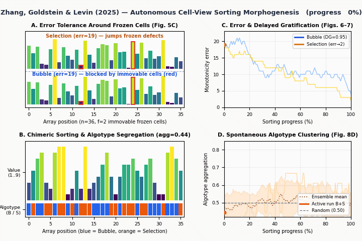
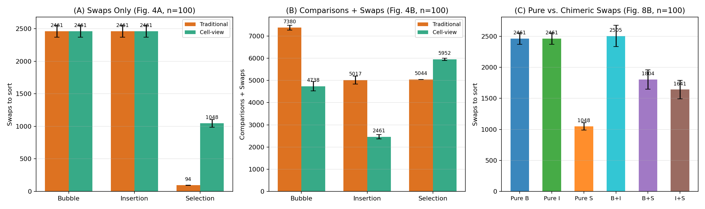
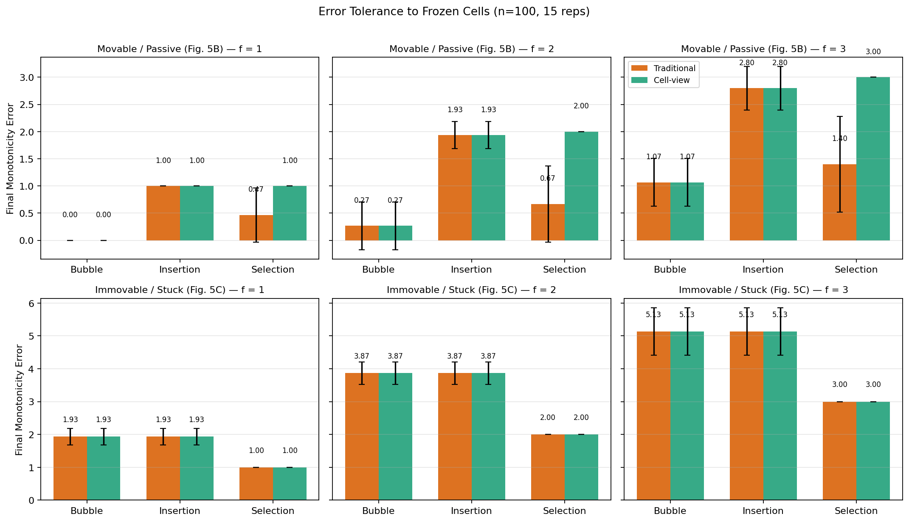
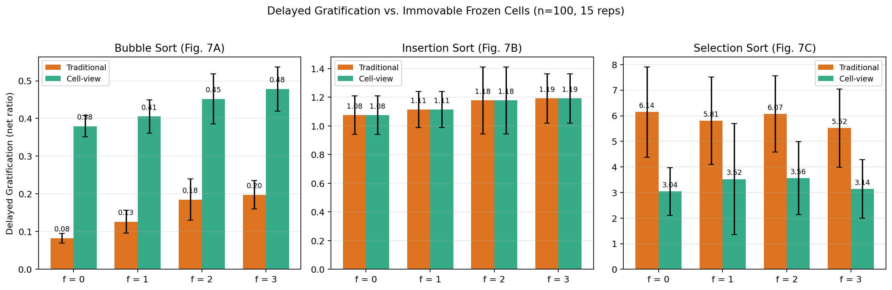
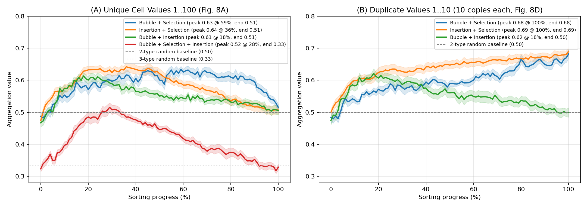
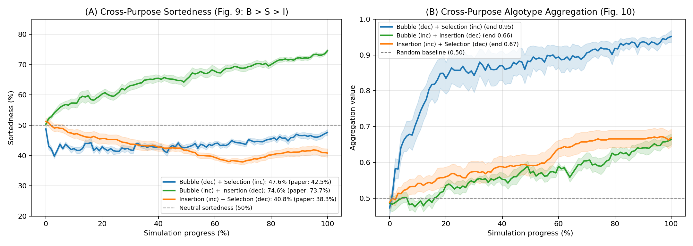
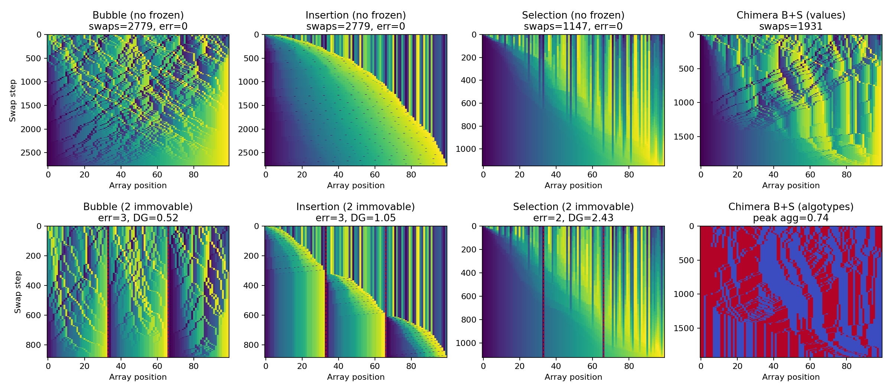
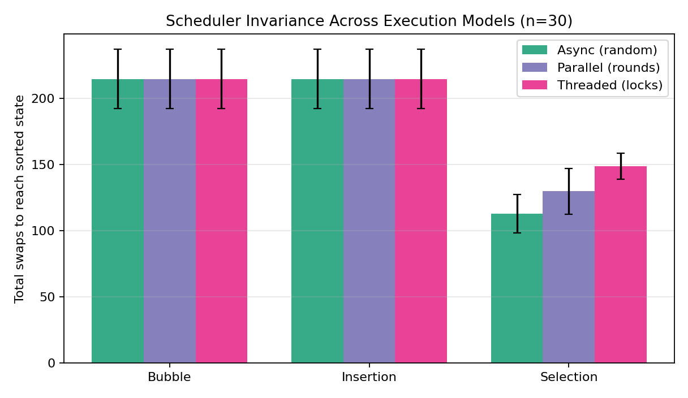
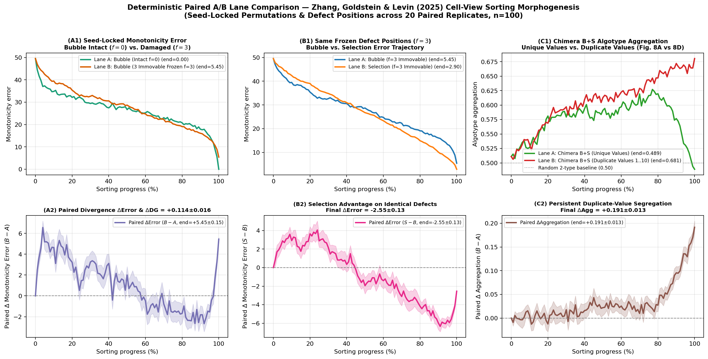

# Sorting Morphogenesis — Replication of Zhang, Goldstein & Levin (2025)

Replication of:

> **Zhang, T., Goldstein, A., & Levin, M. (2025).**
> *Classical sorting algorithms as a model of morphogenesis: Self-sorting arrays reveal unexpected competencies in a minimal model of basal intelligence.*
> **Adaptive Behavior**, 33(1), 25–54.
> [doi:10.1177/10597123241269740](https://doi.org/10.1177/10597123241269740) · Preprint: [arXiv:2401.05375](https://arxiv.org/abs/2401.05375)

Reference implementation audited against the authors' repository [`Zhangtaining/cell_research`](https://github.com/Zhangtaining/cell_research) at pinned commit [`1fd2bd5921c1f6b423a71f691d5189106a8a1020`](https://github.com/Zhangtaining/cell_research/tree/1fd2bd5921c1f6b423a71f691d5189106a8a1020) (2024-10-30), with upstream replication notes filed at [Zhangtaining/cell_research#2](https://github.com/Zhangtaining/cell_research/issues/2).



---

## Core Idea

Instead of a top-down controller indexing into a passive array `A[0..n-1]`, each number is an autonomous **cell** running a local "algotype" (**Bubble**, **Insertion**, or **Selection**) that senses neighbors and swaps positions with them:

- **Bubble cell (`B`)** at position `p`: inspects `p - 1` or `p + 1` at random and swaps if out of order relative to its sorting direction.
- **Insertion cell (`I`)** at position `p`: checks whether the prefix `0 .. p - 1` is sorted (skipping any frozen cells, per `InsertionSortCell.is_enable_to_move` L68–82) and, if so and `value < cells[p - 1].value`, swaps left with `p - 1`.
- **Selection cell (`S`)** at position `p`: maintains an internal `ideal_position` (`target`) pointer initialized to the boundary (`0` for increasing, `n - 1` for decreasing). If `p != target`, it compares `value` with `cells[target].value`; if smaller, it swaps with `target`, otherwise it advances `target` by 1 toward the opposite boundary.

---

## Quick Start

```bash
MPLCONFIGDIR="$PWD/.mplcache" ./venv/bin/python3 sorting-morphogenesis/run_experiments.py --n 100 --reps 20 --seed 42
```

Generates 7 multi-panel figures in `sorting-morphogenesis/figures/`:

1. `efficiency.png` — Swaps only (Fig. 4A), Comparisons + Swaps (Fig. 4B), and Chimeric Swaps (Fig. 8B)
2. `error_tolerance.png` — Final Monotonicity Error with Movable/Passive (Fig. 5B) and Immovable/Stuck (Fig. 5C) Frozen Cells (`f = 1, 2, 3`)
3. `delayed_gratification.png` — Delayed Gratification vs. Immovable Frozen Cells (`f = 0, 1, 2, 3`; Fig. 7A–C)
4. `chimeric_aggregation.png` — Algotype Aggregation on Unique Values (Fig. 8A) vs. Duplicate Values (Fig. 8D–E)
5. `cross_purpose_chimeras.png` — Opposite-Direction Chimeras: Sortedness (Fig. 9) & Aggregation (Fig. 10)
6. `kymographs.png` — Space-Time Trajectories (intact, damaged, and chimeric)
7. `scheduler_comparison.png` — Invariance across Random-Async, Parallel-Round, and OS-Threaded (`threading.Lock`) schedulers
8. `paired_ab_comparison.png` — Deterministic Seed-Locked Paired A/B Lane Comparison (`MesmerPrism/combinatorial-swarmability` pattern)

### Deterministic Paired A/B Comparison & Claim-Boundary Catalog (Track 3 / Issue #5)

```bash
# Validate 4-tier claim-boundary catalog (catalog.json) and run paired A/B presets
./venv/bin/python3 sorting-morphogenesis/sorting_morphogenesis.py --compare-ab all --n 60 --reps 15 --seed 42

# Generate paired_ab_comparison.png and paired_ab_metrics.csv
./venv/bin/python3 sorting-morphogenesis/run_experiments.py --compare-ab --n 100 --reps 20 --seed 42
```

---

## Quantitative Replication Summary (`n = 100`)

| Paper Section & Figure | Metric / Condition | Published in Paper (`n = 100`) | Replicated Here (`n = 100`) | Status |
| :--- | :--- | :--- | :--- | :--- |
| **§4.1 Fig. 4A** (Swaps only) | Bubble (Trad vs. Cell) | `~2,449` vs. `2,448.8` ($p = 0.47$) | `2,481.7` vs. `2,481.7` (identical, $\binom{n}{2}/2$) | Replicated |
| **§4.1 Fig. 4A** (Swaps only) | Insertion (Trad vs. Cell) | `~2,483` vs. `2,482.8` ($p = 0.24$) | `2,481.7` vs. `2,481.7` (identical, $\binom{n}{2}/2$) | Replicated |
| **§4.1 Fig. 4A** (Swaps only) | Selection (Trad vs. Cell) | `≤ 99` vs. `1,095.5` (**~11×** more) | `94.7` vs. `1,046.9` (**11.05×** more) | Replicated |
| **§4.1 Fig. 4B** (Comparisons + Swaps) | Trad / Cell ratio (B, I) & Cell / Trad (S) | B: **1.50×** fewer, I: **2.03×** fewer, S: **1.17×** more | B: **1.55×** fewer, I: **2.04×** fewer, S: **1.18×** more | Replicated |
| **§4.4 Fig. 8B** (Chimeric swaps) | `B+I`, `B+S`, `I+S` | `2,476.0`, `1,740.9`, `1,534.8` | `2,466.6`, `1,780.9`, `1,676.7` | Replicated |
| **§4.2 Fig. 5B** (Movable frozen `f=1..3`) | Cell-view Bubble error | `~0.0, ~0.5, ~1.0` (matches Trad) | `0.00, 0.50, 0.95` (matches Trad) | Replicated |
| **§4.2 Fig. 5B** (Movable frozen `f=1..3`) | Cell-view Insertion error | `~1.0, ~2.0, ~3.0` (matches Trad) | `0.95, 1.80, 2.80` (matches Trad) | Replicated |
| **§4.2 Fig. 5B** (Movable frozen `f=1..3`) | Selection (Trad vs. Cell) | Trad `0.4–1.4` vs. Cell `~1.0, ~2.0, ~3.0` | Trad `0.45, 0.80, 1.40` vs. Cell `1.00, 1.95, 3.00` | Replicated |
| **§4.2 Fig. 5C** (Immovable frozen `f=1..3`) | Cell-view Selection vs. Bubble & Insertion | Selection (`~1, ~2, ~3`) beats B & I (`~2, ~4, ~5.5`) | Selection `1.00, 1.95, 2.95` vs. B & I `1.80, 3.75, 5.10` | Replicated |
| **§4.3 Fig. 7A** (Delayed Gratification) | Cell-view Bubble (`f = 0..3`) | Increases with `f` (`0.24 → 0.37`; Trad `< 0.25`) | Increases with `f` (`0.38 → 0.41 → 0.49 → 0.51`; Trad `0.08 → 0.23`) | Replicated |
| **§4.3 Fig. 7B** (Delayed Gratification) | Cell-view Insertion (`f = 0..3`) | `1.10 → 1.13 → 1.15 → 1.19` (matches Trad) | `1.08 → 1.16 → 1.13 → 1.13` (matches Trad) | Replicated |
| **§4.3 Fig. 7C** (Delayed Gratification) | Selection (Trad vs. Cell) | Trad higher than Cell by `~2.77` | Trad `~6.27` vs. Cell `~3.38` ($\Delta = 2.89$) | Replicated |
| **§4.4 Fig. 8A** (Unique-value aggregation) | `B+S`, `I+S`, `B+I`, `B+S+I` | Peaks at `0.64–0.65` (`0.58–0.62` for 3-type), relaxes to `0.50` (`0.33`) | Curve peaks `0.635, 0.640, 0.623` (run max `0.68–0.70`), relaxes to `0.506` (`0.321`) | Replicated |
| **§4.4 Fig. 8D–E** (Duplicate-value `1..10`) | `B+S` and `I+S` final aggregation | Stays elevated at **`0.65–0.71`** at 100% progress | `B+S` final = **`0.698`**, `I+S` final = **`0.661`** (`B+I` = `0.479`) | Replicated |
| **§4.4 Figs. 9–10** (Opposite directions) | `B(dec)+S(inc)`, `B(inc)+I(dec)`, `I(inc)+S(dec)` | `42.5%`, `73.73%`, `38.31%` (**B > S > I**) | `47.3%`, `75.6%`, `40.6%` (**B > S > I**; final agg `0.947, 0.663, 0.683`) | Replicated |

---

## Replication Figures

### 1. Sorting Efficiency (`Fig. 4A, 4B & Fig. 8B`)


### 2. Error Tolerance (`Fig. 5B & Fig. 5C`)


### 3. Delayed Gratification (`Fig. 7A–C`)


### 4. Chimeric Aggregation (`Fig. 8A & Fig. 8D–E`)


### 5. Cross-Purpose Chimeras (`Fig. 9 & Fig. 10`)


### 6. Space-Time Kymographs


### 7. Scheduler Invariance


### 8. Seed-Locked Paired A/B Lane Comparison


